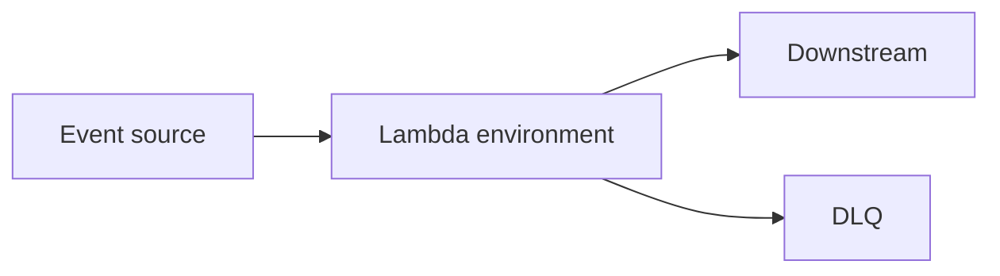

## Why this matters

Lambda runs a function when an event arrives and scales by running more copies. You do not patch an OS. You do pay in cold starts, a timeout ceiling, and a programming model that must be idempotent. It is a good place for a thumbnail, a webhook, or a queue consumer. It is a poor place for the CodeCraft API that serves many routes, holds a database pool, and may watch a code run for tens of seconds, unless you have accepted those limits on purpose.

This lesson is how Lambda actually behaves so you can use it where it fits and refuse it where the long-running service is the honest design.

## Intuition

A function has code, a handler, a memory size, a timeout, and an IAM role. An event source invokes it: API Gateway, SQS, S3, EventBridge. The runtime may reuse an environment between invocations. That reuse is why global caches work and why bugs in global state leak across users. A cold start is a new environment: download the code, init the runtime, run your static setup, then the handler.

Concurrency is the number of environments at once. The account has a quota. One noisy function can consume it and throttle the rest. Reserved concurrency caps a function so it cannot eat the account. Provisioned concurrency keeps environments warm so the first user does not pay the cold start. It also costs money while idle.

## Core concept in depth

### Handler and event

The handler receives an event and a context. The event shape depends on the source. An API Gateway event is not an SQS event. Parse what you expect and fail closed on a shape you do not. The context gives the request id and the remaining time. Log the request id. If remaining time is short, stop cleanly instead of getting killed mid-write.

Return values matter for API Gateway. For SQS, a failure should raise so the message is retried. Swallowing the error and returning success deletes the work.

### Cold starts and memory

More memory also means more CPU. A function that is slow because it is CPU-bound during init often gets faster with a larger memory setting, even if the heap does not need it. Measure. Do not set 10 GB because a blog did.

Cold starts hurt user-facing APIs more than async consumers. A queue consumer can take an extra second. A student waiting on a page cannot. If you put the API on Lambda, budget the cold start into the SLO or pay for provisioned concurrency.

Package size and VPC attachment both slow init. Attach a function to a VPC only if it must reach private RDS or an internal service. A function in a VPC needs subnets and security groups and used to be much slower to start. It is better than it was and it is still not free. A function that only talks to public AWS APIs does not need your VPC.

### Concurrency and retries

Event sources retry. Lambda will run your function twice. Idempotency is mandatory, the same as SQS. A unique id in the event is the key.

A poison message will retry until the event source gives up. Configure a DLQ or an on-failure destination. A function that crashes on one payload should not loop at full concurrency.

Reserved concurrency of 0 disables the function. That is a kill switch. Reserved concurrency of 5 caps it. If you do not set a cap, a loop can scale to the account limit.

Timeouts should be shorter than the caller's patience and longer than a healthy run. API Gateway has its own timeout, which is shorter than Lambda's maximum. A 15-minute Lambda behind an API that gives up at 29 seconds will keep running after the user is gone. That is a bill and a duplicate if the user retries.

### IAM

The function role is what the code can do. `logs:CreateLogGroup` and a specific table or bucket, not `*` on `*`. The resource policy is who may invoke the function. API Gateway, S3, and EventBridge need permission to invoke. A function URL with auth type NONE is a public endpoint. Treat it as one.

Do not put the database password in an environment variable in the console without a secret reference. Environment variables are convenient and visible to anyone who can get the function configuration. Prefer Secrets Manager and cache the value in a global that survives warm starts, and do not log it.

### Where CodeCraft might use it

| Work | Lambda? |
| --- | --- |
| Resize an uploaded image | Yes |
| Send a notification from a queue | Yes |
| The main lesson API | Usually no. A service with a pool fits better. |
| The sandbox | No. You need a locked-down container, not a shared Lambda environment that also runs other tenants' code in the same account concurrency pool. |
| A nightly cleanup | Yes, on a schedule |

The sandbox isolation story is a container with no network and a hard memory limit. Lambda is a different multi-tenant runtime. Do not mix them because both are "serverless."

## Diagram / flowchart



### Dry-run: SQS invokes a function

| Event | Function behavior | Message |
| --- | --- | --- |
| First delivery | Writes a row if absent | Deleted by the event source on success |
| Retry after a crash | Condition says the row exists | Success without a second side effect |
| Bad payload | Fails | Retry, then DLQ |
| Timeout after the side effect | Unclear | Must be idempotent because it will retry |

### Limits worth memorizing as a class

| Limit | Why you care |
| --- | --- |
| Timeout | Work dies. Callers may have given up earlier. |
| Memory and CPU | They are one slider |
| Concurrency quota | A neighbor function can throttle you |
| Payload size | Big lesson bodies do not go through the event. Use S3. |
| `/tmp` | Ephemeral. Do not store the only copy. |

## Code

A handler that is safe to retry. The table condition is the real lock.

```python
import json

def handler(event, context):
    for record in event.get("Records", []):
        body = json.loads(record["body"])
        run_id = body["run_id"]
        process_once(run_id)
    return {"ok": True}
```

`process_once` uses a conditional write. If this function is behind API Gateway instead, the return shape must match what the integration expects, and a raised exception becomes a 502 unless you catch it and return a status.

Deploy with a known runtime and an architecture that matches the wheels you package. arm64 is cheaper and breaks if you uploaded an x86 binary.

```bash
aws lambda update-function-code \
  --function-name codecraft-on-run-finished \
  --zip-file fileb://function.zip
```

Set a reserved concurrency and a timeout in the same change as the code, not as a console surprise later:

```bash
aws lambda put-function-concurrency \
  --function-name codecraft-on-run-finished \
  --reserved-concurrent-executions 10
```

Log the request id from the context. Alarm on the Errors metric and on Throttles. A throttle is not an application exception. It means the event did not run. For SQS, the message should remain. Confirm that. Do not assume.

## Complexity analysis

| Choice | Payoff | Pain |
| --- | --- | --- |
| Lambda for async jobs | No servers, scales to zero | Cold start, retries, time limit |
| Provisioned concurrency | Stable latency | Idle cost. You are paying for warm capacity. |
| VPC-attached function | Reaches private RDS | Slower start, subnet IP usage |
| One function for the whole API | Fewer deploys | A large package, wide IAM, one timeout |
| Service on ECS for the API | Pools, long requests, simpler local dev | You operate a service |
| No DLQ | Less config | Poison events retry until the quota hurts |
| Shared account concurrency | Simple | Noisy neighbor |

Lambda is cheap at low volume and surprising at high concurrency or with provisioned capacity you forgot. The cost lesson applies: a function that retries a poison message all night is a bill.

## Tricks, tips and patterns

- Idempotent handlers. Event sources retry.
- Timeout shorter than a runaway and aligned with the caller.
- Reserved concurrency as a cap and as a kill switch at 0.
- VPC only when the target is private.
- Secrets in Secrets Manager, cached in the warm environment, never logged.
- Big payloads in S3. The event carries the key.
- Alarm on Errors and Throttles.
- Do not put the sandbox on Lambda.

## Common mistakes and edge cases

- Global state that includes the previous user's data. Warm starts reuse the process.
- Returning success after a partial write. The retry never comes and the data is wrong.
- API Gateway timeout and a Lambda that continues. Duplicate when the client retries.
- `Resource: "*"` on the function role.
- A public function URL you forgot.
- Package so large that cold starts dominate. Slim the dependencies.
- Testing only with the console "test event" and not with the real SQS shape.
- Assuming `/tmp` survives. It might on a warm start and will not when you need it.

## Interview notes

**What is a cold start?**
A new execution environment: fetch code, start the runtime, run initialization, then the handler. Warm invocations skip that. User-facing APIs feel it. Queue consumers usually can.

**Why is idempotency required?**
Invocations retry. A timeout after the side effect still retries. Conditional writes or a uniqueness key make the second run safe.

**When would you not use Lambda for CodeCraft?**
The main API and the sandbox. The API wants a pool and a normal process. The sandbox wants a container isolation story you control. Lambda fits notifications, image work, and scheduled cleanup.

**Reserved versus provisioned concurrency?**
Reserved caps how many copies run so you do not consume the account. Provisioned keeps copies initialized so cold starts are rare, and you pay for them.

**Why avoid a VPC when you can?**
You only need it to reach private resources. It adds network setup and startup cost. Public AWS APIs do not require it.

## Practice problems

1. A function times out after sending email and the user gets two emails. What was missing, and what should the timeout line up with?
2. Account throttles appear while one function loops. How do you cap it tonight and debug it tomorrow?
3. The function must read RDS in private subnets. What network do you add, and what do you not add for a function that only writes to S3?
4. Explain warm-start global state as a bug for a request that stores the last user id in a global.
5. Why is a 2 MB lesson body a bad Lambda event, and what do you pass instead?

## Summary / cheat sheet

- Lambda is an event, a handler, a role, a timeout, and a memory size that includes CPU.
- Cold starts are init. Provisioned concurrency trades money for fewer of them.
- Retries are normal. Handlers and side effects are idempotent. Use a DLQ.
- Reserved concurrency caps blast radius. Zero is an off switch.
- VPC attachment only for private targets.
- Secrets are references, not logged env dumps.
- The CodeCraft API and sandbox stay off Lambda. Async jobs can live on it.
- Watch Errors and Throttles. They are different.

## Further reading

- [Lambda programming model](https://docs.aws.amazon.com/lambda/latest/dg/lambda-runtime-environment.html)
- [Cold starts and provisioned concurrency](https://docs.aws.amazon.com/lambda/latest/dg/provisioned-concurrency.html)
- [Lambda concurrency](https://docs.aws.amazon.com/lambda/latest/dg/lambda-concurrency.html)
- [SQS event source](https://docs.aws.amazon.com/lambda/latest/dg/with-sqs.html)
- [Lambda VPC networking](https://docs.aws.amazon.com/lambda/latest/dg/configuration-vpc.html)
