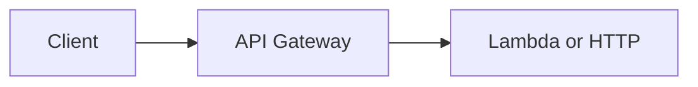
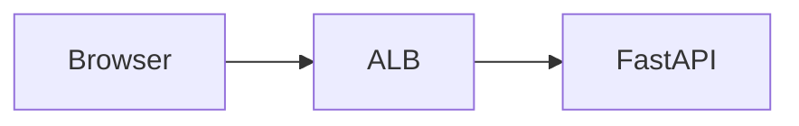

## Why this matters

API Gateway is a managed front door for HTTP and WebSocket APIs. It does throttling, API keys or JWT authorizers, request validation, and integration with Lambda or any HTTP backend. It is also another hop with its own timeout, its own logs, and its own bill per request. CodeCraft's main site is a Next.js app and a FastAPI service behind an ALB. That path does not need API Gateway. A small public webhook or a Lambda-backed endpoint might.

Use the gateway when its features are the product. Do not insert it because the architecture diagram looks more "AWS."

## Intuition

A route is a method and a path. An integration is where the route sends the request: Lambda, an HTTP URL, or a mock. A stage is a deployed snapshot, often `dev` or `prod`, with its own throttle and variables. HTTP APIs are the newer, cheaper, simpler product. REST APIs are the older product with more features and more knobs, including usage plans. For a new HTTP API, start with HTTP APIs unless you need a REST-only feature you can name.

The gateway terminates TLS, applies auth, and then calls the integration. If the integration is Lambda, the event is the gateway's shape, not the raw socket. If the integration is the ALB, you may be paying for two load balancers. Draw that before you build it.

## Core concept in depth

### HTTP API versus REST API

| | HTTP API | REST API |
| --- | --- | --- |
| Cost and latency | Lower | Higher |
| JWT and Lambda authorizers | Yes | Yes |
| Usage plans and API keys | Limited | Full |
| Request validation models | Fewer | Heavier |
| Caching at the gateway | No | Optional |

CodeCraft does not need usage plans for anonymous lesson reads. If you expose a partner API later, REST usage plans or a different gateway might matter. Until then, do not pay for the older product by default.

### Auth

A public route needs no authorizer. A route that submits a run should know who is calling if you have accounts. JWT authorizers check a token against an issuer. A Lambda authorizer is a function you write when the check is custom. Do not invent auth in the integration and also skip it at the edge if the integration is easy to call directly. If Lambda is only reachable through the gateway, the resource policy should say so. If the ALB is also public, the gateway is not the security boundary.

API keys are not authentication. They are a usage-plan identifier. Anyone who has the key is the user. Treat a leaked key as a leaked credential. Do not put the key in a frontend bundle.

### Throttling and stages

Stage throttles protect the backend. A limit that is lower than a class of students clicking at once will return 429 while the API is healthy. That can be correct. Set it on purpose and teach the client to retry with jitter. A limit of the account default that you never looked at will surprise you on launch day.

Stages should match environments. `prod` points at the prod integration. Do not use stage variables as a secret store. They are not secret.

### Timeouts and payloads

REST and HTTP APIs time out around half a minute. A code run that takes longer cannot sit on the gateway connection. The client should receive a run id and poll, or use a different edge. This is the same reason the sandbox is not a synchronous Lambda behind the gateway. The ALB idle timeout is also finite, but the service behind it can be designed for the run. The gateway's cap is harder.

Large bodies belong in S3 with a presigned upload. Do not stream a multi-megabyte lesson through the gateway for fun. It costs and it hits payload limits.

### Observability

Access logs in a format you choose, to CloudWatch, with the request id. Execution logs are verbose and expensive. Turn them on to debug an integration and turn them off. The integration's log is still the place you see the application error. A 502 from the gateway often means the integration crashed or timed out, not that the route is missing. A 403 is often the authorizer. A 429 is the throttle. Read the status. Do not call all of them "the API is down."

## Diagram / flowchart



The CodeCraft browser path that skips this box:



Both can exist. They should exist for different routes.

### Dry-run: a partner webhook

| Step | Result |
| --- | --- |
| Route `POST /hooks/progress` | Public path you named |
| JWT or a signature check | 401 if the signature fails |
| Integration Lambda | Idempotent write |
| Throttle | 429 when a partner loops |
| Gateway timeout | The Lambda may still be running. Idempotency saves you. |

### Status codes

| Code | Likely owner |
| --- | --- |
| 401 or 403 | Authorizer or resource policy |
| 429 | Throttle |
| 502 or 504 | Integration failed or timed out |
| 400 | Request validation |
| 200 with a wrong body | The integration. The gateway did its job. |

## Code

An HTTP API with one Lambda route, created with the CLI so the shape is visible. Production should be Terraform or SAM, not a one-off console click.

```bash
aws apigatewayv2 create-api \
  --name codecraft-hooks \
  --protocol-type HTTP

aws apigatewayv2 create-stage \
  --api-id API_ID \
  --stage-name prod \
  --auto-deploy
```

Throttle the stage. Numbers are an example, not a launch recommendation.

```bash
aws apigatewayv2 update-stage \
  --api-id API_ID \
  --stage-name prod \
  --default-route-settings ThrottlingBurstLimit=20,ThrottlingRateLimit=10
```

The Lambda resource policy must allow this API to invoke it. A function with no permission returns a 500-class error from the gateway that looks mysterious until you read the execution log once.

Access log format should include request id, route, status, and integration status. Store the format in the repo next to the API definition.

For the main app, prefer the ALB listener rules from the load balancer lesson. Document in the architecture which hostnames hit the gateway and which hit the ALB so nobody puts a second cache in front of both by accident.

## Complexity analysis

| Edge | Good at | Extra cost |
| --- | --- | --- |
| ALB to ECS | Long-lived HTTP, path routing, the main site | ALB hours |
| HTTP API to Lambda | Spiky webhooks, auth, throttle | Per request |
| REST API | Usage plans, some legacy features | More per request and more complexity |
| Both in series | Rarely | Latency and two logs |
| API keys in the browser | Nothing | The key is public |

A gateway in front of an ALB in front of ECS is three hops. Justify each. "We might need throttling later" is not enough if the ALB and the app can shed load. Add the gateway when a specific route needs authorizers or Lambda.

## Tricks, tips and patterns

- HTTP APIs unless you need a REST-only feature.
- Authorizers for anything that is not public. API keys are not login.
- Throttles are a product limit. Set them and handle 429.
- Timeouts mean long work is async with a status row.
- Access logs on. Execution logs only while debugging.
- Lambda resource policy must allow the API.
- Do not duplicate the main FastAPI routes here without a reason.
- Presign S3 for large uploads instead of proxying the bytes.

## Common mistakes and edge cases

- A public function URL and a gateway, so the authorizer can be bypassed.
- Stage variables holding secrets.
- 29-second work that sometimes fits and sometimes becomes a 504 while the function continues.
- CORS configured twice, at the gateway and in FastAPI, with different origins. Pick one edge to speak CORS if the browser calls it.
- Caching on a REST API that caches a personalized response.
- Forgetting that a 502 is the integration. The route exists.
- Deploying a stage and not the route change, or the reverse, depending on auto-deploy. Know which you enabled.

## Interview notes

**When do you put API Gateway in front of CodeCraft?**
For a webhook or a Lambda-sized endpoint that needs auth and throttling. The main site stays on the ALB. Say why you are not stacking both.

**HTTP API or REST API?**
HTTP API for new work unless you need usage plans or another REST-only feature. It is cheaper and simpler.

**What is an API key?**
A usage identifier, not a user login. It will leak if you embed it in a frontend. Use JWT or a real signature for callers you need to trust.

**A 504 and a duplicate write.**
The gateway gave up and the client retried. The integration must be idempotent. Do not assume the first call stopped.

**How do you see failures?**
Access logs with the integration status. 401 is auth, 429 is throttle, 502 is the backend. Application logs still matter for the 200 that is wrong.

## Practice problems

1. Draw the main site path and a webhook path. Which one uses API Gateway, and what timeout forces the webhook to stay short?
2. The Lambda works in the console and returns 502 through the gateway. What permission is missing?
3. A partner loops and you want the API healthy for everyone else. Which setting, and what status does the partner see?
4. Why is a JWT in the authorizer safer than an API key in the Next.js bundle?
5. You cached GET `/api/progress` on a REST API. What data can leak across users?

## Summary / cheat sheet

- Routes integrate to Lambda or HTTP. Stages carry throttles and deploys.
- Prefer HTTP APIs. Use REST when you need its specific features.
- Authorizers for identity. API keys are not authentication.
- Timeouts are short. Long work is a job id, not a held connection.
- 401, 429, and 502 mean different layers.
- The main CodeCraft app can stay on the ALB. Say so.
- Idempotency covers gateway retries after timeouts.
- Do not put a second public invoke path beside the authorizer.

## Further reading

- [HTTP APIs](https://docs.aws.amazon.com/apigateway/latest/developerguide/http-api.html)
- [Choosing between HTTP APIs and REST APIs](https://docs.aws.amazon.com/apigateway/latest/developerguide/http-api-vs-rest.html)
- [Lambda authorizers](https://docs.aws.amazon.com/apigateway/latest/developerguide/http-api-lambda-authorizer.html)
- [Throttling](https://docs.aws.amazon.com/apigateway/latest/developerguide/http-api-throttling.html)
- [API Gateway access logs](https://docs.aws.amazon.com/apigateway/latest/developerguide/set-up-logging.html)
