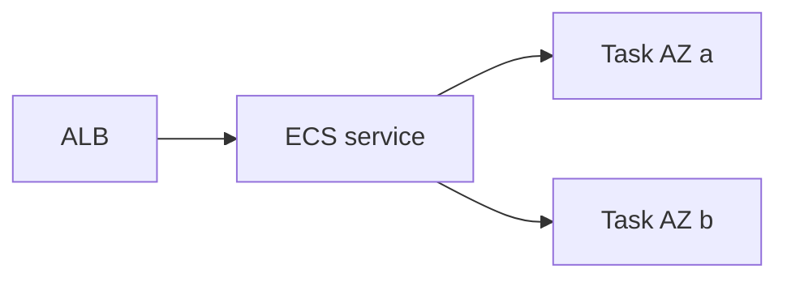

## Why this matters

The images are built. Something has to run them, restart them, and attach them to a load balancer. On AWS the usual choices are ECS and EKS. Fargate is a launch type that runs the container without you managing EC2. CodeCraft's compose file is the local version of this choice. Production should not be a VM with `docker compose up` and a Docker socket.

This lesson picks a default and names the task definition, the service, and the reasons not to adopt EKS on day one.

## Intuition

ECS is AWS's container scheduler. A task definition is the spec: image, CPU, memory, ports, roles, logs, secrets. A service keeps a desired count of tasks running and registers them with a target group. A cluster is the grouping. On Fargate the cluster has no instances to patch. On EC2 launch type you own the instances, the AMI, and the ASG.

EKS is managed Kubernetes. You get the Kubernetes lessons for real: Deployments, Services, Ingress, HPA. You also operate the control plane addons, upgrades, and IAM for service accounts. That is worth it when you need the Kubernetes ecosystem or you are already a Kubernetes shop. It is a tax when you have two services.

Fargate on ECS is the default for this course's deploy module.

## Core concept in depth

### Task definition

CPU and memory are a fixed pair on Fargate. Pick a size that fits the API and leave headroom for a traffic spike until autoscaling adds tasks. The container port is 8000. The log driver is `awslogs` to the group from the CloudWatch lesson. Secrets are ARNs injected by the execution role.

Two roles. The execution role pulls the image, writes logs, and reads injected secrets. The task role is what the process can call. The API task role can read the content bucket if content is in S3. The sandbox task role should be empty or nearly empty.

Do not mount the Docker socket. There is no host socket on Fargate, which is a gift. The sandbox is a separate task definition with a locked-down user, read-only root if you can, and no secrets. How you start that task is an API call with the task role of a runner, not a socket.

`awsvpc` network mode gives each task its own ENI and security group. The ALB reaches the task IP. The task security group allows the ALB. This is the normal Fargate mode.

### Service

Desired count at least 2 for the API, across subnets in two AZs. Deployment minimum healthy 100 and maximum 200, circuit breaker on, from the deployment strategy lesson. The service is attached to the API target group.

Platform version should be current enough to get security patches of the Fargate runtime. Do not pin an ancient platform version to avoid a one-time change.

Service autoscaling tracks a real metric. The service replaces tasks that die. A crash loop with a circuit breaker rolls back the deployment. A crash loop of the only desired task is an outage. Count 2 is the fix.

### EC2 launch type

You manage capacity, bin-packing, and the instance IAM role that the agent uses. Use it when you need GPUs, persistent host devices, or a cost model where reserved instances beat Fargate. You also patch AMIs. For CodeCraft's web tier, that work is not buying you a feature.

### EKS

The cluster is a control plane AWS runs and nodes you run or Fargate profiles you configure. You still write probes, requests, and network policies. IRSA lets a service account assume an IAM role without static keys. That is the task role equivalent and it is one of the best reasons the Kubernetes path is mature on AWS.

Choose EKS if the team will use Kubernetes primitives as the source of truth, or if portability off AWS is a real requirement. Do not choose it so the diagram says Kubernetes. Two controllers, a cluster upgrade, and a VPC CNI are a product you must staff.

### Image roll

The service points at a task definition revision. CI registers a new revision with the new digest and updates the service. Tags that move are not a revision you can trust. The digest is in the task definition. Rollback is an update to the previous revision.

## Diagram / flowchart



### Dry-run: deploy a digest

| Step | Cluster |
| --- | --- |
| Register task definition with the digest | Nothing running changes yet |
| Update service to that revision | New tasks start beside old ones |
| Health checks pass | Old tasks drain |
| Health checks fail and the breaker is on | Service returns to the previous revision |
| You only retagged `latest` | You do not know what is running |

### Decision

| Need | Choice |
| --- | --- |
| Two web services, small team | ECS Fargate |
| GPUs or host daemons | ECS on EC2 or EKS with node groups |
| Kubernetes APIs and a platform team | EKS |
| `docker compose` on one VM | Dev only |

## Code

A minimal task definition skeleton. Real files should be Terraform or the CDK, reviewed as JSON you can read.

```json
{
  "family": "codecraft-api",
  "networkMode": "awsvpc",
  "requiresCompatibilities": ["FARGATE"],
  "cpu": "512",
  "memory": "1024",
  "executionRoleArn": "arn:aws:iam::111111111111:role/codecraft-exec",
  "taskRoleArn": "arn:aws:iam::111111111111:role/codecraft-api-task",
  "containerDefinitions": [
    {
      "name": "api",
      "image": "111111111111.dkr.ecr.ap-south-1.amazonaws.com/codecraft-api@sha256:REPLACE",
      "portMappings": [{ "containerPort": 8000, "protocol": "tcp" }],
      "essential": true,
      "logConfiguration": {
        "logDriver": "awslogs",
        "options": {
          "awslogs-group": "/codecraft/api",
          "awslogs-region": "ap-south-1",
          "awslogs-stream-prefix": "api"
        }
      }
    }
  ]
}
```

Update the service:

```bash
aws ecs update-service \
  --cluster codecraft \
  --service codecraft-api \
  --task-definition codecraft-api:42
```

Watch it:

```bash
aws ecs describe-services --cluster codecraft --services codecraft-api
aws ecs describe-tasks --cluster codecraft --tasks TASK_ARN
```

The stopped reason on a task that exits is the best error string you will get. `CannotPullContainerError` is IAM or the digest. `Essential container exited` is the process. Health check failures stay in the service events and the target group.

ECR is the registry. The execution role needs `ecr:GetAuthorizationToken` and pull permissions on the repository. The repository should scan on push. The service should pull the digest you scanned, not a tag that moved after the scan.

## Complexity analysis

| Platform | You manage | You gain |
| --- | --- | --- |
| ECS Fargate | Task defs, services, IAM, VPC | No AMI patching |
| ECS EC2 | Above plus ASG and AMIs | Cheaper at steady high CPU, special hardware |
| EKS | Kubernetes plus AWS IAM integration | The Kubernetes ecosystem |
| One VM | Everything, poorly | A demo |

Fargate's cost is per task-hour and per GB. An idle desired count of 2 is the availability floor. Scale to zero only for an internal tool, not for the public site.

## Tricks, tips and patterns

- Fargate, awsvpc, two AZs, desired count 2.
- Digest in the task definition. Revision for rollback.
- Split execution and task roles. Empty role on the sandbox.
- Circuit breaker and the ALB health check on `/health`.
- Logs to a group with retention before the first crash.
- ECR scan on the digest you deploy.
- EKS when you need Kubernetes, not before.
- Read the stopped reason before you rebuild the cluster.

## Common mistakes and edge cases

- `latest` in the task definition.
- One subnet, so a single AZ takes the service down.
- Execution role cannot pull, and the task loops with a pull error that looks like an app bug if you only read the app log. There is no app log yet.
- Task role is admin.
- Sandbox and API in one task definition with shared env.
- Service desired count 1 and a deploy that stops the only task before the new one is healthy because minimum healthy percent is 0.
- Turning on EKS and ECS for the same containers. Pick one scheduler.

## Interview notes

**ECS or EKS for CodeCraft?**
ECS on Fargate. The app is a few containers, not a Kubernetes platform. EKS is justified when the team wants Kubernetes as the API. Say the operational cost.

**What is a task definition versus a service?**
The task definition is the spec and a revision. The service keeps N copies running and connects them to the load balancer. You deploy by pointing the service at a new revision.

**Why two IAM roles?**
The agent needs to pull and log. The application needs its own AWS permissions. One role that can do both means a bug in the app can pull arbitrary images or a bug in the agent policy is the app's admin.

**How do you roll back?**
Update the service to the previous task definition revision. The digest is immutable. A moving tag is not a rollback.

**What does Fargate remove?**
Instance patching, kubelet or agent AMIs, and the Docker socket. You still own VPC, IAM, task size, and health checks.

## Practice problems

1. A new task never reaches running and there are no application logs. What role and what error do you check?
2. Desired count is 1 and minimum healthy percent is 0. Describe the user-visible deploy.
3. Why is the sandbox a second task definition with a different role?
4. A teammate wants EKS so Helm works. What do they still have to operate, and when is that answer yes?
5. Explain how a scanned tag is not a scanned deploy if the tag moved.

## Summary / cheat sheet

- ECS service runs task definition revisions. Fargate means no instances.
- awsvpc, two AZs, count 2, ALB health, circuit breaker.
- Execution role pulls and logs. Task role is the app. Keep them apart.
- Digests and revisions. Rollback is a previous revision.
- ECR is the registry. Scan the digest you run.
- EKS is for Kubernetes shops. It is not a required upgrade.
- The sandbox is a separate locked-down task, not a socket mount.
- Stopped reasons beat guesswork.

## Further reading

- [ECS task definitions](https://docs.aws.amazon.com/AmazonECS/latest/developerguide/task_definitions.html)
- [Fargate launch type](https://docs.aws.amazon.com/AmazonECS/latest/developerguide/AWS_Fargate.html)
- [ECS deployment circuit breaker](https://docs.aws.amazon.com/AmazonECS/latest/developerguide/deployment-circuit-breaker.html)
- [EKS](https://docs.aws.amazon.com/eks/latest/userguide/what-is-eks.html)
- [IAM roles for service accounts](https://docs.aws.amazon.com/eks/latest/userguide/iam-roles-for-service-accounts.html)
