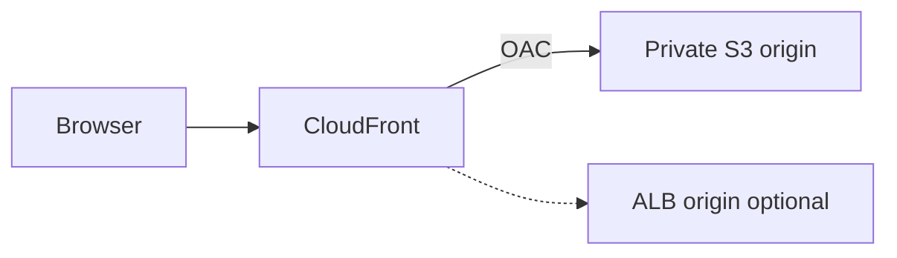

## Why this matters

Students are not all next to `ap-south-1`. A lesson image served from an EC2 task pays regional egress and adds load to the API. CloudFront caches those bytes at edge locations and terminates TLS close to the user. The same feature will happily cache a personalized code-run response if you tell it the cache key is only the URL. That is a privacy bug with a latency win.

This lesson is when to put CloudFront in front of S3 or the site, how the cache key works, and how the origin stays private.

## Intuition

A distribution has origins and behaviors. A behavior says "paths that look like this go to that origin, with this cache policy." The first request for an object is a miss: CloudFront fetches the origin and stores the response. Later requests are hits until the TTL expires or you invalidate.

The cache key is the identity of the object in the cache. If the key is only the path, every user shares one response. If the key includes an authorization header, you fragment the cache and you might still store private bodies at the edge. For public lesson media, a path-only key is what you want. For the API, the honest policy is usually "do not cache."

Origin access control lets CloudFront read a private S3 bucket without making the bucket public. The bucket policy trusts the distribution. Users hit CloudFront. They never need a public object ACL.

## Core concept in depth

### Origins

An S3 origin for `codecraft-content` or a media bucket. A custom origin for the ALB if you front the whole site. Custom origins need a TLS decision: match viewer, HTTPS only, or HTTP. Prefer HTTPS to the ALB. Timeouts on the custom origin must exceed a code run if you foolishly send API traffic through the CDN. Better: do not send API runs through a cache.

Origin groups give you a failover origin. Useful when the primary is S3 and you have a real second place. A failover to a broken origin hides the error. Test it.

### Behaviors and cache policies

Default behavior is `*` and is where mistakes land. Add a more specific behavior for `/static/*` or the media host before you tune the default. Managed cache policies exist: CachingOptimized for static assets, CachingDisabled for the API. Use those unless you can explain the headers you added to the key.

Query strings matter. A lesson URL that includes a cache-busting version query should include that query in the key, or you will serve the old file. A URL that includes a user token in the query must not be cached. Tokens in query strings are a bad idea anyway. They end up in logs.

Cookies in the cache key fragment the cache. Do not add the session cookie "to be safe" on static files. You will miss almost every time and still store copies.

### TTL and invalidation

Respect `Cache-Control` from the origin when you want the app to decide. For hashed filenames (`app.abc123.js`), a long TTL is safe because the name changes when the bytes change. For `index.html`, a short TTL or an invalidation is how users see a new deploy. Invalidations cost money at high volume and take time. Hashed assets plus a short-lived HTML file is the pattern. Invalidating `/*` on every deploy is the pattern you use once and then stop.

### TLS and DNS

Attach an ACM certificate in `us-east-1`. CloudFront is global and wants the certificate in that region even if the origin is in `ap-south-1`. Alternate domain names must be on the certificate. DNS is an Alias record to the distribution, covered again in Route 53. The certificate region surprise is the classic failure: the cert exists in Mumbai and CloudFront cannot see it.

### Private content

Signed URLs and signed cookies let CloudFront serve a private object to a holder of a signature. Use them for something that must not be public. Lesson media on a public course can be public at the edge and private at the bucket. Student submissions are not a CloudFront use case. Keep them off this distribution.

## Diagram / flowchart



### Dry-run: a hashed asset and a personalized API call

| Request | Cache policy | Expected |
| --- | --- | --- |
| `/static/app.abc123.js` | CachingOptimized, long TTL | Miss, then hits worldwide |
| `/` HTML | Short TTL | Fresh after deploy within TTL |
| `/api/run` | CachingDisabled | Always origin. No shared body. |
| Same asset, new hash in the HTML | New key | Miss. Old hash expires later. |

### OAC versus a public bucket

| Setup | Bucket | Risk |
| --- | --- | --- |
| Public read | Anyone with the URL bypasses CloudFront | Hotlinking and no TLS control |
| OAC and a private bucket | Only the distribution can get the object | The URL still public if the object is not signed. That is fine for public lessons. |
| Signed URL | Time-limited | Clock skew and key management |

## Code

A distribution sketched in Terraform. The certificate is in us-east-1. The bucket stays private. This is the shape, not every required argument the provider currently wants.

```hcl
resource "aws_cloudfront_origin_access_control" "content" {
  name                              = "codecraft-content"
  origin_access_control_origin_type = "s3"
  signing_behavior                  = "always"
  signing_protocol                  = "sigv4"
}

resource "aws_cloudfront_distribution" "site" {
  enabled             = true
  default_root_object = "index.html"
  aliases             = ["academy.example.com"]
  price_class         = "PriceClass_200"

  origin {
    domain_name              = aws_s3_bucket.content.bucket_regional_domain_name
    origin_id                = "content"
    origin_access_control_id = aws_cloudfront_origin_access_control.content.id
  }

  default_cache_behavior {
    target_origin_id       = "content"
    viewer_protocol_policy = "redirect-to-https"
    allowed_methods        = ["GET", "HEAD"]
    cached_methods         = ["GET", "HEAD"]
    cache_policy_id        = "658327ea-f89d-4fab-a63d-7e88639e58f6"
  }

  restrictions {
    geo_restriction {
      restriction_type = "none"
    }
  }

  viewer_certificate {
    acm_certificate_arn      = aws_acm_certificate_validation.cf.certificate_arn
    ssl_support_method       = "sni-only"
    minimum_protocol_version = "TLSv1.2_2021"
  }
}
```

The cache policy id above is AWS's managed CachingOptimized id at the time of writing. Look up the current id rather than trusting a memory. A behavior for `/api/*` should use CachingDisabled and, if the API is a second origin, a different origin id.

Invalidate only the HTML you cannot hash:

```bash
aws cloudfront create-invalidation \
  --distribution-id E123EXAMPLE \
  --paths "/index.html"
```

Confirm a response came from the edge:

```bash
curl -sI https://academy.example.com/static/app.abc123.js
```

Look for `x-cache: Hit from cloudfront` on the second request. A Miss every time means the cache key includes something that changes per user, or the origin sends `Cache-Control: no-store`.

The bucket policy must allow the distribution's OAC to `s3:GetObject`. Without it, the edge returns 403 and the bucket is correctly private. That 403 is the integration, not a reason to make the bucket public.

## Complexity analysis

| Choice | Latency | Risk |
| --- | --- | --- |
| No CDN, assets from the task | Simple, farther users wait | Egress and CPU on the app |
| CloudFront plus private S3 | Edge hits, origin stays private | Wrong cache key leaks or misses |
| Cache the API by URL only | Fast and wrong | One student sees another's run |
| Price class 200 | Cheaper, fewer edges | Some regions are not as close |
| Price class all | Closest edge | You pay for edges you may not need |
| Invalidate `/*` every deploy | Simple | Cost and delay. Hash filenames instead. |

## Tricks, tips and patterns

- Hash static filenames. Short-TTL the HTML. Invalidate rarely.
- CachingDisabled on anything personalized.
- OAC and a private bucket. No public ACLs.
- ACM certificate in us-east-1 for CloudFront.
- Separate behaviors before you tune the default `*`.
- `curl -I` twice and read `x-cache`.
- Do not put student source on this distribution.
- Price class is a product decision. Write it down.

## Common mistakes and edge cases

- Public bucket plus CloudFront, so the origin URL still works and bypasses WAF and TLS policy.
- Caching `/api` because the default behavior was CachingOptimized.
- Certificate in the wrong region.
- Query string token as a cache key, or worse, ignored so the token is stripped and users share a response.
- A 403 from S3 interpreted as "turn off block public access."
- Forgetting that invalidation is not instant.
- Origin timeout shorter than a request you sent through the CDN by mistake.

## Interview notes

**What is a cache key?**
The fields that decide whether two requests share a cached response. Path-only is right for public hashed assets. Including cookies or authorization fragments the cache and can store private data.

**How does CloudFront read a private bucket?**
Origin access control signs the origin request. The bucket policy allows that distribution. The bucket does not allow public `GetObject`.

**Why is the ACM certificate in us-east-1?**
CloudFront's viewer certificate must be in that region. A certificate in the origin's region is invisible to the distribution.

**Would you cache the code-run API?**
No. The response is personalized. Use a behavior with caching disabled, or do not put that path on the distribution.

**Hit, miss, and a 403.**
Miss then Hit means the cache works. A 403 from the origin with OAC is usually the bucket policy, not a reason to open the bucket.

## Practice problems

1. Design behaviors for hashed assets, HTML, and `/api`. State the cache policy for each.
2. A second request still shows Miss. Give two cache-key causes.
3. The bucket is private and the site returns 403. What policy is missing, and what will you not turn on?
4. You created the certificate in ap-south-1 and CloudFront will not accept it. Why?
5. Explain why invalidating `/*` is the wrong deploy step if filenames are hashed.

## Summary / cheat sheet

- Distributions have origins and behaviors. The cache key decides who shares a response.
- Public lesson assets: private S3, OAC, long TTL, hashed names.
- HTML: short TTL. API: do not cache.
- ACM certs for CloudFront live in us-east-1.
- Read `x-cache`. A 403 means the origin refused the edge, often the bucket policy.
- Invalidation is a fallback, not the cache strategy.
- Never cache personalized runs.
- Price class and timeouts are part of the design, not defaults you ignore.

## Further reading

- [CloudFront distribution concepts](https://docs.aws.amazon.com/AmazonCloudFront/latest/DeveloperGuide/Introduction.html)
- [Origin access control](https://docs.aws.amazon.com/AmazonCloudFront/latest/DeveloperGuide/private-content-restricting-access-to-s3.html)
- [Cache policies](https://docs.aws.amazon.com/AmazonCloudFront/latest/DeveloperGuide/controlling-the-cache-key.html)
- [Invalidation](https://docs.aws.amazon.com/AmazonCloudFront/latest/DeveloperGuide/Invalidation.html)
- [ACM regions for CloudFront](https://docs.aws.amazon.com/acm/latest/userguide/acm-regions.html)
