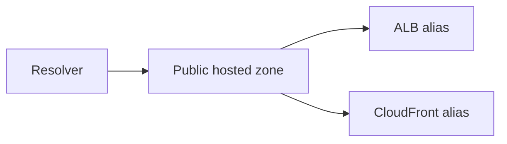

## Why this matters

Route 53 is the authoritative DNS service for a zone you host on AWS. The protocol lesson explained resolvers and TTL. This lesson is the product: hosted zones, alias records to ALBs and CloudFront, health checks, and routing policies people misuse as a load balancer. A wrong apex record or a health check that looks at the wrong path will black-hole the site while every task is healthy.

CodeCraft needs one public name for the academy and a clear record for the API if it is a separate host. Private zones are how tasks resolve names that must not exist on the internet.

## Intuition

A hosted zone is a container for records for a domain. Public zones answer the internet. Private zones answer VPCs you associate. The same name can exist in both, which is split horizon. Update the zone the client actually queries.

An alias record is a Route 53 extension that points a name, including the zone apex, at an AWS resource such as an ALB or a CloudFront distribution. Resolvers see an address. You do not copy the ALB's IP into an A record. Those IPs change. A CNAME cannot sit on the apex. The alias can.

Routing policies choose among records: simple, weighted, latency, failover, geolocation. They are DNS answers, not connection-level balancing. Clients cache them. A failover policy is only as fast as health checks plus TTL.

## Core concept in depth

### Zones and delegation

The registrar points the domain's NS records at Route 53's name servers for the public zone. If the registrar still points at the old DNS host, your new records do nothing. Check the NS set at the registrar and in the zone. They must match.

Private zones are associated with VPCs. A task in a VPC that is not associated will not see the private name. CI runners outside the VPC will not see it either. Do not use a private name as the only way a GitHub-hosted runner checks the site. Use the public name.

### Records for this project

| Name | Type | Target |
| --- | --- | --- |
| `academy.example.com` | Alias A | CloudFront or the ALB |
| `www` | CNAME or alias | The apex |
| Certificate validation | CNAME | The ACM validation target, left in place |
| Private `db` | CNAME | The RDS endpoint, only in the private zone if you want a stable name |

The database already has a DNS name from RDS. An extra CNAME is optional. Do not make the database name public.

### Health checks and failover

A health check hits an IP or a domain on an interval and looks for a status code. Point it at `/health`, not at a page that always returns 200 from a static error file. A check that hits the ALB from the internet tests the path users use. A check that hits a private IP from Route 53's checkers will fail because those checkers are not in your VPC, unless you use a CloudWatch alarm as the health check source.

Failover records: primary and secondary. If the primary check fails, resolvers that ask again get the secondary, after TTL. This is not an ALB. It does not move an existing TCP connection. Use it for a real second region or a static maintenance site, not as a substitute for two tasks behind one ALB. Two tasks in one region should be the ALB's job.

Weighted records split traffic by DNS answer. A 10 percent weight is a coarse canary with all the caching problems of DNS. Prefer the load balancer or a flag for a fine canary. Weighted DNS is acceptable for a slow migration between two stacks if you accept a mixed cache.

### TTL again

Alias records to AWS resources use a short effective TTL that Route 53 manages. Ordinary records use the TTL you set. Lower it before a migration, as the DNS lesson said. Negative cache still applies if you create a name the world already asked for.

### Routing policies that confuse interviews

Latency-based routing sends the user to the region with the lowest latency from the resolver's point of view, which is not always the user's network. Geolocation is a policy choice, not a precision GPS. Geoproximity is another knob. None of them replace an ALB inside a region. They choose which regional endpoint's name to return.

## Diagram / flowchart



Pick one for the apex. Do not alias the apex to both and hope.

### Dry-run: point the apex at a new ALB

| Step | Result |
| --- | --- |
| Confirm registrar NS matches the zone | Otherwise you are editing a zone nobody asks |
| Lower TTL if the record is not an alias | Caches shrink |
| Change the alias target | New lookups see the new ALB |
| Health check on `/health` | Failover only if you configured a secondary |
| Old cached answers | Die out with TTL |

### Public versus private

| Client | Zone |
| --- | --- |
| Browser | Public |
| ECS task resolving an internal API name | Private, if associated |
| GitHub-hosted runner | Public |
| Pod using cluster DNS | CoreDNS first, then the VPC resolver for external names |

## Code

Create a public zone and an alias by CLI only if you also delegate NS at the registrar. Terraform is the repeatable form:

```hcl
resource "aws_route53_record" "apex" {
  zone_id = aws_route53_zone.public.zone_id
  name    = "academy.example.com"
  type    = "A"

  alias {
    name                   = aws_lb.public.dns_name
    zone_id                = aws_lb.public.zone_id
    evaluate_target_health = true
  }
}
```

`evaluate_target_health` makes the alias consider the target's health. It is not a full failover design by itself. You still need a second record if you want a backup answer.

A health check:

```bash
aws route53 create-health-check \
  --caller-reference "codecraft-api-health-1" \
  --health-check-config \
  IPAddress=203.0.113.10,Port=443,Type=HTTPS,ResourcePath=/health,FullyQualifiedDomainName=academy.example.com
```

Prefer a check on the domain name users type, via the public endpoint, so SNI and the path match production. A check on a bare IP with the wrong host header can fail TLS or hit the default listener rule.

Verify from outside:

```bash
dig academy.example.com A @8.8.8.8
dig academy.example.com NS
```

The NS answer should be Route 53's servers. The A answer should change when you change the alias, subject to cache.

## Complexity analysis

| Policy | Precision | Cache problem |
| --- | --- | --- |
| Simple alias to one ALB | One region, the ALB does balancing | Low. This is the default you want. |
| Weighted DNS | Coarse percentages | Clients stick to an answer until TTL |
| Failover | A backup name when checks fail | Not instant. Existing connections stay. |
| Latency | Chooses a region | Resolver location is a guess |
| Private zone | Internal names | Invisible to the public and to CI outside the VPC |
| CNAME at the apex | Illegal in plain DNS | Use an alias |

DNS failover is a coarse tool. Multi-AZ behind one ALB solves a dead task. A second region solves a dead region and costs a second copy of the data plane and a story for the database. Do not add the second region because a routing policy exists in the console.

## Tricks, tips and patterns

- Alias the apex to CloudFront or the ALB. Do not paste IPs.
- Leave ACM validation CNAMEs in the zone.
- Health-check `/health` with the right host name.
- Separate public and private zones on purpose. Say which one you edited.
- Match registrar NS to the hosted zone.
- Use the ALB for in-region balancing. Use Route 53 to name it.
- Lower TTL before a non-alias cutover.
- Do not publish the RDS name in the public zone.

## Common mistakes and edge cases

- Editing the private zone and testing with 8.8.8.8.
- A health check against `/` that returns 200 from the CDN error page, so failover never happens.
- Two apex aliases created by two stacks. Last writer wins and the other stack drifts.
- Forgetting the registrar. The hosted zone is perfect and unused.
- Weighted routing as a canary and wondering why a laptop stays on the old stack for five minutes.
- `evaluate_target_health` without understanding there is no secondary record.
- A geolocation record that sends a region to a stack you turned off.

## Interview notes

**Why an alias instead of a CNAME at the apex?**
DNS does not allow a CNAME at the apex next to the records the apex must have. An alias is a Route 53 feature that still returns an address for an ALB, CloudFront, or similar target, and it tracks the target's addresses.

**Does Route 53 replace an ALB?**
No. The ALB balances connections inside the region and understands targets. Route 53 answers names. Failover and weighted policies are DNS-level and cached.

**Public versus private zone?**
Public answers the internet. Private answers associated VPCs. Update the one your client uses. A laptop using 8.8.8.8 will not see private records.

**What does a health check need to hit?**
The user-facing health URL with the right name and protocol. A 200 from the wrong path is a green check during an outage.

**How fast is a DNS change?**
As fast as caches honor TTL, and alias targets refresh on Route 53's schedule. Lower TTL in advance. Do not promise instant global cutover.

## Practice problems

1. The zone is correct and the internet still sees the old DNS host. What do you compare at the registrar?
2. You want the apex on CloudFront and also tried a CNAME. Which record do you keep?
3. A failover check hits `/` and never fails while `/health` is down. Fix the check.
4. CI cannot resolve `db.internal`. Why is that expected, and how should CI reach the site?
5. Explain why weighted DNS is a weak canary compared with an ALB or a feature flag.

## Summary / cheat sheet

- Hosted zones are authoritative. The registrar's NS records must point at them.
- Alias records point the apex at ALB or CloudFront without a stale IP.
- Private zones are for VPCs. Public zones are for browsers.
- Health checks must hit the real health path and name.
- Failover and weights are cached DNS answers, not an ALB.
- In-region high availability is multiple tasks behind the load balancer.
- Leave certificate validation records in place.
- Do not put the database in the public zone.

## Further reading

- [Route 53 hosted zones](https://docs.aws.amazon.com/Route53/latest/DeveloperGuide/hosted-zones-working-with.html)
- [Alias records](https://docs.aws.amazon.com/Route53/latest/DeveloperGuide/resource-record-sets-choosing-alias-non-alias.html)
- [Health checks](https://docs.aws.amazon.com/Route53/latest/DeveloperGuide/dns-failover.html)
- [Routing policies](https://docs.aws.amazon.com/Route53/latest/DeveloperGuide/routing-policy.html)
- [Private hosted zones](https://docs.aws.amazon.com/Route53/latest/DeveloperGuide/hosted-zones-private.html)
