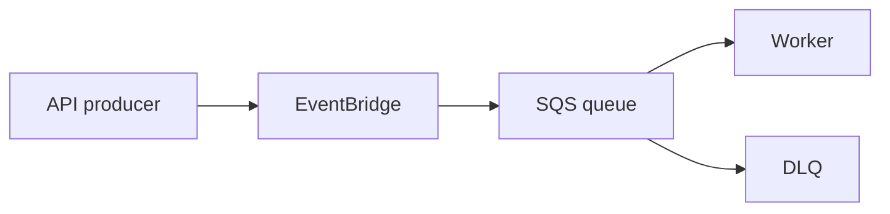

## Why this matters

A request that must finish before the browser gets a response is not a queue. A piece of work that can finish later, be retried, and must not be lost when a task restarts is a queue. CodeCraft's code runner might enqueue a job and return a run id, or it might run inline with a timeout. Email, search indexing, and "tell analytics a lesson was opened" are the clearer queue cases. Picking a queue for the lesson page itself only adds latency and a new failure mode.

SQS stores messages. SNS fans out a notification. EventBridge routes events by rules. They compose. They do not replace a database, and they do not make a handler correct unless the handler is idempotent.

## Intuition

SQS is a buffer. Producers send. Consumers pull and delete. If a consumer crashes before delete, the message becomes visible again after the visibility timeout. That is at-least-once delivery. You will see duplicates. Design the handler so doing the work twice is safe.

SNS is a push to subscribers: email, HTTP, or an SQS queue. One event, many subscribers, and each subscriber should have its own queue if you want retries that do not block the others. EventBridge is a bus with pattern rules. It is the better SNS when the events are "something happened in our platform or in AWS" and many teams attach rules without the producer knowing them.

## Core concept in depth

### SQS

Standard queues give maximum throughput and at-least-once delivery, and they do not promise order. FIFO queues promise order within a message group and exactly-once processing semantics for the send id, at lower throughput and with a stricter API. Use FIFO when order in a group matters, such as updates to one run id. Use standard for independent jobs like "index this lesson."

Visibility timeout must be longer than the handler. If the handler takes 40 seconds and the timeout is 30, another consumer gets the message and you run twice on purpose. If the timeout is an hour, a crashed consumer hides the message for an hour. Heartbeat by extending the timeout if work is long.

A dead-letter queue receives messages that failed too many times. Set a max receive count. Alarm on DLQ depth. A DLQ you never read is a bin. A message in the DLQ is a bug or a poison payload. Fix the handler, then redrive. Do not redrive in a loop without a fix.

Long polling (`WaitTimeSeconds` up to 20) reduces empty receives. Short polling burns API calls and looks like an empty queue when it is not.

### Idempotency

The run id is the idempotency key. The handler writes "this id is done" in the database with a conditional put before the side effect, or it records the effect so a second delivery no-ops. Sending email without that check sends two emails. SQS will not prevent that.

### SNS

Publish once. Each subscriber gets a copy. If the subscriber is SQS, the queue policy must allow the topic to send. Forgetting the queue policy is the usual "messages vanish" bug. SNS retries HTTP subscriptions and then disables them. Prefer SQS subscribers so you control the retry and the DLQ.

Do not put the only copy of a fact in an SNS message with no queue. SNS is not a store.

### EventBridge

A producer puts an event with a source, detail type, and detail. Rules match and send to targets: SQS, Lambda, Step Functions, another bus. AWS services can publish to the bus, which is how you react to an ECS deployment state change without polling.

EventBridge is not a queue. If the target fails, the retry policy on the rule matters, and a DLQ on the target still matters. Archive and replay exist when you need to reprocess. They are not a substitute for a handler that was wrong and wrote bad data. Replaying a bad handler repeats the bad write unless you fixed it.

Schema discovery is optional. A small JSON shape documented in the repo is enough for CodeCraft: `LessonOpened`, `RunFinished`. Version the detail type when you break the shape. Consumers must ignore unknown fields so you can add fields.

### What not to queue

- The health check.
- A lesson read that the page needs now.
- A database transaction's source of truth. The queue is a hint. The row is the truth.
- Student source code as an unencrypted message body in a queue policy that is world-readable. The body is sensitive. SSE and IAM.

## Diagram / flowchart



### Dry-run: a handler crashes

| Time | Message | Effect |
| --- | --- | --- |
| Receive | Invisible | Worker starts |
| Worker dies before delete | Invisible until timeout | Then visible again |
| Second worker, idempotent | Processed once in the database | Deleted |
| Second worker, not idempotent | Two side effects | A bug, not an SQS bug |
| Receive count exceeds max | On the DLQ | Alarm. No more automatic tries. |

### Picking a service

| Need | Service |
| --- | --- |
| Buffer work for one consumer type | SQS |
| Fan out to several consumers | SNS or EventBridge to several queues |
| React to AWS API events | EventBridge |
| Strict order per key | SQS FIFO with a group id |
| Request must finish now | No queue. Do the work or return 202 only if the client polls a real status row. |

## Code

Create a queue and a DLQ, then a redrive policy. Names are examples.

```bash
aws sqs create-queue --queue-name codecraft-runs-dlq
aws sqs create-queue --queue-name codecraft-runs \
  --attributes VisibilityTimeout=60,ReceiveMessageWaitTimeSeconds=20
```

Wire the redrive in the console or in Terraform after you have both ARNs. Max receive count of 5 is a starting point.

A handler's contract:

```python
def handle(message: dict) -> None:
    run_id = message["run_id"]
    if already_finished(run_id):
        return
    mark_started(run_id)
    execute(run_id)
    mark_finished(run_id)
```

`already_finished` must be a conditional write, not a check-then-act race you ignore. Two workers can pass a naive check. The database constraint is the real lock.

Consumer loop sketch:

```python
def poll(client, queue_url: str) -> None:
    resp = client.receive_message(
        QueueUrl=queue_url,
        MaxNumberOfMessages=5,
        WaitTimeSeconds=20,
    )
    for msg in resp.get("Messages", []):
        handle(parse(msg["Body"]))
        client.delete_message(
            QueueUrl=queue_url,
            ReceiptHandle=msg["ReceiptHandle"],
        )
```

Delete only after success. If `handle` raises, do not delete. The visibility timeout will retry. If `handle` succeeds and delete fails, the retry must be idempotent.

An EventBridge rule that matches a finished run and targets the queue is a small JSON pattern on `source` and `detail-type`. Keep the pattern in git next to the producer so they change together.

## Complexity analysis

| Choice | Delivery | Cost |
| --- | --- | --- |
| Inline work | Simple, ties up the request | No duplicate messages. Timeouts hit the user. |
| Standard SQS | At least once, unordered | Cheap buffer |
| FIFO | Ordered per group | Throughput limits, dedup window |
| SNS to HTTP | Push | Endpoint downtime drops or retries poorly |
| SNS to SQS | Fan-out with a buffer | Extra hop, the right default |
| EventBridge | Decoupled rules | Consumers must tolerate replay and duplicates |
| No DLQ | Poison messages retry forever | Cost and a stuck handler |

Visibility timeout is an operations knob. Too short duplicates work. Too long delays recovery. Match it to the worst successful run, and extend it if you approach the limit.

## Tricks, tips and patterns

- Idempotency key on every message that causes a side effect.
- DLQ plus an alarm plus a redrive you have practiced.
- Long polling. Do not busy-loop `receive`.
- One queue per consumer type, not one giant queue with an if-statement on message type, unless the types truly share a handler.
- SSE and a queue policy that is not public.
- Version event shapes. Consumers ignore unknown fields.
- Return 202 only when a status row exists for the client to poll.
- Do not log full message bodies if they contain student source.

## Common mistakes and edge cases

- Deleting the message before the work commits. A crash loses the work.
- Visibility timeout shorter than the work. Duplicate runs.
- No idempotency. Duplicate emails or double charges of quota.
- SNS publish with no queue and no store. A failed subscriber loses the event.
- Queue policy missing `sqs:SendMessage` for the topic. The topic says success and the queue stays empty.
- FIFO group id that is constant for every message, so you have a single-file line and no parallelism.
- Redriving a DLQ without fixing the poison message. It returns.
- Using the queue as the only record of whether a run finished. The API and the student need a row.

## Interview notes

**At least once means what?**
A message can be delivered more than once. You must delete it after success, and the handler must tolerate a second delivery. Exactly-once end to end is your database constraint, not a checkbox on a standard queue.

**SQS versus SNS versus EventBridge?**
SQS buffers work for consumers. SNS broadcasts a notification. EventBridge routes events with rules, including AWS service events. A common pattern is EventBridge or SNS into a queue the worker owns.

**Why a DLQ?**
After N failures the message is set aside so it does not block retries forever. You alarm, fix the bug, and redrive. Without it, poison messages cycle until you notice the bill or the lag.

**When will you not use a queue for CodeCraft?**
When the user is waiting for the lesson HTML or a short run that must return in the same request. A queue adds delay and duplicates. Use it for work that can complete after the response, with a status row.

**Visibility timeout.**
How long a received message stays hidden. It must cover the handler. Extend it for long work. When it expires, another worker can receive the same message.

## Practice problems

1. A worker takes 45 seconds and the visibility timeout is 30. What do users observe, and what do you change?
2. Design the idempotency key for "send the lesson-complete email once."
3. SNS says the publish succeeded and the queue is empty. What policy is missing?
4. A poison message is redriven and returns. What should have happened before redrive?
5. Explain why FIFO with one group id for all runs will not scale, and what the group id should be.

## Summary / cheat sheet

- SQS is at least once. Delete after success. Handlers are idempotent.
- Visibility timeout covers the work. Long poll. DLQ after N receives.
- SNS fans out. Put a queue in front of each serious consumer.
- EventBridge matches rules, including AWS events. It is not a log of record by itself.
- The database row is the source of truth. The message is a nudge.
- Do not queue the synchronous page load.
- Scope queue policies. Encrypt. Do not log student source.
- Standard versus FIFO is an order and throughput choice, not a moral one.

## Further reading

- [SQS visibility timeout](https://docs.aws.amazon.com/AWSSimpleQueueService/latest/SQSDeveloperGuide/sqs-visibility-timeout.html)
- [SQS dead-letter queues](https://docs.aws.amazon.com/AWSSimpleQueueService/latest/SQSDeveloperGuide/sqs-dead-letter-queues.html)
- [SNS fanout](https://docs.aws.amazon.com/sns/latest/dg/sns-common-scenarios.html)
- [EventBridge events](https://docs.aws.amazon.com/eventbridge/latest/userguide/eb-events.html)
- [Building idempotent APIs](https://aws.amazon.com/builders-library/making-retries-safe-with-idempotent-APIs/)
