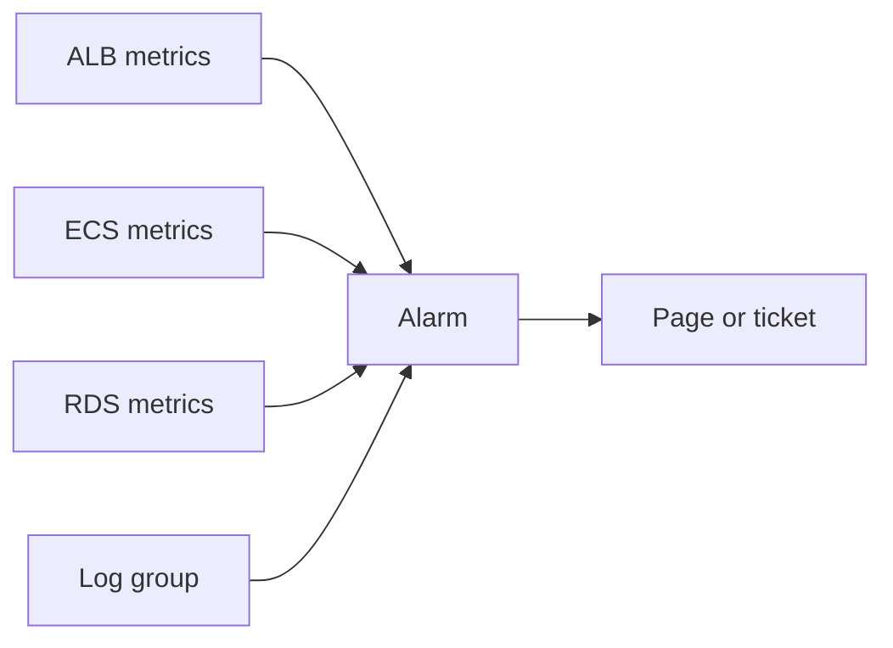

## Why this matters

ECS, ALB, and RDS already emit metrics. If you do not alarm on the ones that mean users cannot learn, you will find out from a student. CloudWatch is the AWS-native place those metrics, logs, and alarms live. It is not a replacement for the Prometheus RED dashboard inside the process. It is the view of the platform: is the target healthy, is the task dying, is the disk filling, did the log group explode in cost.

This lesson is the objects and the few alarms worth a page. The SLO burn math lives in the alerting lesson. Here you wire AWS signals into that policy.

## Intuition

A metric is a time series with a namespace, a name, dimensions, and a period. `AWS/ApplicationELB` and `TargetResponseTime` are not the same number as your app's histogram. Dimensions filter the series. An alarm without the right dimension watches the wrong load balancer.

Logs are events in a log group. ECS can ship container stdout to a group with the `awslogs` driver. Metric filters turn a count of a log pattern into a metric when you do not have a real metric. That is a bridge, not a design. Prefer a counter in the app for request errors, and use logs to find the request id.

Alarms have states: OK, ALARM, INSUFFICIENT_DATA. Insufficient data is not OK. A missing agent looks healthy if you treat missing as fine.

## Core concept in depth

### Metrics that matter for this app

| Source | Metric | Why |
| --- | --- | --- |
| ALB | HealthyHostCount | Zero is a page. The process may be crash-looping. |
| ALB | HTTPCode_Target_5XX_Count | The app is failing, not the listener |
| ALB | TargetResponseTime | Platform latency, not a substitute for route p95 |
| ECS | CPUUtilization and MemoryUtilization | Saturation. Not the first page if the SLO is healthy. |
| ECS | RunningTaskCount | Below desired means the service cannot place or the tasks die |
| RDS | CPUUtilization, DatabaseConnections, FreeStorageSpace | The database ceiling |
| Logs | IncomingBytes | Cost and a runaway debug line |

ALB 5xx on the target is the app. ELB 5xx is the load balancer failing to get a target. Those are different alarms. A spike of ELB 502 with zero healthy hosts is "nothing to send to." A spike of target 500 with healthy hosts is "the app is wrong." The rollout lesson's circuit breaker handles tasks that never pass health. CloudWatch tells a human when the result is user-visible.

### Periods, statistics, and missing data

A one-minute period on a sparse metric flaps. An alarm on a five-minute sum of 5xx is more honest for a small site. Match the period to the evaluation. `treat missing data as not breaching` hides a dead agent. For HealthyHostCount, missing data should be breaching or at least not silently OK. If the metric stops arriving, you want to know.

Dimensions are part of the identity. Alarming on `CPUUtilization` with no `ServiceName` can mix every service in the account. Always set the dimension.

### Logs

One log group for the API, one for the frontend, retention set in code. Infinite retention is a bill. 30 days matches the logging lesson. The stream is per task. A task that restarts creates a new stream. Search by request id if you logged it as JSON. CloudWatch Logs Insights can parse JSON fields. It is not OpenSearch. It is enough until the volume hurts.

Do not log the database password on startup "to verify the env." Insights will keep it for the retention window, and so will anyone who can read the group.

Metric filters are how you alarm on "panic" in a log if you have not emitted a metric yet. They lag and they cost. Replace them when the app can increment a counter.

### Dashboards and traces

A CloudWatch dashboard for the platform sits next to the Grafana board for RED. Do not merge them by copying 40 graphs. Link them. X-Ray or OpenTelemetry traces are how you see one slow request's spans. Turn tracing on when you have a latency problem you cannot see in the histogram. A trace service you do not look at is overhead.

Embedded metric format lets the app write metrics in the log line and CloudWatch extract them. It is a reasonable bridge on Lambda. On ECS, a Prometheus scrape or a small exporter is often clearer. Pick one application metrics path so you do not have two p95s.

## Diagram / flowchart



### Dry-run: tasks are crash-looping

| Signal | Reading |
| --- | --- |
| HealthyHostCount is 0 | Page. Users have no target. |
| RunningTaskCount flaps | Tasks start and die. Read the stopped task reason. |
| Target 5xx | May be empty because nothing is healthy enough to answer |
| ELB 5xx | The balancer is failing requests. This matches the user view. |
| Application RED dashboard | May be flat. No process is scraping. Do not conclude the app is fine. |

### Alarm severity

| Alarm | Severity |
| --- | --- |
| HealthyHostCount below 1 for 2 minutes | Page |
| Target 5xx sustained | Page if it matches the SLO burn, otherwise ticket |
| FreeStorageSpace low | Ticket, then page if it will fill before the next business day |
| CPU high, SLO healthy | Ticket or nothing |
| Log ingest anomaly | Ticket. It is often a cost incident. |

## Code

An alarm on healthy hosts. The threshold and period are the policy. Replace the dimension with the real load balancer and target group.

```bash
aws cloudwatch put-metric-alarm \
  --alarm-name codecraft-api-no-healthy-targets \
  --namespace AWS/ApplicationELB \
  --metric-name HealthyHostCount \
  --dimensions Name=TargetGroup,Value=targetgroup/codecraft-api/REPLACE Name=LoadBalancer,Value=app/codecraft/REPLACE \
  --statistic Minimum \
  --period 60 \
  --evaluation-periods 2 \
  --threshold 1 \
  --comparison-operator LessThanThreshold \
  --treat-missing-data breaching \
  --alarm-actions arn:aws:sns:ap-south-1:111111111111:codecraft-pages
```

Minimum below 1 means every sample in the period was under 1. Two evaluation periods avoid a single scrape blip. Missing data breaches so a vanished metric pages.

Retention on the log group belongs in Terraform:

```hcl
resource "aws_cloudwatch_log_group" "api" {
  name              = "/codecraft/api"
  retention_in_days = 30
}
```

A task definition log driver points stdout at that group. Without `awslogs` or FireLens, the platform metrics still exist and the request logs do not.

Insights query for 500s, once the app logs JSON with a status field:

```text
fields @timestamp, request_id, route, status
| filter status >= 500
| sort @timestamp desc
| limit 50
```

This finds examples. It does not compute the SLO. The rate is a metric.

## Complexity analysis

| Choice | Coverage | Cost and noise |
| --- | --- | --- |
| Default metrics only | Platform health | Misses route-level bugs that still return some 200s |
| App metrics in Prometheus | RED by route | Another system to run |
| Metric filter on logs | Quick alarm | Ingest cost and fragile patterns |
| 1-minute alarm on a rare 500 | Fast | Pages on one user |
| Missing data as OK | Quiet | A dead collector looks healthy |
| Infinite log retention | Audit feeling | The bill from the cost lesson |

Use platform alarms for "is it up" and application metrics for "is it good." One page path, from the alerting lesson, should receive both.

## Tricks, tips and patterns

- Dimension every alarm. Account-wide CPU is not an alarm.
- HealthyHostCount missing means breaching.
- Distinguish target 5xx and ELB 5xx.
- Retention on every log group in Terraform so a new service cannot default to forever.
- JSON logs so Insights has fields.
- Do not page on CPU alone.
- Stopped task reasons explain crash loops. The metric only says the count moved.
- Link the alarm to the runbook URL in the alarm description.

## Common mistakes and edge cases

- An alarm on the wrong load balancer dimension that stays OK during the outage.
- `treat-missing-data notBreaching` on the only health metric.
- Log group in the wrong region from the task.
- Two loggers, one of which prints secrets.
- A dashboard nobody opens and no alarm. The dashboard is not the detection.
- Averaging response time across all routes and calling it search latency.
- High-resolution custom metrics for every endpoint label. Cardinality is a bill here too.

## Interview notes

**What do you alarm on first for CodeCraft?**
Healthy hosts and sustained target or ELB 5xx. Storage on RDS as a ticket that escalates. CPU is saturation, not the page, unless you have shown it predicts the SLO.

**Why is missing data dangerous?**
The alarm can sit at OK while the metric stopped. For a health count, treat missing as breaching.

**CloudWatch versus Prometheus?**
CloudWatch is the platform and the log sink you get from AWS services. Prometheus is the application's RED metrics. You want both signals and one paging policy.

**Target 5xx versus ELB 5xx?**
Target 5xx means the app responded with 500. ELB 5xx means the balancer could not complete the request, often because no healthy target existed.

**How do you keep log cost bounded?**
Retention in code, no debug lines in prod, and an alarm or anomaly detection on incoming bytes.

## Practice problems

1. HealthyHostCount is 0 and the RED dashboard is empty. What is true about the tasks, and where do you read the stop reason?
2. An alarm stayed OK while the site was down. Which treat-missing setting and which wrong dimension could cause that?
3. Set log retention for the API and name the line item that grows if you do not.
4. A 500 in the app log is not a metric. How would you page on it properly, and why is a metric filter only a bridge?
5. Explain why average TargetResponseTime can look fine while search is slow.

## Summary / cheat sheet

- Metrics have namespaces, names, dimensions, and periods. Dimensions select the service.
- Page on zero healthy hosts and real 5xx. Ticket storage and cost. Do not page on CPU by default.
- Missing data on a health metric should not look like success.
- Target 5xx is the app. ELB 5xx is the balancer failing to reach a target.
- Logs to a group with retention. JSON and request ids. No secrets.
- Insights finds examples. Rates belong in metrics.
- Platform CloudWatch plus application Prometheus, one alert route.
- The stopped task reason explains a flap the metric only counts.

## Further reading

- [CloudWatch concepts](https://docs.aws.amazon.com/AmazonCloudWatch/latest/monitoring/cloudwatch_concepts.html)
- [ALB CloudWatch metrics](https://docs.aws.amazon.com/elasticloadbalancing/latest/application/load-balancer-cloudwatch-metrics.html)
- [ECS CloudWatch metrics](https://docs.aws.amazon.com/AmazonECS/latest/developerguide/cloudwatch-metrics.html)
- [Logs Insights query syntax](https://docs.aws.amazon.com/AmazonCloudWatch/latest/logs/CWL_QuerySyntax.html)
- [Alarm evaluation](https://docs.aws.amazon.com/AmazonCloudWatch/latest/monitoring/AlarmThatSendsEmail.html)
