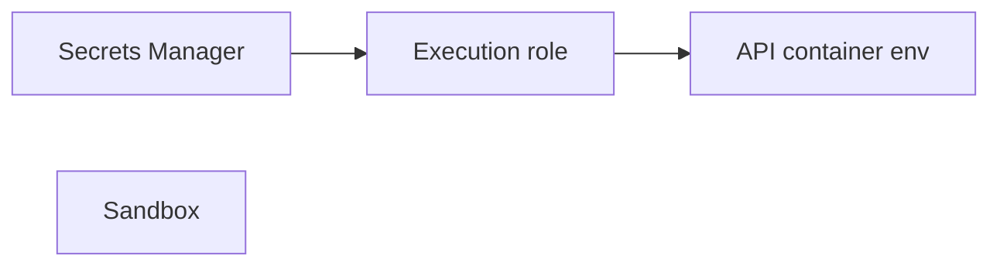

## Why this matters

A database password in a task definition, an environment screenshot, or a Terraform state file in git is a password you should assume has leaked. Secrets Manager and Systems Manager Parameter Store exist so the task can fetch the secret at start, or receive it as an injected file, under an IAM grant that names that secret. Rotation, audit, and "who can read this" are the product. The API still has to use the value without logging it.

The sandbox must not receive this secret. That constraint shows up again because it is the one people copy-paste away.

## Intuition

A secret is a versioned JSON or string in Secrets Manager. An IAM policy allows `secretsmanager:GetSecretValue` on that ARN and not on `*`. ECS can inject the secret into the container as an environment variable at task start. The task definition stores the ARN, not the password. Anyone who can read the task definition sees the ARN. Anyone who can `ecs:RunTask` with that role and then inspect the running container might still see the env var. Injection is not a magic hide. It removes the value from git and from the image.

Parameter Store can hold a SecureString under a KMS key. It is cheaper and simpler when you do not need managed rotation. Secrets Manager earns its price when RDS rotation or a strict rotation lambda matters. Do not put the same password in both and update one.

## Core concept in depth

### What goes in which store

| Value | Store | Why |
| --- | --- | --- |
| RDS password | Secrets Manager, often the RDS-managed secret | Rotation exists |
| A third-party API key | Secrets Manager or SecureString | No rotation lambda required for a key you rotate by hand |
| Log level, public host | Plain SSM parameter or a task env that is not secret | Not a credential |
| Lesson content | S3 | Not a secret and not small |
| The sandbox's limits | Plain env | Public design, not a credential |

A plain SSM parameter is not encrypted as a secret. Do not put the password there because the console path was shorter.

### Injection into ECS

The task execution role needs permission to read the secret and the KMS key, because ECS agent pulls the secret before the container starts. The task role is what the application uses at runtime. If the app also calls `GetSecretValue` itself, the task role needs the grant. If ECS injects the env var, the execution role needs it and the app does not. Prefer injection plus a file or env the app already understands, so the app does not embed AWS SDK calls only to read a password.

The execution role and the task role are different. Mixing them means the app can pull images or the agent can call your database API. Split them.

Kubernetes on EKS uses the external secrets operator or a CSI driver instead of the ECS injection block. The idea is the same: the manifest stores a name, the cluster materializes a Secret, the Pod mounts it. Do not also bake the value into the Helm values file.

### Rotation

RDS-integrated rotation creates a new password, updates the database, and updates the secret. Your tasks still hold the old value until they restart. Use a two-step rotation or a window where both passwords work, then roll the service. A rotation that invalidates the old password immediately will break every running task. Read which strategy the rotation uses before you turn it on in prod.

Test rotation in dev. A rotation lambda in a private subnet without a path to Secrets Manager or the database will fail and leave you unsure which password is live. The VPC endpoints or NAT path is part of rotation, not an afterthought.

### Audit

CloudTrail logs `GetSecretValue`. Alarm on unusual callers. A trail that the application can delete is not a trail. The secret policy can deny `GetSecretValue` except from the execution role. Resource policies and IAM policies both apply. A grant in IAM and a deny in the resource policy ends in deny.

Do not put the secret value in a CloudFormation parameter or a Terraform output that is not sensitive. Terraform state will still store it if Terraform creates the secret version. Restrict state access as the state lesson said. Prefer the RDS-managed secret so Terraform only stores the ARN.

## Diagram / flowchart



The sandbox has no arrow.

### Dry-run: rotate and roll

| Step | Running tasks | New tasks |
| --- | --- | --- |
| Both passwords accepted | Old password works | Can start with the new one |
| Roll the service | Drained | New password injected |
| Old password revoked | None left that need it | Unaffected |
| Revoke first | All break | Start fails until the roll |

### Who can read

| Principal | Should get the secret? |
| --- | --- |
| ECS execution role | Yes, the specific ARN |
| API task role | Only if the app fetches it itself |
| Sandbox task role | No |
| CI plan role | No. CI does not need the password to plan a network. |
| Humans | Break-glass role, not daily `get-secret-value` |

## Code

Create a secret and a narrow policy statement. The value is passed once from a prompt or a pipe, not committed.

```bash
aws secretsmanager create-secret \
  --name codecraft/dev/db \
  --description "CodeCraft dev database" \
  --secret-string file://db.json
```

`db.json` is local, gitignored, and deleted after the call. The console is an acceptable one-time input. The repository is not.

ECS container definition fragment. The value is not in the file.

```json
{
  "name": "api",
  "image": "111111111111.dkr.ecr.ap-south-1.amazonaws.com/codecraft-api:REPLACE",
  "secrets": [
    {
      "name": "DB_PASSWORD",
      "valueFrom": "arn:aws:secretsmanager:ap-south-1:111111111111:secret:codecraft/dev/db"
    }
  ]
}
```

Use a digest in real task definitions. The fragment shows the secrets block, which is the point.

Execution role policy:

```json
{
  "Effect": "Allow",
  "Action": ["secretsmanager:GetSecretValue"],
  "Resource": "arn:aws:secretsmanager:ap-south-1:111111111111:secret:codecraft/dev/db*"
}
```

The ARN suffix after the name is the random suffix AWS adds. Scope the resource to that secret's ARN pattern, not to `*`.

Confirm the sandbox task definition does not contain a `secrets` block and its role cannot call `GetSecretValue`. A test that starts a sandbox and prints the environment should not show `DB_PASSWORD`.

Parameter Store is the alternative for a non-rotating key:

```bash
aws ssm put-parameter \
  --name /codecraft/dev/search-key \
  --type SecureString \
  --value "replace-me"
```

Same rule: the command is local. The value does not go in the markdown you commit, and this lesson's placeholder is not a real key.

## Complexity analysis

| Choice | Rotation | Leak surface |
| --- | --- | --- |
| Env baked in the image | Rebuild | Registry and every node |
| Plain text in the task definition | New revision | API readers, git, state |
| ECS secrets injection | Roll tasks | Execution role, env inside the container |
| App fetches at runtime | Can refetch | Task role, and you must not log the response |
| SSM SecureString | Manual | Similar, cheaper, fewer rotation features |
| Same secret on the sandbox | Easy | Student code |

Injection plus a roll is the right default for the API. Fetch-at-runtime is worth it when you need to refresh without a restart and you have tested the failure when Secrets Manager is unreachable. If the fetch fails, the process should refuse to serve, not start with an empty password.

## Tricks, tips and patterns

- Store ARNs in git. Store values in the secret manager.
- Split execution role and task role.
- Scope `GetSecretValue` to one ARN.
- Two-phase rotation, then roll ECS.
- RDS-managed secrets when you want AWS to own the password lifecycle.
- CloudTrail on the secret. Alarm on unknown principals.
- Terraform stores the ARN. Restrict state because a managed secret version can still land attributes there.
- The sandbox role is deny by default.

## Common mistakes and edge cases

- `Resource: "*"` on `GetSecretValue` for convenience.
- Logging the full environment at startup.
- Rotation in a subnet that cannot reach the API or the database.
- Forgetting the KMS decrypt permission. GetSecretValue fails and the task stays pending.
- A secret in Parameter Store as String, not SecureString.
- Copying the API secrets block into the sandbox task definition.
- Putting the secret in a build arg. It lands in image history.
- Humans using a shared admin key that can read every secret and also deploy. Break-glass should be separate and loud.

## Interview notes

**Where does the password live for CodeCraft?**
In Secrets Manager. The task definition references the ARN. ECS injects it at start using the execution role. It is not in the image and not in git.

**Execution role versus task role?**
The execution role is the ECS agent: pull the image, write logs, fetch injected secrets. The task role is the application. Give each only what it needs.

**Why not environment variables in the task definition?**
The value is visible to anyone who can describe the task definition and it ends up in templates in git. The ARN is safe to describe. The value is not.

**How do you rotate without an outage?**
Both passwords work, you roll tasks so new ones load the new value, then you revoke the old password. An instant revoke kills the running tasks.

**What must the sandbox not have?**
The database secret, the API environment, and IAM permission to read secrets. Untrusted code plus `GetSecretValue` is a full leak.

## Practice problems

1. A task stays pending and the stopped reason mentions Secrets Manager. List the IAM and network checks.
2. Rotation ran and every live request started failing before the new tasks were healthy. Which order was wrong?
3. Compare Secrets Manager and SecureString for a key you rotate by hand once a year.
4. Show how Terraform can reference the secret without storing the password in a tfvars file.
5. A debug sandbox prints `env`. Which keys prove the task definition was copied too widely?

## Summary / cheat sheet

- Secrets Manager for credentials that need rotation and audit. SecureString for simpler secrets. Neither replaces S3 for content.
- Git holds ARNs. ECS injects values with the execution role.
- Scope `GetSecretValue`. Split execution and task roles.
- Roll tasks after rotation. Do not revoke first.
- The sandbox cannot read the API secret.
- CloudTrail the reads. Do not log the values.
- KMS decrypt is part of the grant. Private network paths are part of rotation.
- A password in a build arg or a plain task env is a leak even if a secret also exists.

## Further reading

- [Secrets Manager](https://docs.aws.amazon.com/secretsmanager/latest/userguide/intro.html)
- [Rotate secrets](https://docs.aws.amazon.com/secretsmanager/latest/userguide/rotating-secrets.html)
- [ECS secrets injection](https://docs.aws.amazon.com/AmazonECS/latest/developerguide/specifying-sensitive-data-secrets.html)
- [Parameter Store SecureString](https://docs.aws.amazon.com/systems-manager/latest/userguide/parameter-store-advanced-parameters.html)
- [IAM policies for secrets](https://docs.aws.amazon.com/secretsmanager/latest/userguide/auth-and-access.html)
