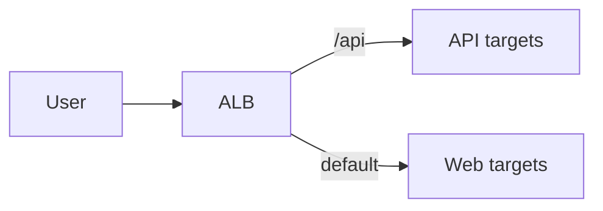

## Why this matters

One task is a single failure. A load balancer spreads requests across healthy targets and stops sending them to the rest. An Auto Scaling group replaces dead instances and grows capacity. On Fargate you often scale the ECS service instead of an ASG, and you still need the load balancer. The health check is the hinge. A check that always passes will drain users into a broken task. A check that never passes will leave the group empty.

This lesson is ALB versus NLB, target groups, and the scaling loop. The rolling deploy lesson uses the same health check. Read them as one story.

## Intuition

Listeners accept traffic on a port. Rules choose a target group. A target group is a set of tasks or instances plus a health check. The ALB understands HTTP: host, path, headers, status codes. The NLB understands TCP and UDP and is what you want for extreme performance or a static IP, not for path routing to `/api` and `/`.

An ASG launches instances from a launch template to meet a desired capacity, between min and max. A scaling policy changes desired capacity from CPU or from a request count. ECS on EC2 uses the ASG as the cluster capacity and the service as the task count. Those are two knobs. Fargate has no instances, so the service desired count is the only knob, and the ALB still health-checks tasks.

## Core concept in depth

### ALB for CodeCraft

One internet-facing ALB in public subnets, at least two AZs. A listener on 443 with the ACM certificate. A listener on 80 that redirects to 443. Rules:

- `/api/*` to the API target group, port 8000, HTTP, health check `/health`.
- default to the frontend target group, port 3000.

Target type `ip` for Fargate. Target type `instance` for EC2. Health checks come from the ALB's security group, so the task security group must allow the ALB, not the whole internet, on the app port.

Deregistration delay is connection draining. In-flight requests finish. Match it to real request time. A code run that you insist on finishing on the dying task needs a longer delay or a design that finishes the run elsewhere. Do not set the delay to an hour or deploys crawl.

Sticky sessions pin a user to a target. The API should be stateless. Do not enable stickiness to paper over a session stored in memory. Fix the session store or use signed cookies.

### NLB and Gateway Load Balancer

NLB for TLS pass-through or non-HTTP protocols, or when you need a stable private IP per AZ. Gateway Load Balancer is for inserting appliances. You do not need either for this HTTP site. Mention them so you do not pick NLB just because it sounds faster and then lose path routing.

### Auto Scaling groups

A launch template is the versioned instance recipe: AMI, instance type, security group, user data, IAM instance profile. The ASG references a template version. Do not edit the live instance. Launch a new version.

Min, max, and desired: min is what you keep even when metrics are quiet, max is the budget, desired is now. A scaling policy that sets desired above max does nothing. For an EC2-backed ECS cluster, the ASG max must be large enough for the service's max tasks plus a little room, or tasks stay pending.

Target tracking on CPU is the simple policy. It will not see an I/O-bound API, the same trap as the HPA lesson. Request count per target is a better ALB metric when CPU is flat. Scale-in protection during a deploy stops the ASG from terminating the instance you are draining.

Lifecycle hooks let you pause on launch or terminate to finish work. They also let you hang terminates forever if the hook does not complete. If you add a hook, alarm on instances stuck in a lifecycle state.

### Fargate without an ASG

The ECS service desired count, minimum healthy percent, and maximum percent replace the ASG for task count. Cluster capacity is AWS's problem. You still configure the ALB target group and the health check. Do not invent an ASG "for symmetry" on Fargate. There is nothing for it to launch.

### Health check alignment

| Check | Passes when |
| --- | --- |
| ALB health | `/health` returns 200 within the timeout, from the network path the ALB uses |
| Container health | Optional, the agent uses it. Do not contradict the ALB. |
| ECS service | Tasks stay running |

If `/health` depends on the database, a database blip empties the target group and the ALB returns 503. That may be what you want, or you may want `/health` to mean the process is up and a separate readiness that still fails the deploy without flapping every task. For a small API, failing closed when the database is gone is honest. Know that you chose it.

## Diagram / flowchart



### Dry-run: one task fails health

| Step | ALB | Users |
| --- | --- | --- |
| Check fails the unhealthy threshold | Target marked unhealthy | Traffic goes to the other target |
| Only one target and it fails | Zero healthy | 503 |
| ASG or ECS replaces the task | New target registers | Health must pass before traffic |
| Check path is wrong and nothing ever passes | Empty group | Outage until the path is fixed |

### Which scaler

| Runtime | What you scale |
| --- | --- |
| Fargate | ECS desired count or service autoscaling |
| ECS on EC2 | Service count and ASG capacity |
| A single VM | ASG of one is a weak HA story. Use two AZs. |

## Code

Target group health check and an ASG policy, in Terraform shape.

```hcl
resource "aws_lb_target_group" "api" {
  name        = "codecraft-api"
  port        = 8000
  protocol    = "HTTP"
  vpc_id      = aws_vpc.main.id
  target_type = "ip"

  health_check {
    path                = "/health"
    matcher             = "200"
    interval            = 15
    timeout             = 5
    healthy_threshold   = 2
    unhealthy_threshold = 2
  }

  deregistration_delay = 30
}
```

Allow the ALB security group into the task security group on port 8000. Do not open 8000 to `0.0.0.0/0` because the ALB is public. The ALB is the only public HTTP surface.

Service autoscaling for Fargate, tracking ALB request count, is a target-tracking policy on the ECS service. The ASG version for EC2:

```hcl
resource "aws_autoscaling_policy" "cpu" {
  name                   = "codecraft-cpu"
  autoscaling_group_name = aws_autoscaling_group.ecs.name
  policy_type            = "TargetTrackingScaling"

  target_tracking_configuration {
    predefined_metric_specification {
      predefined_metric_type = "ASGAverageCPUUtilization"
    }
    target_value = 60
  }
}
```

If the API is I/O bound, this policy will sit still. Use `ALBRequestCountPerTarget` for the service instead. Confirm in CloudWatch that the metric moves when students do.

Commands:

```bash
aws elbv2 describe-target-health --target-group-arn "$TG_ARN"
aws autoscaling describe-auto-scaling-groups --auto-scaling-group-names codecraft-ecs
```

Unhealthy reason strings are specific: health checks failed, target mismatch, draining. Read them before you replace the launch template.

## Complexity analysis

| Choice | Availability | Cost |
| --- | --- | --- |
| One task, one AZ | None during a failure | Lowest |
| ALB plus two tasks, two AZs | Survives one task or one AZ | ALB hours plus a second task |
| NLB plus path rules | You do not get path rules | Wrong tool |
| ASG min 1 | Replaces a dead instance | Gap until the new one is healthy |
| ASG min 2 across AZs | Overlap | The extra instance |
| Sticky sessions | Hides in-memory state | Uneven load and a stuck user |
| Health check on `/` | Easy | False healthy |

The ALB has an hourly cost even at zero traffic. One ALB for the site is justified. An ALB per preview environment is the cost lesson's warning.

## Tricks, tips and patterns

- One ALB, two listeners, path rules, two target groups.
- Health check `/health` with a tight unhealthy threshold.
- Security group: internet to the ALB, ALB to the tasks.
- Deregistration delay matches real requests.
- Fargate scales the service. EC2 scales the service and the ASG.
- Launch templates are versioned. Do not hotfix an instance.
- Target tracking on a metric that actually moves.
- Read `describe-target-health` during an incident before you scale.

## Common mistakes and edge cases

- Health check port 80 while the container listens on 8000.
- Opening the task port to the world because health checks failed. The ALB could not reach it. Fix the security group, not the internet.
- ASG max equal to min equal to 1, so a scale policy cannot help and a replace is downtime.
- Two scalers fighting: ECS desired count and a human setting task count, or an ASG that terminates nodes with running tasks and no protection.
- Sticky sessions plus a target you are draining. Users stay on the dying target.
- NLB in front of an HTTP app because a blog said NLB is faster, then no path-based routing.
- A lifecycle hook that never completes. Instances sit in Terminating:Wait.

## Interview notes

**ALB or NLB for CodeCraft?**
ALB. You need HTTP path rules, host routing, and status-code health checks. NLB is for TCP/UDP or static IPs. Gateway Load Balancer is for appliances.

**What makes a target receive traffic?**
It is registered and the health check passes. Describe target health. A running container that fails `/health` should not receive users.

**How does an ASG relate to ECS?**
On EC2, the ASG provides instances and the service places tasks. On Fargate there is no ASG. You scale the service. The ALB remains either way.

**Why not open port 8000 to the world?**
The ALB is the front door. Tasks should accept traffic only from the ALB security group. A public task port bypasses listener rules and TLS.

**A scale policy does nothing while the site is slow.**
The tracked metric is probably CPU and the bottleneck is not CPU. Track request count or fix the query. Also check that desired is not already at max.

## Practice problems

1. `/health` is 200 from inside the task and the target stays unhealthy. List network causes.
2. You are on Fargate. Which autoscaling object do you create, and which do you skip?
3. Deregistration delay is 300 seconds and deploys are slow. What requests are you protecting, and what delay fits a short lesson read?
4. ASG min is 1 and the only instance dies. What do users see until the replacement is healthy?
5. Explain why sticky sessions are the wrong fix for a session stored in process memory.

## Summary / cheat sheet

- ALB for HTTP. NLB for TCP. One ALB, path rules, TLS at the listener.
- Target health is the gate. `/health`, the right port, ALB security group allowed.
- Draining delay matches in-flight work. No stickiness for a stateless API.
- ASG launch templates for EC2 capacity. Fargate scales the ECS service instead.
- Min across two AZs if you promise availability. Max is a budget.
- Scale on a metric that moves with pain.
- Describe target health before you replace everything.
- Two knobs on ECS-on-EC2: tasks and instances. Do not forget the second.

## Further reading

- [Application Load Balancer](https://docs.aws.amazon.com/elasticloadbalancing/latest/application/introduction.html)
- [Target group health checks](https://docs.aws.amazon.com/elasticloadbalancing/latest/application/target-group-health-checks.html)
- [Auto Scaling groups](https://docs.aws.amazon.com/autoscaling/ec2/userguide/auto-scaling-groups.html)
- [ECS service auto scaling](https://docs.aws.amazon.com/AmazonECS/latest/developerguide/service-auto-scaling.html)
- [Launch templates](https://docs.aws.amazon.com/AWSEC2/latest/UserGuide/ec2-launch-templates.html)
