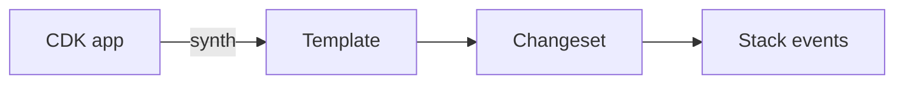

## Why this matters

CloudFormation is AWS's native way to turn a template into a stack of resources. The CDK is a programming language that synthesizes a CloudFormation template. You will meet both in AWS interviews even if this course's later deploy path uses Terraform. The failure modes are the same family: a stack update that replaces the database, a drift between the console and the template, and a tool that hides the template so nobody reads the change.

CodeCraft can be described as a VPC, an ECS service, an RDS instance, a bucket, and IAM roles. Whether the file is YAML, CDK, or HCL, the review is the change set: creates, updates, and replacements.

## Intuition

A stack is a unit of deployment with a name and a state AWS stores for you. You do not keep a state file in S3 the way Terraform does. CloudFormation's control plane is the state. That is convenient and it couples you to AWS. A template is the desired resources. A changeset is the preview, like a Terraform plan. You execute the changeset. You do not apply blind.

The CDK lets you write TypeScript or Python that constructs resources, then `cdk synth` emits the template. The deployed artifact is still CloudFormation. If you cannot read the synthesized template, you cannot review the CDK. Treat synth output as the plan's source.

## Core concept in depth

### Templates and stacks

A template has parameters, resources, and outputs. Parameters are inputs. Outputs are values other stacks might import. Cross-stack references are useful and make deletes order-sensitive. A network stack exports subnet ids. An app stack imports them. You cannot delete the network stack while the export is in use. That is a feature.

Intrinsic functions refer to other resources. Prefer them over hardcoded ids. A replacement happens when a property cannot be updated in place, the same ForceNew idea as Terraform. Read the resource's update behavior in the CloudFormation docs before you change a name.

`DeletionPolicy` and `UpdateReplacePolicy` of `Retain` keep a database or a bucket if the stack is deleted or the resource must be replaced. Use Retain on data. The default Delete will remove a bucket that is empty and will fail or wipe data depending on the resource. Do not learn this on prod.

### Changesets and drift

`create-change-set` then `execute-change-set` is the safe path. The changeset lists add, modify, and remove. A remove on RDS is a stop sign. Execute only the changeset you read.

Drift is a console edit CloudFormation did not make. Detect drift before an update. An update can revert the console edit or fail because the live object does not match the template's assumptions. Drift is not a second source of truth. Put the edit in the template or accept that the next update will undo it.

Stack failure rolls back by default. Rollback can itself fail if a resource is stuck. `continue-update-rollback` is the break-glass. Read the events. The first error in the event list is the cause. Later errors are the rollback.

### CDK levels

L1 constructs are CloudFormation resources with a friendly name. They map one to one. L2 constructs are opinionated AWS-made classes that default security group rules, encryption, or IAM. Those defaults are why people like the CDK and why people get surprised. Read what the L2 actually adds. L3 patterns build whole architectures. Be careful. A pattern that creates a VPC you already have will create a second one.

`cdk diff` is the review. `cdk deploy` synthesizes and deploys. In CI, synth, put the template in the artifact, and deploy that template with a changeset. Do not let a later synth change the deploy. Pin CDK versions. A CLI upgrade can change synthesis.

The CDK creates a bootstrap stack in the account: an S3 bucket and roles it uses to deploy. That bootstrap is privileged. Lock it down. Do not treat it as an implementation detail nobody owns.

### CloudFormation, CDK, or Terraform

| Tool | State | When it fits |
| --- | --- | --- |
| CloudFormation YAML | AWS-managed | Small stacks, or teams that want no extra language |
| CDK | Still CloudFormation | Many similar resources, developers who will test constructs |
| Terraform | Your state file | Multi-cloud, or this course's deploy module |

Do not manage one resource with two of them. Pick an owner per stack. CodeCraft's infrastructure lessons use Terraform so the examples stay consistent. Knowing how to read a changeset is still required.

## Diagram / flowchart



Hand-written templates skip the synth box and still use the changeset.

### Dry-run: change an instance type

| Step | What you should see |
| --- | --- |
| Synth or lint the template | Valid template |
| Create changeset | Modify, not replace, if the property allows update |
| If the action is replace on RDS | Stop. Retain and migrate. |
| Execute | Events stream. Rollback on failure. |
| Drift detection later | IN_SYNC if nobody edited the console |

### Policies

| Policy | Effect |
| --- | --- |
| Delete | Stack delete removes the resource |
| Retain | Stack delete leaves the resource |
| Snapshot | Where supported, snapshot then delete |
| UpdateReplacePolicy Retain | A replacement keeps the old physical resource |

## Code

A tiny template for a private artifact bucket. The deletion policy is Retain so a stack delete does not destroy artifacts.

```yaml
AWSTemplateFormatVersion: "2010-09-09"
Description: CodeCraft artifact bucket
Resources:
  Artifacts:
    Type: AWS::S3::Bucket
    DeletionPolicy: Retain
    Properties:
      BucketEncryption:
        ServerSideEncryptionConfiguration:
          - ServerSideEncryptionByDefault:
              SSEAlgorithm: AES256
      PublicAccessBlockConfiguration:
        BlockPublicAcls: true
        BlockPublicPolicy: true
        IgnorePublicAcls: true
        RestrictPublicBuckets: true
      VersioningConfiguration:
        Status: Enabled
Outputs:
  BucketName:
    Value: !Ref Artifacts
```

Changeset commands:

```bash
aws cloudformation deploy \
  --template-file bucket.yaml \
  --stack-name codecraft-artifacts-dev \
  --no-execute-changeset

aws cloudformation describe-change-set \
  --stack-name codecraft-artifacts-dev \
  --change-set-name CHANGESET_NAME

aws cloudformation execute-change-set \
  --stack-name codecraft-artifacts-dev \
  --change-set-name CHANGESET_NAME
```

`deploy --no-execute-changeset` creates the preview and stops. Read it. Then execute. In CI, the execute step is the gated job.

A CDK app is the same bucket in Python or TypeScript. After `cdk synth`, open `cdk.out` and find the bucket resource. If the synthesized template makes the bucket public, the CDK code is wrong even if the class name sounded safe.

```bash
cdk diff
cdk synth
```

Drift:

```bash
aws cloudformation detect-stack-drift --stack-name codecraft-artifacts-dev
aws cloudformation describe-stack-resource-drifts --stack-name codecraft-artifacts-dev
```

## Complexity analysis

| Approach | Review | Lock-in |
| --- | --- | --- |
| YAML templates | Verbose and obvious | AWS |
| CDK | Shorter code, must read synth | AWS plus the CDK version |
| Terraform | Plan files you already practiced | State backend you operate |
| Console plus drift | Fast | The next update undoes you |
| Two tools, one bucket | None | They fight |

CloudFormation is slower on large stacks because it walks dependencies and waits for stabilization. Split stacks by lifecycle the same way you split Terraform state: network, data, app. A stack that includes the VPC and the task definition makes every image bump a stack update next to the database. Prefer the deploy pipeline to roll the image, and the stack to own the service skeleton, if you want fast deploys.

## Tricks, tips and patterns

- Changeset first. Execute second. Automate the gate, not the skip.
- Retain data resources.
- Read the first stack event on failure, not the last.
- `cdk diff` in pull requests. Store the template as an artifact.
- Bootstrap is a privileged stack. Review its roles.
- L2 defaults are part of the design. Open the synth output once for each L2 you adopt.
- Exports are a contract. Do not rename them casually.
- One owner per resource. CloudFormation or Terraform, not both.

## Common mistakes and edge cases

- `--no-execute-changeset` forgotten, so CI deploys on every plan.
- A replacement of RDS with Delete policy. The changeset said remove and add. Someone executed it.
- CDK construct that opens `0.0.0.0/0` and a reviewer who only read the TypeScript class name.
- Cross-stack export changed while another stack imports it. The update fails. Coordinate the stacks.
- Rollback disabled "so we can debug," and the account is left half-updated with no automatic return.
- Secrets in template parameters that show up in the console history. Pass references to Secrets Manager, not the secret string.
- Assuming CloudFormation state cannot drift. It can, the moment someone uses the console.

## Interview notes

**What is a changeset?**
A preview of how a template update will add, modify, or remove resources. You read it and then execute that changeset. It is the CloudFormation analogue of a saved plan.

**Where does the CDK deploy to?**
It synthesizes a CloudFormation template and CloudFormation deploys it. The CDK is not a separate runtime beside AWS. If synth is wrong, deploy is wrong.

**How do you avoid deleting a database with the stack?**
`DeletionPolicy: Retain` and `UpdateReplacePolicy: Retain`, and a changeset review that treats replace as a migration. Retain does not replace a backup. Snapshots still matter.

**CloudFormation or Terraform for CodeCraft?**
This course uses Terraform so state, modules, and CI match the later lessons. CloudFormation is the right answer when the organization is all-in on AWS-native tooling or you are extending an existing stack. Do not use both on one resource.

**What is drift?**
Live resources differ from the template. Detect it. Then either adopt the live change into the template or let the next update revert it. Do not leave both stories running.

## Practice problems

1. A changeset shows RDS as remove and add. What do you do before execute, and which policies should already be set?
2. `cdk diff` is empty and the console shows a different instance size. What do you run, and which source wins if you do nothing?
3. Explain why a CDK reviewer must open the synthesized template at least once for a new L2 construct.
4. A stack export of subnet ids is renamed. What happens to the app stack, and how do you sequence the change?
5. Why is a database password parameter a bad input to a template that stays in stack history?

## Summary / cheat sheet

- Stacks are CloudFormation's unit. The service stores the state.
- Changesets are the preview. Execute only what you read.
- Retain data. Replacement is not an in-place update.
- Drift is console reality. Detect it.
- CDK synths templates. Review the template. Pin the CLI.
- Bootstrap roles are privileged.
- Split stacks so an image roll is not a database update.
- One tool owns each resource. Terraform in this course, CloudFormation when the stack is already native.

## Further reading

- [CloudFormation concepts](https://docs.aws.amazon.com/AWSCloudFormation/latest/UserGuide/Welcome.html)
- [Changesets](https://docs.aws.amazon.com/AWSCloudFormation/latest/UserGuide/using-cfn-updating-stacks-changesets.html)
- [Drift detection](https://docs.aws.amazon.com/AWSCloudFormation/latest/UserGuide/using-cfn-stack-drift.html)
- [AWS CDK developer guide](https://docs.aws.amazon.com/cdk/v2/guide/home.html)
- [CDK best practices](https://docs.aws.amazon.com/cdk/v2/guide/best-practices.html)
