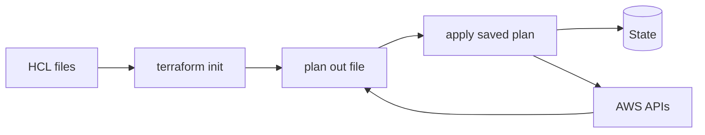

## Why this matters

Clicking through the AWS console does not survive the next engineer, the next region, or the next incident. CodeCraft needs a VPC, a container service, a database, a bucket for content or artifacts, and IAM roles that CI can assume. Those objects must be reviewable in git. Terraform is the tool this course uses to describe them, preview the change, and apply it.

CloudFormation and the CDK, covered earlier, are AWS-native. Terraform is the tool you will also meet on GCP, Azure, and SaaS APIs, and it is the tool many AWS teams still choose because the plan output is easy to review. You need the core loop before modules, remote state, and CI mean anything: write HCL, initialize providers, plan, apply a saved plan.

People who skip this lesson memorize commands and still cannot explain why a one-line tag change wants to replace a database. The plan is a graph diff. Reading it is the job.

## Intuition

Terraform stores two worlds. The configuration is the world you want, written in HCL. The state is the world it believes exists, including real IDs like a subnet id or an RDS endpoint. A plan is the diff. Apply walks that diff in dependency order and calls provider APIs.

You do not tell Terraform the steps. You tell it the destination. "This bucket exists, versioning is on, the task role can read it." Terraform decides create, update, or delete. That is why a renamed resource looks like a destroy plus a create: the name is the identity in state, unless you move the address.

A provider is a plugin that knows one API. The AWS provider knows EC2, S3, IAM, and the rest. Terraform Core knows graphs, state, and the language. Core does not know what a security group is. That split is why `terraform init` must download providers before `plan` can do anything.

## Core concept in depth

### The language you actually write

A Terraform directory that is applied directly is a **root module**. It is just files ending in `.tf`. Terraform loads all of them as one configuration. File boundaries are for humans.

The blocks you will see constantly:

| Block | Role |
| --- | --- |
| `terraform` | Required core version, required providers, backend |
| `provider` | How to authenticate and which region to call |
| `resource` | An object Terraform creates and updates |
| `data` | A read-only lookup of an object it does not own |
| `variable` | Input to the module |
| `output` | A value exported to humans or to other state |
| `locals` | Computed names used to avoid repetition |
| `module` | A call to a child module |

A resource has a type and a local name. `aws_s3_bucket.content` is an address. The type is defined by the provider. The local name is yours. References to attributes, such as the bucket id, create graph edges. You rarely write an explicit dependency. Mentioning the bucket is the dependency.

A data source is how you look up a VPC that another team owns. It is not how you create one. If both teams create it, you will fight. If neither creates it, the lookup fails. Ownership should be obvious from which state file contains the resource.

### Providers, lock files, and versions

`terraform init` reads `required_providers`, downloads the provider binary, and writes `.terraform.lock.hcl`. Commit the lock file. It pins the provider hashes the way a language lock file pins libraries. Without it, two engineers and CI can plan with different provider builds.

Pin the AWS provider with a pessimistic constraint so you take patch releases and review minor upgrades. Pin Terraform itself with `required_version`. A plan generated by 1.9 and applied by 1.5 is an avoidable incident.

Credentials do not belong in the `.tf` files. Use the standard AWS chain: environment variables locally, a profile for humans, and an IAM role assumed from CI. The provider block sets the region and, when you need a second region for replicas, an `alias`. Resources then choose the alias. One provider block without an alias is the default.

### Plan files are the contract

`terraform plan` refreshes state from the live APIs, diffs against config, and prints actions. `terraform plan -out=tfplan` writes an exact plan. `terraform apply tfplan` applies that file and does not silently re-plan. In CI and in production, apply the saved plan that a human approved. A second, later `apply` with no plan file computes a new plan and may include drift that nobody reviewed.

Read the symbols. `+` create, `~` update in place, `-` destroy, `-/+` replace. Replace means destroy and create. On a database that is data loss unless a lifecycle rule creates the new one first and you have a migration story. The fundamentals habit is: if you cannot explain every replace, you do not apply.

`terraform fmt` is whitespace. `terraform validate` is syntax and type references, and it needs `init`. Neither talks to AWS. A green validate does not mean the plan is safe.

### Count, for_each, and identity

Two resources that differ by a name should usually be `for_each` over a map, not copy-pasted blocks. The map key becomes part of the address. Adding a key adds a resource. Removing a key destroys that resource. Changing a key is a move, which Terraform can do with a moved block, or it is a destroy and create if you do not.

`count` indexes by number. Inserting an item at the front renumbers everything after it and can replace a long list of subnets. Prefer `for_each` for anything that has a stable name. Use `count` for the simple on/off switch, often `count` of 1 or 0.

### What this lesson deliberately postpones

Remote state and locking are the next lesson. Modules are the one after that. Lifecycle meta-arguments and provisioners come after modules. Workspaces and CI close the Terraform sequence. You still need one mental picture of state to read a plan: Terraform records the address, the provider, and the remote id. Delete the state and Terraform thinks the bucket is new, then the API rejects "bucket already exists." That failure mode is why state is not an optional cache.

## Diagram / flowchart



### Dry-run: add versioning to a content bucket

| Step | Talks to AWS? | Result |
| --- | --- | --- |
| `fmt` and `validate` | No | Files are well formed |
| `init` | Registry only | Provider installed, lock file updated if needed |
| `plan -out=tfplan` | Yes, read | One update in place on the versioning resource |
| Human reads the plan | No | No replaces, no destroys |
| `apply tfplan` | Yes, write | Versioning enabled, state serial increments |

If the plan says the bucket must be replaced because you changed `bucket`, stop. Renaming a bucket is a new bucket. Content does not move with the resource. Create the new one, copy objects, then retire the old address.

### Actions you must recognize

| Plan symbol | Meaning | Typical CodeCraft example |
| --- | --- | --- |
| create | New remote object | First ECR repository |
| update in place | Mutable argument changed | Add a tag |
| replace | Force new | Change an RDS identifier |
| destroy | Address removed from config | Deleting a dev queue |

## Code

A minimal root module for a private artifact bucket. Region and name are variables so the same files work for a sandbox account later.

```hcl
terraform {
  required_version = ">= 1.10.0"

  required_providers {
    aws = {
      source  = "hashicorp/aws"
      version = "~> 5.70"
    }
  }
}

provider "aws" {
  region = var.aws_region
}

variable "aws_region" {
  type    = string
  default = "ap-south-1"
}

variable "bucket_name" {
  type = string
}

resource "aws_s3_bucket" "artifacts" {
  bucket = var.bucket_name
}

resource "aws_s3_bucket_versioning" "artifacts" {
  bucket = aws_s3_bucket.artifacts.id

  versioning_configuration {
    status = "Enabled"
  }
}

resource "aws_s3_bucket_public_access_block" "artifacts" {
  bucket                  = aws_s3_bucket.artifacts.id
  block_public_acls       = true
  block_public_policy     = true
  ignore_public_acls      = true
  restrict_public_buckets = true
}

output "artifact_bucket" {
  value = aws_s3_bucket.artifacts.bucket
}
```

The versioning resource references the bucket id, so the graph creates the bucket first. The public access block does the same. No `depends_on` is required.

```bash
terraform fmt -recursive
terraform init
terraform validate
terraform plan -out=tfplan -var="bucket_name=codecraft-artifacts-dev"
terraform apply tfplan
```

Run `plan` again immediately after apply. A second plan with no changes is the signal that state matches the APIs. A surprise diff means drift: someone edited the bucket in the console, or a default you did not set is fighting you.

Inspect the graph when a plan order surprises you:

```bash
terraform graph | dot -Tpng > graph.png
```

If `dot` is not installed, reading the plan's implicit order is enough at this stage. The graph becomes essential once modules hide the references.

## Complexity analysis

| Choice | Benefit | Cost |
| --- | --- | --- |
| One root module, few resources | Easy to read | Blast radius grows with every service |
| Saved plan file | Reviewed bytes are applied bytes | Plan files expire and contain secrets |
| Pinned provider and lock file | Repeatable plans | Renovate-style bumps become a chore you must actually do |
| `for_each` map | Stable addresses | Key changes destroy resources |
| `count` list | Short for on/off flags | Index shifts replace neighbors |
| Data source for shared VPC | No duplicate networks | Lookup fails if the other stack is not applied |
| Unpinned `latest` provider | None worth taking | Plans differ between laptop and CI |

Plan time grows with the number of resources because refresh reads the live objects. That is a reason to split state later, not a reason to skip refresh. A plan that does not refresh will happily apply on top of a deleted subnet.

Provider timeouts and API rate limits show up as errors in the middle of apply. Terraform records partial progress in state. You re-run apply. You do not start over by deleting state.

## Tricks, tips and patterns

- Commit `.terraform.lock.hcl`. Do not commit the `.terraform/` directory or `tfplan` files. Plan files can contain sensitive values.
- Pass variables with a `terraform.tfvars` that is gitignored when it holds account-specific names, or with `TF_VAR_` environment variables in CI.
- Mark outputs that contain passwords as sensitive so the CLI redacts them. State still stores them. State is a secret, which the next lesson treats as such.
- Prefer separate resources the provider documents as separate, such as bucket versioning and public access block, over deprecated inline blocks. The AWS provider has been moving that way for years.
- Use `terraform console` to evaluate a local or a reference without applying.
- When a plan replaces something precious, stop and name the attribute that has `ForceNew` in the provider docs. That attribute is the cause.
- Add `default_tags` on the AWS provider so every resource carries `project`, `environment`, and `owner` without repeating them.
- Keep a `README` next to the root module with the exact init and plan commands. Tribal knowledge of `-var` flags becomes an outage.

## Common mistakes and edge cases

- Applying on a laptop against production with personal credentials. CI should be the only production writer.
- Editing a resource's local name to "clean it up" and applying. That destroys the old object.
- Importing nothing and creating a bucket that already exists. Import the existing id into the address, or pick a new name on purpose.
- Setting `bucket` to a name that is globally taken. S3 names are global. The apply fails and state may record a tainted create. Read the error before you retry blindly.
- Using a data source and a resource for the same object in one config. You will create a second one or fail the lookup.
- Committing AWS keys in `provider` blocks. The provider does not need an `access_key` argument when the environment is set up.
- Ignoring a plan full of tag-only diffs caused by console edits. Either import the tags into config or you will fight drift forever.
- Running Terraform 1.4 in CI and 1.10 locally. Pin the version in CI to match `required_version`.

## Interview notes

**What is a Terraform plan?**
A refresh of state against live APIs, then a diff against HCL, expressed as create, update, delete, or replace. A saved plan file is what production should apply so the reviewed diff cannot change underneath you.

**What does the AWS provider do that Terraform Core does not?**
Core builds the graph, stores state, and evaluates the language. The provider maps resource types to AWS API calls. `init` downloads that plugin. The lock file pins it.

**Why did changing one argument replace the database?**
The provider marked the argument ForceNew. Terraform cannot update it in place, so the plan is destroy and create. You stop, read the docs, and usually change a name through a migration rather than accepting the replace.

**Resource versus data source?**
A resource is created and tracked in state. A data source is a lookup of something this configuration does not own. Use data sources for shared networks and AMIs. Use resources for objects this stack must create and destroy.

**What is an address?**
The type plus the local name, such as `aws_s3_bucket.artifacts`. State maps that address to a remote id. Rename the address without a move and Terraform plans a destroy of the old id and a create of a new one.

## Practice problems

1. Write a root module that creates a versioned, non-public S3 bucket. Explain which references create the graph edges.
2. A plan shows a replace on the bucket because the name changed. What will happen to existing objects, and what sequence avoids data loss?
3. Two engineers run `apply` with different provider versions and get different plans. Which file should have been committed?
4. A subnet is defined with `count` over a list of CIDRs. Someone inserts a CIDR at index 0. Predict the plan for the old index 0.
5. `validate` passes and `apply` fails because the bucket name is taken. Why did validate not catch it?

## Summary / cheat sheet

- HCL is the desired state. Terraform state is memory. The plan is the diff.
- `init`, `fmt`, `validate`, `plan -out`, `apply` the saved file.
- Providers are plugins. Commit `.terraform.lock.hcl`. Pin versions.
- References build the graph. `for_each` keys are stable. `count` indexes are not.
- `+` `~` `-` and replace are the vocabulary. Unexplained replaces stop the apply.
- Data sources look up. Resources own. Do not do both for one object.
- Credentials stay in the environment or in CI roles, not in `.tf` files.
- State loss means Terraform forgets remote ids. The next lesson stores it properly.

## Further reading

- [Terraform language documentation](https://developer.hashicorp.com/terraform/language)
- [AWS provider documentation](https://registry.terraform.io/providers/hashicorp/aws/latest/docs)
- [Terraform plan and apply workflow](https://developer.hashicorp.com/terraform/cli/run)
- [Resource addressing](https://developer.hashicorp.com/terraform/cli/state/resource-addressing)
- [Dependency graph](https://developer.hashicorp.com/terraform/internals/graph)
