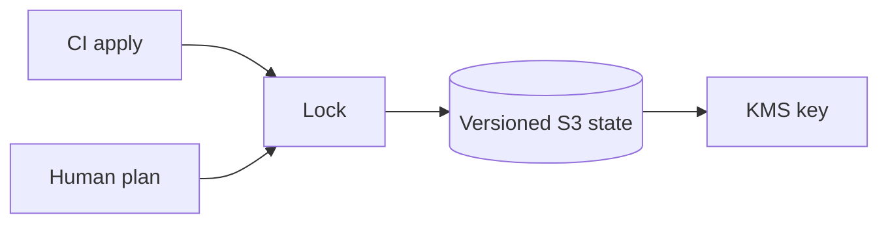

## Why this matters

Terraform without state will try to create a second VPC and fail, or worse, succeed and split your traffic. State is the map from an address like `aws_s3_bucket.artifacts` to a real bucket id. Lose the map and Terraform is amnesiac. Commit the map to git and you have published database passwords, because state stores attribute values, including secrets the provider returns.

CodeCraft will have more than one engineer and a CI job that applies. Two applies at once corrupt a local `terraform.tfstate`. A laptop disk is not a team bus. Remote state with locking is the minimum bar, and the IAM policy on that state bucket is as sensitive as production admin: anyone who can write state can point Terraform at a different resource and delete the real one on the next plan.

## Intuition

State is a JSON database Terraform owns. Each apply increments a serial number and writes a new snapshot of ids and attributes. A backend decides where that JSON lives. The local backend is a file in the directory. The S3 backend is an object. A lock stops a second process from writing that object until the first apply finishes.

Think of state as the inventory book in a warehouse. The shelves are AWS. Two people editing the book at once will ship the same box twice or throw one away. The book also lists what is inside sealed crates, so you do not photocopy it into Slack.

Locking is not a backup. Versioning on the state bucket is the backup. Locking is the mutex.

## Core concept in depth

### What is inside the file

A state snapshot has a lineage id that stays stable across applies, a serial that increments, and a list of resource instances. Each instance stores the provider, the address, the remote id, and attributes. Outputs are stored too.

You almost never edit this JSON by hand. `terraform state mv` changes an address when you rename a resource. `terraform state rm` forgets an object without destroying it, which is how you hand a resource to another stack. `terraform import` attaches an existing remote id to an address that has no state yet. `terraform state list` and `terraform state show` are the safe read tools.

`state rm` is not a destroy. The bucket remains. The next plan will want to create it again unless the address is gone from config or you imported it elsewhere. `apply` after a mistaken `rm` is how teams duplicate or collide.

### Remote backend on S3

The backend block lives in the `terraform` block. For AWS, S3 is the usual store. Enable versioning and encryption on that bucket before the first `init`. Block public access. The state object key should name the stack, not one giant file for the company.

Terraform 1.10 and later can lock with an S3 lock file (`use_lockfile`) so a new stack does not need a DynamoDB table. Many existing codebases still lock with a DynamoDB table whose key is the lock id. Interviews expect you to know both. DynamoDB locking is the pattern you will read in older runbooks. S3 lock files are the simpler default for a new CodeCraft stack on a current Terraform. Do not run two locking schemes against one key and hope.

Pass bucket, key, and region with `-backend-config` or a partial backend so the same module can target a dev key and a prod key without editing committed code. After you change backend settings, `terraform init -migrate-state` copies state. `init -reconfigure` switches without copying. Picking the wrong flag is how state gets abandoned in a local file while CI applies an empty remote state and tries to recreate production.

### Locking and failure

When apply starts, Terraform writes a lock. If your laptop dies mid-apply, the lock remains and the next plan says the state is locked and names the lock id. Read the error. If the other process is alive, wait. If it is dead, `terraform force-unlock` with that id. Force-unlock while an apply is actually running is how you corrupt state. It is a break-glass command, not a retry flag.

A failed apply often leaves state partially updated. The remote object may exist while a later resource failed. The fix is to solve the API error and apply again. Terraform reconciles. Deleting the state object to "start clean" when the VPC already exists will not start clean. It will fight the existing ids.

### State is a secret

RDS master passwords, IAM secret access keys if you were unwise enough to create them, and generated random passwords all land in state. Encrypt with a customer-managed KMS key. Restrict `s3:GetObject` on the state prefix to the CI role and the break-glass humans. Enable bucket versioning so you can recover yesterday's serial after a bad apply. Send S3 access logs or CloudTrail data events somewhere the same role cannot delete, or the person who exfiltrates state can hide the get.

Never commit `terraform.tfstate` or `*.tfstate.backup`. Put them in `.gitignore` on day one. If they were committed, rotating the secrets inside them is part of the cleanup. Deleting the file from the latest commit does not remove it from git history.

### Blast radius

One state file for the network, the database, the ECS service, and DNS means a bad plan can propose changes to all of them, and the lock blocks unrelated work. Split by lifecycle and team. A practical CodeCraft split:

| State key | Owns | Changes |
| --- | --- | --- |
| `network` | VPC, subnets, NAT | Rare |
| `data` | RDS, buckets that hold durable data | Careful, gated |
| `app` | ECS service, task roles, target groups | Every deploy of infra, not every image tag |
| `dns` | Route 53 records | Rare, high impact |

Image tag updates might be a deployment tool rather than Terraform, so a task definition revision does not require a state lock on the database. The deploy lesson makes that call explicit. The state lesson's rule is: objects that fail together and change together can share a state file. Objects that must never be destroyed in the same plan should not.

Outputs are how the app stack learns the subnet ids without reading the network account's console. `terraform_remote_state` data sources couple stacks tightly and grant read on the other state file, secrets included. Prefer remote state outputs that are non-sensitive ids, or SSM parameters written by the network stack. Do not point the app stack at the full network state if that state also stores a VPN pre-shared key.

## Diagram / flowchart



### Dry-run: first migration off a laptop

| Step | State lives | Risk if you skip it |
| --- | --- | --- |
| Create versioned, encrypted, private bucket | Nowhere yet | Later objects are public or unrecoverable |
| `init -migrate-state` to the S3 key | Copied to S3 | Local file remains the only copy |
| Delete local state after a successful remote plan | S3 only | Two sources of truth |
| Second engineer runs `init` and `plan` | Same S3 key | They would have created duplicates |
| Apply holds the lock | Locked | A parallel apply could interleave writes |

After migration, `plan` should show no changes. A plan that wants to create the whole VPC means the remote state is empty and you migrated the wrong file or the wrong key.

### Commands and their blast radius

| Command | Destroys infrastructure? | Use |
| --- | --- | --- |
| `state list` | No | See addresses |
| `state mv` | No, renames address | Refactors |
| `state rm` | No, forgets only | Hand off ownership |
| `import` | No | Adopt an existing object |
| `destroy` | Yes | Tear down a stack on purpose |
| `force-unlock` | Not directly | Clear a stale lock |

## Code

Backend block for a new stack using S3 locking on Terraform 1.10 or newer. The bucket itself is created once, outside this state or in a tiny bootstrap stack, because a backend cannot reliably create the bucket it stores itself in.

```hcl
terraform {
  required_version = ">= 1.10.0"

  backend "s3" {
    bucket       = "codecraft-tf-state"
    key          = "dev/app/terraform.tfstate"
    region       = "ap-south-1"
    encrypt      = true
    kms_key_id   = "alias/codecraft-tf-state"
    use_lockfile = true
  }
}
```

Bootstrap the bucket with the CLI, then migrate.

```bash
aws s3api create-bucket \
  --bucket codecraft-tf-state \
  --region ap-south-1 \
  --create-bucket-configuration LocationConstraint=ap-south-1

aws s3api put-bucket-versioning \
  --bucket codecraft-tf-state \
  --versioning-configuration Status=Enabled

aws s3api put-public-access-block \
  --bucket codecraft-tf-state \
  --public-access-block-configuration \
  BlockPublicAcls=true,IgnorePublicAcls=true,BlockPublicPolicy=true,RestrictPublicBuckets=true

terraform init -migrate-state
terraform plan
```

For an estate that already has the classic DynamoDB lock table, the backend uses `dynamodb_table` instead of `use_lockfile`. The table has a single string hash key named `LockID`. Do not switch a live stack from one locking style to the other in the middle of an apply.

Adopt a bucket that already exists:

```bash
terraform import aws_s3_bucket.artifacts codecraft-artifacts-dev
terraform plan
```

The plan after import should be empty or should show only the attributes your config adds, such as tags. A plan that replaces the bucket means the config does not match the real name. Fix the config. Do not apply a replace to adopt a bucket.

Recover a bad apply from bucket versioning by copying the previous object version back to the key, then run `plan` before you touch anything else. If AWS and the restored state disagree, believe the plan output and reconcile with import or with targeted fixes. Do not keep applying against a state you already know is fiction.

## Complexity analysis

| Choice | Benefit | Cost |
| --- | --- | --- |
| Local state | Zero setup | Unsafe for two people or CI |
| S3 plus lock file | One service, versioning, encryption | Requires a current Terraform |
| S3 plus DynamoDB lock | Works on older Terraform, familiar in interviews | Extra table and IAM |
| One state per environment and stack | Small plans, small locks | More backends to bootstrap |
| Single company-wide state | One place to look | Every plan is terrifying and slow |
| `terraform_remote_state` | Easy wiring | Reads secrets, tight coupling |
| SSM or outputs of ids only | Narrow interface | More resources to write the parameters |

Refresh-heavy plans in a huge state are a productivity problem. Split the state before you reach for `-refresh=false`. Skipping refresh hides drift and then apply "fixes" it in a surprise way, or fails to see that someone already deleted the target group.

## Tricks, tips and patterns

- Bootstrap state storage manually or with a tiny stack whose own state you protect carefully. Circular backends are a trap.
- Turn on versioning before the first migrate, not after the first disaster.
- Use separate KMS keys or at least separate key policies per environment if prod and dev share an account, which they should not.
- Prefer separate AWS accounts for prod and non-prod so a state bug in dev cannot call prod APIs. The backend bucket lives in the account it manages, or in a dedicated tooling account with a narrow role.
- Write `backend.hcl` files per environment and pass them with `-backend-config`. Keep secrets out of them. The bucket name is not a secret. The state contents are.
- After `state mv` inside a module refactor, run `plan` and expect no changes. That is the test that the move was right.
- Add a CI check that fails if `terraform.tfstate` appears in the git diff.
- Store plans as CI artifacts with a short retention, not in the state bucket next to state, and not in the repo.

## Common mistakes and edge cases

- Force-unlock as the default response to "state locked." Confirm the other run is dead.
- `state rm` on a database, then apply, which creates a second database or errors on the identifier. Know which you are trying to do.
- Importing into the wrong address and applying. Terraform may destroy the real object to match an empty or different config.
- Disabling encryption or public access "temporarily" on the state bucket.
- Using the same state key for dev and prod via a workspace you forgot to select. Workspaces are the later lesson. The failure mode belongs here: always print the key or workspace at the start of CI logs.
- A backend change without `init`. Plans still talk to the old location.
- Restoring an old state version while AWS has moved on, then applying, which destroys resources created after that snapshot. Plan, read, then decide.
- Granting every developer `s3:*` on the state bucket. Read in prod can be enough for most humans. Write belongs to CI.

## Interview notes

**Why is state required?**
Terraform needs the remote id for each address. Without it, a plan cannot tell an existing bucket from a bucket it should create. Configuration does not contain those ids. State does.

**Why is a local state file not enough?**
It does not lock, it is not shared with CI, and it is easy to commit, which leaks secrets. Two applies can write two snapshots and lose updates.

**How do you lock S3 state?**
On current Terraform, `use_lockfile` on the S3 backend. On older stacks, a DynamoDB table with hash key `LockID`. Both are mutexes. Versioning on the bucket is the backup, not the lock.

**Someone imported a production bucket into the wrong address. What do you do?**
Do not apply. `state rm` the bad address if no destroy has happened, or fix the config until `plan` shows no destroy. Apply only when the plan is empty or is the change you intended.

**How should CodeCraft split state?**
Separate keys for network, data, and app, and separate accounts or at least separate keys per environment. Image rollouts should not need to lock the database state.

## Practice problems

1. List the bucket settings you require before `init -migrate-state`. Explain which disaster each setting prevents.
2. An apply crashes and the next plan says the state is locked. Write the decision tree for waiting versus `force-unlock`.
3. Rename `aws_s3_bucket.artifacts` to `aws_s3_bucket.content` with no destroy. Name the command and the plan you expect afterward.
4. A database password shows up in a committed tfstate from last month. What do you rotate, and why is deleting the file from the latest commit insufficient?
5. The app stack uses a remote state data source on the network stack and can read a VPN key stored there. Propose a narrower interface.

## Summary / cheat sheet

- State maps addresses to remote ids and stores attributes. It is a secret.
- S3 backend, encryption, versioning, public access blocked, lock via lock file or DynamoDB.
- `init -migrate-state` moves state. `init -reconfigure` does not.
- `state mv` renames. `state rm` forgets. `import` adopts. None of them are substitutes for reading the next plan.
- Force-unlock only when the lock holder is dead.
- Split state by lifecycle: network, data, app. Separate prod from dev.
- Never commit state. Never hand-edit the JSON. Versioning is how you undo a bad snapshot.

## Further reading

- [Terraform state](https://developer.hashicorp.com/terraform/language/state)
- [S3 backend](https://developer.hashicorp.com/terraform/language/backend/s3)
- [State import](https://developer.hashicorp.com/terraform/cli/import)
- [Refactoring with state mv](https://developer.hashicorp.com/terraform/cli/state/move)
- [AWS S3 versioning](https://docs.aws.amazon.com/AmazonS3/latest/userguide/Versioning.html)
