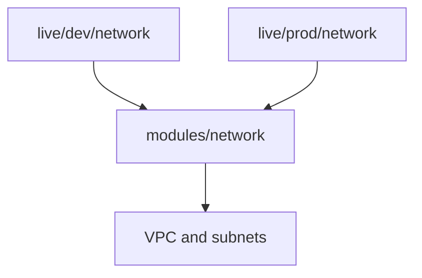

## Why this matters

A single directory of copied security groups and subnets works until the second environment. Then every fix is applied twice, or once and forgotten. Modules are how Terraform packages a pattern: inputs in, resources managed, ids out. The root module for dev and the root module for prod should call the same module at a pinned version and differ in variables, not in pasted HCL.

CodeCraft's network shape repeats: a VPC, public subnets for load balancers, private subnets for tasks and the database, and a place for content storage. That is a module. The ECS service shape repeats too. If those modules expose every AWS argument, callers drown. If they expose nothing, callers fork them. The design problem is the interface.

Interviewers ask where you draw module boundaries and how you version them. "We put everything in one module" and "every resource is its own module" are both failures you should be able to explain.

## Intuition

A module is a function whose body is infrastructure. Variables are arguments. Outputs are return values. The calling module does not reach into the child's resources except through outputs. That rule keeps refactors possible: you can replace a NAT gateway implementation inside the module without editing every caller, as long as the subnet ids still come out.

A child module has its own resources in the same state file as the caller. Modules do not create a separate state unless they are separate root modules with separate backends. This distinction causes real bugs. People hear "module" and think "separately applied project." A child module is a namespaced set of resources in one apply. A separate root module is a separate state, a separate plan, and a separate pipeline. Use child modules for reuse. Use separate roots for blast radius, which the state lesson already split into network, data, and app.

## Core concept in depth

### The interface

Keep variables few and named for the caller's intent. `vpc_cidr` and `az_count` are intent. A variable that is the entire AWS resource schema is a pass-through that means the module is not earning its keep. Give types. Use `string`, `number`, `bool`, `list`, and `map` rather than leaving everything untyped. Set defaults only for values you would bet a production incident on. `enable_nat_gateway` defaulting to true is a cost bug waiting for a dev account. Default it to false and let prod turn it on.

Validate variables when a bad value would create a painful plan. A CIDR that is not a CIDR should fail at plan, not at the AWS API twenty minutes into apply.

Outputs should be the ids and names other stacks need: subnet ids, security group ids, the bucket name. Do not output the whole resource object out of habit. Do not output secrets unless the caller truly must receive them, and mark those outputs sensitive.

Document the module with a short README and an `examples/` directory that is itself a tiny root module. An example that is not planned in CI will rot.

### Composition for CodeCraft

A sensible layout in one repository:

| Path | Kind | Responsibility |
| --- | --- | --- |
| `modules/network` | Child | VPC, subnets, route tables |
| `modules/ecs_service` | Child | Task definition shell, service, IAM to pull images |
| `live/dev/network` | Root | Calls network module, dev CIDRs, dev state key |
| `live/prod/network` | Root | Same module, prod CIDRs, prod state key |
| `live/dev/app` | Root | Calls ecs module, reads network outputs |

The live directories are thin. They hold backend config, provider, variables for that account, and module calls. If a live directory grows its own security groups and buckets, the module boundary has already failed.

The app root should not copy the VPC id from a human's notes. It should take a variable set by CI from the network stack's output, or read a non-sensitive parameter the network stack publishes. Coupling the app root to the entire network state file pulls secrets and a bigger IAM grant than you need.

### Sources and versions

Modules in the same repo are called with a relative path. That is the right default while one team owns callers and module. You change both in one pull request, and the plan shows the effect.

Modules shared across repositories come from a git URL or a registry, pinned to a version or a commit. An unpinned git source that tracks a branch will change production the next time someone inits. Pin a tag. Renovate or a scheduled job opens the bump as a pull request so the plan is reviewed.

A module version bump is an application change. Treat it like a library bump: read the changelog, read the plan, especially for destroys. Registry modules from strangers are supply chain. Prefer modules you can read. HashiCorp's official modules are common and large. Read the variables you set and the resources they create before you adopt one. A "VPC module" that also creates a dozen endpoints you did not ask for will surprise your bill.

### Addresses inside modules

Resources in a child module are addressed from the root as `module.network.aws_subnet.private["ap-south-1a"]` when the subnet uses `for_each`. State mv and import use that full address. Renaming the module call from `network` to `vpc` is a state move of every resource inside it, or a destroy and recreate. Rename with `moved` blocks so the plan stays empty.

`moved` blocks are how you refactor without downtime. They record the old address and the new one. After one apply you can leave them for a release or remove them once every environment has applied. Removing them too early in prod, while dev has applied and prod has not, makes prod plan a destroy. Keep the block until all roots have applied.

### What does not belong in a module

Provisioners that SSH and run shell do not become safer inside a module. They become a hidden shell script. User data or a task definition belongs in the module only if it is the product. A module that silently opens `0.0.0.0/0` on port 22 is a defect, not a convenience default.

Provider configuration belongs in the root, not buried in a child, except for the rare module that must declare its own provider requirements. Children inherit the caller's provider. Aliases for a second region are passed explicitly. Implicit provider magic is how a replica gets created in the wrong region.

## Diagram / flowchart



### Dry-run: change private subnet tags inside the module

| Environment | What happens |
| --- | --- |
| Dev root plan | In-place tag update on each private subnet |
| Prod root, not yet bumped | No change, still on the old module revision |
| Prod pull request bumps the module ref | Same tag update, reviewed separately |
| Module renamed without `moved` | Plan destroys subnets and creates new ones |

The fourth row is the outage. Subnet replacement breaks ENIs, load balancers, and database subnet groups that cited the old ids.

### Interface smells

| Smell | Why it hurts | Better shape |
| --- | --- | --- |
| Fifty pass-through variables | Callers rewrite AWS | A smaller opinionated module |
| No outputs | Callers hard-code ids | Output the ids you expect to share |
| `create_everything` boolean maze | Untestable combinations | Two modules or one honest feature flag |
| Root full of resources plus modules | No boundary | Move the resources in or delete the module |
| Unpinned git branch | Surprise plans | Pin a tag or a commit |

## Code

A small network module and a root that calls it. The module creates the VPC and one public subnet so the example stays readable. A real module loops subnets with `for_each` over a map of AZ to CIDR.

```hcl
variable "name" {
  type = string
}

variable "vpc_cidr" {
  type = string
}

variable "public_subnet_cidr" {
  type = string
}

resource "aws_vpc" "this" {
  cidr_block           = var.vpc_cidr
  enable_dns_support   = true
  enable_dns_hostnames = true

  tags = {
    Name = var.name
  }
}

resource "aws_subnet" "public" {
  vpc_id                  = aws_vpc.this.id
  cidr_block              = var.public_subnet_cidr
  map_public_ip_on_launch = true

  tags = {
    Name = "${var.name}-public"
  }
}

output "vpc_id" {
  value = aws_vpc.this.id
}

output "public_subnet_id" {
  value = aws_subnet.public.id
}
```

The root module:

```hcl
module "network" {
  source = "../../../modules/network"

  name                = "codecraft-dev"
  vpc_cidr            = "10.20.0.0/16"
  public_subnet_cidr  = "10.20.1.0/24"
}

output "vpc_id" {
  value = module.network.vpc_id
}
```

The string interpolation inside the module's tags uses HCL expression syntax. It stays in the module file, not in the root, so callers pass a name and do not assemble AWS tag strings themselves.

A `moved` block in the root after renaming the call from `vpc` to `network`:

```hcl
moved {
  from = module.vpc
  to   = module.network
}
```

Then:

```bash
terraform fmt -recursive
terraform init
terraform plan -out=tfplan
```

You want a plan with no destroys on the rename. You want tag updates, not subnet replacements, on the module change. If init cannot find the module, the source path is wrong relative to the root, not relative to your shell's current directory. Terraform resolves module sources from the file that contains the module block.

## Complexity analysis

| Choice | Benefit | Cost |
| --- | --- | --- |
| Relative modules in one repo | One PR shows caller and implementation | Harder to share with another repo |
| Versioned registry module | Clear upgrades, reusable | Slower iteration, supply-chain review |
| One mega-module | Fewer calls | Every change plans the world |
| One module per resource | Maximum reuse on paper | No abstraction, painful calls |
| Separate root modules | Blast radius | Wiring outputs between them |
| `moved` blocks | Refactor without replace | Must stay until every env applies |

Child modules do not reduce apply time by themselves. They organize the graph. The graph is still one apply. If you need independent lifecycles, you need another root and another state key, not another folder.

## Tricks, tips and patterns

- Name the module call for the role: `network`, `api`, `content_bucket`. The call name is part of every resource address.
- Put `versions.tf` inside reusable modules with `required_providers` so a consumer's init fails clearly, but do not put a `backend` block in a child. Backends belong only in roots.
- Example directories should run `terraform validate` in CI even if they never apply.
- Use `for_each` on the module block itself when you create one service per name. The module address includes the key, which stays stable.
- Output maps of subnet ids keyed by AZ, not a list whose order can drift.
- Keep feature flags few. A module with eight booleans has 256 behaviors and one test.
- When adopting a public module, vendor the source or pin a commit you have read. A tag can be moved on some git hosts.
- Write the module's destruction story. If deleting the module call destroys a database, the root README should say so in the first screen.

## Common mistakes and edge cases

- A `backend` block inside a child module. Init fails or, worse, you thought you had separate state and you do not.
- Changing `source` from a local path to a registry without a state move. Addresses may stay the same if the call name stays, but resources the new module does not declare will be destroyed.
- Defaults that open SSH to the world or create NAT gateways in every dev account.
- Outputting a password into logs because it was not marked sensitive. It is still in state either way.
- Two roots calling one module against the same AWS names. They fight. Modules do not reserve global names for you. Pass distinct `name` prefixes.
- Removing a `moved` block before prod applies the move.
- A module that requires a provider alias the root does not pass, so a replica is created in the primary region and you notice on the bill.
- Copy-paste of the module into `live/prod` "just this once." You now have two implementations.

## Interview notes

**What is the difference between a child module and a separate root module?**
A child module is namespaced resources in the caller's state and the caller's apply. A root has its own backend and its own plan. Use children for reuse and roots for blast radius.

**How do you version modules?**
Same repository and a relative source while one team changes both sides together. Across repositories, pin a git tag or a registry version and review the plan on bump. Do not track a branch.

**A rename of the module call wants to rebuild the VPC. What happened?**
The address changed, so state does not match. Add a `moved` block from the old call to the new one and plan again. You want no destroys.

**How do you stop a module from becoming a pass-through of the entire AWS API?**
Expose intent-level variables, opinionated safe defaults, and a small set of outputs. If callers must set fifty AWS fields, the module is not an abstraction.

**Where should CodeCraft put the VPC?**
In `modules/network`, called from thin `live/dev/network` and `live/prod/network` roots with different CIDRs and different state keys.

## Practice problems

1. Extract the artifact bucket from the fundamentals lesson into a module with a name variable and a bucket name output. The root should contain no `aws_s3_bucket` resource of its own.
2. Rename the module call and show the `moved` block that keeps the plan empty.
3. A public VPC module defaults NAT gateways to on. What does that cost in a dev account with three AZs, and what default would you ship instead?
4. Explain why the app root and the network root should not share a state file even though they both call modules from the same repository.
5. A module outputs a database password into the CI log. What flag marks the output, and where does the password still exist?

## Summary / cheat sheet

- Child modules reuse code inside one state. Root modules split state and pipelines.
- Variables are intent. Outputs are the ids callers need. Defaults must be safe.
- Pin cross-repo sources. Relative paths are fine inside one repo.
- Module call names are part of addresses. Rename them with `moved`.
- No backends inside children. Providers are configured in the root.
- CodeCraft: `modules/network` and `modules/ecs_service`, thin live roots per environment.
- A module bump is a reviewed plan, especially when the plan destroys.

## Further reading

- [Terraform modules](https://developer.hashicorp.com/terraform/language/modules)
- [Module sources](https://developer.hashicorp.com/terraform/language/modules/sources)
- [moved blocks](https://developer.hashicorp.com/terraform/language/modules/develop/refactoring)
- [Standard module structure](https://developer.hashicorp.com/terraform/language/modules/develop/structure)
- [Terraform Registry publishing](https://developer.hashicorp.com/terraform/registry/modules/publish)
