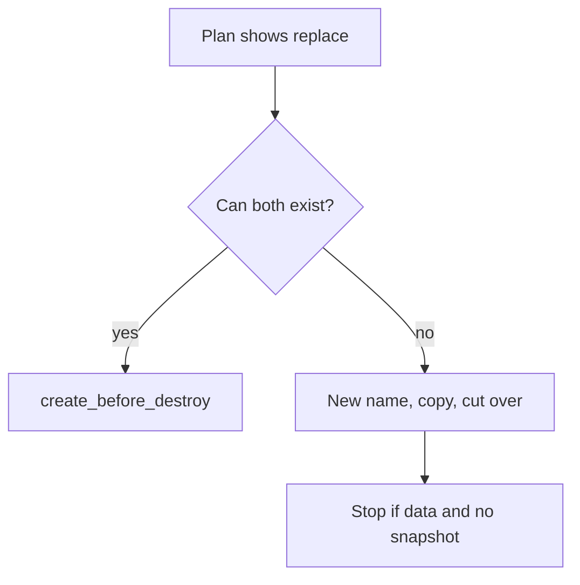

## Why this matters

Most Terraform outages are not syntax errors. They are plans that replace a database, a load balancer, or a volume because one argument cannot be updated in place. The graph usually does the right order. Lifecycle rules exist for the cases where the default order destroys the thing users are still using, or where something outside Terraform keeps editing a tag and you are tired of reverting it.

Provisioners, especially remote-exec over SSH, look like an escape hatch and become untested shell scripts that do not run on the next apply. CodeCraft's API image should be configured by the task definition, user data, or an entrypoint, not by Terraform SSHing into a box after create.

You need to read a replace plan, decide whether `create_before_destroy` is even possible, and know when `ignore_changes` is an honest boundary versus a way to hide drift forever.

## Intuition

Terraform draws an edge from A to B when B mentions A. It creates A first and destroys B first, so dependents do not point at nothing. That rule is enough for a bucket and its versioning configuration.

It is not enough when a security group and an instance must swap names, or when a launch template change replaces instances that are in a target group. `create_before_destroy` tells Terraform to create the replacement, move dependents, and only then destroy the old object. It only works if the two objects can exist at once. Two S3 buckets can. Two resources that must share one global name cannot, unless you also change the naming scheme.

`ignore_changes` is a promise that Terraform will not fight a particular argument. Use it when an autoscaler or a deploy tool owns that field. Do not use it because a plan was noisy and you wanted it to go green.

## Core concept in depth

### The graph you get for free

A reference to an attribute is a dependency. The versioning resource that takes the bucket id depends on the bucket. Terraform will not create versioning first. You do not add `depends_on` for that.

`depends_on` is for hidden edges: a policy that must exist before an API call that does not reference the policy's id, or a wait for an IAM propagation that the provider should have handled and did not. Every `depends_on` you add serializes the graph and can pull extra resources into a replacement chain. When B depends on A and A is replaced, B may be updated or replaced too. Extra edges make blasts bigger. Add them when you can name the race, not as a habit.

Data sources are read during refresh. A data source that looks up a security group created in the same apply can fail because the lookup runs before the create. Prefer a direct reference to the resource in the same state. Use data sources for objects this state does not manage.

### ForceNew and replace

Provider docs mark some arguments ForceNew. Changing them is a replace: destroy and create. RDS identifier, some subnet fields, and many IAM name fields behave this way. The plan shows `-/+` and, if you are lucky, which argument caused it.

Before you apply a replace of anything with data:

1. Can the new object exist beside the old one?
2. How does data move?
3. What still points at the old id, and will Terraform update those pointers after the new id exists?
4. Is there a snapshot?

If the answer to the first question is no, `create_before_destroy` cannot save you. You need a migration: new name, copy, cut over, then remove the old address in a later apply.

### create_before_destroy

Set it on the resource that will be replaced when you need the new one up first. Classic case: a security group used by an instance, or a launch template used by an autoscaling group, where the new group must be attached before the old group is deleted.

The new and old objects exist together for a while. AWS names, S3 bucket names, and IAM role names must not collide. Include a stable prefix and accept that the physical name may have a suffix, or change only arguments that are not the name.

`create_before_destroy` does not make a database replacement safe. A second RDS instance is a new empty database unless you restore a snapshot on purpose and repoint the application. Lifecycle is not a backup.

### prevent_destroy

`prevent_destroy` makes Terraform error instead of destroying the resource. It is a seatbelt for state files that include a production database or the content bucket. It does not stop a human in the console. It does not stop you from removing the flag and applying. It does stop a sloppy plan in CI if the pipeline fails on the error.

Put it on data stores. Do not put it on every security group, or routine refactors become an argument with the seatbelt.

### ignore_changes and replace_triggered_by

`ignore_changes` lists arguments Terraform should not try to correct. A common honest use is a desired count that an autoscaler owns, or a task definition image tag that CI updates on every deploy. If Terraform and the deploy pipeline both set the image, they will fight. Pick one owner. Ignore the field in Terraform or stop setting it in Terraform and pass it only from the pipeline.

Ignoring `tags` because the console is messy means you have abandoned tags. Either import the tag scheme into code or accept that Terraform will revert console tags. The second option is healthier.

`replace_triggered_by` forces a replace when another resource changes. Use it sparingly, for cases like "a new TLS certificate resource should roll the listeners." A casual trigger replaces production on unrelated edits.

### Provisioners

`local-exec` and `remote-exec` run after create. They do not run again unless the resource is replaced. They are invisible to the plan's main diff. They fail in ways that taint the resource. They require SSH keys or local binaries in CI.

Prefer, in order: a real resource argument, user data or a container entrypoint, an SSM document, a separate small application step in CI. If you still need `local-exec`, it should be a notification or a label, not the thing that configures the server.

`null_resource` with a provisioner is the older form of "run this script when this value changes." `terraform_data` is the modern trigger object. Both are still imperative. Keep them at the edge.

Tainted resources are Terraform's memory that a create's provisioner failed. A tainted address will be replaced on the next apply. Untaint only if you have fixed the object by hand and accept responsibility. Replacing a tainted instance is usually right. Replacing a tainted database is a disaster. Do not attach risky provisioners to data stores.

## Diagram / flowchart



### Dry-run: replace a task security group

| Order | Default destroy-first | create_before_destroy |
| --- | --- | --- |
| 1 | Destroy old group | Create new group |
| 2 | Tasks lose the group or the destroy fails because ENIs still use it | Point the service at the new group |
| 3 | Create new group and hope | Destroy the old group |
| Failure | Apply stuck on dependency violation | Two groups exist briefly, names must differ |

The default often fails halfway, which is safer than deleting a database and worse than a clean cutover. Read the error. Do not mash apply.

### Ownership of fields

| Field | Owner | Terraform behavior |
| --- | --- | --- |
| VPC CIDR | Terraform | Replace if it changes, so do not change it casually |
| RDS password | Terraform or a rotation tool | If both, they fight. Pick one. |
| ECS desired count | Autoscaler or Terraform | Ignore in Terraform if the scaler owns it |
| Image tag | CI deploy | Prefer the deploy tool, not a Terraform apply, for every release |
| Bucket versioning | Terraform | In place update |

## Code

Lifecycle on a production database and a security group that must be replaced cleanly. The database refuses destroy. The security group can exist twice, so create-before-destroy is legal. Names include a prefix so the pair does not collide.

```hcl
resource "aws_db_instance" "app" {
  identifier             = "codecraft-prod"
  engine                 = "postgres"
  instance_class         = "db.t4g.micro"
  allocated_storage      = 20
  username               = "codecraft"
  password               = var.db_password
  skip_final_snapshot    = false
  final_snapshot_identifier = "codecraft-prod-final"

  lifecycle {
    prevent_destroy = true
  }
}

resource "aws_security_group" "api" {
  name_prefix = "codecraft-api-"
  vpc_id      = var.vpc_id

  lifecycle {
    create_before_destroy = true
  }
}
```

`name_prefix` lets AWS append a unique suffix so the new group can exist before the old one is deleted. A fixed `name` often makes `create_before_destroy` fail with "already exists."

Ignore a desired count owned by an autoscaler:

```hcl
resource "aws_ecs_service" "api" {
  name            = "codecraft-api"
  desired_count   = 2
  task_definition = aws_ecs_task_definition.api.arn

  lifecycle {
    ignore_changes = [desired_count]
  }
}
```

If you also ignore `task_definition`, Terraform will not roll the task when you change CPU or environment. Ignore the smallest list that matches the other owner. Do not ignore the whole resource.

Prove the graph order:

```bash
terraform plan -out=tfplan
terraform show tfplan
```

Search the human-readable plan for "must be replaced" and for the argument name. Then decide. A CI job can fail the pipeline when the plan contains a delete on addresses that match the database. That is a better seatbelt than memory.

There is intentionally no `remote-exec` in this lesson's code. If a pull request adds one to configure the API after boot, send it back. Put the setting in the task definition or the image.

## Complexity analysis

| Rule | Protects | Breaks when |
| --- | --- | --- |
| Default graph | Order of create and destroy | The dependency is invisible, so you need `depends_on` |
| `create_before_destroy` | Downtime and in-use deletes | The name must be unique and both copies cannot exist |
| `prevent_destroy` | Accidental database delete in Terraform | Someone removes the flag, or deletes in the console |
| `ignore_changes` | Fights with autoscalers and deploy tools | You ignore the field you meant to manage |
| `replace_triggered_by` | Roll dependents when a cert or config changes | It rolls them when you did not expect |
| Provisioners | Almost nothing you cannot do another way | They do not re-run, they taint, they hide in the graph |
| `depends_on` everywhere | A feeling of control | Larger replacement chains |

Lifecycle does not change AWS recovery. Snapshots, Multi-AZ, and a tested restore do that. A `prevent_destroy` database with no snapshot is still one console click from data loss.

## Tricks, tips and patterns

- Read ForceNew in the provider docs before you change an identifier "just in dev," because the same config will be applied in prod.
- Prefer `name_prefix` over `name` on security groups you expect to replace.
- Keep `prevent_destroy` on data resources in prod roots. Omit it in ephemeral dev if it blocks teardown, and make dev teardown an explicit `destroy`, not a shared habit with prod.
- Pair `skip_final_snapshot = false` with the lifecycle seatbelt. A destroy that is blocked is good. A destroy that is allowed and skips the snapshot is how backups do not exist.
- Use `terraform apply -refresh-only` to update state to match the console when you have decided the console was right. Do not mix that with an infrastructure change in the same plan.
- Targeted applies (`-target`) are break-glass. They skip the full graph and leave state half-applied relative to config. Follow them with a normal plan.
- When IAM changes seem to succeed but the task cannot assume the role, you are waiting on IAM propagation, not on a missing `depends_on`. A retry of the task start is the fix. A depends_on does not sleep.
- Delete provisioners in review the way you would delete a curl pipe to a shell.

## Common mistakes and edge cases

- `create_before_destroy` on a bucket with a fixed global name. The new create fails because the name is taken by the old one. The apply stops. The old bucket is still there, which is the lucky outcome.
- `ignore_changes` on the password after a rotation in Terraform, so the database never receives the new password, or the opposite: Terraform resets a password the rotation tool just changed and breaks the app.
- A provisioner that seeds a database. It runs once. The second environment is empty and nobody knows why.
- `depends_on` the entire module, so any change inside it updates every dependent and the plan becomes unreadably large.
- Removing `prevent_destroy` in the same change as a refactor that destroys the instance. Reviewers see a noisy plan and miss the database line.
- Tainting to "force a restart." On ECS, update the service. On a VM, replacing it may be fine. On RDS, taint is unacceptable.
- Assuming destroy order will detach ENIs for you every time. Sometimes the provider needs an explicit detach or a longer timeout. Read the error. Do not unlock state and run a second apply on top of a confused first one without reading state.

## Interview notes

**When do you set `create_before_destroy`?**
When a replace must bring the new object up before the old one is deleted, and both can exist. Security groups with a name prefix are the textbook case. A uniquely named database cannot use it to dodge a replacement. You migrate instead.

**What does `prevent_destroy` not do?**
It does not stop the AWS console, an IAM admin, or a future commit that removes the lifecycle block. It makes this Terraform configuration refuse to destroy the resource.

**Why are provisioners discouraged?**
They are imperative, they do not show up as a clean diff, they run on create rather than on every relevant change, and failure taints the resource. User data, task definitions, and CI steps are easier to test.

**A plan replaces the RDS instance because the identifier changed. Walk through the response.**
Do not apply. Revert the identifier or introduce a second instance with a snapshot restore and a cutover. `create_before_destroy` does not copy data. `prevent_destroy` should have made a careless apply fail.

**When is `ignore_changes` correct for CodeCraft?**
When an autoscaler owns `desired_count` or the deploy pipeline owns the image tag. It is not correct as a way to silence a tag diff you should have encoded.

## Practice problems

1. A security group with a fixed `name` and `create_before_destroy` fails apply with "already exists." Change the naming so the rule can work, and say what the plan should show.
2. ECS desired count is 2 in Terraform and 6 in the cluster after a scale-out. What happens on the next apply if you do not ignore the field? What should own the field?
3. Someone adds `remote-exec` to seed lesson content into a new account. Replace that design with one that does not SSH.
4. Explain a hidden dependency that actually needs `depends_on`, and one that only feels like it does.
5. `prevent_destroy` is set and a refactor removes the database resource. What does apply do, and what should the reviewer demand before the flag is deleted?

## Summary / cheat sheet

- References build the graph. `depends_on` is for hidden edges only.
- ForceNew means replace. Read it before you apply.
- `create_before_destroy` requires two copies to coexist. Use name prefixes.
- `prevent_destroy` guards state-driven deletes of data. It is not a backup.
- `ignore_changes` documents another owner. It is not a silencer.
- Provisioners are a last resort. Prefer real resources and images.
- A replace of RDS is a migration project, not a lifecycle flag.
- Fail CI on unexpected destroys of data addresses.

## Further reading

- [Terraform lifecycle meta-argument](https://developer.hashicorp.com/terraform/language/meta-arguments/lifecycle)
- [depends_on](https://developer.hashicorp.com/terraform/language/meta-arguments/depends_on)
- [Provisioners](https://developer.hashicorp.com/terraform/language/resources/provisioners/syntax)
- [terraform_data](https://developer.hashicorp.com/terraform/language/resources/terraform-data)
- [AWS provider ForceNew behavior in resource docs](https://registry.terraform.io/providers/hashicorp/aws/latest/docs)
