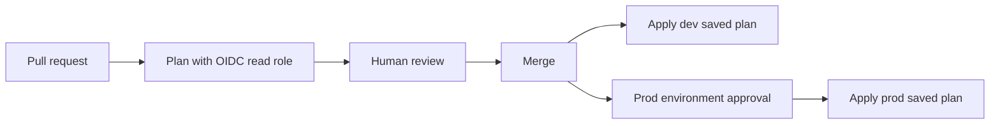

## Why this matters

A correct module pointed at the wrong account is how a Tuesday experiment becomes a production change. Environments are a state and identity problem: which backend key, which AWS role, which variable values. Workspaces are one Terraform feature that looks like it solves this and often does not. CI is the place the decision becomes real, because production apply should not be a laptop with an admin key.

CodeCraft needs at least a dev account and a prod account, a plan on every pull request, and an apply that runs only after review. The pipeline assumes a role with OpenID Connect. It does not store an access key in GitHub. The plan that reviewers read is the plan that apply executes.

This lesson closes the Terraform sequence: fundamentals, state, modules, lifecycle, then the promotion path.

## Intuition

An environment is a complete set of names, credentials, and state. Dev and prod should be allowed to disagree on instance size and not on whether the database is protected. The safest way to get that is two root directories, or one directory applied twice with explicit backend config and var files, each against its own state key and its own AWS account.

A Terraform workspace is a named state prefix inside one backend. `terraform workspace select prod` swaps the state key suffix. The configuration is the same. Nothing in the language stops you from selecting prod and applying with dev credentials, or selecting the default workspace in CI because you forgot the command. Separate directories and separate CI jobs make the mistake louder.

CI's job is to make the quiet path the correct path. Format, validate, lint, plan, comment, require a human for prod, apply the saved plan, and fail if the plan was regenerated under different credentials.

## Core concept in depth

### Workspaces, precisely

`terraform workspace new dev` creates a separate state for the same configuration. The default workspace is named `default`. Resources can read the active workspace name and branch on it. That branch is how one directory tries to be both environments: smaller tasks in dev, deletion protection in prod. It works until a typo in the condition protects the wrong one, or a data source lookup uses the wrong name prefix.

Workspaces share one backend configuration and usually one provider configuration unless you also switch roles. They do not give you separate IAM, separate accounts, or separate approval. They are useful for short-lived feature stacks with identical shape, such as a preview VPC per branch that is destroyed on merge. They are a weak fit for prod versus dev.

Prefer this layout, which matches the modules lesson:

| Path | Account | State key | Apply job |
| --- | --- | --- | --- |
| `live/dev/network` | dev | `dev/network/terraform.tfstate` | Automatic after merge is acceptable |
| `live/prod/network` | prod | `prod/network/terraform.tfstate` | Manual approval |
| `live/dev/app` | dev | `dev/app/terraform.tfstate` | Automatic or light review |
| `live/prod/app` | prod | `prod/app/terraform.tfstate` | Manual approval |

Same module source. Different variables. Different roles. A workspace flag is not required.

If you inherit a workspace-based repo, do not mix styles in one directory. Print the workspace name in every CI log. Fail the job if the name is `default` and the job claimed to be prod.

### Variables per environment

`terraform.tfvars` for an environment can be committed when it contains only sizes, CIDRs, and names. Secrets are not in tfvars. Passwords come from a secret manager the task reads at runtime, or from a CI secret injected as a sensitive variable for the rare resource that truly needs it at apply time. A database password in a tfvars file in git is a leaked password, even in a private repo.

Use a variable `environment` with a validation that allows only `dev` and `prod`. Use it in name prefixes so a dev apply cannot create an object whose name collides with prod. Account separation is still the real barrier. Name prefixes are the seatbelt when someone uses the wrong profile in a single account, which is a design you should be leaving.

### The pipeline

On every pull request that touches Terraform:

1. `terraform fmt -check -recursive` so style is not a review comment.
2. `terraform init -backend=false` or init against the dev backend with read-only credentials for validate. Validate does not need to apply.
3. `tflint` and a policy tool such as Checkov or tfsec. These catch open security groups, unencrypted buckets, and missing versioning. They do not understand your business. A finding you waive needs a one-line reason in the repo.
4. `terraform plan -out=tfplan` using the dev role for dev roots and, for prod roots, a plan-only role that cannot apply.
5. Post the plan summary on the pull request. Truncate huge plans and upload the full log as an artifact.

On merge to the main branch, a dev job may `terraform apply tfplan` if the plan artifact is the one just approved. Prod waits for an environment protection rule: a named reviewer approves the GitHub environment, then the prod job assumes the prod role and applies.

Do not run `apply -auto-approve` on a fresh plan computed minutes later with different variables. Save the plan, store it as an artifact, apply that file. Plans expire. If the file is stale, fail and re-plan. Do not shrug and apply whatever the new plan says.

`-auto-approve` belongs only inside the CI job after those gates. It does not belong in a human's shell alias.

### OIDC instead of access keys

GitHub Actions can request an OIDC token for the workflow. AWS STS exchanges that token for short-lived credentials if the IAM role's trust policy allows that repository, that branch, and that environment. Prod roles trust only the prod environment and the main branch. Dev roles do not trust pull requests from forks.

A long-lived `AWS_ACCESS_KEY_ID` in repository secrets will leak eventually, and it will not tell you which workflow used it. OIDC credentials last minutes. The trust policy is the allow-list.

The role for plan needs read access to the services you manage plus read and lock access to state. The role for apply needs write on those services. Split them if you can. A plan role that can delete RDS is a plan role in name only.

Lock the state. Two jobs applying the same key will fail the lock, which is the correct failure. Serialize prod applies. Do not force-unlock from CI.

### Policy and drift

Scheduled jobs can run `terraform plan` on prod every night and notify if the plan is non-empty. That is drift detection. It is not an invitation to auto-apply at 03:00. Someone changed the console or a resource is fighting `ignore_changes`. Read it in the morning.

A policy failure on an existing estate should be fixed forward or waived with an expiry. A waiver with no expiry becomes the new default, and the tool is noise.

Terraform Cloud and similar products wrap this same loop: remote plans, policy, approvals. You do not need them to do CodeCraft correctly. You do need the loop. If a company already pays for a platform, use its approval gates rather than inventing a second one.

## Diagram / flowchart



### Dry-run: change a dev task size

| Step | Role | State key | Writes to AWS? |
| --- | --- | --- | --- |
| PR plan for `live/dev/app` | dev plan role | `dev/app` | No |
| Policy scan | none | none | No |
| Merge | — | — | Not yet |
| Dev apply of saved plan | dev apply role | `dev/app` | Yes, dev account |
| Prod plan | prod plan role | `prod/app` | No, until someone changes prod variables |

A pull request that only changes `live/dev` must not assume the prod role. Scope the workflow by path filters so a docs edit does not plan the world, and so a prod file change cannot hide inside a dev job.

### What each gate catches

| Gate | Catches | Does not catch |
| --- | --- | --- |
| `fmt -check` | Noisy diffs | Wrong CIDR |
| `validate` | Bad references | A replace of RDS |
| Checkov or tfsec | Open CIDR, no encryption | A correct but expensive NAT in dev |
| Saved plan review | Destroys and replaces | A plan against the wrong account if the role was already wrong |
| OIDC trust on main only | A fork PR applying prod | A compromised maintainer on main |
| Environment approval | Unreviewed prod apply | A bad approval |

## Code

Path-scoped workflow shape. The token exchange uses GitHub's OIDC subject. The role ARN is an environment secret so prod and dev cannot share it. The expression that reads the secret stays inside the workflow file, which is a fenced example, not prose you copy into Markdown.

```yaml
name: terraform-dev-app
on:
  pull_request:
    paths:
      - "live/dev/app/**"
      - "modules/**"
  push:
    branches: [main]
    paths:
      - "live/dev/app/**"
      - "modules/**"

permissions:
  id-token: write
  contents: read
  pull-requests: write

jobs:
  plan:
    runs-on: ubuntu-latest
    steps:
      - uses: actions/checkout@v4
      - uses: aws-actions/configure-aws-credentials@v4
        with:
          role-to-assume: arn:aws:iam::111111111111:role/codecraft-terraform-dev-plan
          aws-region: ap-south-1
      - uses: hashicorp/setup-terraform@v3
        with:
          terraform_version: "1.10.5"
      - name: init and plan
        working-directory: live/dev/app
        run: |
          terraform init -input=false
          terraform fmt -check -recursive
          terraform validate
          terraform plan -input=false -out=tfplan -no-color
```

The apply job should download the same `tfplan` and run `terraform apply -input=false tfplan`. It should use the apply role, not the plan role. Prod is a second workflow with `environment: production` so GitHub's required reviewers run before any step assumes the prod role.

Local commands you still want:

```bash
terraform -chdir=live/dev/app init
terraform -chdir=live/dev/app plan -var-file=dev.tfvars
```

`-chdir` keeps scripts from depending on the caller's working directory. CI should use it or set `working-directory`. Do not `cd` in a long script and then plan the wrong root.

A trust policy for the dev apply role allows only this repository and only the main branch or the protected environment. A trust policy that allows any repository in the account is a stolen OIDC token away from your VPC. Scope the subject.

Checkov in the same job:

```bash
checkov -d live/dev/app --quiet
```

Start by failing on high severity findings you agree with, such as an S3 bucket without public access blocked. Do not fail the first week on every style rule or the team will disable the job.

## Complexity analysis

| Approach | Isolation | Operational cost |
| --- | --- | --- |
| One workspace switch | Weak. Same code, easy to select the wrong name | Lowest |
| Var files plus one backend | Medium, if keys differ | Easy to point both at one key |
| Separate roots and accounts | Strong | More pipelines, which you want |
| Apply from laptops | None | Audit trail is "who remembers" |
| Plan and apply different commits | Dangerous | Looks fast, reviews a lie |
| Nightly drift plan | Good signal | Noisy if console edits are common |
| Terraform Cloud | Strong gates if you configure them | Cost and a second control plane |

The expensive mistake is a prod apply from a plan that was computed with dev variables. Bind the plan file to the job, the role, and the directory. Put the state key in the log line before any create happens.

## Tricks, tips and patterns

- Pin `terraform_version` in CI to the same minor line as `required_version`.
- Use GitHub environments for prod approval, not a comment that says "LGTM" on the plan.
- Path filters must include `modules/**` or a module change will not plan the live roots that call it. The inverse bug is planning nothing. A weekly full plan catches that.
- Give plan and apply different roles. Log the role ARN at the start of the job.
- Fail if `git status` is dirty after `fmt`. Do not let CI rewrite files on the apply branch silently.
- Store `tfplan` as an artifact with a short retention. It can contain sensitive values. Do not commit it.
- For preview environments, workspaces or a per-branch state key plus a destroy job on pull request close is reasonable. Never use that pattern for prod.
- Run policy tools on the module directory too, not only on live roots, or the bad security group lives in the module and every environment inherits it.

## Common mistakes and edge cases

- `workspace select prod` locally while `AWS_PROFILE` is dev, or the reverse. Account and workspace are independent. That is the footgun.
- Auto-approve in CI on a plan computed after the merge of a second, unrelated change. Apply the reviewed file.
- A pull request from a fork that receives OIDC for prod. Trust only the protected environment, and do not expose secrets to fork workflows.
- Sharing one state key across workspaces by misconfiguring the backend so the workspace prefix is ignored. Always read the key Terraform prints during init.
- Policy exceptions with no owner. Six months later nobody knows why SSH is open.
- Running `terraform destroy` in the prod job because a variable `action` was set wrong. Do not parameterize destroy. Make it a separate workflow you cannot trigger by editing a tfvars boolean.
- Init against prod state from a pull request so the plan works, using a role that can also apply. Plan credentials will be abused the day a pull request is malicious.
- Ignoring a failed lock and starting a second apply with force-unlock in the script. Serialize instead.

## Interview notes

**Workspaces or separate directories for prod and dev?**
Separate directories or separate roots, separate state keys, and separate accounts. Workspaces only switch state inside one backend and make it easy to apply the same code to the wrong place. Workspaces fit preview stacks, not the prod boundary.

**How does CI authenticate to AWS?**
OIDC. The workflow requests a token, STS assumes a role whose trust policy names this repo and the prod environment, and the credentials expire. No long-lived access keys in GitHub secrets.

**Why apply a saved plan file?**
The reviewed diff and the applied diff must be the same bytes. A later `apply` with no plan file computes a new plan that reviewers have not seen.

**What should a prod gate include?**
A plan-only role, a human approval on the protected environment, an apply role that is not used by pull requests, state locking, and a policy check for open networks and unencrypted storage.

**A module change did not produce a plan. Why?**
The workflow path filter watched `live/**` and not `modules/**`, or the live root pins a registry version and the pull request did not bump it. Fix the filter or the pin, then plan.

## Practice problems

1. Design the state keys and AWS accounts for CodeCraft network and app in dev and prod. Say which jobs may apply without a click and which may not.
2. A workspace-based repo applied prod with the dev AWS profile. What ran, what should have made it impossible, and how do you restructure the roots?
3. Write the difference between a plan role and an apply role in IAM terms. Why is "read-only" not quite enough for plan?
4. Show why applying `terraform apply -auto-approve` after merge, with a fresh plan, can ship a change nobody reviewed.
5. Checkov fails because a dev security group allows the world on port 22. Fix it in the module, not with a waiver, and explain why a waiver in dev would still bite prod.

## Summary / cheat sheet

- Environments are separate state, separate roles, and preferably separate accounts.
- Workspaces are a state prefix, not an account boundary. Prefer thin live roots.
- CI: fmt, validate, lint, policy, plan, review, apply the saved plan.
- Prod apply requires a protected environment approval.
- OIDC to a scoped role. No static AWS keys. Plan role is not the apply role.
- Path filters include modules. Nightly prod plans detect drift and do not auto-apply.
- Never parameterize destroy. Never force-unlock from the pipeline.
- The plan in the pull request is the change. If it is not, the pipeline is wrong.

## Further reading

- [Terraform workspaces](https://developer.hashicorp.com/terraform/language/state/workspaces)
- [GitHub Actions OIDC with AWS](https://docs.github.com/en/actions/security-for-github-actions/security-hardening-your-deployments/configuring-openid-connect-in-amazon-web-services)
- [Automate Terraform with GitHub Actions](https://developer.hashicorp.com/terraform/tutorials/automation/github-actions)
- [Checkov](https://www.checkov.io/1.Welcome/Quick%20Start.html)
- [tflint](https://github.com/terraform-linters/tflint)
