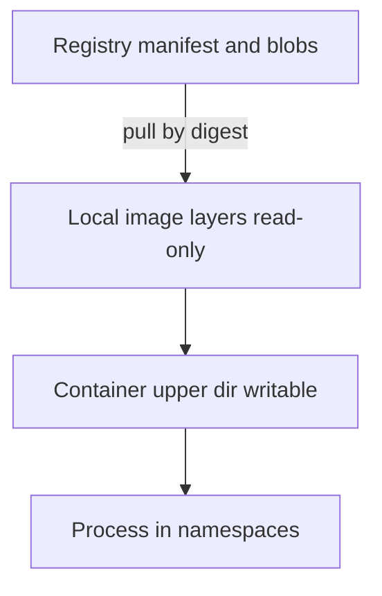

## Why this matters

Every later lesson in this course — Dockerfiles, Compose, Kubernetes, ECS, and the CodeCraft production deploy — assumes you can picture what an image actually is. People say "a container is a lightweight VM." That sentence causes real outages: someone SSHes into a container and patches it, the pod restarts, and the patch vanishes. Or CI "fixes" a flaky build by committing a 900 MB image layer that every deploy must pull.

CodeCraft ships three images. The backend and the sandbox both start from `python:3.12-slim`. The frontend starts from `node:20-alpine` and throws most of that image away in later stages. If those bases share layers, pulling the second image is cheap. If a tag moves underneath you, yesterday's deploy and today's deploy are different software with the same name.

This lesson is the storage and identity model: images, layers, manifests, tags, digests, and the writable layer that makes a container.

## Intuition

An image is a stack of read-only filesystem snapshots, plus a small config that says which program to run. A container is a running process whose root filesystem is that stack, plus one extra writable sheet on top, isolated with Linux namespaces and limited with cgroups.

The sheets are content-addressed. If two images contain the same bytes, they store those bytes once. Tags are nicknames stuck on a particular snapshot. The nickname can be moved. The snapshot's digest cannot.

Think of a git repository. A digest is a commit hash. A tag is a branch name. `docker commit` of a live container is the container equivalent of committing a dirty working tree with no review. You can do it. You should almost never ship it.

## Core concept in depth

### Image, container, and registry

An **image** is an Open Container Initiative (OCI) artifact. It has:

- A **manifest** (or a manifest list) describing the config blob and the layer blobs.
- A **config** JSON: environment, entrypoint, command, working directory, exposed ports, history.
- One or more **layers**, each a tar archive of filesystem changes relative to the layer below.

A **container** is a runtime instance: a process (or a small group of processes) using the image as its root filesystem. Stop the container and the writable layer can be deleted. The image remains.

A **registry** (Docker Hub, Amazon ECR, GitHub Container Registry) stores blobs and manifests. It is not a running environment. ECS and Kubernetes pull from a registry; they do not read your laptop's Docker cache.

### Layers and copy-on-write

Docker on modern Linux uses the `overlay2` storage driver. The image layers are the **lower** directories. The container gets an **upper** directory for writes and a **work** directory for internal overlay bookkeeping. Reads fall through to the highest layer that contains the file. Writes copy the file into the upper directory first (copy-on-write). Deletes create a whiteout marker so the file disappears even though a lower layer still has it.

That is why `RUN rm -rf /secret` does not remove the secret from the image. The secret remains in the lower layer. The whiteout only hides it from the container's merged view. Anyone who exports the layer tar still has the file.

Shared layers are why base images matter. Backend and sandbox both use `python:3.12-slim`. After the first pull, the second image downloads only the layers it does not already have. A unique `RUN pip install` on top is a new layer that cannot be shared.

### Digests, tags, and multi-arch manifests

A tag such as `python:3.12-slim` points at a manifest. Maintainers move the tag when they rebuild. A **digest** (`sha256:` plus 64 hex characters) identifies the manifest bytes. Pull by digest when you need a deploy to be repeatable.

Modern tags often point at a **manifest list** (an index) with one manifest per architecture and OS. `docker pull python:3.12-slim` on an Apple Silicon laptop fetches `linux/arm64`. The same tag on ECS Fargate with the default platform fetches `linux/amd64`. They are different images. A bug that exists only in the arm64 build will never show up in CI if CI runs on amd64, and the reverse. Set the platform explicitly when you build artifacts for AWS:

```text
docker build --platform linux/amd64
```

`docker image inspect` on a tag shows the digest you actually resolved. Record that digest in the release notes or in the deploy pipeline, not only the tag.

### What is not in the image

Namespaces and cgroups are runtime features, not layers. The image does not contain a kernel. Containers on one host share the host kernel. That is the source of both the efficiency and the risk: a kernel exploit is a host exploit, which is why the sandbox lesson cares about seccomp, dropped capabilities, and not mounting the Docker socket for untrusted code.

Environment variables baked with `ENV` live in the image config, which is a separate blob from the layers. They show up in `docker inspect` even when they never appear as files. Treat the config as public.

Volumes and bind mounts are not layers either. The Compose file mounts `./content` into the frontend and backend as read-only. Those files are visible in the container and absent from the image. A production task that forgets the mount will start and then fail when it cannot find the MDX lessons.

## Diagram / flowchart



### Dry-run: two Python images on one host

| Event | Bytes downloaded | What is reused |
| --- | --- | --- |
| Pull `python:3.12-slim` for the backend | Full base | Nothing yet |
| Pull sandbox image that uses the same base plus pinned wheels | Only the pip layer | Slim root filesystem layers |
| Rebuild backend after an app-only change | Nothing from the registry | Base and pip layers in the build cache |
| Deploy to a fresh ECS host | Full runtime image | Nothing on that host |

The first cold start on a new instance pays the full pull. Layer sharing helps only when the other image is already on that machine. Across a fleet, each node fills its own cache.

### Identity cheat sheet

| Name | Moves? | Use it for |
| --- | --- | --- |
| Tag `codecraft-api:latest` | Yes, constantly | Local convenience only |
| Tag `codecraft-api:1.4.2` | Should not, but can be overwritten | Human-readable releases, plus a digest |
| Image digest | Never | Deployments, rollback, signatures |
| Container id | Per run | Logs and `docker diff`, then throw away |

## Code

Inspect the base image CodeCraft already uses, then watch copy-on-write.

```bash
docker pull python:3.12-slim
docker image inspect python:3.12-slim --format "Id={{.Id}} Arch={{.Architecture}}"
docker history python:3.12-slim
docker run --name cow-demo python:3.12-slim python -c "open('/tmp/hello.txt','w').write('from-container')"
docker diff cow-demo
docker rm cow-demo
```

`docker history` prints the instruction that created each layer and its nominal size. A missing size often means the layer came from another image and the history was squashed or the metadata was not preserved. `docker diff` prints `A` for added and `C` for changed paths in the writable layer. After `docker rm`, those paths are gone. The image is unchanged. That is the whole operational moral of containers.

Compare two tags and prove whether they are the same bytes:

```bash
docker buildx imagetools inspect python:3.12-slim
docker pull python:3.12-slim@sha256:REPLACE_WITH_DIGEST_FROM_INSPECT
```

Replace the placeholder with a real digest from the inspect output. A pull by digest fails closed if the registry does not have those exact bytes. A pull by tag succeeds and may give you something new.

Build the backend and see which layers are unique to CodeCraft:

```bash
docker build -t codecraft-api:dev -f backend/Dockerfile backend
docker history codecraft-api:dev
```

You should see the shared Python base, then a thin `apt` layer for curl, then a pip layer, then a source layer. If the source layer is hundreds of megabytes, the build context is dragging in files that belong in `.dockerignore`, not in the image.

## Complexity analysis

| Choice | Time | Disk | Risk |
| --- | --- | --- | --- |
| Few fat layers | Slower cache reuse | Simple | A one-line edit re-downloads a huge layer |
| Many tiny layers | Better cache | More registry requests | Slightly slower pulls, hitting registry rate limits |
| `latest` tag | Convenient | — | Unrepeatable deploys, surprise rollbacks |
| Digest pin | Explicit bumps | Stable | You must automate the bumps or you go stale |
| Multi-arch index | One tag, many platforms | Extra storage | Wrong platform silently tested |
| `docker commit` | Immediate hotfix | Dirty image | No review, no Dockerfile, cannot rebuild |

Pull time dominates cold start for large images. ECR in the same region as ECS is fast; pulling from Docker Hub on every task start is a reliability dependency you do not control. Push the runtime image to ECR and give tasks a pull policy that still allows rollback by digest.

Storage on the node is a silent failure mode. Unused images and stopped containers fill the disk, overlay metadata operations slow down, and the kubelet or the Docker daemon starts evicting. `docker system df` is the first command, not an afterthought.

## Tricks, tips and patterns

- Record both the tag and the digest in the deploy manifest. Humans read the tag. The cluster pulls the digest.
- Build with `--platform linux/amd64` when the laptop is arm64 and the cluster is not. Test that image, not only the native one.
- Prefer one process per container so the writable layer is not a junk drawer of cron, sshd, and the app.
- Do not store uploads or SQLite files in the container filesystem. Put them on a volume or in S3. The upper directory dies with the task.
- Use `docker system df` and a scheduled prune of dangling images in CI runners. Do not prune on production nodes during a deploy.
- When two services share a base, a security patch of that base is one rebuild of the base and a redeploy of both, not two unrelated upgrades.
- Read `docker inspect` for `GraphDriver` and `RootFS.Layers` once so the vocabulary is concrete before you memorize OCI spec terms.

## Common mistakes and edge cases

- Patching a running container and calling it a hotfix. The next pull recreates the bug. Change the Dockerfile and roll the deployment.
- Assuming `docker pull` on two machines with the same tag yields the same image. It does not, unless the tag was immutable or you pulled a digest.
- Confusing image size in `docker images` with the sum of layer sizes. Shared layers are counted once on disk and sometimes shown in full on each image line.
- Building on Apple Silicon and pushing an arm64 image to an amd64 Fargate service. The task fails with an exec format error, which looks like a corrupt binary if you have not seen it before.
- Relying on layer whiteouts to delete credentials. Export the image with `docker save` and search the tar if you need to be sure.
- Putting a database's data directory inside the image. You get a huge layer and a split brain the moment two replicas write.
- Forgetting that `ENV` secrets live in the config blob, so they survive even a multi-stage copy of "only the binary."

## Interview notes

**What is the difference between an image and a container?**
An image is a read-only OCI artifact: config plus content-addressed layers. A container is a process with namespaces and cgroups whose root filesystem is those layers plus a writable upper directory. Deleting the container does not delete the image.

**Why does deleting a file in a later layer not shrink the image or remove secrets?**
Layers are immutable tar diffs. A delete writes a whiteout in the upper layer. The original bytes stay in the lower blob, which registries store and scanners can read.

**Tag versus digest?**
A tag is a mutable pointer. A digest is the hash of the manifest. Production rollouts should pull by digest so a redeploy cannot change software by surprise.

**Why did the same tag work on a laptop and fail on ECS?**
The tag pointed at a manifest list. The laptop pulled arm64 and ECS pulled amd64, or the task received an image built for the wrong architecture. Pin `--platform` and confirm the digest's architecture in the index.

**What do two CodeCraft Python images share?**
The `python:3.12-slim` layers, if they resolve to the same base digest. The pip install layers differ because the sandbox pins scientific libraries and the API installs the FastAPI stack.

## Practice problems

1. Draw the lower and upper directories for a container that edits `/etc/hosts` and deletes `/tmp` file from the image. Which changes survive `docker rm`, and which survive `docker commit`?
2. Explain an `exec format error` on Fargate when the image was built on Apple Silicon. Name the flag that fixes the build.
3. `docker history` shows a 600 MB layer after `COPY . .` in the backend. List the likely files and the ignore rules that would drop them.
4. Two services tag their images `latest`. Describe a rollback that does not work, then describe one that uses digests.
5. The sandbox and the API both use `python:3.12-slim`. A CVE lands in that base. What do you rebuild, and what do you not need to rebuild from source?

## Summary / cheat sheet

- Image = manifest + config + immutable layers. Container = process + writable upper layer.
- Overlay copy-on-write hides deletions; it does not erase lower-layer bytes.
- Tags move. Digests do not. Deploy digests.
- Manifest lists hide architecture. Build the platform you run.
- Shared base layers make pulls cheap only when they are already on the node.
- Data, secrets, and hotfixes do not belong in the writable layer.
- `docker history`, `docker diff`, and `imagetools inspect` are the tools that make this visible.

## Further reading

- [OCI image specification](https://github.com/opencontainers/image-spec)
- [Docker storage drivers and overlay2](https://docs.docker.com/storage/storagedriver/overlayfs-driver/)
- [Image digests and immutable references](https://docs.docker.com/reference/cli/docker/image/pull/)
- [Multi-platform images](https://docs.docker.com/build/building/multi-platform/)
- [Amazon ECR image scanning](https://docs.aws.amazon.com/AmazonECR/latest/userguide/image-scanning.html)
