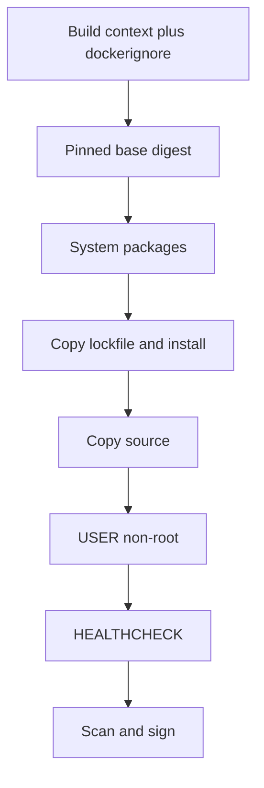

## Why this matters

A Dockerfile is the build contract for every environment that runs your service. The same file that makes `docker compose up` pleasant on a laptop becomes the artifact that ECS, Kubernetes, and CI promote to production. A sloppy file leaks `.env` secrets into layers, runs as root, invalidates the cache on every typo, and ships a 1 GB image that takes minutes to pull during an incident.

CodeCraft Academy already has three Dockerfiles: a FastAPI backend, a multi-stage Next.js frontend, and a Python sandbox for untrusted code. The backend image installs curl, copies `requirements.txt` before the source tree, and starts Uvicorn with an exec-form `CMD`. Those are good instincts. It also runs as root and bakes `--reload` into the command, which is a development convenience and a production footgun. This lesson is the checklist that turns a working Dockerfile into one you would defend in a design review.

Interviewers and platform teams ask the same questions: why is the dependency install above the source copy, why is the user not root, how do secrets stay out of layers, and how do you know the image is healthy. You should be able to answer from the file, not from a slogan.

## Intuition

Think of an image as a stack of transparent sheets. Each instruction writes a new sheet. Docker reuses a sheet when the instruction and everything it depends on are unchanged. The expensive sheets — `apt-get`, `pip install`, `npm ci` — should sit under the sheets that change every commit, which are usually your source files.

The process inside the container should look like a well-behaved Unix daemon: a single main process, a non-root uid, a working directory that is not `/`, and a health check the orchestrator can poll. Anything you would not commit to git — passwords, cloud tokens, the contents of `node_modules` from your laptop — must not enter the build context.

The official image tag `python:3.12-slim` is a moving pointer. Pinning a digest makes today's build match next month's build. You can still move the pin on purpose; you just stop moving it by accident.

## Core concept in depth

### Instruction order and the build cache

Docker's classic builder caches each instruction. The cache key includes the instruction text and, for `COPY` and `ADD`, a checksum of the files. The first miss invalidates every later step.

A reliable order for a Python service is:

1. `FROM` a pinned base.
2. System packages that change rarely.
3. `COPY` only the dependency manifest (`requirements.txt`, `package-lock.json`).
4. Install dependencies.
5. `COPY` the application source.
6. `USER`, `EXPOSE`, `CMD`.

The CodeCraft backend already copies `requirements.txt` before `COPY . .`. That is the pattern. If you invert it, a one-line Python edit reinstalls every wheel.

`EXPOSE` does not publish a port. It documents intent. Publishing happens at `docker run -p` or in Compose/Kubernetes.

### Exec form versus shell form

`CMD ["uvicorn", "app.main:app", "--host", "0.0.0.0", "--port", "8000"]` is exec form. The binary becomes PID 1 and receives `SIGTERM` directly, which is what ECS and Kubernetes send on stop.

Shell form, `CMD uvicorn app.main:app ...`, wraps the process in `/bin/sh -c`. The shell is PID 1, often ignores `SIGTERM`, and the app keeps running until the orchestrator kills it with `SIGKILL` after the grace period. Use exec form, or an entrypoint script that ends with `exec` so the app replaces the shell.

`--reload` watches the filesystem and is appropriate for the Compose development target. A production stage should start Uvicorn without it, with a fixed worker count, and without a bind-mount of your laptop source.

### Pin the base, not just the name

Tags float. `python:3.12-slim` today is not the same bytes as `python:3.12-slim` after the next Debian point release. For production images, pin by digest:

```text
python:3.12-slim@sha256:<digest>
```

Discover the digest with `docker buildx imagetools inspect`. Renovate or Dependabot can open a pull request when the digest moves. You still write the human tag next to the digest so reviewers know which line they are approving.

Pin application dependencies too. `pip install` without a lock file is not reproducible. Use a fully pinned `requirements.txt` or a lock file, and prefer hashes for services that handle untrusted input. The sandbox Dockerfile already pins `numpy`, `pandas`, `matplotlib`, and `scikit-learn` to exact versions. That is the right instinct for a code-execution image.

### COPY, ADD, and the build context

`COPY` copies files. `ADD` can also unpack archives and fetch URLs, which makes builds depend on the network and on whatever that URL serves today. Prefer `COPY` unless you have a specific reason to unpack a local tar.

The context is every file sent to the daemon. A missing `.dockerignore` sends `.git`, local virtualenvs, `.env`, and frontend `node_modules`. Those files can land in a layer, and `.env` in a layer is a credential leak even if a later instruction deletes the file. Deleted files remain in the earlier layer. Secrets must never be copied in the first place.

A practical `.dockerignore` for this repo excludes `.git`, `.env`, `**/__pycache__`, `frontend/node_modules`, `frontend/.next`, and test caches. Keep the ignore file next to the Dockerfile that uses that context.

### Users, filesystems, and health

Create a user in the image and switch to it before `CMD`. The sandbox image does this with `useradd --uid 1000` and `USER sandbox`. The backend image does not, so a remote code execution bug in a dependency starts as root inside the container. Root inside a container is not always root on the host, but it is still a large capability set: package installs, reading secrets mounted into the container, and easier container escapes if a kernel bug shows up.

`HEALTHCHECK` is a Dockerfile instruction. Compose and the Docker daemon use it. Kubernetes ignores it and uses probes on the Pod spec instead. For the backend, a check against `http://127.0.0.1:8000/health` matches the route the API already exposes. Give the check a `start-period` so a slow import of scientific libraries does not flap the sandbox.

### BuildKit: cache mounts and secret mounts

BuildKit is the modern builder. A cache mount keeps pip or npm caches between builds without writing them into the image:

```text
RUN --mount=type=cache,target=/root/.cache/pip pip install -r requirements.txt
```

A secret mount exposes a file only for the duration of that `RUN`. It is not copied into a layer. That is how you pass a private package index token. `ARG` and `ENV` are the wrong tools for secrets: `ARG` values are visible in image history, and `ENV` is visible to every process in the container.

## Diagram / flowchart



### Dry-run: a one-line backend change

Assume the backend Dockerfile order above, and a developer changes only `app/main.py`.

| Step | Cache |
| --- | --- |
| FROM pinned digest | hit |
| apt-get curl | hit |
| COPY requirements.txt | hit, file unchanged |
| pip install | hit |
| COPY application source | miss, checksum changed |
| USER, EXPOSE, CMD | rerun, cheap |

The rebuild copies source and sets metadata. It does not download wheels. Invert `COPY . .` with the install step and the same one-line change pays the full pip install on every commit.

### What "good" looks like on this repo

| File | Keep | Change before production |
| --- | --- | --- |
| backend/Dockerfile | Manifest copied before source, exec-form CMD, apt lists removed | Drop `--reload`, add a non-root user, pin the base digest |
| frontend/Dockerfile | Multi-stage deps, builder, production | Run the production stage as non-root, ignore local `.next` |
| sandbox/Dockerfile | Pinned Python libs, uid 1000, WORKDIR | Read-only root and no network belong at runtime, not only in comments |

## Code

A production-shaped backend Dockerfile. Digest shortened in the comment so you replace it with the output of `imagetools inspect` rather than trusting a pasted hash.

```dockerfile
# syntax=docker/dockerfile:1.7
FROM python:3.12-slim-bookworm AS runtime

WORKDIR /app

RUN apt-get update && apt-get install -y --no-install-recommends \
        curl \
    && rm -rf /var/lib/apt/lists/*

COPY requirements.txt .
RUN --mount=type=cache,target=/root/.cache/pip \
    pip install --no-cache-dir -r requirements.txt

COPY app ./app

RUN useradd --create-home --uid 10001 appuser \
    && chown -R appuser:appuser /app
USER appuser

EXPOSE 8000

HEALTHCHECK --interval=30s --timeout=3s --start-period=20s --retries=3 \
    CMD curl -fsS http://127.0.0.1:8000/health || exit 1

CMD ["uvicorn", "app.main:app", "--host", "0.0.0.0", "--port", "8000"]
```

Build it with BuildKit and then inspect what you actually shipped:

```bash
docker build -t codecraft-api:dev -f backend/Dockerfile backend
docker history --no-trunc codecraft-api:dev
docker image inspect codecraft-api:dev --format '{{.RootFS.Layers}}'
docker scout cves codecraft-api:dev || trivy image codecraft-api:dev
```

`docker history` is how you prove a secret did not become a layer. If you see an `ENV TOKEN=...` line, the token is in the image config and will be in the registry.

A matching `.dockerignore` next to that context:

```text
.git
.env
.env.*
**/__pycache__
**/*.pyc
.venv
tests
```

Lint the file in CI with hadolint. Treat DL3008 (pin apt versions) as a team decision: pinning every apt package is noisy on Debian, while pinning the base digest plus a lock file catches the drift that actually breaks builds. Do not silence DL3002 (last user must not be root) or the rule that flags `latest`.

## Complexity analysis

| Choice | Build time | Image size | Operational risk |
| --- | --- | --- | --- |
| Unpinned `latest` | Fast until the tag moves | Unpredictable | Broken deploys, surprise CVEs |
| Digest pin + lock file | Stable, updates are explicit | Stable | Stale bases if nobody bumps the pin |
| Dependencies after full `COPY .` | Rebuilds install every commit | Same | Slow CI, developers disable cache |
| Multi-stage (next lesson) | Extra stages | Much smaller runtime | More moving parts in the file |
| Non-root user | Negligible | Negligible | Breaks if the app must bind to port 80 |
| Secret as `ARG` | Convenient | Secret in history | Credential leak via registry |

Cache hits are the main performance lever. A warm CI cache turns a two-minute pip install into a two-second metadata step. Registry pulls dominate deploy time once images exceed a few hundred megabytes, which is why the next lesson splits build tools from the runtime stage.

Security complexity is mostly about what is *in* the image, not about Dockerfile syntax. A perfect file that `pip install`s an unpinned, compromised package is still compromised. Scanning and lock files sit beside the Dockerfile, not instead of it.

## Tricks, tips and patterns

- Put a `# syntax=docker/dockerfile:1` directive at the top when you use cache mounts or secret mounts, so older daemons fail clearly.
- Copy only the directories the process needs (`COPY app ./app`) instead of `COPY . .`, and keep tests out of the runtime image.
- Use `pip install --no-cache-dir` or a cache mount, not both writing a cache into the layer and also mounting one.
- Set `PYTHONUNBUFFERED=1` and `PYTHONDONTWRITEBYTECODE=1` so logs appear immediately and the image does not fill with `.pyc` files you will never read.
- Add OCI labels (`org.opencontainers.image.source`, `org.opencontainers.image.revision`) so a running container can be traced back to a commit.
- Match the uid you use in Kubernetes `runAsUser` and in the Dockerfile so volume permissions do not surprise you.
- Keep a `development` stage and a `runtime` stage in one file. Compose targets `development` with `--reload` and a bind mount. Production targets `runtime`.
- Run hadolint and a vulnerability scanner as required checks, and fail the pipeline on critical findings with a documented exception process.

## Common mistakes and edge cases

- Deleting a secret in a later layer and believing it is gone. Anyone with the image can read the earlier layer.
- Using `ADD https://.../install.sh` and piping it to a shell. You have no checksum and no review.
- Running `apt-get update` in one layer and `apt-get install` in a later layer. The update cache goes stale and builds fail nondeterministically. Combine them and delete `/var/lib/apt/lists`.
- Forgetting `.dockerignore` and sending a multi-gigabyte `.next` or `.git` directory as context. The build looks "hung" while the client uploads.
- Binding to `127.0.0.1` inside the container. That interface is the container itself, not the host. The CodeCraft backend correctly binds to `0.0.0.0`.
- Assuming `USER` protects a container started with `--privileged` or with the Docker socket mounted. The socket is root-equivalent on the host. The backend Compose file mounts the socket so the API can launch the sandbox; that is a conscious, dangerous choice and must not be copied into a public deployment.
- Health checks that hit a dependency (the database) rather than the process. A database blip then marks every replica unhealthy and the orchestrator restarts the fleet.
- `CMD` and `ENTRYPOINT` both in shell form, so arguments concatenate in surprising ways. Prefer exec-form `ENTRYPOINT` for the binary and exec-form `CMD` for default arguments.

## Interview notes

**Why copy the lock file before the rest of the source?**
The install layer is cached until the lock file changes. Source edits stay cheap. If the whole tree is copied first, every commit invalidates the dependency layer.

**Exec form or shell form, and why?**
Exec form. The application is PID 1 and receives `SIGTERM` on shutdown. Shell form traps the signal in `/bin/sh`, so containers hit the termination grace period and get `SIGKILL`.

**How do you keep a private registry token out of the image?**
BuildKit secret mount on the single `RUN` that needs it. Not `ARG`, not `ENV`, not `COPY` of a `.netrc` that you later `rm`. Confirm with `docker history`.

**What does `EXPOSE` actually do?**
It is metadata. It does not open the port on the host, and it does not change security groups. Orchestrators and `docker run -P` may use it as a hint.

**The image runs as root. How bad is that?**
A process compromise starts with root capabilities inside the container namespace. Drop to a dedicated uid, and pair it with a read-only root filesystem and dropped capabilities at runtime. Also say clearly that a mounted Docker socket bypasses this control.

**How would you review the CodeCraft backend Dockerfile?**
Praise the requirements-before-source order, the exec-form command, and the cleaned apt lists. Flag `--reload` in the only stage, root, the unpinned base tag, and the broad `COPY . .`. Propose a development target versus a runtime target rather than one command that tries to serve both.

## Practice problems

1. Reorder a Dockerfile that copies the full source tree before `pip install`. Explain which layers rebuild when only `README.md` changes, before and after the fix.
2. A production incident finds `AWS_SECRET_ACCESS_KEY` in `docker history`. Write the BuildKit `RUN` that needs the token and the history output you expect after the fix.
3. Add a non-root user to `backend/Dockerfile` and decide what breaks if the process still tries to write to `/app`. Specify the directories that must be writable.
4. Draft a `.dockerignore` for this repository and list three files that must never reach the daemon. Explain why deleting them in a `RUN` step is not equivalent.
5. Define a health check for the API that does not depend on Postgres. State interval, timeout, and start period, and why Kubernetes will not read the Dockerfile instruction.

## Summary / cheat sheet

- Order instructions from least volatile to most volatile. Lock files before source.
- Pin base images by digest. Pin libraries with a lock file.
- Exec-form `CMD` or `ENTRYPOINT`. One process. Non-root `USER`.
- `.dockerignore` is a security control. Secrets use BuildKit mounts, never layers.
- `EXPOSE` is documentation. `HEALTHCHECK` serves Docker, not Kubernetes.
- Scan and lint in CI. `--reload` stays in the development stage only.
- Prove the image with `docker history` before you call it clean.

## Further reading

- [Dockerfile best practices](https://docs.docker.com/develop/develop-images/dockerfile_best-practices/)
- [BuildKit cache and secret mounts](https://docs.docker.com/build/building/secrets/)
- [hadolint rule catalog](https://github.com/hadolint/hadolint)
- [OWASP Docker security cheat sheet](https://cheatsheetseries.owasp.org/cheatsheets/Docker_Security_Cheat_Sheet.html)
- [OCI image spec annotations](https://github.com/opencontainers/image-spec/blob/main/annotations.md)
