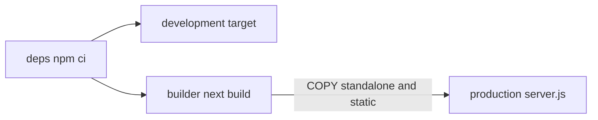

## Why this matters

A Node image that can compile a Next.js app is a bad image to serve traffic. It contains package managers, headers, a full `node_modules` tree, and often the source maps and tests. Attackers get more tools, pulls take longer, and cold starts on ECS or Kubernetes burn the deploy budget.

Multi-stage builds keep the compiler and the runtime in one Dockerfile without keeping them in one image. CodeCraft's `frontend/Dockerfile` already does this with four stages: `deps`, `development`, `builder`, and `production`. Compose builds the `development` target. A production pipeline should build the `production` target and push only that.

If you cannot explain which files cross a stage boundary, you will leak the entire build toolchain into production the first time someone "simplifies" the file back to a single `FROM`.

## Intuition

Each `FROM` starts a new image. Stages can see earlier stages only through an explicit `COPY --from`. Nothing else — not apt packages, not root's home directory, not an `ENV` you set in the builder — crosses the boundary unless you copy it or set it again.

Think of a workshop and a storefront. The workshop has saws. The storefront receives the finished shelf. You do not ship the saws with the shelf. `COPY --from=builder` is the loading dock: you name the crate.

The final stage in the file is the default build target. Naming stages and selecting them with `--target` lets one Dockerfile serve laptop hot-reload and a slim production image.

## Core concept in depth

### How a stage boundary works

Instructions before the next `FROM` belong to that stage only. Layers of stage `builder` are not parents of stage `production`. They share blobs on disk only when the content is identical, which is rare across a compiler stage and a runtime stage. The relationship is the copy, not the inheritance.

`COPY --from` accepts a stage name or an external image. `COPY --from=builder /app/.next/standalone ./` copies that path from the builder's filesystem into the current stage's current directory. The copy is a new layer in the current stage. Build tools that are not in that path stay behind.

External copies are how you grab a binary without apt:

```text
COPY --from=public.ecr.aws/docker/library/caddy:2 /usr/bin/caddy /usr/bin/caddy
```

Pin that external image by digest in real pipelines. An unpinned `--from` is a supply-chain dependency.

### The CodeCraft frontend file, stage by stage

`deps` uses `node:20-alpine`, copies only `package.json` and `package-lock.json`, and runs `npm ci`. This stage exists so both later stages share a cached dependency install. Change a React component and this stage stays warm. Change the lock file and it rebuilds, which is what you want.

`development` copies `node_modules` from `deps`, then copies the rest of the tree, sets `CONTENT_DIR=/content`, and runs `npm run dev`. Compose uses this target. The content directory is also bind-mounted in `docker-compose.yml`, so lesson edits on the host appear without a rebuild. This stage is large and includes the toolchain. It is not the production artifact.

`builder` again starts from `node:20-alpine`, copies `node_modules` from `deps`, copies source, and runs `npm run build`. `CONTENT_DIR` is both an `ARG` and an `ENV` because Next.js reads lesson files at build time for static generation. If the content directory is empty during `docker build`, the image builds a site with no lessons. The compose file mounts content for the dev server; the production image must have content available at build, or the task must mount it at runtime the way the dev stack does. Know which one your pipeline does.

`production` copies three trees out of `builder`: `public`, `.next/standalone`, and `.next/static`. Next.js standalone output traces the server into a minimal `node_modules` and emits `server.js`. The stage does not run `npm ci`. It does not contain the Alpine package index tooling beyond what the base image has, and it does not contain the original source tree unless the standalone trace pulled a file in. The command is `node server.js`.

### What does not cross the boundary

- `ENV` and `ARG` from `builder` are not in `production` unless repeated. The production stage correctly resets `NODE_ENV` and `NEXT_TELEMETRY_DISABLED`.
- A user created in `builder` does not exist in `production`.
- Files deleted in `builder` were never in `production` in the first place. This is the real fix for secrets accidentally present at build time: do not copy them. Do not delete them and hope.
- The `development` stage is not a parent of `production`. Building `--target production` does not run the dev command. BuildKit still schedules `deps` and `builder` because production depends on them. It can skip `development` entirely because nothing copies from it.

### Cache and CI

Stage cache is per instruction, same as a single-stage file. The valuable cache is `deps`. CI should persist the BuildKit cache between runs (GitHub Actions cache exporter, or a registry cache) or the lock-file install is cold on every job.

`--target production` is what you tag and push. Tagging the default last stage is fine only while `production` stays last. If someone appends a `debug` stage at the end of the file, the default image silently becomes the debug image. Always pass `--target` in the pipeline.

Build-args such as `CONTENT_DIR` are part of the cache key for the instructions that use them. Changing the arg invalidates the build from that point. Do not pass secrets as build-args. They land in history for the stage that declared them, and a careless `COPY --from` can carry a file that embedded the secret.

### Backend and sandbox

The backend Dockerfile is a single stage. That is acceptable for a slim Python base plus wheels, and it is a candidate for a later split if you compile native extensions: a builder stage with `gcc`, a runtime stage with only the virtualenv. The sandbox image should stay single-purpose and small. Do not multi-stage it into the API image. Untrusted execution and the public API are different trust zones, which is why Compose defines them as different services.

## Diagram / flowchart



### Dry-run: change a lesson component

| Change | deps | development | builder | production |
| --- | --- | --- | --- | --- |
| Edit `frontend/src/app/page.tsx` | cache hit | reruns copy and dev command | rebuilds Next | new copy of standalone |
| Edit `package-lock.json` | npm ci reruns | everything after deps reruns | rebuilds | new runtime image |
| Edit only `content/` MDX on the host in Compose | no image rebuild | dev server sees the bind mount | not involved | production image unchanged until rebuild |

The third row is why authors can edit lessons without a frontend rebuild in development, and why a production deploy that bakes content at build time must rebuild to publish a lesson. Decide that explicitly. This repository mounts `./content` read-only into the running containers, so a task definition that keeps the mount can ship lesson changes without a new image. A task definition that forgets the mount serves whatever content was present at build, which may be empty.

### Stage selection

| Command | Image you get |
| --- | --- |
| `docker build --target development` | Toolchain, `npm run dev` |
| `docker build --target production` | Standalone server |
| `docker build` with production last | Production, until someone reorders stages |
| Compose `target: development` | Matches the current frontend service |

## Code

The production target, reduced to the copies that matter. This matches `frontend/Dockerfile`.

```dockerfile
FROM node:20-alpine AS deps
WORKDIR /app
COPY package.json package-lock.json ./
RUN npm ci

FROM node:20-alpine AS builder
WORKDIR /app
COPY --from=deps /app/node_modules ./node_modules
COPY . .
ARG CONTENT_DIR=/content
ENV CONTENT_DIR=$CONTENT_DIR
ENV NEXT_TELEMETRY_DISABLED=1
RUN npm run build

FROM node:20-alpine AS production
WORKDIR /app
ENV NODE_ENV=production
ENV NEXT_TELEMETRY_DISABLED=1
COPY --from=builder /app/public ./public
COPY --from=builder /app/.next/standalone ./
COPY --from=builder /app/.next/static ./.next/static
EXPOSE 3000
CMD ["node", "server.js"]
```

Build and compare sizes:

```bash
docker build --target development -t codecraft-web:dev -f frontend/Dockerfile frontend
docker build --target production -t codecraft-web:prod -f frontend/Dockerfile frontend
docker image ls codecraft-web
docker history codecraft-web:prod
```

`docker history` on the prod tag should not show `npm ci` as a layer of that image. The install happened in `deps`. If it appears, you built the wrong target or a stage copied `node_modules` from the wrong place.

A Python service that compiles a native extension follows the same shape: builder image installs `build-essential`, creates a virtualenv, and the runtime stage copies only `/opt/venv`. Do not copy the compiler. Alpine and Debian wheels are not interchangeable. If `deps` is Alpine and the runtime is Debian, copied `node_modules` with native addons will fail at load. CodeCraft stays on Alpine for every frontend stage. Keep it that way or move every stage together.

## Complexity analysis

| Approach | Image size | Build complexity | Failure mode |
| --- | --- | --- | --- |
| Single stage, full SDK | Largest | Lowest | Prod runs as a build machine |
| Multi-stage, copy the app | Small | Medium | Forgotten `COPY` of a needed file |
| Multi-stage, wrong libc | Small | Medium | Native module crashes on start |
| Remote `--from` image | Small | Low | Unpinned upstream moves |
| Build once, many targets | Good cache | One file to review | Default target surprise |

The cost of multi-stage is conceptual: reviewers must track aliases. The payoff is a runtime image you can actually scan. A 1.5 GB image full of compilers produces a CVE report nobody triages. A 200 MB standalone image produces a report you can finish.

Cache exporters in CI cost storage and save minutes. For this frontend, the `npm ci` stage dominates. Export the BuildKit cache from `deps` before you invent a private npm proxy.

## Tricks, tips and patterns

- Name every stage. Future `COPY --from` should use the name, not a numeric index, because inserting a stage renumbers indexes.
- Put the production stage last, and still pass `--target` in CI.
- Copy the smallest path that runs. For Next.js that is `standalone` plus `static` plus `public`, not the whole `.next` cache.
- Repeat runtime `ENV` in the final stage. Do not assume inheritance.
- Keep dev and prod on the same base distro so native dependencies do not rot.
- Use `.dockerignore` so the builder's `COPY . .` does not send `node_modules` from the host over the top of the `npm ci` tree.
- Give the production stage its own non-root user. A user in `builder` does not count.
- When content is read at build time, make "content present" a CI assertion, not a hope. Fail the build if the lessons directory is empty.

## Common mistakes and edge cases

- Copying `/app` from the builder into production. You just reimported the toolchain and the `.next/cache`.
- Forgetting `.next/static`. The server starts and every page is unstyled, which looks like a CDN bug.
- Using `npm install` in `deps` and `npm ci` in another stage. The trees diverge. `npm ci` in the only install stage, then copy.
- Setting `NEXT_PUBLIC_*` only in Compose. Those values are inlined at `next build`. A runtime-only env change will not update client code. Rebuild.
- Alpine `libc` versus Debian. Copying `node_modules` across that boundary breaks `sharp` and similar native modules.
- A final debug stage appended for a one-off, left in the file, becoming the default image.
- Believing multi-stage removes secrets from the builder image stored in the local cache. The builder stage still exists locally. Do not push it. CI should push only the production tag.

## Interview notes

**Why multi-stage instead of a small base image from the start?**
The build needs a compiler or a package manager. The run does not. Separate stages let you use heavy tools and ship a filesystem that only contains the server.

**What crosses a `FROM` boundary?**
Only what you `COPY --from` and what you set again. Environment variables, users, and packages do not inherit.

**Walk the CodeCraft frontend targets.**
`deps` installs from the lock file. `development` runs the dev server and is what Compose builds. `builder` runs `next build`. `production` copies standalone output and runs `node server.js`.

**A production container is missing CSS. Where do you look?**
The copy of `.next/static` into the final stage, and whether the deploy is running the `production` target or the `development` target. Then check that `public/` was copied.

**Can a secret in the builder stage reach production?**
Only if a copied file contains it, or you pass it again as `ENV`. Deleting the file in the builder is irrelevant to the final image. Do not copy the secret's path.

## Practice problems

1. List every path the CodeCraft production stage copies, and name one path that must not be copied (`node_modules` from the host, `.git`, the full `.next/cache`).
2. `NEXT_PUBLIC_API_URL` was changed in the task definition and the browser still calls localhost. Explain why a rebuild is required.
3. Add a non-root user to the production stage only. State which `COPY` instructions must learn `--chown`.
4. CI built the frontend with an empty `content/` directory. What will the running site contain, and which stage should fail the pipeline?
5. A colleague copies `node_modules` from an Alpine builder into a Debian runtime. Predict the failure and the rule that prevents it.

## Summary / cheat sheet

- Every `FROM` is a new image. `COPY --from` is the only bridge.
- CodeCraft frontend: `deps`, `development`, `builder`, `production`.
- Push `--target production`. Compose keeps `--target development`.
- Standalone Next needs `standalone`, `static`, and `public`.
- `ENV` does not inherit. `NEXT_PUBLIC_*` is fixed at build.
- Same libc across stages. Do not push the builder.
- Multi-stage is how you delete the compiler without pretending whiteouts work.

## Further reading

- [Multi-stage builds](https://docs.docker.com/build/building/multi-stage/)
- [Next.js standalone output](https://nextjs.org/docs/app/api-reference/config/next-config-js/output)
- [Docker build targets](https://docs.docker.com/reference/cli/docker/build/#target)
- [Build cache backends](https://docs.docker.com/build/cache/backends/)
- [Node.js Docker best practices](https://github.com/nodejs/docker-node/blob/main/docs/BestPractices.md)
