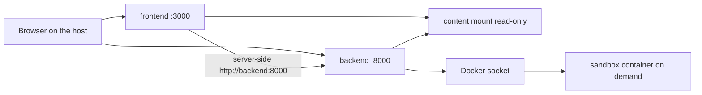

## Why this matters

CodeCraft Academy is not one process. The browser talks to a Next.js frontend, the frontend talks to a FastAPI backend, both read the same MDX tree, and the backend can start a sandbox container to run student Python. A README full of `docker run` flags will drift. Compose is the declarative description of that local system: images, ports, environment, networks, volumes, and start order.

The same file is also a design document. When you later draw the AWS architecture, every Compose service becomes a question: does this stay a container, does this volume become S3 or EFS, does this health check become a target-group check, and does this Docker socket disappear because production cannot have it?

Engineers who only know `docker run` struggle in interviews the moment the system has two services and a database. Compose is the smallest place to practice dependencies, DNS, and failure domains.

## Intuition

Compose starts a project: a named network, a set of containers, and optional volumes. Containers on that network resolve each other by service name. `frontend` reaches the API at `http://backend:8000`. You do not hard-code the bridge IP. IPs change every recreate. Names do not.

`depends_on` is not a load balancer and it is not a retry loop. With `condition: service_healthy` it waits until the dependency's health check passes, then starts the dependent container. If the API crashes ten seconds later, Compose does not restart the frontend for you unless you set a restart policy. Health at start and health over time are different problems.

Volumes are how state and source survive container recreation. A bind mount reflects the host directory. A named volume is Docker-managed and is the right place for `node_modules` so a Linux container does not fight a Windows or macOS `node_modules` on the bind-mounted source tree.

## Core concept in depth

### The CodeCraft project

`docker-compose.yml` defines three services and one network, `codecraft`, using the bridge driver.

**backend** builds `./backend`, publishes `8000`, and sets `CONTENT_DIR=/app/content`. It bind-mounts the backend source for reload and the repo `content/` directory read-only at `/app/content`. It also mounts `/var/run/docker.sock`. The health check runs `curl -f http://localhost:8000/health` inside the container. `start_period: 15s` gives Uvicorn time to import before failures count.

**frontend** builds `./frontend` with `target: development`, publishes `3000`, and sets `NEXT_PUBLIC_API_URL` to `http://localhost:8000`. That URL is what the browser uses, not what the Next server uses from inside the network. The browser runs on the host, so `localhost:8000` is correct for client calls. A server-side fetch from the Next container to `localhost:8000` would hit the frontend container itself, not the API. Server-side calls must use `http://backend:8000`.

The frontend waits for the backend health check. It bind-mounts `./frontend` to `/app` and uses a named volume `frontend_node_modules` mounted at `/app/node_modules`. The named volume hides the host's `node_modules` and keeps the Linux modules installed in the `deps` image. `WATCHPACK_POLLING=true` makes file watching work through bind mounts on Docker Desktop.

**sandbox** builds `./sandbox` but only under the profile `build-only`. A normal `docker compose up` does not start it. The backend starts sandbox containers itself through the Docker socket when a student runs code. The profile exists so CI can build the image without leaving a sandbox process idle.

### Networks and DNS

Compose creates a network named with the project prefix plus `codecraft`. Service names are DNS names on that network. Only published ports are reachable from the host. The backend is reachable from the host as `localhost:8000` and from the frontend container as `backend:8000`. Those are different paths. Mixing them up is the most common "it works in the browser and fails in SSR" bug.

Containers not on the network cannot resolve the names. If you `docker run` a one-off curl without `--network`, it will not see `backend`.

### Volumes

| Mount | Type | Survives recreate? | Purpose |
| --- | --- | --- | --- |
| `./backend:/app` | Bind | Host files, yes | Edit Python without rebuild |
| `./content:/app/content:ro` | Bind, read-only | Yes | Lessons the API and Next read |
| `frontend_node_modules:/app/node_modules` | Named | Yes, in Docker | Isolate Linux modules from the host |
| `/var/run/docker.sock` | Bind of a socket | N/A | Lets the API start sandbox containers |

Read-only is enforced by the mount, not by application code. A bug in the API cannot rewrite lesson files through that mount. It can still read them, which is what static generation and the lesson API need.

Named volumes are not deleted by `docker compose down`. They are deleted by `docker compose down -v`. That distinction matters when `node_modules` is corrupt: you want the volume gone and recreated, and you do not want that flag in a habit that also deletes a future Postgres volume.

### Health checks and start order

The backend health check talks to itself at `localhost` inside the container namespace. That is correct. The published host port is irrelevant inside the container.

`depends_on` with `condition: service_healthy` requires the dependency to define a health check. Without one, Compose cannot evaluate the condition and the wait fails. `retries: 5` and `interval: 10s` mean a broken API blocks the frontend for a bounded time, then Compose reports the dependency unhealthy. It does not infinite-loop, and it does not fix the API.

### Profiles, overrides, and environments

Profiles keep optional services out of the default graph. `docker compose --profile build-only build sandbox` builds the image. Production-shaped files should not rely on profiles for the API itself. Use a second file instead:

```text
docker compose -f docker-compose.yml -f docker-compose.prod.yml up
```

The prod file overrides the command to drop `--reload`, removes the source bind mount, removes the Docker socket, and sets real secrets from a secret store rather than from the YAML. Compose merges maps by key. Lists such as `ports` are replaced, not appended, depending on the field. When in doubt, run `docker compose config` and read the merged result. That command is the source of truth, not your memory of the merge rules.

`env_file` loads variables into the container. Interpolation in the YAML file itself uses the shell environment and a project `.env` next to the compose file, which is a different mechanism. A variable can be set for interpolation and still be absent inside the container if you never pass it under `environment:`.

## Diagram / flowchart



### Dry-run: `docker compose up --build`

| Step | What you should see |
| --- | --- |
| Build backend | Apt and pip layers, then Uvicorn |
| Build frontend target development | `deps` then the dev stage, not production |
| Start backend | Health check goes from starting to healthy |
| Start frontend | Only after healthy, then Next listens on 3000 |
| Sandbox service | Absent, unless the profile is selected |
| Request `/health` on port 8000 | 200 from FastAPI |

If the frontend starts and immediately logs connection refused, the health check is green for the wrong URL or the frontend is calling `localhost` from inside the container.

### Dev versus a production-shaped override

| Setting | Compose dev | Production override |
| --- | --- | --- |
| Frontend target | development | production |
| Source bind mount | Yes | No |
| Uvicorn `--reload` | Yes | No |
| Docker socket | Mounted | Not mounted |
| Content | Bind mount | Mount or bake, explicitly |
| Restart | Default no | `on-failure` or orchestrator restarts |

## Code

Bring the stack up and inspect the project Compose actually created.

```bash
docker compose up --build
docker compose ps
docker compose config
docker compose exec backend curl -fsS http://127.0.0.1:8000/health
docker compose exec frontend wget -qO- http://backend:8000/health
```

The second curl runs inside the frontend network namespace and is the SSR path. The host browser path is `http://localhost:8000/health`. Both must succeed for the architecture to be honest.

Build the sandbox image without starting it:

```bash
docker compose --profile build-only build sandbox
```

A minimal production override that removes the socket and the reload behavior:

```yaml
services:
  backend:
    command: ["uvicorn", "app.main:app", "--host", "0.0.0.0", "--port", "8000"]
    volumes: !reset []
    restart: on-failure
  frontend:
    build:
      target: production
    restart: on-failure
```

`!reset` is a Compose specification feature that clears the base list instead of merging it. If you only set a new `volumes` list, confirm with `docker compose -f docker-compose.yml -f docker-compose.prod.yml config` that the socket mount is gone. Do not assume the override replaced it.

Logs and a one-shot command:

```bash
docker compose logs -f backend
docker compose run --rm backend python -c "import app.main"
docker compose down
```

`down` removes containers and the project network. It keeps named volumes. `down -v` removes volumes. Stop using `-v` once any service has data you meant to keep.

## Complexity analysis

| Choice | Benefit | Cost |
| --- | --- | --- |
| One compose file for dev | Easy onboarding | Tempting to ship dev settings |
| Override file for prod | Small diff, reviewable | Merge rules surprise people |
| Bind mount source | Fast edit loop | Hides "works only on my machine" path bugs |
| Named volume for modules | Correct libc and OS | Stale volume after lock-file changes |
| Health-gated depends_on | Fewer race conditions at boot | Slow start if the check is heavy |
| Docker socket in dev | Sandbox works | Root-equivalent on the host |
| Profiles | Optional tools stay out of `up` | Easy to forget they exist |

Compose is not an orchestrator. It does not reschedule a container onto another machine, roll a deployment, or replace a failed host. Use it for local development, CI integration jobs, and simple single-host stacks. ECS and Kubernetes own production for this project.

## Tricks, tips and patterns

- Run `docker compose config` in CI so a bad merge fails before anyone boots the stack.
- Name the project with `COMPOSE_PROJECT_NAME` when two checkouts would otherwise share volumes and networks.
- After a lock-file change, recreate `frontend_node_modules` or the container keeps yesterday's modules under the fresh source.
- Keep `NEXT_PUBLIC_*` values aligned with what the browser can reach. Keep server-to-server URLs on the Docker DNS names.
- Mount content read-only in every service that only reads lessons.
- Put health checks on the process, not on a downstream dependency, or one database blip blocks every start.
- Prefer `docker compose up --build --wait` in CI scripts so the job blocks until health checks pass.
- Do not commit real secrets into the compose file. Use `.env` locally and a secret manager in any shared environment. `.env` stays out of git.

## Common mistakes and edge cases

- `depends_on` without a health check, then wondering why the frontend raced the API. The default condition is process started, not ready.
- Server-side fetch to `localhost` from inside the frontend container. That is the frontend, not the API.
- Forgetting that named volumes shadow a bind mount's subdirectory. The host `frontend/node_modules` is not what the container runs.
- `docker compose down -v` as a habit, then a Postgres volume is gone.
- Publishing the same host port in two projects. The second `up` fails with address already in use. Change the host side, not the container port.
- Editing YAML lists and assuming they append. Verify with `config`.
- Leaving the Docker socket mounted in a "prod" override. That is the security lesson's critical bug, and Compose will not warn you.
- Apple Silicon versus amd64 images in Compose without `platform`. The service starts on the laptop and fails in CI on amd64, or the reverse.

## Interview notes

**What problem does Compose solve that a Dockerfile does not?**
A Dockerfile builds one image. Compose describes several services, their network, their config, and their start dependencies so a new engineer can boot the system with one command.

**Does `depends_on` wait until the app is ready?**
Only with `condition: service_healthy` and a real health check. Otherwise it waits until the process has started, which can be before the port is open.

**Why is `NEXT_PUBLIC_API_URL` set to localhost in this compose file?**
The browser on the host calls the published port. Processes inside the frontend container must call `http://backend:8000` instead. One URL cannot serve both paths.

**Why a named volume on `node_modules`?**
The source tree is bind-mounted from the host. A host `node_modules` may be the wrong OS or architecture. The named volume preserves the modules installed inside the Linux image.

**How do you keep dev Compose from becoming the production deploy?**
An override file reviewed with `docker compose config`, no source bind mounts, no Docker socket, production image target, and an orchestrator instead of Compose once you need more than one host.

## Practice problems

1. Trace a browser request for a lesson page and a server-side request for `/api/courses`. Name the host, port, and DNS name used on each hop.
2. The frontend starts before Uvicorn binds. Show the compose change that waits for `/health`, and the failure if the backend has no health check.
3. `npm ci` updated the lock file but the container still imports an old package. Explain the named volume and the exact command that fixes it without deleting content.
4. Write the prod override that removes the Docker socket. Show the `docker compose config` line you would grep for to prove it is gone.
5. Two clones of the repo are open. `up` fails or corrupts `node_modules`. What project name and volume prefix are colliding, and how do you separate them?

## Summary / cheat sheet

- Compose defines services, a network, and volumes for one project.
- Service names are DNS names. Published ports are for the host.
- Browser URLs and in-network URLs are different. `localhost` inside a container is that container.
- `depends_on` plus `service_healthy` needs a health check.
- Bind mounts share host files. Named volumes outlive `down` and can shadow directories.
- Profiles keep the sandbox build optional. Overrides keep prod from inheriting dev mounts.
- `docker compose config` is the merge you actually get.
- Compose is local orchestration, not a multi-host control plane.

## Further reading

- [Compose specification](https://compose-spec.io/)
- [Compose health checks and depends_on](https://docs.docker.com/compose/how-tos/startup-order/)
- [Compose profiles](https://docs.docker.com/compose/how-tos/profiles/)
- [docker compose config](https://docs.docker.com/reference/cli/docker/compose/config/)
- [Bind mounts versus volumes](https://docs.docker.com/engine/storage/volumes/)
