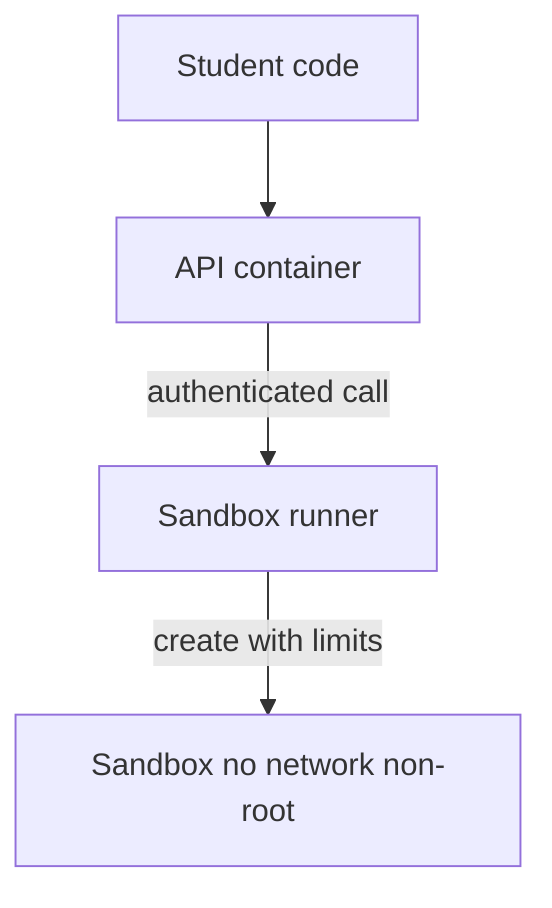
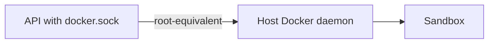

## Why this matters

The CodeCraft backend executes student Python. That is untrusted code by definition. The repository's own security note says the sandbox must run with no network, memory and CPU limits, a non-root user, and a timeout. The sandbox Dockerfile already creates uid 1000 and drops to `USER sandbox`. The compose file still mounts the Docker socket into the API so the API can launch that sandbox. Those two facts are the whole tension of this lesson: image hardening is necessary, and a mounted Docker socket throws most of it away on the API container.

Production is a different trust story from `docker compose up` on a laptop. On a laptop, you are the attacker and the victim. On ECS or a shared CI runner, a student payload, a compromised dependency, or a stolen deploy key is the attacker. Runtime policy is how you limit the blast radius after the image is already built.

Interviewers will ask where you drop privileges, how you stop a container from filling the disk, and why "it runs in Docker" is not a security boundary. You should answer with specific controls, not with the word isolation.

## Intuition

A container is a process with a filtered view of the kernel. Namespaces hide other processes, the network, and the filesystem root. Cgroups limit CPU, memory, and process count. Linux capabilities split traditional root into pieces you can drop. Seccomp filters the system calls the process may attempt.

None of that creates a second kernel. If the container can talk to the Docker socket, it can ask the daemon to start a privileged container that mounts the host root. That is root on the host, reached through an API, not through a kernel exploit. Treat the socket as an administrative credential.

The sandbox should be the opposite shape: one uid, a read-only root, a writable tmp that is size-capped, no network, a short wall clock, and a seccomp profile that still allows CPython to start. The API that launches it should not be the sandbox.

## Core concept in depth

### Identity and capabilities

`USER sandbox` in the image is the default. A `docker run --user root` or a Kubernetes `runAsUser: 0` overrides it. Set the user in the image and again in the orchestrator so one of them being wrong is not enough.

Root inside a container still has many capabilities: `NET_RAW`, `SYS_ADMIN`, `DAC_OVERRIDE`, and others, depending on the runtime. Drop them. The usual baseline is:

```text
cap_drop: ALL
cap_add: only what you measured
```

A typical web server needs nothing beyond what a non-root process has if it binds to a port above 1024. CodeCraft's API binds to 8000 and the frontend to 3000. They do not need `NET_BIND_SERVICE`. The sandbox needs no capabilities at all.

`no-new-privileges` stops a setuid binary inside the image from gaining privileges. Turn it on for every service. There is no CodeCraft process that should escalate.

### Filesystem

A read-only root filesystem stops a payload from rewriting `/usr` or dropping a cron-like script into the image's writable layer. Python still needs somewhere to write bytecode or temp files. Mount a tmpfs on `/tmp` with a size limit. Set `PYTHONDONTWRITEBYTECODE=1` so imports do not need to write `.pyc` next to the standard library.

The lesson content mount is already `:ro`. Keep it that way in every environment. Uploaded student source belongs in a per-run tmpfs that is wiped when the container exits, not in a long-lived volume.

### Resources and time

Without a memory limit, one student notebook can trigger the Linux OOM killer and take the API with it. Set memory, CPU, and a pid limit. Pid limits stop fork bombs that would otherwise exhaust the host process table before memory does.

```text
mem_limit: 256m
cpus: 0.5
pids_limit: 128
```

The backend environment already names `SANDBOX_MEMORY_MB` and `SANDBOX_TIMEOUT_SECONDS`. Those values must reach the `docker run` or the orchestrator API that creates the sandbox. A variable that nothing reads is not a control.

Wall-clock timeout is separate from CPU limit. A process can sleep forever while using no CPU. The runner has to kill the container. `docker stop` sends `SIGTERM`, then `SIGKILL` after a grace period. Exec-form `CMD` matters here so Python is PID 1 and can die promptly. A timeout that only stops reading stdout leaves the container running.

### Network

Student code does not need the network. `--network none` removes the interfaces. Do not rely on application-level "we did not give them the requests library." The standard library can still open sockets if the namespace has a route. No network namespace means no route.

The API itself needs egress to nothing in the local compose stack except, unfortunately, the Docker socket. In production, prefer a dedicated sandbox runner that the API calls over a small authenticated API, so the internet-facing service never holds the socket. That split is the production design. The socket mount is a development shortcut documented in the README, not a pattern to copy onto ECS.

### Supply chain and admission

Pin base digests, lock language dependencies, and scan images in CI. Scanning tells you about known CVEs in packages. It does not tell you that the container is configured safely. You need both.

Sign images you deploy and verify the signature at pull time. Cosign with keyless signatures tied to the GitHub Actions identity is enough for a project this size. The cluster should refuse tags that are not signed. `latest` plus no signature check is not a supply chain.

Do not run a scanner only on the laptop. The image that ECS pulls is the one that matters, identified by digest.

### Operations

Logs go to stdout and stderr. The API uses structured logging. The daemon or the orchestrator ships them. A log file inside the container disappears with the writable layer and fills the disk if nobody rotates it.

Restart policies: `on-failure` for stateless API tasks, never for a batch sandbox you expect to exit. Restarting a failed sandbox hides student errors and can loop a fork bomb.

`docker events` and the health check endpoint are the local operational signals. In production those become CloudWatch metrics and the load balancer health check, which a later lesson covers. The contract is the same: liveness means the process can serve, not that every downstream dependency is perfect.

## Diagram / flowchart



The development shortcut that you must not promote:



### Dry-run: a hostile submission

| Payload | Control that stops it |
| --- | --- |
| `while True: fork()` | `pids_limit` and memory limit |
| Open a socket to the internet | `--network none` |
| Write a binary into `/usr/local/bin` | Read-only root filesystem |
| Read the API's cloud credentials | Sandbox has no mounted secrets and a separate user |
| `mount` the host disk | No `SYS_ADMIN`, no privileged, no socket inside the sandbox |
| Run for an hour | Wall-clock timeout and `docker kill` |
| Escape via the API's Docker socket | Do not mount the socket on the internet-facing task |

If the socket is mounted on the API, the last row fails. The student need not escape the sandbox. They need a bug in the API that forwards a container-create call, or a remote code execution bug in a dependency, and they inherit the socket.

### Control map

| Control | Where it lives | Stops |
| --- | --- | --- |
| `USER` non-root | Image and runtime | Default root |
| `cap_drop ALL` | Runtime | Capability abuse |
| `read_only` plus tmpfs | Runtime | Persistence in the image fs |
| `network_mode: none` | Sandbox only | Exfiltration and downloads |
| Memory, CPU, pids | Runtime | Denial of service |
| Timeout | Runner | Hung processes |
| Image digest and signature | CI and admission | Swapped or tampered images |
| No socket on the API | Deploy config | Host takeover |

## Code

Run a sandbox-shaped container locally. This is the shape the runner should request.

```bash
docker run --rm \
  --user 1000:1000 \
  --cap-drop ALL \
  --security-opt no-new-privileges \
  --read-only \
  --tmpfs /tmp:rw,noexec,nosuid,size=64m \
  --network none \
  --memory 256m \
  --cpus 0.5 \
  --pids-limit 128 \
  codecraft-sandbox:latest \
  python -c "print('sandbox ready')"
```

Confirm the bad paths fail:

```bash
docker run --rm --network none python:3.12-slim \
  python -c "import urllib.request; urllib.request.urlopen('https://example.com')"
```

That should fail because there is no network. If it succeeds, the flag was not applied.

See what the API container can do with the socket, so the risk is concrete:

```bash
docker compose exec backend sh -c 'ls -l /var/run/docker.sock || true'
```

If the socket is there, that container can list and start host containers. Production task definitions omit this mount. The runner, if it stays on Docker, is a separate locked-down service, not the public API.

Scan and attest the image you built:

```bash
docker build -t codecraft-sandbox:latest ./sandbox
trivy image --exit-code 1 --severity CRITICAL codecraft-sandbox:latest
```

Wire the same command into CI. A scanner that only prints and never fails will be ignored by the third week.

A Compose fragment for a one-off hardened sandbox, not for the API:

```yaml
services:
  sandbox-test:
    image: codecraft-sandbox:latest
    read_only: true
    cap_drop: ["ALL"]
    security_opt: ["no-new-privileges:true"]
    tmpfs: ["/tmp"]
    network_mode: none
    mem_limit: 256m
    pids_limit: 128
    user: "1000:1000"
```

## Complexity analysis

| Control | Cost | What you give up |
| --- | --- | --- |
| Non-root | Occasional permission bugs | Writing to root-owned paths |
| Read-only root | Must design tmpfs | Tools that patch themselves in place |
| No network on sandbox | Students cannot pip install at runtime | Some notebook-style workflows |
| Pid and memory caps | Tuning | Legitimate heavy data lessons need a higher tier, not unlimited |
| Drop all capabilities | Measure syscalls if something breaks | Ping and mount, which you do not need |
| Separate runner, no socket on API | Extra service | The convenience of the current compose file |
| Signature admission | CI and cluster policy | Running random local tags in prod, which you should not do |

The expensive control is the architectural one: moving sandbox creation off the public API. The cheap controls (user, caps, read-only, limits, no network) should be in place even on the development runner so production is not the first time they are tested.

## Tricks, tips and patterns

- Apply the user, capabilities, and read-only flags in the orchestrator, not only in the Dockerfile. Runtime flags win, including the dangerous ones.
- Give the sandbox a clean environment. Do not pass the API's environment block through. That block contains `CONTENT_DIR` and, in a careless deploy, cloud credentials.
- Use a tmpfs for `/tmp` with `noexec` if student code should not download a binary and run it. Python can still interpret source from `/tmp`. That is expected. `noexec` stops a straightforward ELF drop.
- Log the digest, the timeout, and the exit code for every run. You cannot investigate an escape you did not record.
- Keep a second, stricter seccomp profile for the sandbox once the default profile is understood. Test CPython imports before you roll it out, or imports fail in confusing ways.
- Fail CI on critical vulnerabilities in the sandbox base. That image is the one exposed to hostile input.
- Restart the API on failure. Do not restart sandbox containers automatically.
- Read the CIS Docker Benchmark section on the socket, privileged mode, and `host` network. Those three settings erase the rest of the checklist.

## Common mistakes and edge cases

- Mounting the Docker socket and also documenting a non-root sandbox, as if the socket were unrelated. The socket is the stronger control, and it is wide open.
- `--privileged` to "make it work." Privileged disables most isolation. It is not a debugging step you leave in the file.
- `--network host` on the API. The container shares the host network namespace and any local service.
- A memory limit with no pid limit. Fork bombs win.
- A CPU limit with no wall-clock timeout. `time.sleep` in a loop runs until you notice the bill or the slot is stuck.
- Passing `AWS_ACCESS_KEY_ID` into every container through a shared `env_file`.
- Scanning the base tag and deploying a different digest than the one you scanned.
- Read-only root without a tmpfs, then disabling read-only forever because Python could not start. Add `/tmp`. Do not drop the control.
- `latest` in the task definition so a bad push rolls out without a deploy commit.

## Interview notes

**Is a container a security boundary?**
It is a set of kernel features you can configure into a boundary. Default Docker is a weak boundary. Non-root, dropped capabilities, seccomp, no privileged mode, and no host mounts make it a useful one. A mounted Docker socket is not a boundary at all.

**How do you run untrusted Python for CodeCraft?**
A separate image, uid 1000, all capabilities dropped, read-only root, tmpfs on `/tmp`, no network, memory and pid limits, and a wall-clock kill. The internet-facing API does not hold the Docker socket. It calls a runner.

**What does the socket mount allow?**
Anyone who can talk to it can create containers, including privileged containers with the host filesystem mounted. That is host root.

**Where do you set the non-root user?**
In the image with `USER`, and again at runtime so a manifest cannot silently override it to root. Check the running process list, not the Dockerfile.

**Scanning versus configuration?**
Scanning finds known vulnerable packages in the image. Configuration stops a process from mounting the host or opening the network. Neither replaces the other.

## Practice problems

1. List the runtime flags for a student run. For each flag, name the attack it stops.
2. The API container can run `docker ps` through the socket. Explain the production redesign in one diagram: API, runner, sandbox.
3. A fork bomb escapes the memory limit. Which second limit was missing, and why memory alone is not enough?
4. `trivy` passed on `python:3.12-slim` yesterday. The cluster pulled the tag today. Why is that not the scan you think it is?
5. Read-only root breaks the sandbox because it cannot write `.pyc`. Fix it without making `/usr` writable.

## Summary / cheat sheet

- Containers share the host kernel. Configure namespaces, cgroups, capabilities, and seccomp on purpose.
- Non-root, `cap_drop ALL`, `no-new-privileges`, read-only root, tmpfs `/tmp`.
- Sandbox: no network, memory, CPU, pids, wall-clock timeout, clean environment.
- The Docker socket is host root. Keep it off the public API.
- Scan and sign the digest you deploy.
- Logs to stdout. Restart the API, not the sandbox.
- "It runs in Docker" is not a control. The flags are the control.

## Further reading

- [Docker runtime privilege and Linux capabilities](https://docs.docker.com/engine/containers/run/#runtime-privilege-and-linux-capabilities)
- [CIS Docker Benchmark](https://www.cisecurity.org/benchmark/docker)
- [OCI runtime security notes](https://github.com/opencontainers/runtime-spec)
- [Trivy image scanning](https://aquasecurity.github.io/trivy/latest/docs/target/container_image/)
- [Cosign container signing](https://docs.sigstore.dev/cosign/signing/overview/)
