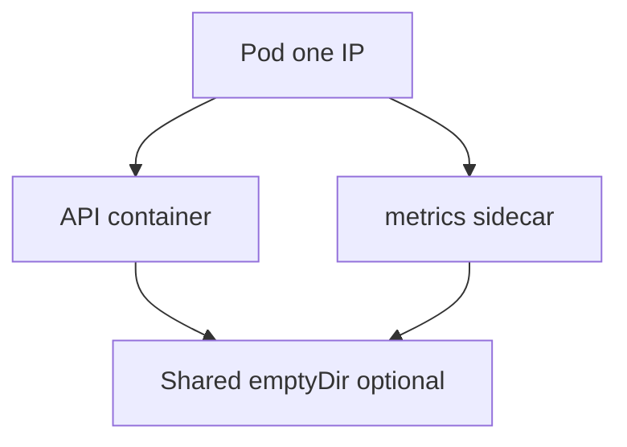

## Why this matters

If the API moves from ECS to Kubernetes, the thing the scheduler places is not a container. It is a Pod: one or more containers that share a network namespace and can share volumes, with a lifecycle the control plane watches. People who treat a Pod as a small VM SSH in, install tools, and are surprised when a reschedule deletes the disk. People who skip probes send traffic to a process that has not opened its port.

This lesson is the Pod itself. Deployments, Services, and Ingress come next and only make sense if you know what they wrap. The sandbox and the API are different Pods. They do not belong in one Pod just because they talk to each other. A Pod is for containers that must share localhost or a volume, not for a whole product.

## Intuition

Containers in a Pod share one IP address and one port space. The API and a sidecar exporter both listen on that IP, on different ports. They can reach each other on localhost. They do not share a filesystem unless you mount a volume into both. They do not share a process namespace unless you ask.

The kubelet starts the containers, runs probes, and restarts a container when its restart policy says to. The Pod object stays until something deletes it. A container restart is not a new Pod. A new Pod is a new IP.

Requests and limits are how the scheduler and the kernel see the Pod. A request is what you reserve. A limit is what you cap. A Pod with no request is easy to schedule and easy to evict when the node is tight. A Pod with a limit and no request is a different quality of service class than a Pod whose request equals its limit. Those classes decide who dies first under memory pressure.

## Core concept in depth

### What is inside a Pod spec

The spec lists containers: image, command, ports, env, and volume mounts. `restartPolicy` for a workload Pod is almost always Always. OnFailure is for Jobs. Never is for a Pod you want to debug once.

An init container runs to completion before the app containers start. Use it for a migration only if you understand that a bad migration blocks every start, and that a rolling set of Pods may run the migration concurrently. The deployment lesson's expand-contract rules still apply. An init container is not a magic lock.

A sidecar container runs beside the app. A log shipper or a proxy fits. The API and the sandbox runner do not. They scale differently, they fail differently, and a student payload should not share the API's network namespace. If they share a Pod, they share localhost and the sandbox can see the API's loopback. That is the wrong trust boundary.

### Probes

| Probe | Question | Failure does |
| --- | --- | --- |
| startup | Has the process finished booting? | Restarts if it exceeds the budget. Liveness waits. |
| readiness | Should this Pod receive Service traffic? | Removes it from endpoints. Does not restart. |
| liveness | Is the process wedged and in need of a kill? | Restarts the container. |

Readiness hits `/health` and fails when the app cannot serve. Liveness should be cheaper and harder to fail. If liveness checks the database, a database blip restarts every API Pod, which makes the blip worse. Let readiness fail closed and keep liveness to "the process is stuck." Startup probes exist so a slow import does not get killed by liveness before it listens.

The ECS health check maps most closely to readiness plus the target group. Liveness is the extra Kubernetes behavior of killing a wedged process. You want both, aimed at different failures.

### Resources

Set a CPU request and a memory request and limit for the API. Memory limit is a kill. CPU limit is throttling, which looks like latency. For a small API, a memory limit slightly above the request prevents one leak from taking the node. Do not set a CPU limit so low that the process throttles during startup. The sandbox Pod is where a memory limit is the product: it is the cgroup version of the Docker memory flag. Set it. A sandbox without a limit is a node outage.

Quality of service:

| Class | When | Eviction |
| --- | --- | --- |
| Guaranteed | Every container has memory and CPU request equal to limit | Last |
| Burstable | Requests are set and lower than limits, or only some are set | Middle |
| BestEffort | No requests or limits | First |

The API can be Burstable. The sandbox should be Guaranteed or at least have a hard memory limit so BestEffort neighbors are not the only ones protected.

### Scheduling in one paragraph

The scheduler picks a node that has room for the requests and that matches affinity and taints. You do not pin a Pod to a hostname in normal operation. A node pool for the sandbox, tainted so the API does not land there, is reasonable: student CPU must not starve the API. That is a later cluster-design choice. The Pod spec is where the requests that make it possible are declared.

### Naked Pods

A Pod you create by hand will not be recreated when the node dies. A Deployment will. A Job will, within its completion rules. Do not ship the API as a bare Pod. The next lesson wraps it. You still need to read a Pod spec, because the Deployment's template is a Pod spec.

## Diagram / flowchart



The sandbox is a second Pod, not a third box in this picture.

### Dry-run: database blip

| Probe behavior | What happens |
| --- | --- |
| Readiness checks the database | Endpoints drop, traffic stops, Pods stay up, they return when the database returns |
| Liveness checks the database | kubelet kills the containers, restart storms, the database gets a thundering herd |
| Neither checks anything | Traffic keeps flowing to errors |
| Startup still running | Liveness does not fire yet. Good. |

### Shared namespaces

| Namespace | Shared in the Pod? | Consequence |
| --- | --- | --- |
| Network | Yes | localhost works between containers. Port numbers must not collide. |
| IPC | Yes, by default | Processes can use the same IPC. Rarely what you want to rely on. |
| PID | No, unless shareProcessNamespace | A sidecar cannot see the app's processes unless you opt in. |
| Filesystem | No, except mounted volumes | A file in one image is not in the other. |

## Code

A Pod spec you would embed in a Deployment, not apply alone. Probes hit `/health`. Resources are modest for the lesson API. The image is a digest.

```yaml
apiVersion: v1
kind: Pod
metadata:
  name: codecraft-api
  labels:
    app: codecraft-api
spec:
  containers:
    - name: api
      image: 111111111111.dkr.ecr.ap-south-1.amazonaws.com/codecraft-api@sha256:REPLACE_WITH_DIGEST
      ports:
        - containerPort: 8000
      readinessProbe:
        httpGet:
          path: /health
          port: 8000
        periodSeconds: 10
      livenessProbe:
        httpGet:
          path: /health
          port: 8000
        periodSeconds: 20
        failureThreshold: 6
      startupProbe:
        httpGet:
          path: /health
          port: 8000
        failureThreshold: 30
        periodSeconds: 2
      resources:
        requests:
          cpu: "100m"
          memory: 256Mi
        limits:
          memory: 512Mi
```

Liveness uses the same path here with a slower failure budget so a brief stall does not kill the process. If `/health` depends on the database, split them: readiness can check dependencies, liveness should hit a path that only proves the process can answer. Add `/live` that does not touch RDS if you see restart storms.

A sandbox Pod's difference is the limit and the absence of a Service that faces users:

```yaml
resources:
  requests:
    cpu: "250m"
    memory: 256Mi
  limits:
    cpu: "500m"
    memory: 256Mi
securityContext:
  runAsNonRoot: true
  runAsUser: 1000
  readOnlyRootFilesystem: true
  allowPrivilegeEscalation: false
```

Equal memory request and limit puts the sandbox in Guaranteed for memory. `readOnlyRootFilesystem` matches the Docker security lesson. You still need a writable tmp volume. Add an `emptyDir` mounted on `/tmp` with a size limit. Without it the process cannot start and you will be tempted to turn read-only off.

Commands:

```bash
kubectl apply -f pod.yaml
kubectl describe pod codecraft-api
kubectl logs codecraft-api
kubectl delete pod codecraft-api
```

`describe` shows probe failures and the reason a Pod is Pending: usually insufficient CPU or a taint. Read events before you change the image. `delete` on a bare Pod is the end of it. `delete` on a Pod owned by a Deployment is a restart. Know which one you are holding.

## Complexity analysis

| Choice | Benefit | Cost |
| --- | --- | --- |
| One container per Pod | Clear failure and scaling | More objects |
| Sidecar for metrics | Shared localhost | Coupled restarts if you are not careful |
| API and sandbox in one Pod | Easy localhost call | Shared trust boundary. Do not. |
| No probes | Simpler spec | Traffic to dead processes, no restart of wedges |
| Liveness equals deep health | Fast kill | Restart storms |
| No resource requests | Easy scheduling | Evicted first, noisy neighbors |
| Memory limit on sandbox | Node survives a leak | The run dies at the limit, which is what you want |
| Bare Pod in prod | One YAML | No reschedule story |

## Tricks, tips and patterns

- Put the digest in the image field. A tag can move without a Pod change you can see in git.
- Labels `app: codecraft-api` are how Services will select these Pods. Choose them now and do not change them casually.
- Readiness before liveness in your mind: stop traffic first, kill only if wedged.
- Startup probe for the frontend or the API if the first import is slow.
- Requests are for the scheduler. Limits are for the kernel. Set both on purpose.
- Taint a sandbox node pool so only sandbox Pods tolerate it.
- `kubectl describe` events are the log of scheduling. Use them.
- Never commit a bare Pod as the production API. Wrap it.

## Common mistakes and edge cases

- Two containers binding the same port. The second never starts. Events say the address is in use.
- Readiness and liveness both depending on RDS.
- A memory limit below the request. The API will reject the spec.
- BestEffort API Pods on a node with a BestEffort sandbox. The API can be evicted.
- `kubectl exec` installing curl into a running container and calling it a fix.
- HostPath volumes for student code. That mounts a host directory into a Pod that runs untrusted work. Use an emptyDir.
- Privileged security context to make a probe tool work.
- Forgetting that deleting a Deployment's Pod is safe and deleting the Deployment is not.

## Interview notes

**What is a Pod?**
The smallest schedulable object. One or more containers share a network namespace and can share volumes. They get one IP. A restart of a container is not a new IP. A new Pod is.

**Why not put the API and the sandbox in one Pod?**
They would share localhost and fate. The sandbox runs untrusted code and needs a hard limit and a different node pool. Call it over the network from a different Pod, with the runtime flags from the Docker lesson.

**Readiness versus liveness?**
Readiness removes the Pod from Service endpoints. Liveness kills the container. A dependency check belongs on readiness. Liveness answers "is the process wedged?"

**What happens to a bare Pod when the node dies?**
It is gone. A Deployment or Job creates a replacement. Production workloads use those controllers. The Pod spec still lives in their template.

**Guaranteed versus Burstable?**
Guaranteed means requests equal limits for CPU and memory on every container, and those Pods are evicted last. The sandbox wants a hard memory limit. The API wants requests so it actually gets scheduled.

## Practice problems

1. Draw the network namespace for an API container and a metrics sidecar. Which address does the sidecar scrape?
2. A database failover restarts every API Pod. Which probe is mis-aimed, and how do you split `/health` and `/live`?
3. The sandbox has no memory limit. What kills the node, and what resource block stops it?
4. Explain why a hand-applied Pod is the wrong production object even though the YAML looks complete.
5. An events list says the Pod is Pending and the node has free CPU but a taint. What must the Pod declare, and would you declare it on the API?

## Summary / cheat sheet

- A Pod is one IP, shared network, optional shared volumes, one or more containers.
- Do not colocate the API and the sandbox.
- Startup, readiness, and liveness answer different questions. Do not point liveness at the database.
- Requests schedule. Memory limits kill. Sandboxes need limits.
- BestEffort is evicted first. Set requests on the API.
- Bare Pods do not come back. Controllers own them.
- Digests, labels, and `kubectl describe` events are part of the spec's operation.
- Read-only root and a non-root user belong on the sandbox Pod, with a tmp volume.

## Further reading

- [Pod lifecycle](https://kubernetes.io/docs/concepts/workloads/pods/pod-lifecycle/)
- [Configure probes](https://kubernetes.io/docs/tasks/configure-pod-container/configure-liveness-readiness-startup-probes/)
- [Resource management](https://kubernetes.io/docs/concepts/configuration/manage-resources-containers/)
- [Pod security standards](https://kubernetes.io/docs/concepts/security/pod-security-standards/)
- [Init containers](https://kubernetes.io/docs/concepts/workloads/pods/init-containers/)
