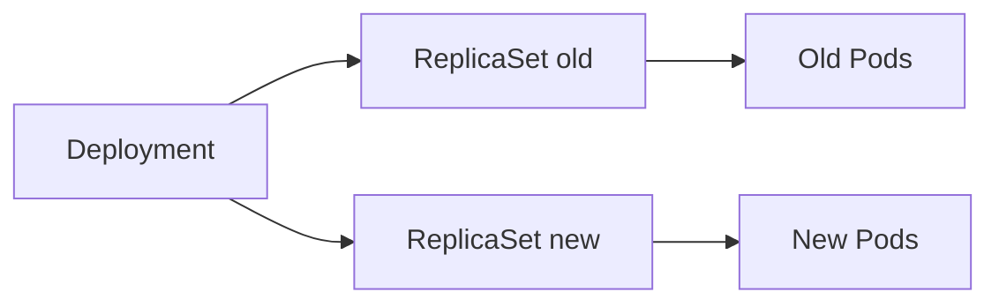

## Why this matters

A Deployment is the controller that keeps N copies of a Pod running and replaces them when the template changes. It is the Kubernetes counterpart of the ECS service rollout: minimum healthy, maximum surge, health checks, and a previous revision you can return to. If probes are wrong, the Deployment will patiently roll a bad image to 100 percent or get stuck, which is also a kind of outage.

This lesson is that controller. Services, which give the Pods a stable address, are next. You need both. A Deployment without a Service is a set of IPs. A Service without a healthy Deployment is an empty set of endpoints.

## Intuition

You change the Pod template. The Deployment creates a new ReplicaSet for the new template and scales it up while scaling the old ReplicaSet down. The ReplicaSet's only job is to keep its own replica count. The Deployment decides what those counts should be during a rollout.

`maxSurge` is how many extra Pods you may have. `maxUnavailable` is how many you may be missing. Those are the same idea as ECS maximum percent and minimum healthy percent, written as counts or percentages. Readiness gates the surge: a new Pod that is not ready does not count as available, so the old Pods stay.

Rollback is "scale the previous ReplicaSet up and the new one down." It is fast if the old ReplicaSet still exists. It does not undo a database migration. The expand-contract rule from the deployment-strategy lesson is still in force.

## Core concept in depth

### Objects

| Object | Owns | You edit it? |
| --- | --- | --- |
| Deployment | Rollout policy and the template | Yes, in git |
| ReplicaSet | A specific template's replicas | No. The Deployment edits it. |
| Pod | The running containers | No. Delete it and the ReplicaSet replaces it. |

`kubectl apply` on a hand-edited ReplicaSet will fight the Deployment. Change the Deployment. If you are using Argo CD, the Deployment in git is the only writer.

The selector labels must match the template labels. Changing the selector is not a casual edit. It can orphan ReplicaSets. Pick `app: codecraft-api` and keep it.

### Strategy

`RollingUpdate` is the default. `Recreate` kills all Pods before starting new ones. Recreate is downtime. Use it only when two versions must not run, which is a smell: you probably have a migration or a lock that should be fixed so rolling is possible.

With 2 replicas, `maxUnavailable: 0` and `maxSurge: 1`, the sequence is: start one new Pod, wait until ready, stop one old Pod, repeat. During the overlap both versions serve. They must both work against the current schema.

`progressDeadlineSeconds` marks the rollout failed if it cannot make progress. A failed rollout does not always auto-revert unless you have something watching it. `kubectl rollout undo` is the manual revert. A pipeline can run that command. Argo can roll back a revision. If self-heal is on, git must move too, or the bad template returns.

### Probes and the rollout

A new Pod is not available until the readiness probe passes. If readiness never passes, surge sits at the extra Pod, old Pods remain, and the deadline eventually fails the rollout. That is the good stuck state. Users still have the old Pods if `maxUnavailable` is 0.

If you set `maxUnavailable` high and readiness passes too early, you drain the old Pods before the new ones can really serve. The site goes empty. Keep unavailable at 0 for the API until you have a reason not to.

Liveness restarts do not create a new ReplicaSet. They restart a container in the same Pod. A crash loop on the new image looks like a rollout that never becomes ready. Read `kubectl describe` on the new Pod before you scale the Deployment to zero in a panic.

### History

`revisionHistoryLimit` keeps old ReplicaSets so undo works. Too small and you cannot undo. Too large and you keep old templates around, which is cheap but messy. 10 is a normal default. The ReplicaSet you undo to must still have an image the registry will pull. If you deleted the digest, undo cannot start the container.

Record the change cause or rely on git. `kubernetes.io/change-cause` is optional metadata. Git is the record you will actually trust if Argo is in the path.

### Jobs and CronJobs, briefly

A Deployment is for the API that should always be up. A one-shot migration or a reindex is a Job. A nightly content check is a CronJob. Do not use a Deployment with replica 1 and a process that exits. The controller will restart it forever. Do not use a Job for the API. It will run once and stop.

## Diagram / flowchart



### Dry-run: two replicas, surge 1, unavailable 0

| Step | Old ready | New ready | Traffic |
| --- | --- | --- | --- |
| Start | 2 | 0 | Old only |
| New Pod created | 2 | 0, starting | Old only |
| Readiness passes | 2 | 1 | Mixed |
| One old terminated | 1 | 1 | Mixed |
| Second new ready, last old gone | 0 | 2 | New only |
| Readiness never passes | 2 | 0 | Old only, rollout stuck. Good. |

### ECS words and Kubernetes words

| ECS | Kubernetes |
| --- | --- |
| desired count | replicas |
| maximum percent | maxSurge plus the current count |
| minimum healthy percent | related to maxUnavailable |
| target group health | readiness |
| circuit breaker rollback | rollout undo, or a controller that does it |
| task definition revision | Pod template hash and ReplicaSet |

## Code

```yaml
apiVersion: apps/v1
kind: Deployment
metadata:
  name: codecraft-api
spec:
  replicas: 2
  revisionHistoryLimit: 10
  selector:
    matchLabels:
      app: codecraft-api
  strategy:
    type: RollingUpdate
    rollingUpdate:
      maxSurge: 1
      maxUnavailable: 0
  template:
    metadata:
      labels:
        app: codecraft-api
    spec:
      containers:
        - name: api
          image: 111111111111.dkr.ecr.ap-south-1.amazonaws.com/codecraft-api@sha256:REPLACE_WITH_DIGEST
          ports:
            - containerPort: 8000
          readinessProbe:
            httpGet:
              path: /health
              port: 8000
          resources:
            requests:
              cpu: "100m"
              memory: 256Mi
            limits:
              memory: 512Mi
```

Rollout commands:

```bash
kubectl apply -f deploy.yaml
kubectl rollout status deployment/codecraft-api
kubectl rollout history deployment/codecraft-api
kubectl rollout undo deployment/codecraft-api
kubectl rollout pause deployment/codecraft-api
kubectl rollout resume deployment/codecraft-api
```

Pause is how you inspect a canary Pod before the rest proceed, if you are doing a manual canary. Resume continues. Undo returns to the previous ReplicaSet. After undo, fix git. A later apply of the bad manifest will roll forward again.

Watch the new Pod while status waits:

```bash
kubectl get pods -l app=codecraft-api
kubectl describe pod -l app=codecraft-api
```

If the new Pod is `ImagePullBackOff`, you rolled a digest the node cannot pull. That is an IAM or a typo problem, not a probe problem. If it is `CrashLoopBackOff`, read logs. If it is Running and not Ready, the readiness probe is failing. Those three states have three different fixes. `rollout status` timing out is the symptom, not the cause.

## Complexity analysis

| Setting | Availability during rollout | Extra capacity |
| --- | --- | --- |
| Recreate | None | None |
| maxUnavailable 0, maxSurge 1 | Old Pods stay until new are ready | One extra Pod |
| maxUnavailable 1, maxSurge 0 | You drop a Pod first | None |
| replicas 1, unavailable 0 | Needs surge or you cannot move | One extra, briefly |
| No readiness probe | New Pod is Ready as soon as it starts | The rollout lies |
| Undo | Fast if the old image still pulls | No schema undo |

A Deployment is not a canary controller. It will finish the roll once probes pass. For a percentage canary you want a tool that understands weights, or a flag inside one Deployment. Do not confuse pause with a productized canary. Pause is a human holding the gate.

## Tricks, tips and patterns

- `maxUnavailable: 0` for the API. Spend one extra Pod.
- Digests in the template. The template change is what creates a new ReplicaSet.
- Keep `revisionHistoryLimit` high enough to undo the last known good.
- Split "cannot pull," "crashes," and "not ready." Do not undo blindly before you know which.
- The selector is a contract with the Service. Change it in the same commit as the Service, or do not change it.
- Jobs for migrations, Deployments for the server. Do not invert them.
- If two versions cannot run, fix the compatibility. Recreate is the escape hatch, not the design.
- After undo, commit the old digest so GitOps does not resurrect the bad one.

## Common mistakes and edge cases

- Changing labels so the selector no longer matches, which stalls the rollout or orphans Pods.
- A readiness probe that always succeeds, so a broken app rolls out fully.
- `maxUnavailable` equal to replicas, which is recreate.
- Deleting the old ReplicaSet to "clean up," then discovering undo has nothing to scale.
- A rolling update together with a column drop.
- Editing the live Deployment with `kubectl edit` and losing the change at the next apply.
- Using the same Deployment for a batch worker that should be a Job.
- Forgetting that a crash loop in one new Pod, with unavailable 0, leaves the old version serving. That is success of a kind. Do not "fix" it by setting unavailable to 100 percent.

## Interview notes

**What does a Deployment do that a Pod does not?**
It keeps the desired replica count and performs a controlled replacement of the Pod template through ReplicaSets. A bare Pod is not recreated and has no rollout history.

**Walk a rolling update with two replicas, surge 1, unavailable 0.**
One new Pod starts. Traffic stays on the old Pods until the new one is ready. Then an old Pod is removed. Repeat. If the new Pod never becomes ready, the old Pods remain.

**How do you roll back?**
`kubectl rollout undo` scales the previous ReplicaSet up. Then change git to that digest. Undo does not migrate the database backward.

**Why might rollout status hang?**
Image pull failure, crash loop, or readiness failing. Describe the new Pod and read the events. Those are different bugs.

**How is this like ECS?**
Replicas are desired count. maxSurge and maxUnavailable are the capacity bounds. Readiness is the target health check. Undo is the previous task definition. The coexistence rule for schemas is identical.

## Practice problems

1. Set replicas to 1 and unavailable to 0. Can the rollout proceed, and what surge do you need?
2. The new Pod is Running, Ready is false, and the old Pods are still up. Is the site down? What do you inspect?
3. You undo a rollout and Argo immediately rolls forward. What state did you forget to change?
4. A migration Job and a Deployment ship in one commit and the Job drops a column. What do the old Pods do during surge?
5. Explain why deleting a Pod is fine and deleting the ReplicaSet is not.

## Summary / cheat sheet

- Deployment owns the template and the rollout. ReplicaSets own a version's Pods.
- Rolling update with unavailable 0 and surge 1 keeps the old Pods until the new ones are ready.
- Readiness is the gate. Liveness restarts do not create a new revision.
- Undo needs history and an image that still pulls. Then fix git.
- Recreate means downtime. Use it only when two versions must not overlap, and treat that as a design smell.
- Jobs exit. Deployments do not.
- ImagePullBackOff, CrashLoopBackOff, and not-Ready are three bugs.
- Schema compatibility still rules. The controller will not save a bad migration.

## Further reading

- [Deployments](https://kubernetes.io/docs/concepts/workloads/controllers/deployment/)
- [Rolling updates](https://kubernetes.io/docs/tutorials/kubernetes-basics/update/update-intro/)
- [ReplicaSet](https://kubernetes.io/docs/concepts/workloads/controllers/replicaset/)
- [kubectl rollout](https://kubernetes.io/docs/reference/kubectl/generated/kubectl_rollout/)
- [Jobs](https://kubernetes.io/docs/concepts/workloads/controllers/job/)
