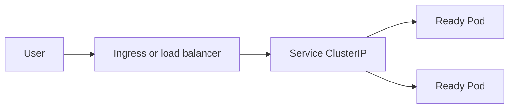

## Why this matters

Pods die and their IPs change. A Deployment rollout creates new IPs on purpose. Nothing in the cluster should call a Pod IP it learned yesterday. A Service is a stable virtual IP and a DNS name that selects Pods by label and load-balances across the ones that are ready. Without it, the frontend cannot find the API, and the Ingress in the next lesson has nothing to point at.

This is also where "the network is flat" becomes a design rule. Every Pod can reach every Service unless a NetworkPolicy says otherwise. The sandbox Pod should not be able to reach the database Service. That sentence is a policy object, not a hope.

## Intuition

A Service has a selector. Kubernetes keeps an Endpoints (or EndpointSlice) object listing the IPs of Pods whose labels match and whose readiness is true. kube-proxy, or a replacement dataplane, programs the node so that traffic to the Service IP is forwarded to one of those Pod IPs.

DNS does the name. `codecraft-api.codecraft.svc.cluster.local` resolves to the Service IP, not to a Pod. You almost always use the short name `codecraft-api` from another Pod in the same namespace.

ClusterIP is the default and is reachable only inside the cluster. NodePort opens a port on every node. LoadBalancer asks the cloud for an external load balancer. For CodeCraft, the API is a ClusterIP. The thing users hit is an Ingress or a single LoadBalancer in front of the frontend and the API, not a LoadBalancer per Pod.

## Core concept in depth

### Types

| Type | Who can connect | Typical CodeCraft use |
| --- | --- | --- |
| ClusterIP | Inside the cluster | API, database client endpoint if you run a proxy |
| NodePort | Node IP plus a high port | Debug only. Do not publish the API this way. |
| LoadBalancer | A cloud load balancer | The edge, ideally one, in front of Ingress |
| ExternalName | A DNS CNAME | Rare here. Easy to hide a dependency. |
| Headless, clusterIP None | DNS returns Pod IPs | Stateful sets. Not the API. |

A headless Service is how a StatefulSet lets clients find pod-0 and pod-1. The API is stateless. It wants one VIP and no identity per Pod.

### Readiness and endpoints

Not Ready Pods are removed from the EndpointSlice. That is why the readiness probe is a traffic control and not just a dashboard. A Service without ready Pods still has a DNS name and a VIP. Connections fail or time out. The name resolving does not mean the app is healthy. Check endpoints when "DNS works and the request does not."

```bash
kubectl get endpointslices -l kubernetes.io/service-name=codecraft-api
```

If the slice is empty, the selector does not match, or no Pod is ready. Those are the two bugs. A selector typo is silent. The Service is happy. It has nowhere to send packets.

### Cluster DNS and ports

The Service port is the port clients use. The targetPort is the container port. They can differ. Clients should use the Service port. If you change the container to listen on 8080 and forget the targetPort, the Service still listens on 8000 and forwards to whatever targetPort you wrote, which might be the old 8000 where nothing listens.

`http://codecraft-api:8000` from another Pod in the namespace is the normal URL. From a different namespace, use `codecraft-api.codecraft.svc`. From your laptop, neither works until you port-forward or go through the Ingress. Do not tell the frontend container to use localhost for the API. Localhost is the frontend Pod.

### NetworkPolicy

Default is allow all. A policy that selects the sandbox Pods and allows egress only to DNS, and nothing else, is the Kubernetes form of `--network none` if you can live without DNS, or DNS-only if you cannot. The API Pods need egress to the database and to DNS, and ingress from the Ingress controller. Write those policies explicitly in a cluster that runs untrusted code. A policy that selects nothing is a policy that does nothing. Check the pod labels you select.

Policies are enforced by the CNI plugin. If the cluster has no policy engine, the YAML applies and does not enforce. Know which CNI you run before you claim the sandbox is isolated.

### What is not a Service

An Ingress is a routing rule in front of Services. A Gateway API object is the newer version of that idea. An AWS target group is the cloud object a LoadBalancer Service or the AWS Load Balancer Controller creates. Do not create a Kubernetes LoadBalancer Service for the API and also an Ingress that creates another load balancer, unless you want two bills and a confusing path. Pick one edge.

## Diagram / flowchart



### Dry-run: rollout and the slice

| Moment | EndpointSlice | What a caller sees |
| --- | --- | --- |
| Two ready Pods | Two IPs | Success |
| New Pod not ready | Still the old IPs | Success on old Pods |
| New Pod ready, old terminating | Both, then the new ones | Mixed versions, which you already accepted |
| Selector edited by mistake | Empty | Timeouts, DNS still answers |
| All Pods crash | Empty | Timeouts |

### Name lookup

| Caller | Address |
| --- | --- |
| Frontend Pod, same namespace | `http://codecraft-api:8000` |
| Job in another namespace | `http://codecraft-api.codecraft.svc:8000` |
| Browser | The Ingress hostname, never the ClusterIP |
| Laptop debug | `kubectl port-forward svc/codecraft-api 8000:8000` |

## Code

```yaml
apiVersion: v1
kind: Service
metadata:
  name: codecraft-api
  namespace: codecraft
spec:
  type: ClusterIP
  selector:
    app: codecraft-api
  ports:
    - name: http
      port: 8000
      targetPort: 8000
```

The selector matches the Deployment template labels from the previous lesson. If it does not, this file is a black hole with a DNS name.

A NetworkPolicy sketch for the sandbox namespace. The exact fields depend on the CNI, and you should test it by trying to open a connection that must fail.

```yaml
apiVersion: networking.k8s.io/v1
kind: NetworkPolicy
metadata:
  name: sandbox-deny-egress
  namespace: codecraft-sandbox
spec:
  podSelector: {}
  policyTypes:
    - Egress
  egress: []
```

An empty egress list plus `policyTypes: Egress` denies egress. DNS will break unless you add a DNS allow. If the runner does not need DNS, this is what you want. Prove it:

```bash
kubectl -n codecraft run curl-test --rm -it --image=curlimages/curl -- curl -m 5 https://example.com
```

Run that Pod in the sandbox namespace with the same labels the policy selects, or the test proves nothing. A curl that succeeds means the policy is not enforced or does not select the Pod.

Port-forward for a human:

```bash
kubectl -n codecraft port-forward svc/codecraft-api 8000:8000
```

That tunnel is not the production path. It is a debug path that bypasses Ingress and any auth the Ingress adds. Do not leave it running on a shared jump host.

## Complexity analysis

| Choice | Reach | Risk |
| --- | --- | --- |
| ClusterIP only | Inside the cluster | You must build an edge on purpose. Good. |
| NodePort | Anyone who can hit the node | Bypasses Ingress rules |
| LoadBalancer per service | Easy externally | Cost and a wide surface |
| One edge, many ClusterIPs | One bill, one TLS place | The edge becomes important. Run two replicas. |
| No NetworkPolicy | Simple | Sandbox can talk to the database if it can route |
| Policy with no CNI enforcement | A comforting YAML | No enforcement |
| Headless for the API | Direct Pod IPs | Clients must handle churn. Unnecessary. |

kube-proxy's iptables mode is fine at CodeCraft's size. You do not need a custom dataplane to ship. You do need to know that the Service IP is not a process. Nothing listens there except the programmed rules. A tcpdump on the Pod is where the packets arrive.

## Tricks, tips and patterns

- Select the same labels the Deployment sets. Review both files in one pull request.
- Name the port. Ingress and probes can refer to the name.
- Use ClusterIP for the API. Put TLS and host routing on the Ingress.
- Check EndpointSlices when DNS works and HTTP does not.
- Short DNS names are namespace-local. A Job in `batch` cannot use the short name.
- Deny sandbox egress and test the deny.
- Do not bake the ClusterIP into config. It can change if the Service is recreated. Use the DNS name.
- One LoadBalancer for the edge, not one per microservice.

## Common mistakes and edge cases

- Selector `app: api` and Pods labeled `app: codecraft-api`. Empty endpoints.
- Browser pointed at a ClusterIP. It is not routed on the internet.
- Frontend Pod using `localhost:8000` because Compose did that for the host. Inside Kubernetes, localhost is not the API.
- NodePort left open after a debug session.
- NetworkPolicy in a cluster whose CNI ignores it.
- A policy that allows all egress because you added a broad CIDR to "fix DNS" and never tightened it.
- ExternalName to a database hostname, which skips network policy expectations and hides the dependency in DNS.
- Forgetting targetPort after the container port changes.

## Interview notes

**What problem does a Service solve?**
Pods have changing IPs. The Service gives a stable VIP and DNS name and forwards to ready Pods that match a selector.

**Why does DNS succeed while requests fail?**
The Service name points at the VIP even when no Pod is ready or the selector matches nothing. Check the EndpointSlices and the readiness probes.

**ClusterIP versus LoadBalancer for the API?**
ClusterIP. Users should hit one edge load balancer or Ingress. A LoadBalancer per service costs money and bypasses shared TLS and routing rules.

**How do you keep the sandbox off the database?**
A NetworkPolicy that selects sandbox Pods and denies egress, enforced by a CNI that implements policy. Then a test that tries to connect and must fail. YAML alone is not enforcement.

**What is the in-cluster URL?**
From the same namespace, the Service name and port. From another namespace, add the namespace and `svc`. From a browser, the public hostname. Never the Pod IP and never localhost.

## Practice problems

1. The Service exists and `get endpointslices` is empty. List the two causes and the commands that distinguish them.
2. Rewrite the Compose habit `localhost:8000` as the correct URL for a frontend Pod in the same namespace.
3. Write the NetworkPolicy intent for the sandbox and the test that proves it.
4. A teammate creates a LoadBalancer Service for the API and an Ingress. What are you paying for twice, and which one do you delete?
5. Explain targetPort versus port when the container moves from 8000 to 8080 and clients must not change.

## Summary / cheat sheet

- Services select ready Pods and give them a stable name and VIP.
- ClusterIP for the API. One edge in front. No NodePort in prod.
- Empty endpoints mean a bad selector or no ready Pods. DNS will not tell you.
- Same-namespace short names. Cross-namespace needs the namespace.
- NetworkPolicy is allow-all until you write a deny and the CNI enforces it.
- Do not colocate a debug port-forward with the threat model of the sandbox.
- Labels must match the Deployment. Change them together.
- The Service IP is not a process. Packets are forwarded to Pod IPs.

## Further reading

- [Service](https://kubernetes.io/docs/concepts/services-networking/service/)
- [DNS for Services](https://kubernetes.io/docs/concepts/services-networking/dns-pod-service/)
- [EndpointSlices](https://kubernetes.io/docs/concepts/services-networking/endpoint-slices/)
- [NetworkPolicy](https://kubernetes.io/docs/concepts/services-networking/network-policies/)
- [Virtual IPs and service proxies](https://kubernetes.io/docs/reference/networking/virtual-ips/)
