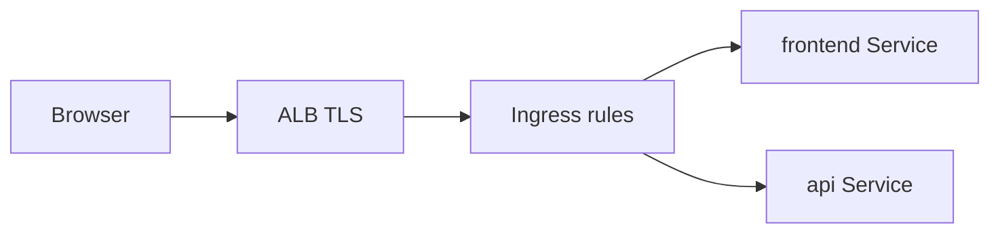

## Why this matters

Users do not open a ClusterIP. North-south traffic is the path from the internet into the cluster. An Ingress is a rule: this host and this path go to that Service. An Ingress controller is the process that makes the rule true, usually by configuring a load balancer or a proxy. The rule without the controller does nothing. The controller without a careful rule publishes more than you meant.

CodeCraft needs one public hostname for the site and a way to reach the API, either on the same host under a path or on `api.` as a separate host. TLS terminates somewhere on this path. If you terminate it in three places by accident, you will debug a certificate that is not the one the browser sees.

## Intuition

Think of Ingress as a small routing table and the controller as the router. On AWS the AWS Load Balancer Controller can create an ALB and register targets. NGINX Ingress runs Pods and typically sits behind one Network Load Balancer or the cloud load balancer. Both can implement the same Ingress object. They do not honor every annotation the other one invented. Pick a controller and read its docs for TLS, timeouts, and body size. A student code submission can be a large POST. The default body limit might reject it.

Gateway API is the newer Kubernetes API for the same job, with more roles for who owns the gateway versus the route. Learn Ingress first. You will meet it constantly. Mention Gateway API in an interview as the successor, and do not pretend they are the same object.

## Core concept in depth

### Controller versus object

Applying an Ingress on a cluster with no controller leaves the object Accepted or simply pending forever, depending on version and class. `ingressClassName` selects which controller handles it. If you install two controllers, an Ingress with no class might be claimed by both or by neither. Set the class.

The controller watches Ingress objects and Services and programs the data plane. For an ALB, the targets are node ports or Pod IPs, depending on the target type. IP targets skip an extra hop and need the Pods to be reachable from the ALB, which on AWS means the right subnets and security groups. The controller usually manages those groups. If you also hand-edit them, it will fight you.

### Hosts and paths

A host rule for `academy.example.com` sends `/` to the frontend Service and `/api` to the API Service. Path type matters. `Prefix` matches a prefix. `Exact` matches one path. `ImplementationSpecific` means "whatever this controller does," which is a portability bug. Use Prefix and Exact.

Order and overlap are a common outage. A Prefix of `/` swallows `/api` if it is evaluated first and the controller does not choose the longest match. Most controllers use the longest path. Do not rely on that until you have tested `/api` and `/`. A separate host for the API avoids the overlap.

The frontend still needs the public API URL baked or configured as a browser-reachable URL. Inside the cluster the frontend Pod might call `http://codecraft-api:8000`. The browser cannot. If both the page and the browser call the API, you have two URLs on purpose. Document them.

### TLS

A certificate lives in a Secret. The Ingress tls block names the host and the Secret. cert-manager can create and renew that Secret from Let's Encrypt or from ACM. On AWS, terminating TLS on the ALB with an ACM certificate is fewer moving parts than running cert-manager, and the traffic from the ALB to the Pod may be HTTP inside the VPC. Know which hop is encrypted. "We use HTTPS" is incomplete if the ALB talks HTTP to a Pod on a shared node network and you assumed otherwise.

Redirect HTTP to HTTPS at the edge. Do not run the API in cleartext on a public NodePort beside the Ingress.

### Timeouts, size, and headers

Code execution can take seconds. The ALB idle timeout and the proxy read timeout must be longer than a normal run and shorter than a runaway. The sandbox has its own kill timer. The proxy timeout should agree with it or the user sees a 504 while the run continues.

`proxy-body-size` or the ALB equivalent must allow the submission payload. A 1 MB default will fail a reasonable paste and look like an application bug.

Forwarded headers tell the API the original scheme and client. If the app generates links, it needs `X-Forwarded-Proto` and it must be configured to trust only the ingress, or a client can spoof the scheme.

### What Ingress is not

It is not a service mesh. East-west traffic between API and database does not go through the Ingress. It is not authentication by itself, though you can add an auth annotation. It is not a replacement for NetworkPolicy. A public Ingress to the API Service means anyone who can reach the host can hit the Service's paths. Auth belongs in the app or a real gateway policy.

## Diagram / flowchart



### Dry-run: a request to a lesson page and a request to the API

| Request | Host and path | Service | Port |
| --- | --- | --- | --- |
| Lesson page | `academy.example.com/` | frontend | 3000 |
| Browser calls API | `academy.example.com/api/...` | api | 8000 |
| Server-side fetch inside the frontend Pod | Cluster DNS, not the public host | api | 8000 |

The third row avoids a hairpin through the public ALB for server-side calls. The browser cannot use that internal name.

### Controller choices

| Controller | Edge | Watch-outs |
| --- | --- | --- |
| AWS Load Balancer Controller | ALB per Ingress or a grouped ALB | Annotations are AWS-specific. Group Ingresses to avoid an ALB each. |
| NGINX Ingress | Proxy Pods behind one LB | ConfigMap and annotation dialect |
| No controller | Nothing | The object sits there |

## Code

An Ingress that splits the site and the API on one host. Class name must match what you installed.

```yaml
apiVersion: networking.k8s.io/v1
kind: Ingress
metadata:
  name: codecraft
  namespace: codecraft
  annotations:
    alb.ingress.kubernetes.io/scheme: internet-facing
    alb.ingress.kubernetes.io/target-type: ip
    alb.ingress.kubernetes.io/certificate-arn: arn:aws:acm:ap-south-1:111111111111:certificate/REPLACE
spec:
  ingressClassName: alb
  rules:
    - host: academy.example.com
      http:
        paths:
          - path: /api
            pathType: Prefix
            backend:
              service:
                name: codecraft-api
                port:
                  number: 8000
          - path: /
            pathType: Prefix
            backend:
              service:
                name: codecraft-frontend
                port:
                  number: 3000
```

Group Ingresses with the controller's group annotation if the frontend and the API are separate objects, so you get one ALB. Two ALBs means two hostnames or a fight over the same DNS name.

Check what the controller did:

```bash
kubectl describe ingress codecraft
kubectl get ingress codecraft -o wide
```

The address field should become the ALB hostname. Point DNS at it. A CNAME to that hostname is the usual shape. The Route 53 lesson is the DNS side. Until the CNAME exists, the Ingress can be correct and the browser still cannot find it.

Test both paths:

```bash
curl -fsS https://academy.example.com/api/health
curl -fsI https://academy.example.com/
```

If `/api/health` returns the frontend's HTML, the path rule is not winning. Fix the controller's match, do not "fix" it by moving the API to a strange port the frontend happens to ignore.

## Complexity analysis

| Choice | Cost | Failure |
| --- | --- | --- |
| One ALB, path routing | One load balancer | Longest-match bugs |
| Separate hosts | Clearer | More certificates and DNS |
| TLS at ALB with ACM | Managed renewal | Pod hop may be HTTP |
| TLS at NGINX with cert-manager | Portable | You run renewal |
| NodePort plus a hand-built LB | Control | You will drift from the controller |
| Auth only in the UI | None | The API path is public |
| Default body size | None | Large submissions 413 or 502 |

Path routing is enough for CodeCraft if you test `/api` against `/`. Separate hosts are worth it when cookies and CORS get confusing. Same-origin `/api` avoids a CORS preflight. That is a reason to prefer the path design for a browser app.

## Tricks, tips and patterns

- Set `ingressClassName`. Do not hope the default controller is the one you installed.
- Group AWS Ingresses so you do not pay for an ALB per namespace by accident.
- Test the longest path explicitly.
- Align proxy timeouts with the sandbox kill timer.
- Raise the body size before users hit it.
- Trust forwarded headers only from the ingress.
- Server-side calls use Cluster DNS. Browser calls use the public host.
- Describe the Ingress when the address stays empty. The events usually say the subnet or the IAM role is wrong.

## Common mistakes and edge cases

- An Ingress and no controller.
- Annotations for NGINX applied to an ALB class. They are ignored. The rule half-works.
- Prefix `/` registered in a way that steals `/api`.
- ACM certificate in the wrong region. ALBs want the cert in the same region.
- HTTP only, and a secure cookie that the browser will not send.
- A 504 that is the proxy timeout, while the API log shows the run finished later.
- Publishing the sandbox Service through the same Ingress. Students would reach the runner directly. Only the API is public.
- Forgetting the frontend is a Service too. The Ingress cannot target a Deployment name. It targets a Service.

## Interview notes

**Ingress versus Service?**
A Service is a stable VIP inside the cluster. An Ingress is a host and path rule that sends external HTTP to a Service. You need a controller to implement the Ingress.

**Why is there an ALB and also a Service?**
The ALB is the public entry. The Service is the in-cluster VIP the ALB or the proxy targets. Deleting the Service because "the ALB exists" removes the backends.

**Where does TLS terminate?**
Wherever you configured it, often the ALB via ACM. Say whether the hop to the Pod is encrypted. Do not claim end-to-end TLS if that hop is HTTP.

**How should the browser and the frontend Pod call the API?**
The browser uses the public host and path. The Pod uses the ClusterIP DNS name. Localhost is neither.

**What do you check when the hostname does not resolve to the new Ingress?**
The Ingress address, the controller events, then DNS. A correct object with no CNAME is invisible to users.

## Practice problems

1. `/api/health` returns the Next.js page. Explain a path-rule cause and how you would confirm it.
2. You have three LoadBalancer Services and one Ingress. Which bills do you cut, and what must stay public?
3. A 1 MB submission fails and a tiny one works. Which proxy setting is the first suspect?
4. Draw TLS termination on the ALB and say what the Pod sees. What header must the app trust, and from whom?
5. The Ingress address is empty. List three controller problems `describe` might show.

## Summary / cheat sheet

- Ingress is rules. The controller is the implementation. `ingressClassName` picks it.
- One public edge, path or host to ClusterIP Services, not NodePorts.
- Test `/api` against `/`. Longest match is a behavior you verify.
- TLS at ACM on the ALB is the simple AWS path. Know if the next hop is HTTP.
- Timeouts and body size must fit a code run.
- Browser URL and in-cluster URL are different.
- Do not expose the sandbox Service.
- Empty address means controller, IAM, or subnets. Then DNS.

## Further reading

- [Ingress](https://kubernetes.io/docs/concepts/services-networking/ingress/)
- [AWS Load Balancer Controller](https://kubernetes-sigs.github.io/aws-load-balancer-controller/)
- [NGINX Ingress annotations](https://kubernetes.github.io/ingress-nginx/user-guide/nginx-configuration/annotations/)
- [cert-manager](https://cert-manager.io/docs/)
- [Gateway API](https://gateway-api.sigs.k8s.io/)
