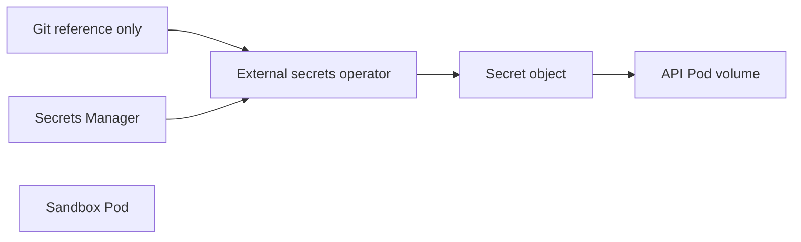

## Why this matters

The API needs a content path, a log level, and a database password. Those are not the same kind of data, and none of them should be baked into the image if they change per environment. ConfigMaps and Secrets are Kubernetes objects the Pod can see as environment variables or as files. The image stays the same digest across dev and prod. The configuration changes.

The failure mode is treating a Secret as encrypted because it looks scrambled, mounting the API's environment into the sandbox, or assuming a changed ConfigMap restarts the process. It does not. This lesson is how configuration actually arrives in the container.

## Intuition

A ConfigMap is a bag of string keys for non-secret config. A Secret is a bag of keys you intend to keep quieter: the database password, a signing key. Both can be projected as files in a volume or as environment variables. Files can be updated while the Pod runs. Environment variables are a snapshot at process start. A long-running API will not see an env-var change until the Pod is recreated.

Base64 in a Secret manifest is encoding so binary values survive YAML. Anyone who can `kubectl get secret -o yaml` can decode it. Encryption is a separate feature of the API server's storage, or you never put the plaintext in etcd at all and use an external secret store.

The sandbox must get a clean environment. If you use `envFrom` on the API Secret and copy the same block into the sandbox Pod, student code can read the database password from the environment. Give the sandbox a volume for `/tmp` and no secret.

## Core concept in depth

### What belongs where

| Data | Object | Why |
| --- | --- | --- |
| Log level, public API hostname for server-side calls | ConfigMap | Not a credential |
| Database password | Secret, or external store projected as a Secret | Credential |
| Lesson MDX tree | A volume, not a ConfigMap | Too large. ConfigMaps are capped around 1 MiB. |
| Image digest | The Deployment spec | It is identity, not config |
| Feature flag percent | ConfigMap or a database row | A flag store if you need a fast kill. A ConfigMap update still needs consumers to reload. |

Do not put `NEXT_PUBLIC_` browser values only in a ConfigMap and expect the already-built JavaScript to change. Those were compile-time. Runtime config for the browser is an endpoint the page fetches.

### Files versus environment

Mount a Secret as a file when the process can reread it, or when you do not want the value in the environment block that shows up in a crash dump and in `/proc`. Many libraries read the password once at startup anyway. Then a file does not buy you live rotation, but it still keeps the value out of `kubectl describe pod`, which prints environment variables and does not print the contents of a mounted Secret file.

`subPath` mounts are not updated when the Secret changes. A directory mount of the Secret volume does update the files, eventually, via the kubelet's sync. The application still must notice. Uvicorn will not reload its database URL because a file changed unless you wrote that loop. For CodeCraft, a password rotation means a rolling restart, on purpose, during a window. Document that. Do not promise live rotation you did not build.

`optional: true` on a key you can live without. Do not mark the database password optional or the API will boot and fail every request with a confusing auth error.

### Immutable and size

An immutable ConfigMap cannot be edited in place. You create a new one and point the Deployment at it, which rolls the Pods. That is a feature for config you want tied to a revision. Mutable ConfigMaps are easy to edit and easy to drift from git. If Argo or Terraform owns the object, you should not `kubectl edit` it either way.

A ConfigMap is not a content delivery network. The lesson corpus does not go in one. Mount the content from a volume the platform provides, or bake it into the image as the deploy design chooses. Stuffing a large file into a ConfigMap will be rejected by the API server.

### Secrets at rest and in git

If the manifest in git contains the password, the Secret object is theater. Git history has it. Use an external secrets operator: git holds a reference, the operator talks to AWS Secrets Manager, and the Secret appears in the namespace. The API Pod mounts that Secret. IAM for the operator is the new blast radius. Scope it to the CodeCraft secret names.

etcd encryption encrypts Secret data at rest on the cluster. It does not stop a user with RBAC `get secrets` from reading them. RBAC is the control. Developers do not need `get` on prod Secrets. CI does not need it if the operator creates them.

### The sandbox boundary

The API Pod's service account can pull the password. The sandbox Pod's service account should not be able to get Secrets at all, and it should not mount the API Secret. A shared service account "for simplicity" is how student code calls the API server and reads the Secret. Disable automount of the API token on the sandbox if the runner does not need to call Kubernetes. A token in the sandbox is a cluster credential.

## Diagram / flowchart



The sandbox is not on this path.

### Dry-run: rotate the database password

| Step | API behavior |
| --- | --- |
| New password in the secret manager | Operator updates the Secret object |
| File mount, app does not reread | Still uses the old password until restart |
| Rolling restart | New Pods read the new file at start |
| Old Pods still running during surge | They still have the old password. Both must work, or you rotate in two steps. |
| Sandbox | Unaffected, because it never had the password |

Two-step rotation: add the new password as valid on the database, roll the API, then remove the old password. A single cutover during a rolling update breaks the Pods that have not restarted.

### Visibility

| Mechanism | Visible in `describe pod` | Updates without restart |
| --- | --- | --- |
| Environment variable | Names and values, yes | No |
| Env from a Secret | Values shown | No |
| Volume mount | Mount path, not contents | Files change, app must reread |
| subPath mount | Mount path | No |
| Baked into image | In the image | Only a new digest |

## Code

ConfigMap and Secret projected into the API. The password here is a placeholder so the shape is clear. Do not commit a real password. In production the Secret is created by the operator, not by this file.

```yaml
apiVersion: v1
kind: ConfigMap
metadata:
  name: codecraft-api
  namespace: codecraft
data:
  LOG_LEVEL: info
  CONTENT_DIR: /content
---
apiVersion: v1
kind: Secret
metadata:
  name: codecraft-api-db
  namespace: codecraft
type: Opaque
stringData:
  DB_PASSWORD: replace-me
```

`stringData` is plaintext in the manifest and is stored as base64 in etcd. It is convenient and it is not encryption.

The Pod fragment:

```yaml
envFrom:
  - configMapRef:
      name: codecraft-api
volumeMounts:
  - name: db
    mountPath: /secrets/db
    readOnly: true
volumes:
  - name: db
    secret:
      secretName: codecraft-api-db
```

The process reads the password from `/secrets/db/DB_PASSWORD`. It does not also import the Secret via `envFrom`. One path.

A sandbox Pod that refuses the API token:

```yaml
automountServiceAccountToken: false
```

And no `envFrom` of `codecraft-api-db`.

Verify:

```bash
kubectl -n codecraft exec deploy/codecraft-api -- ls /secrets/db
kubectl -n codecraft get secret codecraft-api-db -o jsonpath='{.data.DB_PASSWORD}'
```

The second command prints base64 to your terminal. That is why RBAC on `get secret` matters. Do not run it in a shared CI log.

## Complexity analysis

| Approach | Rotation | Leak risk |
| --- | --- | --- |
| Env var from Secret | Needs restart | `describe`, crash dumps, child processes |
| File mount | Restart unless the app reloads | Lower. The file is still root-readable in the container if you run as root. |
| Password in the image | New image | The registry and every node |
| Password in git | Instant, and forever | History |
| External secrets operator | Restart or reload | The operator's IAM and the store |
| Same env on the sandbox | Easy | Student code sees production credentials |

Running as non-root does not hide an environment variable from the process. The process is the student code. Environment is the wrong place for a secret in any Pod that executes untrusted work. It is a questionable place in the API too.

## Tricks, tips and patterns

- ConfigMap for knobs, Secret for credentials, volume for content.
- One projection path. Do not mount and also inject the same password as env.
- Roll the API to pick up a new password. Do not pretend Uvicorn noticed.
- Two-step database rotation so old and new Pods overlap safely.
- Externalize prod secrets. Commit references.
- `automountServiceAccountToken: false` on the sandbox.
- Immutable ConfigMaps when you want a revision, not a live edit.
- Keep lesson files out of ConfigMaps. They will not fit, and they do not need the API server as a CDN.

## Common mistakes and edge cases

- Believing base64 is encryption.
- `kubectl edit secret` in prod while git and the operator overwrite it.
- Optional database password, so the Pod starts and every query fails.
- A 2 MiB ConfigMap of lesson text. The API server rejects it or you have made etcd a content store.
- Sandbox `envFrom` copied from the API manifest.
- subPath mount and a rotation that "does not work" because the file is a frozen copy.
- Granting every developer `get` on Secrets so they can debug. Give them logs and a break-glass role.
- A ConfigMap used as a feature flag with a 60-second kubelet sync and an app that never rereads. The kill switch is a restart. Say so.

## Interview notes

**Is a Secret encrypted?**
Not because it is a Secret. It is base64 in the API. Encryption at rest is a cluster setting. RBAC decides who can read it. Plaintext in git bypasses all of that.

**Why will my process not see the new ConfigMap value?**
Environment variables are fixed at start. File mounts update only if you did not use subPath, and only if the process reads the file again. Plan on a rolling restart for the API.

**What must the sandbox not receive?**
The database Secret, the API's service account token, and the API environment. Untrusted code plus `envFrom` is a credential dump.

**Where do lesson files go?**
A volume or the image, not a ConfigMap. ConfigMaps are small and are stored in etcd.

**How do you rotate the database password during a rolling update?**
Make both passwords valid, roll the Pods, then revoke the old one. A hard cutover breaks the Pods that still hold the old value.

## Practice problems

1. A teammate says the Secret is safe because `get secret` shows gibberish. Decode the argument and name the controls that actually matter.
2. You changed a ConfigMap env value and the API still logs at the old level. Why, and what do you roll?
3. Design the sandbox Pod's environment. List three keys that must be absent.
4. Lessons were added to a ConfigMap and the apply failed or the cluster got slow. What limit did you hit, and where should the files live?
5. Describe a two-step database password rotation that survives `maxUnavailable: 0`.

## Summary / cheat sheet

- ConfigMaps are configuration. Secrets are credentials. Neither is a content store.
- Base64 is not encryption. RBAC, encryption at rest, and keeping plaintext out of git are.
- Env is a snapshot. File mounts can update. The app still needs a restart unless it reloads.
- Do not use subPath if you expect updates.
- External secrets for production. Commit a reference.
- The sandbox gets no API Secret and no API token.
- Rotate passwords so old and new Pods overlap.
- Browser build-time config is not a ConfigMap problem. It was baked into the image.

## Further reading

- [ConfigMaps](https://kubernetes.io/docs/concepts/configuration/configmap/)
- [Secrets](https://kubernetes.io/docs/concepts/configuration/secret/)
- [Good practices for secrets](https://kubernetes.io/docs/concepts/security/secrets-good-practices/)
- [External Secrets Operator](https://external-secrets.io/latest/)
- [Encrypting Secret data at rest](https://kubernetes.io/docs/tasks/administer-cluster/encrypt-data/)
