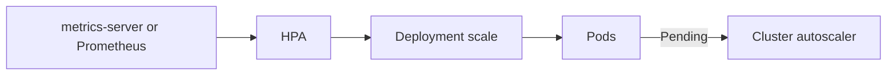

## Why this matters

A fixed replica count of 2 survives a small rollout and falls over when a class of students hits search at once. The Horizontal Pod Autoscaler changes the Deployment's replica count from a metric. It does not make a slow query fast, and it does not replace a memory limit on the sandbox. Used well, it keeps the API inside its latency SLO. Used badly, it scales a crash loop, fights a rolling update, or multiplies a Pod that has no CPU request so the percent is fiction.

This lesson is the HPA: what it reads, how it decides, and how it should differ between the API and the sandbox.

## Intuition

The HPA controller reads a metric, compares it to a target, and sets `replicas` on the scale subresource. CPU utilization is "usage divided by request," not usage divided by the node's size. A Pod with no CPU request cannot have a CPU percentage. The HPA will not do what you think.

Scale-up should be quicker than scale-down. A traffic spike hurts now. A scale-down that is too eager kills Pods you will need in two minutes and causes churn. Stabilization windows exist so the desired count does not flap.

The cluster autoscaler, or Karpenter, adds nodes when Pods are Pending. The HPA adds Pods. If you only add Pods and the nodes are full, the new Pods stay Pending and you did not add capacity. If you only add nodes and nothing schedules, you bought empty instances. They are a pair.

## Core concept in depth

### Metrics

CPU and memory come from metrics-server, which scrapes kubelet summary stats. That is not Prometheus. A broken metrics-server means the HPA holds the last decision or cannot compute. Check it before you tune the target.

Custom metrics come from an adapter, often Prometheus. A useful custom metric for CodeCraft is in-flight requests or request rate, not CPU, if the API is I/O bound and CPU stays low while latency climbs. Scaling on CPU would sit still during the exact incident you care about. Scaling on a queue depth or on concurrent requests matches the work.

External metrics are for things outside the cluster, such as a queue in another account. You probably do not need them on day one.

Do not scale on a metric that includes a label per user. The adapter will suffer the same cardinality problem as Prometheus. The HPA wants one number per Deployment, or a clearly aggregated one.

### The formula, in words

Desired replicas is current replicas times (current metric divided by target). If CPU is at 80 percent of request and the target is 50 percent, you are over and the count rises. The result is rounded and clamped to min and max. Min should be the number you need for a rolling update with `maxUnavailable: 0`. If min is 1, a rollout and a scale event interact badly and a single Pod is your availability story. Min 2 for the API.

Max is the budget and the blast radius. A bug that makes every request spin will scale to max and stay there. Max is a cost and safety cap, not a suggestion. Set it to a number you can afford and that the database can survive. Ten API Pods against a tiny RDS can knock the database over. The HPA does not know about RDS.

### Behavior

`scaleUp` and `scaleDown` policies limit how fast the count changes. A scale-up policy of "at most double every minute" prevents a metric glitch from going from 2 to the max in one sync. A scale-down stabilization of several minutes prevents a brief quiet period from deleting Pods.

The HPA writes the same replica field a human might edit. If you `kubectl scale` and the HPA is active, it will change the count back. Git that says `replicas: 2` will fight the HPA if a controller applies the manifest continuously. For an HPA-managed Deployment, leave replicas unset in the applied spec or accept that the HPA is the owner of that field. Argo and the HPA fight when both set replicas. Ignore differences on replicas, or stop setting them in git once the HPA exists.

### Sandbox versus API

Scale the API on user-facing load. Scale the sandbox on in-flight runs, with a much harder max, because each sandbox Pod is a place untrusted code runs. Do not use one HPA for both. Do not scale the sandbox on CPU alone if a tight CPU limit means a runaway is throttled rather than busy in the metric you expect. In-flight runs or a queue are the honest signal. A sandbox Pod that is Pending because of node scale-up adds latency to a student run. That may be acceptable. An API Pod Pending is a user-facing outage. Give the API room to surge on nodes that are already up, and let the cluster autoscaler trail it.

### What the HPA will not fix

A memory leak scales out and then each Pod gets OOMKilled. Fix the leak. A bad deploy at 100 percent error rate might lower CPU and scale down, or raise CPU and scale up, depending on the bug. Neither is a rollback. The rollout and the SLO alert still do that job. HPA is capacity. It is not correctness.

## Diagram / flowchart



### Dry-run: search traffic doubles

| Signal | CPU HPA | Concurrency HPA |
| --- | --- | --- |
| CPU stays at 20 percent of request | No scale | — |
| In-flight requests double | No scale | Scale up within the policy |
| New Pods Pending | No capacity yet | Cluster autoscaler should add a node |
| Traffic returns to normal | Scale down after stabilization | Same |
| Database CPU at 100 percent | API scale makes it worse | Same. Max must be safe for RDS. |

The dash means the CPU row is the point: the wrong metric does not move.

### Bounds for CodeCraft

| Workload | Min | Max | Metric |
| --- | --- | --- | --- |
| API | 2 | a number the database survives | request concurrency or CPU if you have measured it |
| Sandbox | 0 or 1 | small | in-flight runs |
| Frontend | 2 | modest | CPU is often fine |

Sandbox min 0 needs a scaler that allows zero, which the classic HPA does not. KEDA can scale to zero on an external trigger. If you do not have that, min 1 costs one idle sandbox. That is a cost lesson, not a reason to scale the API to zero. Do not scale the API to zero. The site would cold-start on the first student.

## Code

CPU HPA for the API. The Deployment must set CPU requests or this percentage is undefined.

```yaml
apiVersion: autoscaling/v2
kind: HorizontalPodAutoscaler
metadata:
  name: codecraft-api
  namespace: codecraft
spec:
  scaleTargetRef:
    apiVersion: apps/v1
    kind: Deployment
    name: codecraft-api
  minReplicas: 2
  maxReplicas: 8
  metrics:
    - type: Resource
      resource:
        name: cpu
        target:
          type: Utilization
          averageUtilization: 70
  behavior:
    scaleDown:
      stabilizationWindowSeconds: 300
```

If CPU is the wrong signal, a Pods metric from Prometheus looks like this in spirit: average in-flight requests per Pod, target 10. The adapter's exact object name depends on the install. The decision to use concurrency is the part that matters. Wire the adapter when the RED dashboard shows latency moving without CPU moving.

Commands:

```bash
kubectl get hpa codecraft-api
kubectl describe hpa codecraft-api
kubectl top pods -n codecraft
```

`describe` shows the current metric, the target, and whether metrics-server returned an error. "unknown" in the targets column means you are not scaling. You are hoping.

A load test in dev should move the count. If it does not, stop and fix the metric before prod. Raising max on a blind HPA is how you discover the database's connection limit at the worst time.

## Complexity analysis

| Choice | Responds to | Hazard |
| --- | --- | --- |
| Fixed replicas | Nothing | Cheap and predictable until the spike |
| CPU at 70 percent | CPU | Misses I/O-bound pain. Requires requests. |
| Concurrency target | Actual work | Needs a custom metric you must keep honest |
| min 1 | Saves a Pod | No surge room and a weak rollout |
| max too high | Big spikes | Database and cost |
| Scale-down in 0 seconds | Quiet minutes | Flap |
| HPA plus git-set replicas | — | They fight |
| One HPA for API and sandbox | Simpler YAML | Wrong blast radius |

Cluster autoscaler lag is minutes. A spike shorter than node boot will not be saved by new nodes. Keep a little headroom in the API's min or in spare node capacity if the SLO requires it. Headroom is the cost of not waiting for a VM.

## Tricks, tips and patterns

- Set CPU requests before you create a CPU HPA.
- Min replicas at least 2 for the API.
- Max is a contract with the database connection pool. Multiply pool size by max and compare to RDS `max_connections`.
- Prefer a concurrency metric if CPU is flat in incidents.
- Stabilization on the way down, a few minutes.
- Do not let git fight the HPA over `replicas`.
- Separate HPAs. The sandbox max is a security and cost cap.
- Watch Pending Pods. That means the HPA did its job and the cluster did not.

## Common mistakes and edge cases

- No metrics-server, targets unknown, and a belief that autoscaling is on.
- CPU target with no CPU request. The HPA complains or refuses.
- Scaling the crash-looping deploy because restarts use CPU.
- max 100 against an RDS that allows 50 connections.
- Scale to zero on the API with a tool you installed for the sandbox.
- A rolling update that sets replicas back to 2 from the manifest and undoes a scale-up.
- Memory-based HPA that scales out a leak until the node pool is full of OOMKilled Pods.
- Using the HPA as a rollback mechanism. It will not return you to the previous digest.

## Interview notes

**What does the HPA change?**
The replica count on a Deployment or similar scale target. It does not change the image, the probes, or the node size.

**Why is CPU utilization a percentage of the request?**
The scheduler and the HPA need a denominator. Usage without a request has no stable percent. Set the request to a measured baseline, then set the target.

**When is CPU the wrong metric for CodeCraft?**
When search latency grows and CPU stays low. Scale on in-flight requests or a similar custom metric, and still cap max so the database survives.

**How do HPA and the cluster autoscaler split the work?**
HPA adds Pods. If they cannot schedule, the cluster autoscaler adds nodes. Pending Pods are the handoff. One without the other is an incomplete scale.

**What must you not scale the same way as the API?**
The sandbox. Separate max, separate metric, no API secrets, and do not scale it so high that untrusted work crowds out the API node pool.

## Practice problems

1. The HPA target column says unknown. List the checks from metrics-server down to the Pod request.
2. Latency is bad, CPU is 15 percent, replicas stay at 2. Which metric do you add, and what max do you refuse to exceed?
3. Git declares replicas 2 and the HPA sets 6. What happens on the next Argo sync, and how do you stop the fight?
4. Each API Pod opens 20 database connections. Max replicas is 10. What must RDS allow, and what breaks first if it cannot?
5. Explain why min replicas of 1 fights `maxUnavailable: 0` during a node loss.

## Summary / cheat sheet

- HPA sets replicas from a metric. It does not fix bad code or roll back digests.
- CPU percent needs a CPU request. metrics-server must be alive.
- Prefer concurrency if CPU does not track pain.
- Min 2 for the API. Max limited by the database and the bill.
- Scale down slowly. Scale up with a cap per minute.
- HPA adds Pods. The cluster autoscaler adds nodes. Pending means the second step failed.
- Do not let git overwrite replicas every sync.
- A separate, tighter HPA for the sandbox. Never scale the API to zero for convenience.

## Further reading

- [Horizontal Pod Autoscaler](https://kubernetes.io/docs/concepts/workloads/autoscaling/horizontal-pod-autoscale/)
- [HPA walkthrough](https://kubernetes.io/docs/tasks/run-application/horizontal-pod-autoscale/)
- [metrics-server](https://github.com/kubernetes-sigs/metrics-server)
- [Cluster autoscaler](https://github.com/kubernetes/autoscaler/tree/master/cluster-autoscaler)
- [KEDA](https://keda.sh/docs/latest/concepts/)
