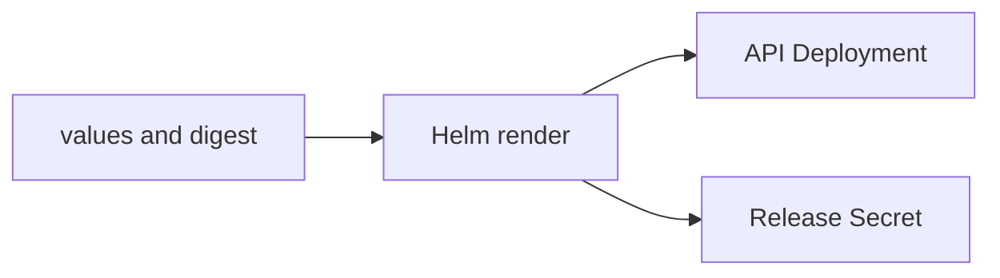

## Why this matters

You already have a Deployment, a Service, a ConfigMap, and an Ingress. Copying those files per environment and editing names by hand will drift. Helm is a package manager for Kubernetes: a chart is a set of templates, a release is an install of that chart with a values file, and an upgrade changes the release. It is not magic, and it is not required. It earns its place when the same manifests differ by digest, replica bounds, and hostname across dev and prod.

The failure mode is a template language nobody reviews, a values file with a password, and both Helm and Argo applying the same objects. Pick a renderer. Store values in git. Upgrade in a way that rolls back if the new Pods never become ready.

## Intuition

A chart is a folder: `Chart.yaml`, `values.yaml`, and `templates/`. Helm reads values and renders templates into YAML, then applies that YAML. The release name prefixes objects so two installs do not collide. `codecraft-dev` and `codecraft-prod` can be two releases of one chart.

Templates are Go templates. They are code. A small chart that substitutes a hostname and an image digest is healthy. A chart that reimplements all of Kubernetes with conditionals is a private framework. Prefer boring templates and a values file a reviewer can read without a manual.

Helm 3 keeps release state in a Secret in the cluster, not in a local tiller process. That Secret is how rollback knows the previous manifests. It is also another place configuration lives. Do not put the database password in values in git. Pass it from a secret store at install time, or have the chart create only an ExternalSecret reference.

## Core concept in depth

### Chart layout for CodeCraft

| Path | Purpose |
| --- | --- |
| `Chart.yaml` | Name, version, appVersion |
| `values.yaml` | Defaults safe for dev: small replicas, no public guesswork |
| `templates/deployment.yaml` | API Deployment |
| `templates/service.yaml` | ClusterIP |
| `templates/configmap.yaml` | Non-secret config |
| `values-prod.yaml` | Hostname, min replicas, digest |

`appVersion` is informational. The image digest in values is what actually rolls. Do not assume Helm reads `appVersion` and pulls an image.

A library chart or a dependency on the official ingress chart can save work and can surprise you with extra objects. Vendor the dependency version in `Chart.lock`. An unpinned dependency is the unpinned Terraform module problem.

### Values and environments

Dev values set `replicaCount` to 2, a dev hostname, and a digest. Prod values set the prod hostname, the HPA max, and a different digest. The template does not contain `if prod` scattered through every field if a value can express it. A few conditionals are fine: create the Ingress only if `ingress.enabled` is true.

Prod values do not contain the database password. The template mounts a Secret that already exists, named in values. The operator creates the Secret. Helm does not become the password database.

### Upgrade and rollback

`helm upgrade --install` creates or updates. `--atomic` rolls the release back if the new version does not become ready within the timeout. That is the chart equivalent of a failed rollout with undo. It depends on readiness probes. Without probes, atomic thinks the release is ready when the Pod is merely started.

`--wait` waits for readiness. Use it in CI. A pipeline that runs upgrade and immediately tests the public URL will race the rollout.

`helm rollback` returns to a previous release revision, which is the rendered manifests from that revision, including the old digest. Then fix git so the next pipeline does not upgrade forward again. Same GitOps rule as everywhere else.

`helm diff` in CI shows the rendered change in the pull request. Review the diff, not the template, when the template is hard to see. Review the template when someone adds a new conditional.

### Three-way strategic merge

Helm does not always delete a field you removed from the template the way a naive replace would. Kubernetes strategic merge and Helm's three-way merge try to reconcile the live object, the previous release, and the new render. This is how an annotation you removed can linger, or a field you think you cleared remains. When the live object is wrong, look at the release history before you blame the cluster. Forcing a replace is a bigger hammer. Understand the stuck field first.

### Who applies

Option one: CI runs Helm against the cluster. Simple, and CI holds deploy credentials.

Option two: CI renders `helm template` and commits the YAML, and Argo syncs the YAML. Argo does not need the Helm binary if you commit rendered output. The diff in git is plain YAML.

Option three: Argo's Helm support renders the chart from git. Argo holds the deploy role. CI only bumps values.

Pick one. Option one plus option three means two upgraders. The release Secret and Argo's desired state will disagree in creative ways.

Do not also apply the raw Deployment with kubectl.

### Hooks

Helm hooks can run a Job before upgrade. That Job is a migration. It has all the compatibility rules you already know. A hook that fails should fail the upgrade. A hook that is not idempotent will fail the second time and block every release. Migrations must be safe to retry.

## Diagram / flowchart



### Dry-run: prod upgrade of the digest

| Step | Cluster |
| --- | --- |
| `helm diff` in the pull request | Unchanged |
| `helm upgrade --install --atomic --wait` | New Pods must become ready |
| Probes pass | Release stays at the new revision |
| Probes fail before timeout | Atomic rollback to the previous revision |
| Git still has the bad digest | The next pipeline upgrades to the bad digest again |

Atomic saved you once. Git has to agree or you will repeat it.

### What not to template

| Tempting | Why not |
| --- | --- |
| Entire Kubernetes API behind flags | Unreviewable |
| Passwords in `values-prod.yaml` | Git history |
| A different chart for dev and prod | Two bugs |
| Hooks that drop columns | Old Pods break during the upgrade |
| Replica count and an HPA both authoritative | They fight. Template the HPA, not a fixed replicas field, if the HPA owns scale. |

## Code

A minimal values file and the image line in the Deployment template. The template uses Helm's value lookup. The braces of the template language stay in the chart files, which are not the Markdown prose.

```yaml
replicaCount: 2
image:
  repository: 111111111111.dkr.ecr.ap-south-1.amazonaws.com/codecraft-api
  digest: sha256:REPLACE_WITH_DIGEST
ingress:
  enabled: true
  host: academy.example.com
secretName: codecraft-api-db
```

The container image field in the template is the repository plus the digest, rendered from those values. Do not use `latest` as a default in `values.yaml`. A default of `latest` will be what someone installs when they forget the prod file.

Commands:

```bash
helm lint ./chart
helm template codecraft-api ./chart -f values-prod.yaml
helm diff upgrade codecraft-api ./chart -f values-prod.yaml
helm upgrade --install codecraft-api ./chart -f values-prod.yaml --atomic --wait --timeout 5m
helm history codecraft-api
helm rollback codecraft-api 4
```

`template` prints YAML. Read it in CI as a sanity check that the host and the digest are the prod ones. A lint that only checks syntax will not catch "prod file was not passed."

Pin the chart dependency versions and commit `Chart.lock` if you add dependencies. Run `helm dependency update` on purpose, not as a side effect of every install.

## Complexity analysis

| Approach | Reviewability | Deploy credential |
| --- | --- | --- |
| Raw YAML, no Helm | Highest, more copy-paste | Whoever applies |
| Small Helm chart, CI applies | Good if diffs are rendered | CI |
| Helm rendered to git, Argo applies | Plain YAML in the PR | Argo |
| Argo renders Helm | Chart in git | Argo |
| Huge upstream chart with 200 values | Low | Whoever applies |
| Chart plus kubectl apply of the same Deployment | None. They fight. | Both |

For a single API, raw YAML is acceptable. Helm becomes worth it at two environments and a handful of objects. It is not a badge. If the chart is harder to read than the YAML it produces, delete the chart.

## Tricks, tips and patterns

- Defaults in `values.yaml` should be safe if someone forgets `-f values-prod.yaml`. No public production hostname as the default. No `latest`.
- `--atomic` and real readiness probes, or atomic is a false sense of safety.
- `helm template` in CI so the prod digest is visible in logs.
- The release Secret is state. Back up the namespace or accept that rollback history lives there.
- One renderer. Helm or Argo-Helm or committed YAML.
- If the HPA owns replicas, do not set replicas in the Deployment template.
- Name releases for the environment so objects do not collide in a shared cluster. Prefer separate namespaces too.
- Keep templates dumb. Put variation in values.

## Common mistakes and edge cases

- Password in the values file that is committed.
- `--atomic` with no readiness probe, so a broken app is "successful."
- A hook Job that is not idempotent and blocks every future upgrade.
- Two releases in one namespace with the same object names because the template forgot the release name prefix.
- `latest` as the chart default.
- Editing the live Deployment, then upgrading, and watching the three-way merge keep a field you do not understand. Render and read before you force anything.
- A dependency chart that creates a LoadBalancer you did not notice until the bill.
- Using Helm to install into prod from a laptop with no `--atomic` and no git record of the values used.

## Interview notes

**What is a release?**
An installed instance of a chart with a name, a revision history, and the values that were rendered. Rollback returns to a previous revision's manifests.

**Why `--atomic`?**
If the upgrade does not become ready before the timeout, Helm rolls back. It only works if readiness means ready. Otherwise the upgrade looks successful while the app is broken.

**Where should the database password live?**
Not in git values. In a Secret created by an external secrets operator, with the chart only naming that Secret.

**Helm and Argo both updating the API. What happens?**
They overwrite each other and the diff never stays clean. Choose one applier. CI can still bump the digest in git.

**When would you skip Helm?**
When you have one environment and a few manifests that are already clear. Helm is for parameterized reuse, not for its own sake.

## Practice problems

1. Prod was upgraded without `-f values-prod.yaml` and the public host changed. What default caused it, and how do you make that mistake loud in CI?
2. `--atomic` did not roll back a crash-looping API. What probe was missing?
3. A migration hook drops a column and the upgrade times out halfway. What state are old and new Pods in, and how should the hook have been written?
4. Argo and Helm both manage `codecraft-api`. Describe one sync cycle of the fight and pick the owner.
5. The HPA set replicas to 6 and the chart sets 2. What do you remove from the template?

## Summary / cheat sheet

- Chart is templates plus values. Release is an install with history.
- Parameterize digest, host, and sizes. Do not parameterize the entire API.
- No secrets in values files. No `latest` defaults.
- `helm template` and `helm diff` before upgrade. `--atomic --wait` with real probes.
- Rollback is a previous revision, then fix git.
- Hooks are migrations and must be idempotent and compatible.
- One of Helm, Argo, or kubectl owns the objects.
- If the chart is harder to read than the YAML, stop templating.

## Further reading

- [Helm charts](https://helm.sh/docs/topics/charts/)
- [Helm upgrade](https://helm.sh/docs/helm/helm_upgrade/)
- [Helm values files](https://helm.sh/docs/chart_template_guide/values_files/)
- [Helm hooks](https://helm.sh/docs/topics/charts_hooks/)
- [Argo CD Helm](https://argo-cd.readthedocs.io/en/stable/user-guide/helm/)
