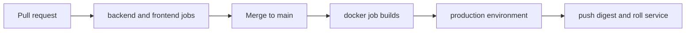

## Why this matters

CodeCraft already runs CI on GitHub Actions. The workflow lints and tests the FastAPI backend, lints and builds the Next.js frontend, and on a push builds the Compose images plus the sandbox. That file is the team's definition of "this commit is safe to merge." If it is wrong, main is wrong. If it is slow, people skip it. If it holds a long-lived cloud key, it is an incident waiting for a pull request.

Actions is not magic YAML. A workflow runs on a runner, in response to an event, with a token that can do whatever the `permissions` block allows. The rest of this module — deployment strategies, flags, GitOps — assumes this loop is boring and locked down. This lesson makes the loop explicit, using the workflow that is already in `.github/workflows/ci.yml`.

## Intuition

An event happens: a push, a pull request, a manual dispatch. GitHub starts a workflow. The workflow has jobs. Jobs run in parallel unless one needs the other. Each job is a fresh runner unless you pay for a larger environment. Steps inside a job share the runner's filesystem, so a checkout step is visible to the test step after it.

Nothing is saved unless you upload an artifact or push an image. The runner is destroyed. That is a feature. It is also why "it passed locally" and "it passed in CI" diverge when a dependency is missing from the workflow.

The `GITHUB_TOKEN` is minted for the job. Default permissions used to be broad. Set them narrow. A test job needs contents read. A job that comments on a pull request needs pull-requests write. A job that assumes an AWS role needs id-token write and should not need write access to the repository.

## Core concept in depth

### What this repository runs today

The workflow triggers on push to `main` or `master` and on any pull request. Three jobs:

**backend.** Working directory `backend`. It installs Python 3.12, installs `requirements.txt` and `requirements-dev.txt`, runs Ruff and Black, then pytest. `CONTENT_DIR` points at the repository content so tests can read lessons. `SANDBOX_DISABLED` is true so CI does not need a Docker socket to execute student code. That is the right CI default. A later, separate job can run one sandbox integration test on a locked-down runner if you need it. The unit tests should not.

**frontend.** Node 20, npm cache keyed by the lock file, `npm ci`, lint, typecheck, and build. `CONTENT_DIR` is the repo content again, because the Next build reads lessons. `NEXT_PUBLIC_API_URL` is set to localhost for the build. Remember from the Docker lessons that this value is baked into client code. CI is compiling a build whose browser calls localhost. A production workflow must set the real public URL at build time for `NEXT_PUBLIC_` variables, or the image is wrong even if the job is green.

**docker.** Needs the other two jobs, and only runs on push, not on pull requests. It builds Compose and the sandbox image. It does not push them. A green push means "the Dockerfiles still build." It does not mean "production is running this digest."

That split is sensible. Pull requests prove tests. Pushes prove images. Neither proves a deploy. Deploy is a separate workflow you add with an environment protection rule, not a step you casually append to the test job.

### Runners, concurrency, and cache

GitHub-hosted runners are the right start. They are patched, and they do not have your production network. A self-hosted runner in the VPC is faster for some builds and is a security boundary problem: a malicious pull request script runs on a machine you own. Do not point pull requests from forks at self-hosted runners.

Concurrency groups cancel outdated runs on the same pull request so you do not spend minutes testing a commit the author already replaced. Do not cancel the production deploy group. An in-flight prod apply should finish or fail visibly, not vanish because someone pushed again.

Cache `npm` the way the frontend job already does. Cache pip with the setup-python cache option. Cache is a speed tool. It is not a lock file. The lock file is the source of truth. If the cache is poisoned you delete the key. You do not debug a poisoned cache by turning off the lock file.

### Secrets, variables, and OIDC

Secrets are masked in logs and are not available to pull requests from forks unless you opt in, which you should not. Variables are non-secret configuration, such as a region name. Neither is a substitute for OIDC to AWS. The Terraform lesson's pattern belongs here: `id-token: write`, `aws-actions/configure-aws-credentials`, a role that trusts this repository and the environment.

A secret printed with a deliberate `echo` that splits the string can bypass masking. Do not write steps that debug secrets. If a step needs to show that it authenticated, print the role ARN, not the session token.

### Third-party actions

`uses: actions/checkout@v4` pins a major tag. That tag can move. For a stronger pin, use the full commit SHA. Dependabot can bump those SHAs. A tag pin is acceptable for official actions if you accept the trade. An unpinned `uses: some-action@main` is not acceptable. The action's main branch runs in your CI with your token.

Prefer actions from GitHub or from vendors you already trust. Read the action before you grant it `id-token: write`. Composite actions in the same repo are easier to review than a marketplace action that shells out to an unknown script.

### The deploy workflow you still need

Keep `ci.yml` as the test and image build. Add `deploy.yml` that:

1. Runs only on push to main, or on workflow_dispatch.
2. Depends on the image having been built and pushed to ECR by digest.
3. Uses the `production` environment so required reviewers gate it.
4. Assumes a deploy role, not the Terraform plan role, if the permissions differ.
5. Updates the ECS service to the digest that CI just pushed, or lets a GitOps controller do that from a commit. The Argo CD lesson covers the second path. This lesson's job is to not bury that update inside the pytest job.

Path filters matter once the workflow is expensive. A docs-only change still needs the content build if the frontend bakes content. Be honest about that. Filtering away the frontend job on a content change ships stale lessons.

## Diagram / flowchart



### Dry-run: a pull request that only changes a lesson

| Job | Should it run? | Why |
| --- | --- | --- |
| backend tests | Yes if tests read content, or if you are unsure | A broken MDX fixture fails here |
| frontend build | Yes | Next reads the content tree at build |
| docker on the PR | No, today | The workflow limits it to push |
| docker after merge | Yes | The image must contain the new build if content is baked |
| deploy | Only if prod bakes content into the image | A bind mount of content in prod would not need an image roll for a lesson typo |

Know which of those your prod design uses. The compose file bind-mounts content. A baked image does not. CI follows the design. It does not invent it.

### Permissions

| Job | id-token | contents | pull-requests |
| --- | --- | --- | --- |
| Test | none | read | none |
| Comment a plan | none | read | write |
| AWS plan or deploy | write | read | none |

## Code

The backend job, in the shape the repo uses, with permissions made explicit. The expression that points `CONTENT_DIR` at the workspace stays in the workflow file.

```yaml
jobs:
  backend:
    runs-on: ubuntu-latest
    permissions:
      contents: read
    defaults:
      run:
        working-directory: backend
    steps:
      - uses: actions/checkout@v4
      - uses: actions/setup-python@v5
        with:
          python-version: "3.12"
          cache: pip
      - run: pip install -r requirements.txt -r requirements-dev.txt
      - run: ruff check app tests && black --check app tests
      - run: pytest -q
        env:
          SANDBOX_DISABLED: "true"
```

Set `permissions` at the workflow level to read-only and raise them per job. A job that forgets will fail closed if the default is empty, which is what you want.

Concurrency for pull requests:

```yaml
concurrency:
  group: ci-${{ github.ref }}
  cancel-in-progress: true
```

That block belongs in the test workflow. Omit it, or set `cancel-in-progress` to false, on the deploy workflow.

A manual deploy dispatch that still requires the production environment:

```yaml
on:
  workflow_dispatch:
    inputs:
      image_digest:
        description: Image digest to roll
        required: true
jobs:
  deploy:
    runs-on: ubuntu-latest
    environment: production
    permissions:
      id-token: write
      contents: read
    steps:
      - uses: aws-actions/configure-aws-credentials@v4
        with:
          role-to-assume: arn:aws:iam::222222222222:role/codecraft-deploy
          aws-region: ap-south-1
```

The digest input should be a sha256 digest, not a moving tag. The runbook says where to copy it from the build job's output.

## Complexity analysis

| Choice | Speed | Risk |
| --- | --- | --- |
| GitHub-hosted runners | Minutes of startup | Low. No VPC access, which is usually good. |
| Self-hosted in the VPC | Faster, private network | A bad PR runs on your hardware |
| One giant job | Simple graph | A frontend failure hides whether tests passed, and reruns cost more |
| Three jobs, as now | Clear | docker waits on both |
| Cancel in-flight CI | Less waste | Can hide a flake you needed to see. Acceptable on PRs. |
| Cancel in-flight deploy | None worth taking | You abort a rollout halfway |
| Tag-pinned actions | Easy bumps | The tag can move |
| SHA-pinned actions | Reproducible | Noisier diffs, needs a bump bot |
| `NEXT_PUBLIC_*` from a prod secret only on the deploy build | Correct client bundle | Easy to build the image in the wrong job and ship localhost |

The docker job on every push is cheap insurance while images are small. When the frontend image becomes slow, split "build and push on main" from "pull request tests" and cache layers with the BuildKit cache exporter. Do not skip the prod URL problem to save five minutes.

## Tricks, tips and patterns

- Read `permissions` before you read steps. The token is the blast radius.
- Keep `SANDBOX_DISABLED` on in the default test job.
- Pass `CONTENT_DIR` the same way locally and in CI so content bugs reproduce.
- Build the production frontend with the production public API URL. Do not reuse the CI localhost build as the prod image.
- Pin actions. Prefer SHAs for anything with cloud credentials.
- Use environments for prod approval and for environment-scoped secrets.
- Upload test logs as artifacts when pytest fails in a way the annotation truncates.
- Path-filter carefully once content is part of the frontend build. A lesson edit is not "docs only."

## Common mistakes and edge cases

- `pull_request_target` with a checkout of the PR branch and a secret in the environment. That runs untrusted code with the base repo's secrets. Do not use that pattern to "fix" fork CI.
- A workflow that deploys on every pull request to save time.
- `continue-on-error` on the test step so the docker job still runs. The badge is green and the tests are red.
- Caching `node_modules` by hand instead of `npm ci` plus the setup-node cache. The hand cache drifts from the lock file.
- Writing the AWS access key into the workflow env from a secret, then turning on debug logging.
- Assuming the push docker job updated ECS. It only builds locally on the runner and throws the image away unless you added a push.
- A required check that is skipped by path filters. GitHub may still allow merge if you have not set the skipped-check behavior. Look at the branch protection rule.
- Matrix jobs that all deploy. A matrix is for versions of a test, not for four parallel prod applies.

## Interview notes

**What runs today when you open a pull request?**
Backend lint and pytest, frontend lint, typecheck, and build. The docker job does not run until a push. Sandbox execution is disabled. Nothing deploys.

**Why is `permissions` a security control?**
The job's `GITHUB_TOKEN` can otherwise write to the repository, and `id-token: write` lets the job request an OIDC token for AWS. Narrow permissions mean a compromised step cannot push to main or assume a role the job never needed.

**How should production get its image?**
A separate workflow, production environment reviewers, OIDC to a deploy role, and an immutable digest. Not a step at the bottom of pytest, and not the localhost `NEXT_PUBLIC_API_URL` build.

**What is wrong with self-hosted runners for pull requests?**
The runner is inside your trust zone. Untrusted code from a fork or a malicious dependency executes there. Use hosted runners for PRs. Use self-hosted only for trusted branches, with the network you intend.

**Why did a content-only change need a frontend build?**
The production Next build reads MDX at build time if content is baked. Path filters that skip the frontend job will ship a site without the lesson. If prod bind-mounts content instead, say so, and then the image does not need to rebuild for a typo.

## Practice problems

1. List the three jobs in `ci.yml` and the one thing they do not do. Where would you add it?
2. A pull request from a fork needs AWS to run a plan. Design the trust so the fork cannot assume the prod role.
3. The frontend prod image calls `localhost:8000`. Find the workflow env that caused it and the job that must set the real URL.
4. Add a concurrency block that cancels stale PR runs and explain why the deploy workflow should differ.
5. `uses: some-action@main` appears in a deploy job. What is the failure mode, and how do you pin it?

## Summary / cheat sheet

- Events start workflows. Jobs are parallel unless `needs` says otherwise. Steps share a fresh runner.
- This repo: test on PR, build images on push, sandbox disabled, no deploy yet.
- `permissions` stay minimal. OIDC instead of static cloud keys.
- Do not bake `NEXT_PUBLIC_API_URL=localhost` into the prod image.
- Pin actions. Do not run untrusted PRs on self-hosted runners.
- `pull_request_target` plus secrets plus PR code is a leak.
- Deploy is a gated workflow on a digest, not a tail step on pytest.
- Content changes rebuild the frontend if the image bakes lessons.

## Further reading

- [GitHub Actions workflow syntax](https://docs.github.com/en/actions/reference/workflows-and-actions/workflow-syntax)
- [Security hardening for Actions](https://docs.github.com/en/actions/security-for-github-actions/security-guides/security-hardening-for-github-actions)
- [OpenID Connect in AWS](https://docs.github.com/en/actions/security-for-github-actions/security-hardening-your-deployments/configuring-openid-connect-in-amazon-web-services)
- [Environment protection rules](https://docs.github.com/en/actions/reference/deployments-and-environments)
- [CodeCraft CI workflow in this repo](https://github.com/features/actions)
