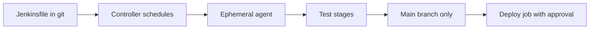

## Why this matters

Many companies still run Jenkins. Interviews ask for a Jenkinsfile even when the job posting says GitHub Actions. The ideas match: a pipeline in git, stages that fail closed, secrets outside the script, and agents that are cattle. The operations do not match. Jenkins is a server you patch, back up, and lock down. Actions is a control plane you configure. CodeCraft's CI lives in Actions. You still need to read a Jenkinsfile and to know the failure modes of a controller that has been "temporary" for six years.

This lesson is the Jenkins model and a pipeline that could build the same backend and frontend. It is also an explicit recommendation: do not add a Jenkins controller to this project unless an organization already operates one.

## Intuition

The controller schedules work and stores job configuration, build history, and credentials. It should not compile your code. Agents are the machines that check out the repo and run pytest. If the controller runs the build, a malicious pipeline can read the credentials store. That split is the Jenkins version of "do not run pull requests on a self-hosted runner that holds prod keys."

A Jenkinsfile in the repo is the job. Declarative syntax has a fixed shape: agent, options, stages, post. Scripted syntax is a Groovy program. Declarative is what you want for CodeCraft-shaped builds. Scripted is what you read when a pipeline has grown a private programming language.

Credentials enter the pipeline through a binding that injects an environment variable for one stage. They are not pasted into the Jenkinsfile. The file is in git. The secret is in the credentials store, and the store is the crown jewel.

## Core concept in depth

### Controller, agents, and plugins

Install the controller on a small instance. Put it behind SSO. Turn off anonymous read. Back up `JENKINS_HOME`, because job history and the credentials live there. Configuration as code (JCasC) keeps the plugin list and the security realm in git so a rebuilt controller is not a weekend of clicking.

Agents connect outbound to the controller or through a short-lived cloud plugin. A permanent agent that people SSH into becomes a pet: old toolchains, a docker socket, and a home directory full of secrets. Prefer agents from a cloud template that last one build. Label them. The Jenkinsfile asks for a label such as `linux-docker`. It does not pin a hostname.

Plugins are both the ecosystem and the risk. Pin versions. A plugin that can execute on the controller is a remote code execution bug if the update site or the plugin is compromised. Fewer plugins is a security setting. You need pipeline, git, credentials binding, and an agent provisioner. You do not need twenty UI themes.

### Declarative shape

A stage is a named step in the story: test, build, publish. `when` skips a stage. `post` runs `always`, `success`, or `failure` blocks for notifications and cleanup. A timeout option stops a hung pytest from occupying an agent until Monday.

`environment` at the top is for non-secrets: `AWS_REGION`. Secrets use `withCredentials` inside the stage that needs them. A secret in a global environment block leaks into every stage's process list and into a debug dump someone will add later.

Parameters are how a human passes an image digest to a deploy job. The deploy job is a separate pipeline with a manual approval input. It is not a boolean on the test pipeline that defaults to true.

### Multibranch and trust

A multibranch pipeline creates a job per branch from the Jenkinsfile. That is convenient and it will execute Jenkinsfiles from feature branches. A feature branch is untrusted if outside collaborators can push, or if a dependency install runs arbitrary code, which it does. Do not give those builds prod credentials. The same rule as Actions: the trusted branch may assume the prod role. The pull request build may not.

Shared libraries in a global trusted library can run Groovy on the controller. A typo or a malicious change there is controller compromise. Keep shared libraries small, reviewed, and untrusted-by-default if you can. Copy-paste of a ten-line stage is better than a framework nobody can upgrade.

### Mapping CodeCraft's three jobs

| Actions job | Jenkins stage | Notes |
| --- | --- | --- |
| backend | Test API | Same pytest, `SANDBOX_DISABLED` |
| frontend | Test Web | `npm ci`, lint, build |
| docker | Image | Only on main, after tests |
| not present | Deploy | Separate job, manual input, digest pin |

Checkout once. Stash the test reports if a later stage needs them, or just archive artifacts in `post`. Do not rebuild the frontend in the deploy job with a different `NEXT_PUBLIC_API_URL` than you tested, unless the deploy job is the only place that sets the prod URL and the test job is explicitly a non-prod build. Write that down in the Jenkinsfile comments so the next person does not "simplify" it.

### When Jenkins is the wrong tool

Choose Actions or GitLab CI when you do not already run a controller. Jenkins wins when the company has agents on a factory network, a plugin you truly need, or a decade of pipelines you are migrating carefully. It loses when the controller is unpatched, the agents are pets, and the Jenkinsfile is generated by a click-through UI that is not in git. If the UI and the file disagree, the next run will use whichever the job is configured to use. Make the job load the Jenkinsfile from the repository and disable freestyle snowflakes.

## Diagram / flowchart



### Dry-run: a pull request

| Stage | Credentials | Runs on PR? |
| --- | --- | --- |
| Test API | None | Yes |
| Test Web | None | Yes |
| Image build | Registry push token | No. Main only. |
| Deploy | Prod role | No. Separate job, main, approved. |

If the image stage runs on the PR with the push token, a forked Jenkinsfile can push a tag. Keep the token off the PR build.

### Controller health

| Check | Why |
| --- | --- |
| SSO and no anonymous admin | The default password on port 8080 is a meme because it keeps happening |
| Backups of `JENKINS_HOME` | Otherwise the credentials store is one disk away from gone |
| Plugin pins | An unpinned update can execute on the controller |
| Agents ephemeral | Pets accumulate docker.sock and old keys |
| Builds not on the controller | A pipeline should not be able to read every credential |

## Code

A declarative Jenkinsfile for the test half of CodeCraft. The agent label is `linux`. The sandbox is disabled. No cloud credentials appear.

```groovy
pipeline {
  agent { label "linux" }
  options {
    timeout(time: 30, unit: "MINUTES")
    timestamps()
  }
  environment {
    SANDBOX_DISABLED = "true"
    CONTENT_DIR = "${WORKSPACE}/content"
  }
  stages {
    stage("Test API") {
      steps {
        dir("backend") {
          sh "pip install -r requirements.txt -r requirements-dev.txt"
          sh "ruff check app tests && black --check app tests"
          sh "pytest -q"
        }
      }
    }
    stage("Test Web") {
      steps {
        dir("frontend") {
          sh "npm ci"
          sh "npm run lint && npm run typecheck && npm run build"
        }
      }
    }
  }
  post {
    always {
      junit allowEmptyResults: true, testResults: "backend/.pytest-cache/**"
    }
  }
}
```

`CONTENT_DIR` uses a Groovy string because the workspace path is injected by Jenkins. That string is not a secret. Do not put a registry password in `environment` the same way.

A deploy stage that does belong in a different pipeline, with a manual gate and a bound credential:

```groovy
stage("Publish image") {
  when { branch "main" }
  steps {
    withCredentials([usernamePassword(
      credentialsId: "ecr-push",
      usernameVariable: "AWS_ACCESS_KEY_ID",
      passwordVariable: "AWS_SECRET_ACCESS_KEY"
    )]) {
      sh "echo publish-by-digest-here"
    }
  }
}
```

Prefer an OIDC or instance-role on the agent over a long-lived access key in the credentials store. If the store is what the company has, the binding should be the only copy in the build, and the agent should not print env. Rotate that key. The snippet above shows the binding shape. It is not an endorsement of static keys. The comment in the shell step is a placeholder so this lesson does not look like a working exfiltration script. The real command pushes a digest and records it as a build artifact.

## Complexity analysis

| Choice | Operational load | Safety |
| --- | --- | --- |
| GitHub-hosted Actions | Low for this repo | High if permissions are tight |
| Jenkins controller you patch | High | High only if agents and plugins are disciplined |
| Builds on the controller | Low at first | Critical risk to the credentials store |
| Permanent agents | Familiar | Drift and leftover secrets |
| Ephemeral agents | You must automate images | Cleaner |
| Global trusted shared library | DRY | Groovy runs with controller trust |
| Declarative Jenkinsfile | Readable | Some things need a script block |
| Freestyle jobs in the UI | Clicky | Not reviewable, will diverge |

For CodeCraft as this repository stands, adding Jenkins adds a server and does not add a capability the Actions workflow lacks. Learn the Jenkinsfile so you can work in a company that has one. Do not migrate this project onto a controller you will not patch.

## Tricks, tips and patterns

- The Jenkinsfile is the job. Disable UI-only freestyle builds for anything that ships.
- Guard publish and deploy so they run only on the main branch. Confirm the multibranch source cannot spoof that on a fork. Lock down who can open branches if you are unsure.
- Timeouts on every pipeline. A hung npm install should die.
- Archive the pytest log and the image digest. The console log scrolls away.
- JCasC and a pinned plugin list beat a hand-built controller.
- Read `withCredentials` usages in review the way you read `sudo`.
- Keep sandbox disabled on the test agent. A Jenkins agent with a docker socket is the same host-root problem as the API socket.
- If you must script a step, keep the script block smaller than the stage. A Jenkinsfile that is 90 percent Groovy is a program without tests.

## Common mistakes and edge cases

- Running tests on the controller because "the agent was offline."
- A global credential available to every folder, including the sandbox job a contractor can edit.
- `sh "curl | bash"` inside a stage to install a tool that should have been on the agent image.
- Approving a script-security signature without reading it. That prompt is Groovy running on the controller.
- A multibranch scan of a public repo with prod credentials in the folder.
- Using the same pipeline to deploy from a feature branch because the parameter defaulted to prod.
- Backups that exclude the credentials key, so the restore is a locked box.
- An agent image that has not been rebuilt in a year, with an old Docker and an old cred helper.

## Interview notes

**Controller versus agent?**
The controller schedules and holds credentials. Agents run the build and should be ephemeral. Builds on the controller put untrusted pipeline code next to the credentials store.

**Where do secrets go?**
In the credentials store, injected with `withCredentials` for one stage. Not in the Jenkinsfile, not in a global environment block, not in the agent image.

**Declarative or scripted?**
Declarative for a normal test and publish pipeline. Scripted when you are stuck. A file that is mostly a script has become an untested program. Prefer a small shared library only if you can review Groovy changes as carefully as a production deploy.

**How would you map CodeCraft?**
Test API and Test Web on every branch with no cloud credentials. Publish an image only on main. Deploy from a second job with a manual approval and a digest. Same policy as the Actions workflow.

**Why might you refuse to introduce Jenkins here?**
This repo already has Actions, and a controller is a service to patch, back up, and secure. Jenkins is justified when the organization already runs it well, not as a second CI system for one application.

## Practice problems

1. Rewrite the three CodeCraft CI concerns as Jenkins stages and mark which stages may see cloud credentials.
2. A teammate runs pytest on the controller to "save an agent." What can a malicious test read?
3. Explain where the ECR password lives and how a stage sees it without the Jenkinsfile containing the password.
4. A multibranch job deployed prod from a feature branch. Which `when` block was missing, and what credential scope made it worse?
5. List three things you would back up or codify before you call a Jenkins controller recoverable.

## Summary / cheat sheet

- Controller schedules and stores secrets. Agents run builds. Do not mix them.
- Declarative Jenkinsfile in git. No freestyle snowflakes.
- Credentials are bound per stage. Prod credentials are not on pull request builds.
- Timeouts, ephemeral agents, pinned plugins, SSO, backups of `JENKINS_HOME`.
- Shared libraries that run on the controller are production code.
- CodeCraft stays on Actions unless you already operate Jenkins.
- Publish on main. Deploy is a separate approved job with a digest.
- A docker socket on an agent is host root. The sandbox stays disabled in CI.

## Further reading

- [Jenkins pipeline syntax](https://www.jenkins.io/doc/book/pipeline/syntax/)
- [Credentials binding](https://www.jenkins.io/doc/pipeline/steps/credentials-binding/)
- [Jenkins Configuration as Code](https://www.jenkins.io/projects/jcasc/)
- [Securing Jenkins](https://www.jenkins.io/doc/book/security/)
- [Installing Jenkins agents](https://www.jenkins.io/doc/book/using/using-agents/)
