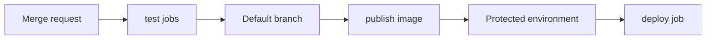

## Why this matters

GitLab puts the repository, the pipeline, the container registry, and the environment dashboard in one product. Some teams pick it for that reason. The pipeline language is YAML in `.gitlab-ci.yml`, which looks enough like GitHub Actions to cause mistakes and not enough like it to copy a file across. Runners are yours unless you pay for GitLab's shared runners. A shared runner you registered with a privileged Docker socket is the Jenkins-agent problem again.

CodeCraft's CI is GitHub Actions. This lesson teaches the GitLab shape so you can implement the same policy: tests on every branch, image publish on the default branch, deploy behind a protected environment, no static cloud key in the YAML.

## Intuition

A pipeline is a set of jobs. Each job runs on a runner that matches its tags. Jobs in the same stage run in parallel. The next stage starts when the previous one succeeds, unless you use `needs` to draw a smaller dependency. Artifacts are files you pass to a later job. Cache is a best-effort speedup and may be missing. Treat cache as optional and artifacts as the contract.

Variables come from the YAML, the project settings, or the trigger. Protected variables are exposed only to protected branches and tags. That is the mechanism that keeps the prod role off a feature-branch pipeline. Masked variables are hidden in logs and still show up if you print them in pieces. Same discipline as Actions secrets.

## Core concept in depth

### Runners

A runner is registered to a project or a group. The executor is usually Docker: the job runs inside a container you name with `image`. The runner host is still a machine you patch. If that host mounts the Docker socket into job containers so they can build images, every job can control the host. Prefer a rootless builder or a dedicated build runner whose only job is image build, with credentials that can push to the registry and cannot touch prod ECS.

Tags select runners. `tags: [test]` should never land on the prod deploy runner. If you forget the tag, the job may run on a shared runner you did not expect, or sit pending forever. Pending is the safer failure. A shared runner with prod network access is the dangerous one.

### Rules

`rules` decide whether a job is in the pipeline. Prefer `rules` over the older `only` and `except` lists. A test job runs on merge requests and on the default branch. A publish job runs only on the default branch. A deploy job runs only on the default branch and only when the publish job succeeded, and GitLab's environment protection can require a manual action.

`rules` changes also decide whether variables marked protected are present. If you run deploy on a branch that is not protected, GitLab will omit the protected variable and the job will fail, or worse, you marked the variable unprotected so the job would work and now feature branches have it. Protect the variable and protect the branch. Do not unprotect the variable to green the pipeline.

### Artifacts and cache

The frontend build produces `.next` output you might want as an artifact if a later job publishes it. Declare paths and an expiry. Artifacts live on the GitLab server and count toward storage. A 30-day retention of every frontend build will surprise the quota. Keep the image in the container registry, not as a tarball artifact, once you are pushing by digest.

Cache the npm directory with a key based on the lock file. If the key is only the branch name, a lock file change still uses the old cache and `npm ci` repairs it, which is fine, or a sloppy `npm install` hides drift, which is not. Use `npm ci`. The cache is just a head start.

### Environments

An environment named `production` with a URL shows up on the project's environment page. `action: start` on deploy and a later stop job for preview environments give you a place to see what is running. Protection rules on the production environment require a maintainer to click. That click is the approval gate. It is not a comment on the merge request.

Preview environments per merge request are possible and expensive. For CodeCraft, a preview means a frontend and an API and a safe dataset, not a clone of prod RDS. If you cannot afford the clone, do not create a preview that points at prod data. A review app against prod student data is a data leak with a nice URL.

### Includes

`include` pulls a template from the same group so every service lints the same way. Pin the template ref. An include of `main` from a shared repo changes every pipeline the moment someone pushes the template. That is the unpinned action problem. Pin a tag.

### What not to duplicate

You do not need a second design for tests. Backend pytest with the sandbox disabled, frontend lint and build with `CONTENT_DIR` set, image build only on the default branch. The YAML keywords change. The policy does not. If GitLab is the company standard, this file is the port. If it is not, do not run both GitLab and GitHub CI on the same commits. Two greens that mean different things is worse than one system.

## Diagram / flowchart



### Dry-run: merge request versus main

| Job | Merge request | Main |
| --- | --- | --- |
| test-api | Runs, no prod variables | Runs |
| test-web | Runs, public URL is a dummy | Runs |
| publish | Does not run | Pushes digest to the registry |
| deploy | Does not run | Manual, protected environment |

The web test job must not be the job that bakes the production public API URL unless you are willing to rebuild in publish with the real URL. Say which job bakes the client bundle. It is a one-line comment that prevents a localhost image in prod.

### Variable scope

| Kind | Visible on feature branches? | Use |
| --- | --- | --- |
| YAML variable, not secret | Yes | Region name, `SANDBOX_DISABLED` |
| Protected variable | Only protected branches | Prod role ARN |
| Masked variable | Depends on protected flag | Still not a license to print it |
| File variable | Same rules | A kubeconfig you should probably replace with OIDC |

## Code

A pipeline that mirrors the CodeCraft test split. Image names are examples. The publish job's script should push a digest and write that digest to a dotenv artifact the deploy job reads, so deploy cannot "just use latest."

```yaml
stages:
  - test
  - publish
  - deploy

variables:
  SANDBOX_DISABLED: "true"

test-api:
  stage: test
  image: python:3.12-slim
  script:
    - cd backend
    - pip install -r requirements.txt -r requirements-dev.txt
    - ruff check app tests
    - black --check app tests
    - pytest -q
  rules:
    - if: $CI_PIPELINE_SOURCE == "merge_request_event"
    - if: $CI_COMMIT_BRANCH == $CI_DEFAULT_BRANCH

test-web:
  stage: test
  image: node:20
  script:
    - cd frontend
    - npm ci
    - npm run lint
    - npm run typecheck
    - npm run build
  rules:
    - if: $CI_PIPELINE_SOURCE == "merge_request_event"
    - if: $CI_COMMIT_BRANCH == $CI_DEFAULT_BRANCH

publish:
  stage: publish
  image: docker:27
  script:
    - echo "push digest from this commit"
  rules:
    - if: $CI_COMMIT_BRANCH == $CI_DEFAULT_BRANCH

deploy:
  stage: deploy
  environment:
    name: production
    action: start
  script:
    - echo "roll ECS to the published digest"
  rules:
    - if: $CI_COMMIT_BRANCH == $CI_DEFAULT_BRANCH
      when: manual
  needs:
    - publish
```

`when: manual` on a protected environment is the gate. `needs: publish` means you do not wait for an unrelated test stage structure if you later split stages, and you do not deploy a pipeline whose publish was skipped. If publish is skipped, deploy should be skipped too. Check that with a pipeline on a merge request: deploy must be absent, not a manual button.

Set `CONTENT_DIR` in the test jobs to the checkout path GitLab provides as `CI_PROJECT_DIR`. Do it in the job environment so pytest and Next see the lessons. A missing content directory is a green test suite that did not read the course.

## Complexity analysis

| Choice | Benefit | Cost |
| --- | --- | --- |
| Shared GitLab runners | Nothing to patch | Less isolation, limits |
| Group runners you operate | Control of the network | You patch them, socket risk |
| `rules` | Explicit pipelines | Easy to write a rule that never matches |
| `only` / `except` | Familiar in old files | Harder to compose. Prefer rules. |
| Protected variables | Prod secrets stay on main | Jobs fail closed if the branch is not protected. Good. |
| Manual production job | A human gate | Someone will click without reading. Pair with a digest in the log. |
| Artifacts for images | Simple | Storage heavy. Use the registry. |
| Include from a moving branch | Central policy | Surprise breaks. Pin the include. |

GitLab's product is wider than CI. The review is still the YAML and the runner host. A green pipeline on a privileged runner is not a secure pipeline.

## Tricks, tips and patterns

- Pin `image` digests for the test containers the same way you pin application bases, once the pipeline is stable.
- Use `needs` so test-api and test-web run in parallel without an artificial stage barrier if you want speed. Stages are fine while there are three jobs.
- Fail the pipeline on `ruff` and `black` the same as tests. Warnings do not keep main clean.
- Write the digest to the job log in full. The deploy script should refuse a tag that is not a digest.
- Protect `main`. Protect prod variables. Make the default branch the only place those two meet.
- Separate runner tags for test and deploy.
- Expire artifacts in days, not months.
- If a job needs the Docker socket, isolate that runner and assume it is privileged. Do not also give it the prod ECS role if a different runner can deploy by API.

## Common mistakes and edge cases

- A variable that is masked but not protected, so every fork pipeline receives the prod token if the project is public. For a public project, assume merge request pipelines are hostile.
- `when: manual` on an unprotected environment, so anyone who can run a pipeline can press deploy.
- Cache keyed only by branch, and a script that mutates the cache directory into a broken `node_modules`.
- Two jobs both named in a way that `needs` points at a job the rules skipped. The pipeline gets stuck or skips deploy silently. Read the pipeline graph, not just the YAML.
- Including a template from `main` that someone edited to echo variables for debugging.
- A runner tagged `docker` that every job uses, including unit tests, so a test container has the socket.
- Building the frontend once in test with a dummy API URL and publishing that image.
- Leaving `CI_DEBUG_TRACE` on. It prints variables. Turn it on for one failed job, then turn it off.

## Interview notes

**How is a GitLab job different from a GitHub Actions job?**
Both are steps on a fresh environment. GitLab jobs select a runner with tags and an image. Stages and `needs` order them. Protected variables and protected branches are the usual secret boundary. Actions uses permissions and environments. The policy you want is the same.

**What is a protected variable?**
A CI variable that GitLab injects only into pipelines running on protected branches or tags. Use it for production role identifiers. Do not mark the prod token unprotected because a feature branch failed to see it.

**Where should the image digest come from?**
The publish job on the default branch, passed as an artifact or read from the registry by commit SHA. Deploy is manual and must use that digest. `latest` is not a deploy input.

**What is the risk of a Docker executor with the socket mounted?**
The job is root on the runner host. Fine on a dedicated build host with no prod credentials. Not fine on the same host as the deploy runner or the controller.

**How would you port CodeCraft's workflow?**
test-api and test-web on merge requests with the sandbox disabled. publish on the default branch. deploy manual on the production environment. One system, not both GitLab and GitHub, unless you are mid-migration and the badges say which one is required.

## Practice problems

1. Write the rule that keeps `deploy` off merge request pipelines. Say what a reviewer should see in the pipeline graph.
2. A prod token was marked masked but not protected. Who can receive it?
3. Explain why the test-web image is the wrong artifact to deploy, in terms of `NEXT_PUBLIC_API_URL`.
4. Two runners exist, one with a Docker socket. Which tags do test-api and publish get?
5. An include from a template repo tracks `main` and someone added a debug script. How do you pin it, and what do you rotate if the script printed variables?

## Summary / cheat sheet

- Jobs run on tagged runners. Stages order them. `needs` thins the graph.
- `rules` decide if a job exists. Prefer them over `only` and `except`.
- Protected variables meet protected branches. That is the prod boundary.
- Artifacts are the contract. Cache is optional. Images live in the registry as digests.
- Manual deploy on a protected environment. No `latest`.
- A socket-mounted runner is privileged. Isolate it.
- Pin included templates.
- Same CodeCraft policy as Actions: test everywhere, publish on the default branch, deploy gated.

## Further reading

- [GitLab CI/CD YAML reference](https://docs.gitlab.com/ee/ci/yaml/)
- [GitLab rules](https://docs.gitlab.com/ee/ci/yaml/#rules)
- [Protected variables and environments](https://docs.gitlab.com/ee/ci/variables/#protect-a-cicd-variable)
- [GitLab runner executors](https://docs.gitlab.com/runner/executors/)
- [Environments and deployments](https://docs.gitlab.com/ee/ci/environments/)
