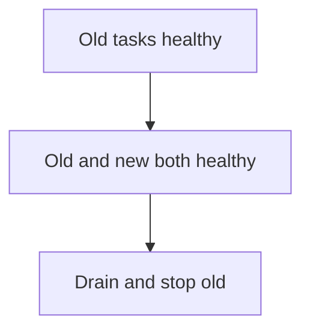
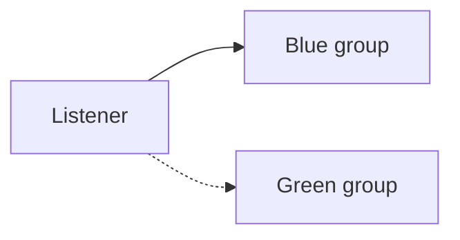

## Why this matters

A green test suite does not mean the new API process can serve traffic next to the old one. Deployment strategy is how you introduce the new digest, watch it, and go back. Pick it before the incident. During the incident you will use whatever the service was configured to do, which for a default ECS service is a rolling update you may never have tuned.

CodeCraft's API is a good rolling-update candidate if two tasks can run two versions at once. The sandbox image can roll the same way if in-flight runs are allowed to finish on the old task. The database is not a rolling update. A migration that breaks the old code will take the site down in the middle of a "safe" rollout. This lesson separates traffic shifting from schema change, and it names when blue-green or a canary is worth the extra machinery.

## Intuition

You have two things to move: the process, and the percentage of requests that hit it. A recreate strategy stops the old process, then starts the new one. Users see downtime. A rolling update replaces instances a few at a time so some requests hit the new version while others still hit the old one. Blue-green runs a full second copy and switches the load balancer in one step. A canary sends a small slice first and grows it.

All three assume the new version can coexist with the old one. Shared state is the hard part. Sessions pinned to a process, a migration that drops a column the old code still reads, and a feature that writes a queue message the old worker cannot parse will fail no matter how clever the traffic shift is.

Rollback is a deploy of the previous digest, or a switch of the load balancer back to the old target group. It is not "git revert and hope CI finishes in twenty minutes" unless you have practiced that and it is fast enough for the SLO.

## Core concept in depth

### Recreate

Stop all old tasks, start the new ones. Simplest, and the user-facing error rate is 100 percent during the gap. Acceptable for a dev environment and for a worker that can pause. Not acceptable for the CodeCraft API if students are on the site. If your desired count is 1, every strategy degrades toward recreate unless you briefly run 2. A rolling update of one task still stops the only task.

### Rolling

ECS replaces tasks according to a minimum healthy percent and a maximum percent. The defaults, 100 and 200, mean: keep at least the current desired count healthy, and you may temporarily run twice as many. With desired count 2, ECS starts a third task on the new digest, waits for the load balancer health check, then stops an old task, and repeats. With desired count 1 and minimum 100, it must start the new task before stopping the old one, so you still need capacity for 2.

Minimum 50 and maximum 100 never goes above desired count, and it takes you down to half during the deploy. That saves capacity and spends availability. For a small API, maximum 200 and minimum 100 is the usual choice. You pay for one extra task for a few minutes.

The health check has to mean ready. If the target group marks a task healthy as soon as the port opens, and the app crashes on the first real query, the rollout proceeds and then both tasks are bad. Use `/health` that fails when the process cannot read content or cannot reach the database, with a grace period long enough for startup and short enough that a dead process is not "healthy" for five minutes.

Connection draining, or deregistration delay, lets a stopping task finish requests. Set it longer than a typical lesson request and shorter than your patience during a rollback. In-flight sandbox runs need a longer drain or a design that does not kill them on SIGTERM until the run ends. The API should still receive SIGTERM, which is why the container command is exec form.

### Blue-green

Two target groups. Blue is live. Green is the new digest, warmed, health-checked, and receiving no user traffic except your synthetic checks. You switch the listener. Rollback is switching back, as long as the blue tasks are still up.

CodeDeploy can do this for ECS. It costs a full extra copy during the bake, and it costs the discipline to leave blue alive until the bake ends. It is worth it when a bad deploy is expensive and the service is large enough that a rolling mix of versions is hard to debug. For a two-task API, a careful rolling update is usually enough. Blue-green becomes attractive when you want the new version to see production-like traffic only after a full warm-up, or when a canary tool is not available and you still want one switch.

Do not point green at a database migration that blue cannot use, then switch. You have stranded blue as a rollback path that cannot read the schema.

### Canary

A small percentage of requests go to the new version. You watch error ratio and latency for that version. Then you raise the percentage. Then you finish. Rollback is setting the percentage to zero.

The split has to be real. A header-based canary that only employees hit will not see student traffic. A random 5 percent will. Compare the canary to the baseline over the same minutes. A canary that looks fine at 5 percent can still fail at 100 percent if it has a connection-pool setting sized for the canary's small share. Raise the steps. Do not jump from 5 to 100 and call it a canary.

Service meshes and some load balancer rules can do this. So can a feature flag, which is the next lesson and solves a different problem: the code is already on every task, and the behavior is off. Canary is a traffic split between builds. A flag is a behavior split inside a build. You often want both. The flag lets you ship a dark feature inside a rolling deploy. The canary is optional extra machinery.

### Migrations

Expand, then migrate, then contract.

1. The new code can read and write the old schema and the new schema.
2. Deploy that code, fully, with the rolling or blue-green strategy.
3. Backfill.
4. Deploy code that stops using the old shape.
5. Drop the old column later.

A pull request that adds a column, writes only the new column, and drops the old one in the same release cannot roll. The old tasks fail as soon as the migration runs. Run the migration as its own change, compatible with the tasks that are still serving.

## Diagram / flowchart



Blue-green is a different picture: two full groups, one listener arrow that moves.



### Dry-run: desired count 2, min 100, max 200

| Step | Task v1 | Task v2 | User effect |
| --- | --- | --- | --- |
| Start | 2 | 0 | All v1 |
| Launch one new | 2 | 1 starting | Still v1 until healthy |
| New healthy | 2 | 1 | Mixed |
| Stop one old | 1 | 1 | Mixed |
| Second new healthy, last old stopped | 0 | 2 | All v2 |

If the first v2 task never goes healthy, ECS stops the rollout if the circuit breaker is on. Turn the ECS deployment circuit breaker on, with rollback. A rollout that keeps replacing until the service is empty is the failure mode the breaker exists to stop.

### Strategy picker

| Situation | Strategy |
| --- | --- |
| Dev, downtime ok | Recreate |
| API, two versions can coexist, small fleet | Rolling, min 100, max 200, circuit breaker |
| Need an instant full switch and a warm standby | Blue-green |
| Want production errors on a slice before the rest | Canary, then full roll |
| Schema change | Expand and contract, not a clever traffic policy |
| Desired count 1 | Raise it for the deploy or accept an outage |

## Code

An ECS service deployment block in Terraform. The circuit breaker rolls back when new tasks fail to become healthy. Minimum and maximum are percents of desired count.

```hcl
resource "aws_ecs_service" "api" {
  name            = "codecraft-api"
  desired_count   = 2
  task_definition = aws_ecs_task_definition.api.arn

  deployment_minimum_healthy_percent = 100
  deployment_maximum_percent         = 200

  deployment_circuit_breaker {
    enable   = true
    rollback = true
  }

  load_balancer {
    target_group_arn = aws_lb_target_group.api.arn
    container_name   = "api"
    container_port   = 8000
  }
}
```

Health check on the target group, aligned with the app:

```hcl
health_check {
  path                = "/health"
  healthy_threshold   = 2
  unhealthy_threshold = 2
  interval            = 15
  timeout             = 5
  matcher             = "200"
}
```

A migration that is safe to run while v1 and v2 both serve:

```text
1. Add the new column as nullable. Do not drop the old column.
2. Deploy API code that writes both columns and reads the old one if the new one is empty.
3. Backfill.
4. Deploy API code that reads the new column only.
5. A later change drops the old column after that deploy is complete and rolled back is no longer required.
```

If step 5 is in the same change as step 2, the rolling dry-run above will serve v1 against a schema v1 cannot use. The traffic policy did not fail. The compatibility did.

Rollback command, once you know the previous task definition ARN:

```bash
aws ecs update-service \
  --cluster codecraft \
  --service codecraft-api \
  --task-definition codecraft-api:42
```

Use the family and revision you recorded at publish time. Do not roll back by moving a tag. The circuit breaker will also roll back the deployment when health checks fail, which covers the case where the new task never becomes ready. It does not cover a task that is healthy and wrong, such as a logic bug that returns 200 with bad JSON. That is why you still watch the error ratio and latency, and why a human rollback of the digest still exists.

## Complexity analysis

| Strategy | Extra capacity | Rollback speed | Coexistence required |
| --- | --- | --- | --- |
| Recreate | None | Redeploy | No |
| Rolling min 100 max 200 | About one extra task | Circuit breaker or previous revision | Yes |
| Rolling min 50 max 100 | None | Same, but you are already degraded | Yes |
| Blue-green | A full second stack | Move the listener | Yes, until blue is destroyed |
| Canary | Small at first, then full | Set weight to zero | Yes |
| Flag inside one build | None | Turn the flag off | The new code must tolerate the flag off |

Flags do not replace health checks. A process that cannot boot will not evaluate a flag. Canaries do not replace expand-contract migrations. Blue-green does not fix a bake window you ignore.

## Tricks, tips and patterns

- Turn on the ECS deployment circuit breaker with rollback before you tune percents.
- Desired count 2 is the minimum if you want a rolling API deploy without downtime.
- Match deregistration delay to real request time. Lesson reads are short. Sandbox runs are not. Do not put both on a task that dies at the first SIGTERM if a run must finish.
- Record the task definition revision in the deploy job output.
- Synthetic checks against the green target group before the listener moves.
- One production change at a time during a migration: schema compatible, then code, then cleanup.
- Watch the canary's own error ratio, not only the global one. Five percent of traffic can hide in a global chart.
- Practice the rollback command in dev until it is boring.

## Common mistakes and edge cases

- Minimum healthy percent 0, which lets ECS stop everything first. That is recreate with extra steps.
- A health check that hits `/` and gets a 200 from a default page while the app is dead.
- No circuit breaker, so ECS keeps killing and recreating until the service is at zero.
- Blue-green with a migration in the middle, then a rollback to blue that cannot read the new schema.
- A canary stuck at 5 percent for a week. That is two versions to operate, not a rollout.
- Sticky sessions that pin a user to a dying task.
- Forgetting that rolling means two versions run at once, so log parsers and consumers must accept both message shapes.
- Rolling the sandbox image in a way that kills running student jobs with no drain.

## Interview notes

**What does ECS do with minimum 100 and maximum 200?**
It will not go below the desired count of healthy tasks, and it may run up to twice desired while it starts new tasks and waits for health. Then it drains and stops the old ones. With desired count 1 you still need room for a second task during the deploy.

**When is blue-green worth it?**
When you want a full second stack warmed and a single listener move, and you will keep the old stack until the bake ends. For a small API, rolling with a circuit breaker is usually the better cost. Blue-green does not make schema changes safe.

**What breaks every strategy?**
A migration or a message format that the old version cannot handle. Use expand, migrate, contract. Deploy compatible code before you remove the old shape.

**Canary versus feature flag?**
A canary splits traffic between two builds. A flag splits behavior inside a build that is already everywhere. Flags are how you ship dark. Canaries are how you limit a new build's blast radius. Health checks still decide whether the process stays in the pool.

**How do you roll back CodeCraft's API?**
Update the ECS service to the previous task definition revision, which you recorded when you published the digest. The circuit breaker covers failed health checks. It does not cover a healthy task that is logically wrong. Watch the SLO and be ready to run the rollback.

## Practice problems

1. Desired count is 1 and minimum healthy percent is 100. Describe the task counts during a deploy and the capacity you need.
2. A migration drops a column and the new code deploys with a rolling update. What do the old tasks do after the migration, and how do you reorder the steps?
3. The new task returns 200 from `/health` and 500 from lesson routes. Will the circuit breaker save you? What watches this case?
4. Compare rollback time for rolling-with-previous-revision versus blue-green listener switch. What must still be true of the database?
5. A canary at 5 percent shows no errors, then 100 percent exhausts the database pool. What did the canary fail to prove, and how do you step the weights?

## Summary / cheat sheet

- Recreate is downtime. Rolling mixes versions. Blue-green switches a full copy. Canary grows a slice.
- ECS: min 100, max 200, desired at least 2, circuit breaker on, `/health` that means ready.
- Drain longer than a normal request. Do not kill sandbox runs blindly.
- Two versions will run at once. Schema and messages must be compatible.
- Expand, migrate, contract. Never drop a column in the same step as the code that stops writing it.
- Roll back by task definition revision or by moving the listener. Tags are not a rollback.
- Flags and canaries solve different splits. Neither fixes a crash on boot.
- A healthy process can still be wrong. Watch the error ratio.

## Further reading

- [ECS deployment configuration](https://docs.aws.amazon.com/AmazonECS/latest/developerguide/deployment-type-ecs.html)
- [ECS deployment circuit breaker](https://docs.aws.amazon.com/AmazonECS/latest/developerguide/deployment-circuit-breaker.html)
- [CodeDeploy blue/green for ECS](https://docs.aws.amazon.com/codedeploy/latest/userguide/deployment-steps-ecs.html)
- [ALB deregistration delay](https://docs.aws.amazon.com/elasticloadbalancing/latest/application/load-balancer-target-groups.html#deregistration-delay)
- [Expand and contract migrations](https://martinfowler.com/bliki/ParallelChange.html)
