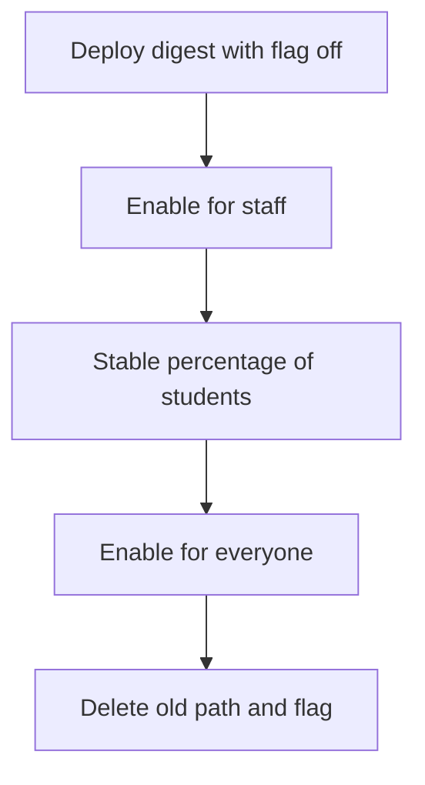

## Why this matters

A rolling deploy puts a new build on every task. It does not have to turn the new behavior on. A feature flag is a runtime decision, usually a boolean or a small config, that the process evaluates per request or per job. You can deploy on Tuesday, enable the behavior for yourself on Wednesday, enable it for ten percent of students on Thursday, and turn it off in seconds if search falls over, without another image build.

That speed is the point and the danger. A flag is a branch in production. Two branches mean two things to test, two things to monitor, and a piece of code that will rot if you never delete it. Teams that add flags and never remove them eventually run a maze. The practice is the lifecycle: introduce, ramp, finish, delete.

CodeCraft can use flags for a new search implementation, a stricter sandbox limit, or a UI experiment. It should not use a flag as a substitute for a broken boot, a missing migration, or an authorization check.

## Intuition

Deploy is "this digest is running." Release is "this behavior is visible." Canaries answer "is the new digest safe for a slice of traffic?" Flags answer "is this behavior on for this context?" You can flag inside one digest and skip the canary when the risk is a feature, not the process. You still roll the digest with health checks, because a flag cannot run if the process never starts.

Think of a fuse box. The kill switch is a flag you can hit without a deploy. The experiment is a flag that splits students so you can compare. The permission flag is "staff only." They have different owners and different lifetimes. A kill switch might live for years. An experiment that has a winner should be gone in weeks.

Evaluation has to be boring. Same inputs, same answer, for the life of a request. If the API and the frontend evaluate a flag differently, the button appears and the API returns 404. Decide where the source of truth lives.

## Core concept in depth

### Kinds of flags

| Kind | Question | Lifetime |
| --- | --- | --- |
| Release | Is the new search on? | Days or weeks, then delete |
| Ops / kill switch | Can we disable sandbox runs now? | Long, reviewed |
| Experiment | Which write-up of a lesson works? | Until the decision, then delete |
| Permission | Is this user staff? | Often better as real authorization, not a flag file |
| Migration | Are we reading the new column? | The expand-contract window, then delete |

Permission flags in a config file are how "temporary staff access" becomes a backdoor. If the question is authorization, use the identity system. A flag is for behavior of the product, not for who is allowed to pass a security boundary, unless the flag platform itself is your entitlement system and is audited.

### Evaluation

A flag check needs a context: user id or anonymous id, environment, and maybe course id. The provider returns a value. Cache it briefly if the provider is remote, and fail in a defined direction if the provider is down. For a release flag, the safe default is off. For a kill switch around a dependency you can skip, the safe default might be "feature off" so an outage in the flag service does not turn on a risky path. Write the default down. "Whatever the SDK does" is not a default.

Do not put personal data into the flag context beyond a stable id you already store. The flag vendor will see the context. A homegrown flag table in your own database keeps that data home and gives you a service to operate.

Targeting rules should be simple: environment, allow-list of staff ids, then a percentage. Percentage must be stable. Hash the id into a bucket so a student does not flip between old and new search on every request. Random per request is not an experiment. It is flicker.

### The frontend and the API

`NEXT_PUBLIC_` values are baked at build. A flag that is a build-time variable is not a runtime flag. It is a rebuild. Runtime flags for the UI come from an API the browser calls, or from a provider script. The API that serves the lesson must enforce the flag again. Hiding a button is not a control. Anyone can call the route.

If the new search is off, the old route works. If it is on, both the UI and the API agree. Contract-test the pair. A screenshot test of the button does not prove the API is gated.

### Cleanup

A flag that has been at 100 percent for two weeks is dead code plus a branch. Schedule the deletion in the same pull request that announces the ramp to 100, or you will not do it. The deletion pull request removes the check and the old path. It is a normal change, with a rollback that is "put the flag back" only if you have not dropped the old path yet. Order it: ramp to 100, watch the SLO, delete the old branch in a follow-up, then delete the flag.

Ops kill switches stay. They need an owner and a drill. A kill switch nobody has flipped in a year will not work when you need it, because the off path is untested. Flip it in staging on a schedule.

### What flags do not fix

- A process that crashes on import. The flag code never runs. Fix the boot, roll back the digest.
- A migration that drops a column. The old path and the new path both need the schema, as in the deployment lesson.
- A security hole you "flag off" in prod while the route still exists. Delete the route or enforce auth. A flag is a product switch.
- Long-term configuration such as the database host. That is config, not a flag. Flags that encode environment topology become a second, worse config system.

## Diagram / flowchart



### Dry-run: new search

| Step | Flag | What students see | Rollback |
| --- | --- | --- | --- |
| Deploy | off | Old search | Nothing to do |
| Staff on | allow-list | Staff see new search | Turn off the allow-list |
| 10 percent | hash bucket | A stable slice | Set percent to 0 |
| 100 percent | on | Everyone | Set percent to 0 if the old path still exists |
| Code deleted | flag removed | Everyone, one path | Redeploy previous digest |

The last rollback is slower. Do not delete the old path in the same hour you hit 100 percent. Watch a day of SLO first.

### Fail-safe defaults

| Flag | If the flag store is down |
| --- | --- |
| New search | Off, old search |
| Kill switch for a broken recommender | Off, skip the recommender |
| Sandbox enabled | Off if you cannot evaluate, or on if you accept runs during a flag outage. Pick one and test it. |

## Code

A tiny in-process evaluator is enough to learn the semantics. A percentage bucket uses a stable hash of the user id. The default is off when the store cannot be read. This is application code, not a vendor SDK, so the failure mode is visible.

```python
import hashlib

def bucket(user_id: str) -> int:
    digest = hashlib.sha256(user_id.encode()).hexdigest()
    return int(digest[:8], 16) % 100

def new_search_enabled(user_id: str, percent: int, allow: set[str]) -> bool:
    if user_id in allow:
        return True
    if percent <= 0:
        return False
    if percent >= 100:
        return True
    return bucket(user_id) < percent
```

Call this in the API that performs search, not only in the React tree. Pass the same percent from config you can change without a rebuild: a row in a table, a short-TTL cache, or an environment variable that a restart picks up if you accept a slower kill switch. A true kill switch should not wait for a rolling restart of every task. A database row or a cache with a few seconds of TTL meets that bar. An environment variable does not, unless you are willing to roll the service to flip it.

Tests you want before the ramp:

```python
def test_percent_is_stable():
    first = bucket("student-1")
    assert bucket("student-1") == first

def test_default_off():
    assert new_search_enabled("student-1", percent=0, allow=set()) is False
```

Log the flag value on the request at info, as a low-cardinality field: `search_impl=new` or `search_impl=old`. That label or log field is how Grafana shows whether the new path is the one burning the error budget. Do not log the full user id in a metric label. The flag result is a small set. The user id is not.

## Complexity analysis

| Approach | Time to turn off | Cost |
| --- | --- | --- |
| Redeploy previous digest | Minutes | Simple, slower than a flag |
| Environment variable flag | A rolling restart | Not a kill switch |
| Remote flag, cached seconds | Seconds | A dependency and a default |
| Vendor platform | Seconds, plus UI | Data leaves your VPC, bill, SDK risk |
| Flag left at 100 percent | Instant, but the old path may be rotten | Unbounded complexity |
| Percentage by random() | Instant flicker | Useless as an experiment |

The vendor is justified when you need a UI for non-engineers and audit logs of who flipped what. A single team running CodeCraft can start with a table and a function. Revisit when the flags have owners outside the repo.

## Tricks, tips and patterns

- Name the flag for the behavior and the expiry: `search_v2`, owner, and a delete date in the pull request.
- Default off. Test the off path in CI, not only the on path.
- Stable bucketing. Same student, same experience, for the experiment window.
- Enforce on the API. The UI flag is cosmetic.
- Put `search_impl` in logs so the error ratio can be split.
- Drill the kill switch. An untested off path is a rumor.
- Delete release flags. Keep ops switches and calendar a drill.
- Do not put secrets or PII in the flag context.

## Common mistakes and edge cases

- A flag checked only in the frontend.
- Random per request, so the UI flickers and the metric is noise.
- The flag service timing out and the SDK defaulting to on for a risky feature.
- Two services reading different configs and disagreeing.
- A percentage of 10 that is 10 percent of requests, not of users, so one student hits both paths.
- Deleting the old path and the flag in one pull request with no bake at 100 percent.
- Using a flag to hide an admin route.
- A metric label of the user id "so we can see who had the flag." You just built a cardinality bomb. Log the id. Metric the flag value only.

## Interview notes

**Deploy versus release?**
Deploy puts a digest on the tasks. Release turns a behavior on. Flags let those happen at different times so you can ship dark code and back it out without a build.

**Flag versus canary?**
A canary splits traffic across two digests. A flag splits behavior inside the running digest. Health checks and rolling deploys still apply. The flag does not boot a crashed process.

**How do you keep a student on one side of an experiment?**
Hash a stable id into a bucket and compare to the percent. Do not draw a random number per request.

**What is the safe default if the flag store is down?**
Off for a new risky path. Document it and test it. A kill switch's off path must work when the store is down, or the switch cannot save you during an outage of the flag system itself.

**When do you delete the flag?**
After it has been fully on long enough to trust, in a follow-up that removes the old branch. Ops kill switches stay, with an owner and a drill.

## Practice problems

1. Design the flag for a new search: default, staff allow-list, stable percent, and the API enforcement point.
2. The flag service times out. What does the API do, and which test proves it?
3. A metric tagged by student id shows who is on the new search. Replace that design with one that still lets you see the error ratio.
4. Explain why a `NEXT_PUBLIC_` build arg is not a kill switch.
5. The flag has been at 100 percent for a month and the old code is still there. Write the deletion sequence and the rollback you still have before the deletion ships.

## Summary / cheat sheet

- Deploy is the digest. Release is the flag. Do not confuse them with a canary.
- Release flags die. Kill switches stay and get drilled. Permission belongs in auth, not a config toggle.
- Default off for new behavior. Stable hash buckets, not random per request.
- Enforce on the server. The UI is not a boundary.
- Log the flag result at low cardinality.
- A remote flag beats an environment variable when you need a fast kill.
- If the store is down, take the documented safe path.
- Ramp, watch, then delete the old path. Flags are branches, and branches rot.

## Further reading

- [Martin Fowler on feature toggles](https://martinfowler.com/articles/feature-toggles.html)
- [Pete Hodgson, feature toggles](https://martinfowler.com/bliki/FeatureToggle.html)
- [LaunchDarkly feature flag guide](https://docs.launchdarkly.com/guides/flags/feature-flags)
- [OpenFeature specification](https://openfeature.dev/docs/reference/intro)
- [Google SRE, canary releases](https://sre.google/workbook/canarying-releases/)
