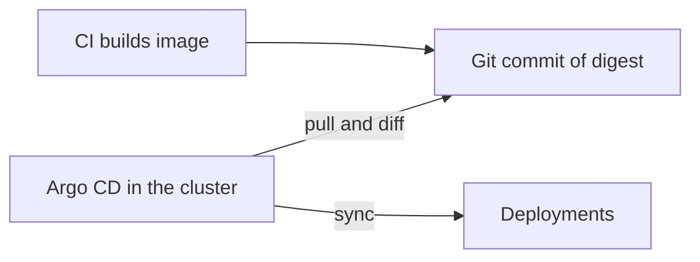

## Why this matters

Push-based deploy means CI has credentials to the cluster and runs kubectl or helm upgrade. The cluster becomes whatever the last pipeline did, including a hotfix someone applied by hand and never committed. GitOps flips the arrow. Git is the desired state. A controller inside the cluster pulls that state and reconciles. Argo CD is the controller most teams mean when they say GitOps on Kubernetes.

CodeCraft's primary production shape in this course is ECS, not a Kubernetes cluster. Argo CD does not manage ECS services. Pretending a GitHub Action that runs `aws ecs update-service` is GitOps confuses the interview and the design. This lesson teaches Argo CD for the path where the API runs on EKS, and it names the ECS equivalent honestly: a pipeline that updates a task definition digest, with the Terraform or the task definition committed, and drift detected by a plan rather than by Argo.

If you later move the API to EKS, you should not invent a second deploy style. You should be ready to put the manifests in git and let Argo sync them.

## Intuition

An Argo CD Application is a record that says: this git path, this cluster, this namespace. On a schedule or a webhook, Argo reads git, renders the manifests, and compares them to the live objects. If they differ, the app is OutOfSync. If you turned on self-heal, Argo changes the cluster to match git. If you did not, it only reports, and a human or a CI job clicks sync.

The cluster does not push commits. The controller pulls. CI's job shrinks to: test, build an image, commit the new digest into the git path Argo watches, or open a pull request that does. CI no longer needs a long-lived cluster admin token. Argo, running in the cluster, has the power to apply. That power is now a Kubernetes service account you can scope, which is a better place for it than a laptop kubeconfig.

Drift is a live object that does not match git. Someone edited a replica count in the console. Self-heal will change it back. If the console edit was the real fix, you are fighting until you commit the fix. GitOps makes that fight visible. It does not make emergency edits unnecessary. It makes them temporary.

## Core concept in depth

### What is in git

Manifests the cluster should have: Deployment, Service, Ingress, ConfigMap, and the Helm release values if you use Helm. The image tag or digest is in that desired state. A human-readable tag that moves is a weak desired state, because git did not change and the cluster did. Commit the digest. The pull request that bumps the digest is the release.

Secrets do not belong in git in plaintext. Argo will happily sync them if you put them there, and then they are in history. Use External Secrets or Sealed Secrets so git holds a reference or a ciphertext, and the cluster materializes the Secret. The Application still owns the pointer.

Do not let Argo and Terraform both create the same Deployment. Pick one owner. A common split: Terraform or the cloud provider manages the cluster, the database, and the IAM. Argo manages the namespaced app. If both apply the same object, the last writer wins and the diff never stays quiet.

### Sync behavior

Manual sync is a good start. You see the diff and you press the button, or CI tells Argo to sync a specific revision. Auto-sync applies on every commit. Auto-sync plus self-heal plus prune means: if it is not in git, it gets deleted, and if someone changes it live, it gets reverted. Prune is correct for an app you fully describe and dangerous for a namespace where a human created a debug pod you did not mean to adopt. Scope the Application to a path that contains only objects you intend to manage. Do not point it at a namespace full of unrelated tools and turn prune on.

Sync waves and hooks order work: a migration Job before the Deployment rolls. Hooks are how people smuggle imperative scripts back into GitOps. A migration Job that is not backward compatible has the same expand-contract rules as the deployment lesson. Argo will not save you from a Job that drops a column.

Health is separate from sync. Synced means the objects match git. Healthy means the Deployment has ready replicas, or your custom check passed. A synced and unhealthy app is a bad digest that rolled out exactly as git asked. Rollback is a git revert of the digest bump, or an Argo history rollback that itself should be committed so git does not immediately "fix" you forward again. If self-heal is on, a UI rollback that does not change git will be undone. Commit the rollback.

### App of apps and projects

One Application that creates other Applications is the app-of-apps pattern. The root app points at a directory of Application manifests. You can also use ApplicationSets to stamp one app per cluster or per environment. Start with two Applications, dev and prod, pointing at two paths or two value files. An ApplicationSet is the next step when the copy-paste hurts, not the first step.

AppProjects restrict which repositories and which destination clusters an Application may use. Put prod in a project that only the prod repo path can target. A team that can create an Application in the default project can point Argo at any repo and any namespace the controller can reach. The controller's RBAC is the real privilege. Scope it. A cluster-admin Argo is a cluster-admin CI you thought you had escaped.

### Webhooks and refresh

Polling every three minutes is fine for a small cluster. A webhook from GitHub makes the sync faster. A hard refresh ignores the cache when you know the manifest changed and Argo shows the old SHA. If the webhook is missing, you wait for the poll. Do not add a second system that also kubectl-applies the same objects "to go faster."

### ECS is not a second-class afterthought

For the ECS path this course deploys, the desired state is the task definition digest in git and the service that references it. CI updates that file or Terraform applies a reviewed plan. Drift is a `terraform plan` that shows a difference, or an ECS event that the running task is not the digest you think. You do not install Argo next to ECS to feel modern. You copy the properties: git is the source, the running system is reconciled to it, humans do not edit prod by hand without a follow-up commit.

If you move to EKS, retire the ECS update step for that service. Two controllers will fight.

## Diagram / flowchart



### Dry-run: bump the API digest

| Step | Git | Cluster | Who has cluster admin? |
| --- | --- | --- | --- |
| CI builds and scans | Unchanged | Old digest | Not CI |
| Pull request changes the image field to the new digest | Proposed | Old | Not CI |
| Merge | New digest desired | OutOfSync | Argo |
| Sync, health checks pass | New digest | Healthy | Argo |
| Bug, revert commit, sync | Old digest | Rolled back | Argo |

If someone kubectl-edited the Deployment during the bug, self-heal will revert that edit at the next reconcile. Commit the edit or lose it. That is the contract, not a surprise.

### Sync settings

| Setting | Use when |
| --- | --- |
| Manual sync | You are learning, or prod wants a click |
| Auto-sync | Dev, or prod after you trust the tests |
| Self-heal | You will not tolerate console edits |
| Prune | The path fully describes the namespace slice |
| No prune | Other tools create objects in the same namespace |

## Code

An Application manifest for the API on EKS. The path is a directory of rendered manifests or a Helm chart. The target revision is a branch or a tag you control. Prod should track a tag or a commit, not an unprotected branch anyone can push.

```yaml
apiVersion: argoproj.io/v1alpha1
kind: Application
metadata:
  name: codecraft-api
  namespace: argocd
spec:
  project: codecraft-prod
  source:
    repoURL: https://github.com/example/codecraft.git
    targetRevision: main
    path: deploy/k8s/api
  destination:
    server: https://kubernetes.default.svc
    namespace: codecraft
  syncPolicy:
    automated:
      prune: true
      selfHeal: true
    syncOptions:
      - CreateNamespace=false
```

`CreateNamespace=false` means the namespace is created on purpose by the platform team, not by the first app that shows up. Turn automated sync off in the first week and click Sync in the UI until the diff is what you expect.

A digest bump is a one-line change in the Deployment or the Helm values:

```yaml
image: 111111111111.dkr.ecr.ap-south-1.amazonaws.com/codecraft-api@sha256:REPLACE_WITH_DIGEST
```

CI opens that change. It does not run `kubectl set image`. The replacement digest is the full sha256, not a tag.

Commands you will actually run:

```bash
argocd app get codecraft-api
argocd app diff codecraft-api
argocd app sync codecraft-api
argocd app history codecraft-api
```

`diff` is the plan. `sync` is the apply. History is how you find the previous revision. After a rollback from history, commit git to that same digest or self-heal will move you forward again.

For the ECS design, the parallel commands are a Terraform plan and an `aws ecs describe-services` that shows the task definition. Do not install Argo "as well."

## Complexity analysis

| Model | Cluster credentials in CI | Drift visibility | Fits CodeCraft today |
| --- | --- | --- | --- |
| CI runs kubectl | Yes, broad | Poor | Only if you are already on EKS and small |
| Argo CD | No, CI writes git | Strong | EKS path |
| Terraform apply of task defs | CI has AWS deploy role | `terraform plan` | ECS path, this course |
| Both Argo and Terraform on one Deployment | Both | Endless diffs | Never |
| Auto-sync plus prune on day one | Low | High, including accidental deletes | After the path is clean |
| Tracking a moving image tag | Low | Git lies. The tag moved without a commit. | Avoid |

GitOps does not remove the need for health checks, circuit breakers, or compatible migrations. It removes hidden state. The bad digest is still bad. It is just bad in a commit you can revert.

## Tricks, tips and patterns

- Commit digests. Tags are pointers.
- One owner per object. Argo or Terraform, not both.
- Secrets as references, not plaintext in the repo.
- Start with manual sync. Add self-heal when console edits are the bug you are fighting.
- Scope AppProjects and the controller's RBAC before you add a second team.
- A migration Job is still a migration. Keep it compatible with the previous Deployment.
- Webhook plus poll. Do not add a side-channel kubectl.
- On ECS, copy the discipline without installing Argo.

## Common mistakes and edge cases

- Auto-sync and prune pointed at a whole namespace that contains the metrics stack. Argo deletes it because it was not in the path.
- Rolling back in the UI with self-heal on, and watching the bad digest return because git was not reverted.
- A cluster-admin service account for Argo "so sync never fails."
- CI that both commits the digest and runs kubectl. Two writers.
- An Application tracking `HEAD` of a repo the whole company can push to, with prod as the destination.
- Sealed secrets encrypted for the wrong cluster, so prod cannot decrypt and the Deployment is unhealthy in a way the image is not responsible for.
- Ignoring OutOfSync until the day it is 400 lines. Sync small and often.
- Calling the ECS GitHub Action "Argo" in a diagram. Use the right name so the next reader knows which API you call.

## Interview notes

**What is GitOps?**
Desired state in git. A controller reconciles the running system to that state. Humans change git, not the live objects, except for emergencies that must be committed afterward.

**What does Argo CD actually do?**
It pulls manifests from a repository, diffs them against the cluster, and syncs if you configured it to. Synced means the objects match git. Healthy means the workloads are ready. Those can disagree.

**Why not give CI a kubeconfig?**
CI then holds cluster admin, and any edit made out of band is invisible. Argo's service account can be scoped, and drift shows up as OutOfSync. CI only needs permission to push a commit or open a pull request.

**How do you roll back?**
Revert the digest in git and sync, or roll back in Argo and immediately commit the same digest. With self-heal, a UI-only rollback does not stick.

**Does CodeCraft need Argo CD?**
Not while the API runs on ECS. The source of truth is the task definition digest in git, applied by a reviewed pipeline. Argo is the right controller if that service moves to EKS. Do not run both against one workload.

## Practice problems

1. Draw the path of an image digest from CI to a running pod using Argo. Mark where cluster credentials are not present.
2. Self-heal is on and you kubectl-scale the Deployment during an incident. What happens at the next reconcile, and what should you have done?
3. Prune deleted a debug pod you wanted. How do you scope the Application so that cannot happen again?
4. Terraform and Argo both define the API Service. Describe the fight and pick an owner.
5. Explain the ECS analogue of OutOfSync without installing Argo.

## Summary / cheat sheet

- Git is desired state. Argo pulls and reconciles. CI publishes a digest into git.
- Synced is not the same as healthy.
- Self-heal reverts console edits. Commit them or lose them.
- Prune deletes what git does not mention. Point it at a path you fully own.
- No plaintext secrets. No second tool applying the same object.
- Scope the project and the controller RBAC.
- Rollback changes git, or self-heal undoes it.
- ECS uses the same idea with task definitions and plans. Argo is for Kubernetes.

## Further reading

- [Argo CD documentation](https://argo-cd.readthedocs.io/en/stable/)
- [Argo CD declarative setup](https://argo-cd.readthedocs.io/en/stable/operator-manual/declarative-setup/)
- [Application spec](https://argo-cd.readthedocs.io/en/stable/user-guide/application-specification/)
- [GitOps principles](https://opengitops.dev/)
- [External Secrets](https://external-secrets.io/latest/)
