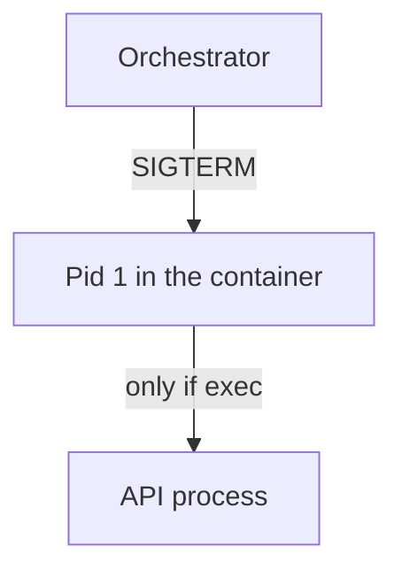

## Why this matters

Every CodeCraft container is a Linux process. When a task will not die, when a file is owned by root and the app is uid 1000, when `journalctl` is the only record of why sshd or the kubelet restarted, you are in this lesson. Cloud consoles hide the host until the host is the bug: a full disk, a zombie, a service that ignored SIGTERM and got SIGKILL after the grace period.

You do not need to be a kernel developer. You need a small set of commands and a correct picture of users, processes, and logs.

## Intuition

A process is a running program with a pid, an owner, a current directory, open files, and an environment. Pid 1 is special. On a host it is systemd, which adopts orphans and starts units. In a container, pid 1 is whatever you set as ENTRYPOINT or CMD. If that is a shell script that does not `exec` the real server, the server is not pid 1 and does not receive the stop signal. That is why Dockerfiles use the exec form.

Permissions are three bits for user, group, and other: read, write, execute. The directory execute bit means "may traverse," not "may run a program." A container running as uid 1000 cannot write a root-owned directory even if the port mapping looks fine.

systemd units are the host's long-running processes: the container runtime, sshd, the node agent. `systemctl` starts and stops them. `journalctl` reads their logs. Inside the container you usually do not have systemd. The orchestrator is the supervisor.

## Core concept in depth

### Processes and signals

`ps` and `top` show who is using CPU. `pid` 1's children are the tree. A zombie is a child that exited and whose parent has not waited. A few zombies are harmless. A growing set means the parent is buggy. In a container, a zombie reaper is pid 1's job. A shell as pid 1 often does not reap, and it does not forward SIGTERM.

SIGTERM asks a process to stop. SIGKILL cannot be caught. Orchestrators send SIGTERM, wait the grace period, then SIGKILL. An API that needs ten seconds to finish a request needs a grace period longer than that, and it needs to be pid 1 so it hears SIGTERM. SIGSTOP freezes a process. You will not use it in production except to understand why a paused debug session looks like a hang.

`nice` and cgroups both affect CPU. In containers, cgroups win. `nice` on a laptop process is not the memory limit you set in Kubernetes.

### Users and files

A file has an owner uid and a mode. `chown` and `chmod` change them. Prefer the least mode that works. A private key at mode 644 is readable by every user on the host. `umask` decides the default mode for new files.

In images, create the user with a fixed uid and `chown` the work directory. A volume mounted from the host keeps the host's ownership. If the host directory is root and the container is uid 1000, writes fail. That is a permissions bug, not a storage bug.

`sudo` is for humans on a host. It should not be the way the API writes logs. If the process needs a capability, grant that capability, do not run the server as root.

### systemd and logs

A unit file declares the command, the user, the restart policy, and the dependencies. `systemctl status` shows whether it is active and the last lines. `systemctl restart` is a blunt fix. Read status first.

`journalctl -u kubelet -f` follows one unit. `journalctl -p err` is the error floor. Logs are not infinite. `journald` vacuuming and disk limits matter on a small node. A node that cannot log will look like a silent failure.

`/var/log` still exists for some services. Do not assume every log is in the journal, and do not assume a container's stdout is in the journal of the host in a way you can read without the runtime. `kubectl logs` and `docker logs` read the runtime's capture of stdout. If the app wrote a file inside the container, those commands will not show it.

### Disk

`df -h` is filesystem full. `df -i` is inode full, which fails creates with "no space" while `df -h` looks fine. `du -sh` finds which directory grew. Container layers and emptyDir volumes live on the node disk. A sandbox that writes a huge `/tmp` can fill the node and evict the API. Size-limit the volume.

`lsof` shows who holds a deleted file open. The space does not return until the process exits. A log rotator that deleted a file the process still has open is the classic case.

### Packages and time

On the host, patch the kernel and the container runtime. Inside images, do not `apt-get` in a running container as a fix. Rebuild. Time comes from NTP or chrony on the host. TLS and log correlation break when the clock is wrong. A skew of minutes is an incident, not a curiosity.

## Diagram / flowchart



### Dry-run: stop a task

| Pid 1 | What SIGTERM does | After the grace period |
| --- | --- | --- |
| Uvicorn exec form | Uvicorn stops accepting and exits | Process is gone |
| Shell script that runs Uvicorn as a child | Shell may exit or ignore it. Child keeps running. | SIGKILL the shell. The child can be orphaned and then killed. |
| App ignores SIGTERM | Nothing | SIGKILL. In-flight work dies. |

### Commands worth memorizing

| Question | Command |
| --- | --- |
| Who is busy? | `top` or `ps aux --sort=-pcpu` |
| Why did a unit die? | `systemctl status` and `journalctl -u` |
| Disk full or inodes? | `df -h` and `df -i` |
| Who owns the port? | `ss -lptn` |
| What has the file open? | `lsof` |

## Code

A stop-friendly entrypoint. `exec` replaces the shell so Uvicorn becomes pid 1.

```bash
#!/bin/sh
set -eu
exec uvicorn app.main:app --host 0.0.0.0 --port 8000
```

Without `exec`, `ps` inside the container shows `sh` as pid 1 and uvicorn as a child. With `exec`, uvicorn is pid 1.

Inspect a host or a debug container:

```bash
ps -ef
ss -lptn
df -h
df -i
journalctl -u containerd -n 50 --no-pager
```

Permissions on a key the host uses:

```bash
chown root:root /etc/codecraft/key.pem
chmod 600 /etc/codecraft/key.pem
```

A systemd unit for a simple host agent, not for the API (the orchestrator runs the API):

```ini
[Service]
User=codecraft
ExecStart=/usr/local/bin/codecraft-agent
Restart=on-failure
RestartSec=5
```

`Restart=always` on a crashing agent will loop. `on-failure` restarts non-zero exits. Read the journal before you set `always` and hide the crash.

## Complexity analysis

| Habit | Outcome |
| --- | --- |
| Exec form pid 1 | Clean SIGTERM |
| Shell as pid 1 | Grace period then SIGKILL |
| Root container | Any bug is root |
| Fixed uid plus chown | Volumes work if the uid matches |
| stdout logs | The platform can ship them |
| Log files inside the container | Gone on reschedule, invisible to kubectl logs |
| Patching live containers | Drift. Rebuild instead. |
| Ignoring inode exhaustion | Mysterious "disk full" |

## Tricks, tips and patterns

- If stop takes the whole grace period, the process is not handling SIGTERM. Fix pid 1 before you raise the grace period blindly. Then raise it if drains are legitimately long.
- `df -i` when `df -h` disagrees with "no space left."
- Match container uid and volume owner.
- `systemctl status` before `restart`.
- stdout for app logs. Journal for host units.
- Do not install debug tools in the prod image as a permanent change. Use a temporary debug container or a sidecar you remove.
- Clock skew breaks TLS. Check `timedatectl` when certificates "are not valid yet."
- A deleted file still using space is `lsof` plus a restart of the holder.

## Common mistakes and edge cases

- `chmod 777` to fix a write error. You fixed the symptom and opened the directory to every user.
- Running the API as root so it can bind port 80. Bind 8000 instead, or grant `CAP_NET_BIND_SERVICE`.
- `kill -9` as the first response. You skipped the clean shutdown and you still do not know why it hung.
- Looking for application logs in the journal when the app logs to stdout and the runtime ships them elsewhere.
- A full disk on the node because container logs have no rotation. Configure the runtime or the agent.
- Two processes writing one log file without a lock. Use stdout.
- Timezone confusion in logs. Store UTC. Convert in the UI.

## Interview notes

**Why does exec form matter?**
The process becomes pid 1 and receives SIGTERM when the orchestrator stops the container. A shell parent often does not forward the signal, so the app is SIGKILL'd after the grace period.

**A volume write fails as uid 1000. What do you check?**
The directory owner and mode on the host or the volume, not the image's `USER` alone. The volume wins. `chown` to the same uid or `fsGroup` in Kubernetes.

**Disk looks free but creates fail.**
Inodes. `df -i`. Or a deleted file still held open. `lsof`.

**Where are logs?**
Application stdout via the runtime. Host units in the journal. A file inside the container is the wrong place for anything you need after the Pod is gone.

**What is pid 1's extra job in a container?**
Signal handling and reaping zombies. If your app will not do that, use an init such as `tini` and still `exec` the app so signals are correct.

## Practice problems

1. A container ignores stop until the grace period ends. What does `ps` show if the shell is pid 1, and what one word in the entrypoint fixes it?
2. `df -h` shows 40 percent used and writes fail. Name the second check.
3. The API runs as uid 1000 and cannot write `/data`. The image `WORKDIR` is fine without the volume. Explain.
4. You need the last kubelet crash on a node. Which command, and why is `docker logs` the wrong one?
5. A private key is mode 644. What can every local user do, and what mode do you set?

## Summary / cheat sheet

- Processes, signals, users, and files are the whole incident surface.
- Pid 1 must be the app. `exec`. SIGTERM then SIGKILL.
- uid and mode on volumes must match the process.
- `systemctl` and `journalctl` for the host. stdout for the app.
- `df -h` and `df -i`. `ss` for ports. `lsof` for deleted files.
- Do not patch running containers. Rebuild.
- UTC clocks. Rotated logs. No 777.
- The orchestrator is systemd for your container. Your app still has to exit.

## Further reading

- [systemd service units](https://www.freedesktop.org/software/systemd/man/systemd.service.html)
- [journalctl](https://www.freedesktop.org/software/systemd/man/journalctl.html)
- [signal(7)](https://man7.org/linux/man-pages/man7/signal.7.html)
- [Docker PID 1 and signals](https://docs.docker.com/reference/dockerfile/#exec-form)
- [Kubernetes termination](https://kubernetes.io/docs/concepts/workloads/pods/pod-lifecycle/#pod-termination)
