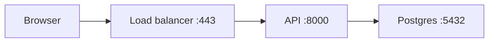

## Why this matters

"Connection refused," "timeout," and "reset" are different bugs. Refused means something answered with a reset, usually nothing is listening or a firewall rejected it. Timeout means packets vanished: a route, a security group, or a drop. Reset during a healthy connection means something in the middle killed it. If you treat them as one error called "the network," you will restart random services.

CodeCraft's browser reaches a load balancer, which reaches a task, which reaches a database. Each hop has an IP, a port, and a policy. This lesson is the vocabulary and the checks. VPC-specific objects come in the AWS module. The packet does not change its nature there.

## Intuition

IP addresses identify interfaces. Ports identify programs on that interface. TCP adds a connection: a handshake, reliable bytes, and a teardown. UDP sends datagrams and does not handshake. DNS is often UDP. HTTP is TCP, or QUIC which is UDP with its own reliability. You can know that much and already stop confusing "the port is open" with "the HTTP route is correct."

NAT rewrites addresses so many private hosts share one public IP, or so a Service VIP becomes a Pod IP. The connection you think is direct often is not. Timeouts that only happen from outside the VPC are often NAT or a missing route, not the application.

Routing is a table of "to reach this prefix, send the packet to this next hop." The default route is where everything else goes. A private subnet's default route to a NAT, and a public subnet's default route to an internet gateway, is the whole AWS story in one sentence. You will draw it properly in the VPC lesson.

## Core concept in depth

### TCP, briefly

The handshake is SYN, SYN-ACK, ACK. Connection refused is often a RST in response to SYN: the host is up and the port is closed. No response to SYN is a timeout: filtered, routed nowhere, or the far side is down in a way that does not generate a RST.

After the handshake, data is a stream. HTTP requests are bytes on that stream. A load balancer can accept the TCP connection and then fail to get a response from the target. The client sees a hang or a 502/504, not a refused connection. That distinction tells you the edge is reachable and the target is not.

TLS sits on TCP for HTTPS. A TCP connect can succeed and the TLS handshake can still fail because of the certificate name, the clock, or a protocol mismatch. Test in layers. Do not jump to the application log if TCP never connected.

### Ports and sockets

A listening socket is an address plus a port plus a backlog. `0.0.0.0:8000` means every interface. `127.0.0.1:8000` means only local. Inside a container, 127.0.0.1 is the container, not the host and not the other container. The API must bind `0.0.0.0` to receive Service traffic. You already saw this in the Dockerfile lesson. It is a networking fact, not a Docker quirk.

Ephemeral ports are the client side. A host that opens many connections can exhaust them. That shows up as failures to connect out, not as a full disk. `ss` shows states: LISTEN, ESTAB, TIME_WAIT. A storm of TIME_WAIT is usually not the outage. A storm of SYN_SENT means you cannot complete handshakes.

### NAT and firewalls

A stateful firewall allows return traffic for a connection it has seen. Security groups are stateful. A NACL is not, which is why people lock themselves out with NACLs and not with security groups. You do not need the AWS names to remember the idea: if the return path is a different device that has no state, you must allow both directions.

Source NAT makes many clients look like one address. The database then sees the NAT's address, not the Pod's, unless you are looking at a proxy protocol header. Debugging "who hit the database" from the database log may show the gateway. That is expected.

### Names come later

IP connectivity does not require DNS. DNS failure looks like "could not resolve host," which is not a timeout to an IP. Always notice whether the error names a host or an address. The next lesson is DNS. If the name will not resolve, do not spend the hour on security groups.

### A path for CodeCraft

Browser to public IP of the load balancer, TCP 443. Load balancer to task private IP, TCP 8000. Task to database private IP, TCP 5432. Each arrow can be allowed or not, routed or not, and listening or not. Draw the three arrows before you change a rule. Changing all three at once is how a fix becomes two new bugs.

## Diagram / flowchart



### Dry-run: three error strings

| Error | Likely layer | First check |
| --- | --- | --- |
| Could not resolve host | DNS | The DNS lesson's tools |
| Connection refused | TCP, port closed or rejected | `ss` on the target, then the security group |
| Connection timed out | Drop or no route | Route table, NACL, remote host down |
| Connected, then HTTP 502 | TCP ok, app or proxy failed | Target health and the API log |
| TLS certificate error | Handshake after TCP | Name on the cert, clock |

### States you will see in `ss`

| State | Meaning |
| --- | --- |
| LISTEN | A server is bound |
| ESTAB | A live connection |
| SYN_SENT | Client sent SYN and is waiting |
| TIME_WAIT | Local side closed and is holding the tuple briefly |
| CLOSE_WAIT | The peer closed and the local app has not closed yet. Often an application bug. |

## Code

From a shell that should reach the API:

```bash
ss -lptn
ip route
ip addr
curl -sv --max-time 5 http://127.0.0.1:8000/health
curl -sv --max-time 5 http://codecraft-api:8000/health
```

`-v` shows whether you resolved a name, connected, and got bytes. `--max-time` stops a timeout from becoming a five-minute stare. If localhost works and the Service name does not, the process is up and the network path is not. If neither works, the process is not listening. `ss` confirms the bind address.

A TCP check that does not speak HTTP, so you do not confuse a protocol error with a closed port:

```bash
nc -vz 10.0.1.20 5432
```

Use the private IP of the database from the task's network, not from your laptop, unless a tunnel exists. A laptop timeout does not prove the task cannot connect.

Trace a route when you suspect the packet leaves the wrong interface:

```bash
ip route get 10.0.2.30
traceroute -n -T -p 443 203.0.113.10
```

`ip route get` is often enough inside a VPC. Traceroute is ambiguous with firewalls that drop probes. Do not treat a row of stars as a precise location of the bug. Treat it as "this path is not answering probes," then check the route table and the security group you already drew.

## Complexity analysis

| Approach | What you learn | What you miss |
| --- | --- | --- |
| Only application logs | HTTP status once connected | Everything before TCP |
| Only security groups | Drops that are policy | A process not listening |
| `curl -v` in layers | Resolve, connect, TLS, HTTP | Intermittent loss if you try once |
| Packet capture | The truth on the wire | Time and noise. Use it when the layers disagree. |
| Changing every rule | Motion | You will not know which change mattered |

Capture with `tcpdump` on a specific port when a timeout and an allow rule contradict each other. Filter hard. A node capture without a filter during an incident is a second incident.

## Tricks, tips and patterns

- Classify the error before you classify the technology.
- Bind `0.0.0.0` in containers. Keep `127.0.0.1` for probes that should not leave the pod.
- Draw the three hops. Test the farthest hop from the host that is supposed to open it.
- CLOSE_WAIT means the application is not closing. Look at the code, not the firewall.
- Stateful versus stateless firewalls explain half of NACL pain. Remember the return path.
- NAT hides client IPs. Do not be surprised.
- Timeouts get a max time in every test command so you can try the next layer.
- DNS errors are not TCP errors. Read the message.

## Common mistakes and edge cases

- Testing the database from a laptop and concluding the task's security group is wrong.
- Opening port 80 in a group when the process listens on 8000.
- A public subnet route and a private instance, or the reverse, so the default route cannot reach the internet or the NAT.
- IPv6 disabled and a client that resolved an AAAA record and hangs. Prefer an explicit IPv4 test when you are isolating.
- MTU black holes: small packets work, large ones die, often on tunnels. Rare, and it looks like a timeout after the handshake. Remember it exists before you rewrite the app.
- Firewall allows the SYN and drops the return, on a stateless rule. The client times out. The server thinks it answered.
- Calling a 504 a "network issue" when TCP to the target is fine and the app is slow. That is a timeout budget.

## Interview notes

**Refused versus timeout?**
Refused means a RST, typically a closed port or an explicit reject. Timeout means no response, typically a drop, a bad route, or a host that is down. The fixes are different.

**Why must the API bind 0.0.0.0?**
127.0.0.1 is only the container's loopback. The Service forwards to the Pod IP, which is not loopback. A process bound to loopback looks healthy to a local probe and dead to the Service.

**What does NAT change about a database log?**
The source address may be the NAT gateway or the node, not the client you had in mind. The connection can still be correct. Do not debug the wrong identity.

**How do you test in layers?**
Resolve the name. TCP connect to the IP and port. TLS if needed. Then HTTP. `curl -v` shows those stages. Stop at the first stage that fails.

**Where does a 502 sit in this model?**
TCP to the load balancer worked. The balancer could not get a good response from a target. Check target health, the app port, and the app log. Do not start by opening port 443 to the world.

## Practice problems

1. `curl` says connection refused on port 8000. `ss` shows the process on 127.0.0.1. What is the one-line fix, and why did a local health check still pass?
2. The laptop times out to the database and the task connects. Explain why both can be true.
3. Clients see timeouts. The server log shows it sent a response. Which kind of firewall drops the return path?
4. Classify: could not resolve, refused, timeout, TLS error, HTTP 502. Name the first tool for each.
5. A flood of CLOSE_WAIT sockets appears after a deploy. Is the security group the prime suspect?

## Summary / cheat sheet

- IP plus port plus TCP is the connection. HTTP comes after.
- Refused, timeout, and reset are different. Read the word.
- `0.0.0.0` listens for the Service. `127.0.0.1` does not.
- Draw browser, load balancer, task, database. Test from the right host.
- NAT rewrites sources. Routes pick the next hop.
- Stateful firewalls remember the return path. Stateless ones do not.
- `ss`, `ip route`, and `curl -v` before packet capture.
- DNS failures are a separate lesson. Do not "fix" them with a security group.

## Further reading

- [TCP](https://datatracker.ietf.org/doc/html/rfc9293)
- [ss man page](https://man7.org/linux/man-pages/man8/ss.8.html)
- [ip-route](https://man7.org/linux/man-pages/man8/ip-route.8.html)
- [curl tutorial](https://curl.se/docs/tutorial.html)
- [AWS VPC route tables](https://docs.aws.amazon.com/vpc/latest/userguide/VPC_Route_Tables.html)
