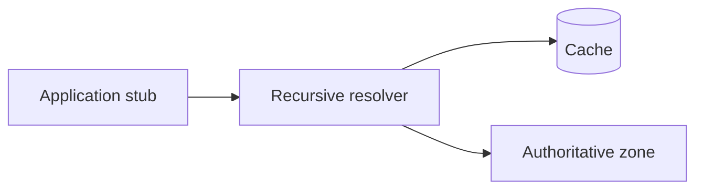

## Why this matters

A deploy can be healthy and invisible because the name still points at the old load balancer. A name can point at the new load balancer and still be invisible because a resolver cached the old answer. DNS failures look like network failures if you do not read the error. "Could not resolve" never reached TCP.

CodeCraft has at least three names: the public site, the in-cluster Service name, and the database hostname RDS gives you. They are resolved by different servers. Mixing them up sends you into the wrong console. This lesson is the lookup path, the records, and the caches. Route 53 as a product is the AWS lesson. The protocol is here.

## Intuition

A stub resolver is the library in the process. It asks a recursive resolver, often the VPC resolver at the famous address ending in 2, or CoreDNS inside Kubernetes. The recursive resolver walks the hierarchy if it does not have a cached answer: root, TLD, authoritative server. The authoritative server is the one that owns the zone. Route 53 is authoritative for a zone you host there. It is not the recursive resolver your Pod uses, unless you deliberately set it up that way.

Caching is everywhere: the application, the node, the recursive resolver, and sometimes a browser. TTL is the maximum time a cache may keep an answer. It is not a promise that every cache will refresh early. Lowering TTL before a migration is how you make a cutover possible. Lowering it during the cutover is how you wait out the old TTL.

## Core concept in depth

### The walk

1. The app asks the resolver configured in `/etc/resolv.conf`.
2. If the name is a single label, search domains may be appended. Kubernetes does this so `codecraft-api` becomes `codecraft-api.codecraft.svc.cluster.local`.
3. The recursive resolver returns a cached answer or queries the authoritative servers.
4. The answer contains records and a TTL.

`ndots` in Kubernetes means a name with fewer dots than the threshold is tried with the search list first. A query for an external host can generate several failing internal lookups before the real one. That adds latency and noise. It is not usually an outage. It is a reason not to be surprised by extra queries in a trace.

### Record types you will actually use

| Type | Points at | CodeCraft use |
| --- | --- | --- |
| A | IPv4 | The load balancer, or an ALIAS/A that tracks it |
| AAAA | IPv6 | Only if you really serve v6. A stray AAAA causes hangs. |
| CNAME | Another name | A friendly name to an ALB DNS name. Not at the zone apex. |
| Alias | An AWS resource, looks like A at the apex | The zone apex to CloudFront or an ALB. Route 53 specific. |
| NS | The nameservers for a zone | Delegation. Wrong NS is a zone that is not yours. |
| TXT | Text | SPF, ownership checks, sometimes config. Not a redirect. |
| SRV | Host and port | Less common here. Kubernetes uses some. |

CNAME at the apex of `example.com` is illegal in plain DNS. Alias records exist so the apex can still track an ALB. If someone "fixes" the apex with a CNAME, some resolvers will reject the zone.

### TTL, negative caching, and split views

Positive TTL caches the answer you got. Negative caching caches the fact that the name did not exist. If you create a record and clients still say NXDOMAIN, they may be sitting on a negative cache from before the record existed. The negative TTL comes from the zone's SOA. It is often an hour. Create the record before you announce the name, or you will debug a name that "exists" in the console and not on the laptop.

Split horizon means the same name returns different answers on the VPC resolver and on the public internet. Useful for private APIs. Dangerous if you forget which resolver `dig` used. `dig` uses the system resolver unless you specify a server. `dig @8.8.8.8` asks a public resolver. `dig @10.0.0.2` asks the VPC resolver if that is your base. Compare them when a name works in one place.

### Kubernetes DNS

CoreDNS answers cluster names. A Service `codecraft-api` in namespace `codecraft` is `codecraft-api.codecraft.svc.cluster.local`. The Pod's `resolv.conf` search list makes the short name work in-namespace. A Job in another namespace that uses the short name may hit a different Service or fail. Use the fully qualified name in cross-namespace config.

An ExternalName Service is a CNAME. It does not create endpoints. Network policy and "is the database up" are not the same as "did the CNAME resolve."

### What DNS will not do

It will not fail over faster than TTL plus client behavior, unless you use a system that health-checks and every resolver honors a low TTL. It will not pin a user to one version. It will not tell you that the HTTP path is wrong. After the name resolves to the right IP, you are back in the networking lesson.

## Diagram / flowchart



### Dry-run: move the site to a new load balancer

| Time | Action | What clients can still see |
| --- | --- | --- |
| Day before | Lower TTL to 60 seconds | Old answer, until their current TTL expires |
| Cutover | Change the A or Alias to the new ALB | Mix of old and new for up to the previous TTL |
| After old TTL | Most resolvers have the new answer | Stragglers with broken clocks or long caches |
| Mistake: create the name at cutover after NXDOMAIN | Negative cache | NXDOMAIN for the negative TTL |

Do the TTL drop a day early. Do not create the record for the first time in the same minute you send email to students.

### Which resolver

| Where the process runs | Typical resolver | Names it knows |
| --- | --- | --- |
| Your laptop | Whatever DHCP gave you | Public DNS |
| A Pod | CoreDNS via resolv.conf | Cluster names plus public, if forwarding works |
| An ECS task in a VPC | VPC resolver | Private hosted zones associated with the VPC |
| A CI runner | The runner's resolver | Often public only. Private names will fail. |

## Code

Ask a specific server so you know whose answer you are reading.

```bash
dig academy.example.com A +ttlunits
dig academy.example.com A @8.8.8.8
dig academy.example.com A @10.0.0.2
dig codecraft-api.codecraft.svc.cluster.local A
dig example.com NS
```

`+trace` shows the walk from the root. Use it when you suspect the wrong nameservers, not on every incident.

```bash
dig academy.example.com +trace
```

Inside a Pod, read the search list before you blame CoreDNS:

```bash
cat /etc/resolv.conf
getent hosts codecraft-api
```

`getent` uses the same path as many applications, including nsswitch. `dig` does not always. If `dig` works and the app does not, compare nsswitch and whether the app cached a failure.

Negative cache check: query a name, create it, query again from a resolver that is not your laptop's stub. If the authoritative server has the record and the recursive resolver still says NXDOMAIN, wait for the negative TTL or flush that resolver if you control it. You cannot flush the world's caches.

## Complexity analysis

| Choice | Cutover speed | Cost |
| --- | --- | --- |
| TTL 300 seconds default | A few minutes of mix | Fine for most records |
| TTL 60 before migration | Faster mix | More queries to authoritative servers |
| TTL 86400 | Cheap and stable | A bad change lasts a day |
| CNAME chain of four | Flexible | Extra lookups, more places to break |
| Alias at the apex | Apex tracks an ALB | AWS-specific |
| Split horizon | Private names stay private | Two answers to compare when debugging |
| Caching in the application | Fast | Stale long after TTL if the app ignores DNS TTL |

Application caches that hold an IP forever are a private TTL you forgot. HTTP clients that resolve once at startup will not see your cutover. Prefer resolving per connection for long-running workers, or restart them as part of the cutover.

## Tricks, tips and patterns

- Read the error. Resolve failures are not security groups.
- Specify `@server` when two networks disagree.
- Lower TTL before the change, not after.
- Create records before the first public lookup to avoid negative cache.
- No CNAME at the apex. Use an alias record in Route 53.
- Fully qualify cross-namespace Kubernetes names.
- Do not leave a debug AAAA record that points nowhere.
- After a cutover, test from a Pod, from a task, and from a phone network. Three resolvers.

## Common mistakes and edge cases

- Editing `/etc/hosts` on one node and calling it a fix. The next Pod will not have it.
- A trailing dot and a missing trailing dot changing the search-list behavior. Know whether the name is absolute.
- Two hosted zones for the same name, public and private, and you updated one.
- A CNAME to an ALB and an A record on the same name. Illegal together. The zone will not do what you hope.
- TTL of a day on the database hostname you are about to replace.
- CoreDNS down. Cluster names fail. External names fail if they were forwarded. The node may still reach IPs. Test an IP to separate the layers.
- Search path turning `example.com` into `example.com.svc.cluster.local` first and slowing every lookup. Look at `ndots` if external lookups are strangely slow.

## Interview notes

**Walk a lookup.**
The stub asks the recursive resolver in `resolv.conf`. The resolver returns a cache hit or queries the authoritative nameservers. The answer has a TTL. Kubernetes search domains expand short names.

**Why do some clients see the old load balancer?**
They cached the previous answer for its TTL. Lower TTL in advance. A change is not global at the moment you click.

**CNAME versus alias?**
A CNAME delegates a name to another name and cannot sit on the zone apex next to other records the way people want. A Route 53 alias can point the apex at an AWS resource and still look like an address to resolvers.

**A Pod cannot resolve the public site, but your laptop can.**
Different resolvers. Check CoreDNS, the Pod's `resolv.conf`, and whether the VPC resolver is healthy. Do not assume the laptop's result applies.

**NXDOMAIN after you just created the record.**
Negative caching. The authoritative server may already be right. The recursive resolver remembers the miss until the negative TTL expires.

## Practice problems

1. You will move `academy.example.com` to a new ALB tomorrow. What do you change today, and what do clients still see during the move?
2. `dig` against 8.8.8.8 returns the new IP and a Pod still uses the old one. Name two caches that can explain it.
3. Why can you not put a CNAME on the zone apex, and what do you use on Route 53 instead?
4. A Job in namespace `batch` calls `http://codecraft-api:8000` and fails. What name should it use?
5. External lookups from Pods are slow but succeed. Which `resolv.conf` setting do you inspect?

## Summary / cheat sheet

- Stub, recursive resolver, authoritative zone. Cache sits in between.
- TTL bounds how fast a change is seen. Lower it before you need speed.
- Negative caching remembers misses. Create names before the world asks.
- A, AAAA, CNAME, alias, NS. No CNAME at the apex.
- Kubernetes short names depend on the search list and the namespace.
- Private and public zones can disagree. Ask the resolver the client uses.
- Resolution is not connectivity. After the right IP, return to TCP.
- Application-level caches can outlive the DNS TTL. Restart or re-resolve.

## Further reading

- [DNS terminology](https://www.rfc-editor.org/rfc/rfc8499)
- [Negative caching](https://www.rfc-editor.org/rfc/rfc2308)
- [Kubernetes DNS](https://kubernetes.io/docs/concepts/services-networking/dns-pod-service/)
- [Route 53 alias records](https://docs.aws.amazon.com/Route53/latest/DeveloperGuide/resource-record-sets-choosing-alias-non-alias.html)
- [CoreDNS](https://coredns.io/manual/toc/)
