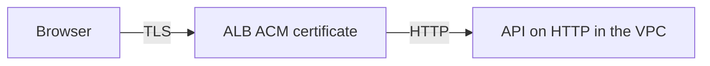

## Why this matters

The browser's padlock is a name check plus a chain of trust, not a moral judgment about your API. A certificate for the wrong name, an expired certificate, or a clock skew produces a wall of students who cannot load the site. A certificate that is valid and a service that does not authenticate users produces a padlock on an open admin route. TLS and authentication are different layers. You need both, and you need to know which failure you are looking at.

CodeCraft's public name should present a certificate a normal browser already trusts, usually from Amazon Certificate Manager on the load balancer or from Let's Encrypt via ACME. The hop behind that load balancer is a separate decision. Saying "we use HTTPS" without saying where it terminates is how teams discover the ALB-to-Pod traffic is cleartext on a shared network.

## Intuition

TLS gives you a confidential, integrity-protected channel to someone who can prove they hold the private key for a certificate. The certificate says "this key belongs to `academy.example.com`." A certificate authority you already trust signs that statement. The browser walks from the server certificate to an intermediate to a root it knows. If any step is expired, the name does not match, or the clock says the cert is not valid yet, the handshake fails before HTTP.

The private key stays on the terminator. ACM can hold it on the load balancer so the key is not in your repo and not on every task. That is the right default. Copying a key into a container image is a leak.

## Core concept in depth

### The handshake, operationally

The client says which protocol versions and which name it wants. Server Name Indication is that name. One IP can host many certificates. Without SNI, the server would not know which certificate to send. The client checks:

- The name in the certificate matches the URL host. `academy.example.com` is not `www.academy.example.com` unless the certificate says both.
- The dates are valid relative to the client clock.
- The chain ends at a trusted root, and the signatures verify.
- The certificate has not been revoked, if the client actually checks. Do not rely on revocation as your only response to a stolen key. Replace the certificate and the key.

You do not need to memorize cipher suite names to operate this. You need to disable ancient protocols. TLS 1.2 and 1.3 only. No SSLv3, no TLS 1.0. Load balancers have a security policy dropdown for this. Pick a modern policy and leave it.

### Where to terminate

| Place | Key lives | Good for CodeCraft |
| --- | --- | --- |
| ALB with ACM | In ACM | Yes, for the public site |
| CloudFront with ACM | In ACM | Yes, for static assets and the site if you front it |
| cert-manager in the cluster | In a Secret | Reasonable on Kubernetes if you are not on ACM |
| Inside the API process | On the task | Extra work. Do it only if you truly need TLS to the Pod. |
| Nowhere, HTTP on the internet | — | No |

If the ALB terminates TLS and talks HTTP to the Pod, the API must still know the original scheme was HTTPS, via a forwarded header it trusts only from the load balancer. Secure cookies need that truth. A client that connects with HTTP to a public IP and never sees the certificate is not "behind TLS."

Mutual TLS means the client also presents a certificate. Use it for service-to-service calls when you have a real identity system for machines. Do not invent mTLS for browsers on a learning site. Students will not install client certificates. Use normal user authentication at the application layer.

### Issuance and renewal

ACM certificates that are attached to an ALB or CloudFront renew if the DNS validation records stay in place. A certificate you requested and never attached may not renew the way you expect. Read the current ACM behavior and do not assume a forgotten cert rotates itself into your nginx config.

ACME with Let's Encrypt is HTTP-01 or DNS-01. HTTP-01 needs port 80 to the solver. DNS-01 needs API access to the zone. Rate limits are real. Do not generate a certificate per pull request against production Let's Encrypt. Use the staging directory for tests.

Expiry is a ticket at 21 days and a page if you are inside a few days and the renewal is broken. The alerting lesson already said this. The failure looks like a sudden total outage because browsers refuse the site. The API process can be healthy the whole time.

### Names and chains

Serve the chain, not only the leaf. If the intermediate is missing, some clients that do not cache that intermediate will fail and browsers might work. That is a miserable bug. Test with a tool that does not forgive a missing intermediate.

A wildcard `*.example.com` does not cover `example.com` and does not cover `a.b.example.com`. Know the dots.

## Diagram / flowchart



If you need TLS on the second hop, draw it. Do not imply it.

### Dry-run: the site is down, the process is up

| Symptom | Cause |
| --- | --- |
| Browser says the certificate expired | Renewal failed or the wrong cert is attached |
| Name mismatch | DNS points at this cert's host, or the cert is for another name |
| Not yet valid | Clock skew on the client or the server |
| Works on Wi-Fi, fails on a phone | Different caches, or a chain issue a strict client rejects |
| curl works with `-k` only | The check is doing its job. Do not ship `-k`. |

### What the padlock is not

| Question | Answered by TLS? |
| --- | --- |
| Is this the host I typed? | Yes, if you checked the name |
| Did anyone change the bytes on the wire? | Yes, on the TLS hop |
| Is the user logged in? | No |
| Is the API authorized? | No |
| Is the Pod hop encrypted? | Only if you set that up |
| Is the content true? | No |

## Code

Inspect a public certificate without ignoring errors:

```bash
curl -svI https://academy.example.com/ 2>&1 | head -n 40
echo | openssl s_client -connect academy.example.com:443 -servername academy.example.com -showcerts
```

`-servername` sets SNI. Without it you may see the default certificate and chase a bug that browsers do not have.

Check dates:

```bash
echo | openssl s_client -connect academy.example.com:443 -servername academy.example.com 2>/dev/null \
  | openssl x509 -noout -dates -subject -ext subjectAltName
```

Request an ACM certificate with DNS validation and leave the validation CNAMEs in the zone. Attach that certificate ARN to the listener. A listener on port 80 should redirect to 443, not serve the app.

In development, a private certificate will make the browser warn. That is acceptable on localhost. It is not acceptable to tell students to click through a warning on a public host. Fix the name and the issuer.

Do not add `curl -k` to a health check in production. You would be green through an expired or mismatched certificate, which is the outage.

## Complexity analysis

| Design | Operational load | Exposure |
| --- | --- | --- |
| ACM on one ALB | Low. Renewal is managed if validation stays. | Pod hop is HTTP unless you add TLS there. |
| TLS to every Pod | High. Certs on every task. | Smaller cleartext region. |
| Self-signed on a public name | Constant browser pain | Students trained to ignore warnings |
| No TLS | None | The whole path is readable |
| mTLS between API and database | High | Strong machine identity, easy to lock yourself out |
| Wildcard cert | Fewer names to track | Broader blast radius if the key leaks |

A leaked private key means you replace the certificate and revoke if you can. A key in git means the replacement includes rewriting history is not enough. Rotate and assume the old key is public.

## Tricks, tips and patterns

- One public certificate story. ACM on the edge is enough for this project.
- Attach the cert to the listener you think is serving. Describe the listener.
- Keep DNS validation records forever so renewal works.
- Alert on expiry even if you believe renewal is automatic.
- SNI in every manual test.
- Redirect port 80 to 443.
- Trust forwarded proto only from the load balancer.
- Never `curl -k` in a prod probe.

## Common mistakes and edge cases

- Certificate for the ALB's raw DNS name while users visit `academy.example.com`.
- Clock skew. The cert is "not yet valid" because the container thinks it is 2019.
- Missing intermediate. Intermittent client failures.
- A second listener still serving an old certificate.
- HTTP-01 behind a redirect that breaks the challenge path.
- Rate-limited Let's Encrypt in CI.
- Teaching users to bypass the warning.
- Terminating TLS and setting the cookie `Secure` while the app thinks it is HTTP, so the cookie is never sent. Forwarded headers, trusted proxy list.

## Interview notes

**What does the browser check?**
The hostname matches the certificate, the dates are valid, and the chain reaches a trusted root. SNI picks which certificate the server sends.

**Where should CodeCraft terminate TLS?**
At the ALB or CloudFront with an ACM certificate. Say clearly whether the hop to the task is HTTP. Do not claim end-to-end encryption you did not configure.

**TLS versus login?**
TLS identifies the server and protects the bytes on that hop. It does not authenticate the student. Application auth still has to exist.

**A phone shows an expiry and your laptop does not.**
Different time, a cached connection, or a different certificate on a different edge. Check the certificate the phone's DNS actually reached. Do not assume one curl is the world.

**How do renewals fail quietly?**
Validation CNAMEs were deleted, the certificate is not associated with a resource that triggers ACM renewal, or the thing serving traffic is not the certificate you renewed. Alert on the certificate that is actually presented.

## Practice problems

1. Users see a name mismatch. DNS is correct. What two names do you compare, and which openssl flag sends SNI?
2. The API is healthy in the target group and browsers refuse the site. List three TLS causes that match this split.
3. Draw termination on the ALB and an HTTP hop to the Pod. What must be true for a `Secure` cookie to be set?
4. A certificate was committed in the repo. What do you rotate, and why is deleting the file from the latest commit not enough?
5. Explain why a prod health check must not use `curl -k`.

## Summary / cheat sheet

- TLS binds a name to a key the client can trust through a chain. It is not login.
- ACM on the public listener is the default for CodeCraft.
- Know whether the next hop is encrypted.
- SNI, dates, chain, and the client clock are the usual failures.
- Redirect HTTP to HTTPS. Alert before expiry.
- Do not put private keys in images or git.
- No `curl -k` in production probes.
- A padlock does not mean the API checks authorization.

## Further reading

- [TLS 1.3](https://www.rfc-editor.org/rfc/rfc8446)
- [ACM certificates](https://docs.aws.amazon.com/acm/latest/userguide/acm-overview.html)
- [Let's Encrypt how it works](https://letsencrypt.org/how-it-works/)
- [Mozilla SSL configuration generator](https://ssl-config.mozilla.org/)
- [AWS load balancer security policies](https://docs.aws.amazon.com/elasticloadbalancing/latest/application/create-https-listener.html)
