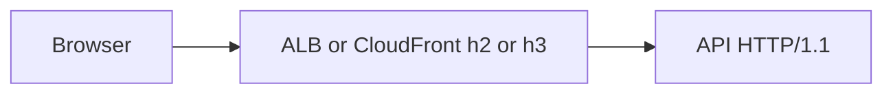

## Why this matters

Browsers open the site, then fetch scripts, styles, and API calls. HTTP/1.1 does that poorly on one connection because a slow response blocks the next one on that connection. HTTP/2 multiplexes many streams on one TCP connection. HTTP/3 does the same on QUIC so a lost packet does not stall every stream. The load balancer in front of CodeCraft may speak HTTP/2 to the browser and HTTP/1.1 to the task. That is normal. You have to know which hop you measured.

A version upgrade is not a free latency win. A single large lesson page with one API call will not transform because you flipped a protocol. A page that fans out to many small files will. This lesson is the mechanism, the place it terminates, and the failures that look like "HTTP/2 is on" while the app still speaks 1.1.

## Intuition

HTTP/1.1 is text. One request, then its response, then the next request, on a given connection. Browsers open several connections to cheat. That wastes handshakes and still stalls when one of those connections is blocked.

HTTP/2 is a binary framing layer. Streams are numbered. Frames from many streams interleave on one connection. Headers are compressed so the cookie is not resent in full every time, in the naive sense of HPACK's table. The TCP connection underneath is still one pipe. A lost packet stalls every stream until it is retransmitted. That is head-of-line blocking at the transport, and HTTP/2 does not remove it.

HTTP/3 runs over QUIC, which is UDP plus its own reliability. Each stream can lose packets without freezing the others. The TLS handshake is part of QUIC's setup, not a separate TCP-then-TLS stack. Middleboxes that expect TCP port 443 sometimes interfere. Fall back to HTTP/2 or 1.1 must work or a subset of networks will see a dead site.

## Core concept in depth

### Negotiation

The client and server pick a protocol with ALPN during the TLS handshake for HTTP/2: the token is `h2` for HTTP/2 over TLS. Cleartext HTTP/2 exists and you should not serve the public site that way. HTTP/1.1 remains the fallback if ALPN does not agree.

HTTP/3 is advertised. The browser often completes the first visit on HTTP/2, learns that HTTP/3 is available, and uses QUIC on a later connection. Your first curl might not show HTTP/3 even when the site supports it. Test with a client that can speak it, and do not panic when a packet capture of the first hit is TCP.

### What the app sees

Many application servers and WSGI/ASGI setups still speak HTTP/1.1 behind the load balancer. Uvicorn can speak HTTP/2 in some deployments, and it does not have to. The browser's protocol and the app's protocol are different hops. Access logs should record the protocol the app saw, which may be 1.1, while the ALB's logs record h2 to the client. When you compare timings, say which hop.

gRPC uses HTTP/2. If you put a gRPC service behind a proxy that downgrades to HTTP/1.1, gRPC breaks. CodeCraft's public API is ordinary HTTP JSON. Do not "upgrade" it to gRPC for fashion. Do not put a proxy in the middle that strips HTTP/2 if you later add a gRPC internal service.

Server push was part of HTTP/2 and is effectively dead in browsers. Do not design the frontend around it. Preload and good caching do the job push was meant to do.

### Head-of-line blocking, precisely

On HTTP/1.1, one slow or large response blocks later responses on that connection. On HTTP/2, those responses can share the connection, so a slow API call does not stop a stylesheet on the same connection. A lost TCP packet still blocks all of them. On a lossy network, HTTP/3's independent streams win. On a clean network with one request, you will not measure a difference worth an incident.

### Timeouts and streams

Proxies limit concurrent streams and header size. A page that opens a hundred streams can hit the limit. A huge cookie header can hit the header table or the size limit and fail in ways HTTP/1.1 did not. If the site breaks only for logged-in users with a large cookie, suspect header limits on the new protocol.

Idle timeouts still exist. A long sandbox run is an HTTP request that occupies a stream. The ALB idle timeout and the app timeout must exceed the run, as in the ingress lesson. HTTP/2 does not make a 30-second idle timeout become five minutes.

### Caching and content

Static assets want cache headers and HTTP/2 or HTTP/3 at CloudFront. The API wants correct cache headers too, mostly "do not cache personalized runs." Protocol version does not fix a missing `Cache-Control`. A CDN in front of the site will negotiate with the browser. The origin may still see HTTP/1.1 from the CDN. Measure the edge and the origin separately.

## Diagram / flowchart



### Dry-run: what improved

| Workload | HTTP/1.1 | HTTP/2 | HTTP/3 |
| --- | --- | --- | --- |
| One health check | Fine | Fine | Fine |
| Page plus 40 small assets | Many connections, some stalls | One connection, multiplexed | Same, plus better behavior under loss |
| One 20-second code run | Holds a connection | Holds a stream. Other streams continue. | Same idea on QUIC |
| Lossy Wi-Fi | Stalls per connection | Lost packet stalls every stream | Lost packet stalls one stream |
| gRPC through an HTTP/1.1-only proxy | Broken | Required | Not the usual gRPC path |

### What to log

| Hop | Record |
| --- | --- |
| Browser | Protocol in the devtools network panel |
| ALB | HTTP version on the request, target timing |
| App | What the server library accepted, often 1.1 |
| Error | 502/504 versus a protocol error. They are not the same. |

## Code

See what a client negotiated:

```bash
curl -svI --http2 https://academy.example.com/
```

On a Unix shell the filter is `grep -i`. The useful lines are ALPN and the status line that starts with `HTTP/2`.

Force HTTP/1.1 when you suspect a protocol bug:

```bash
curl -svI --http1.1 https://academy.example.com/
```

If 1.1 works and 2 does not, the app may be fine and the edge HTTP/2 implementation or a header size is the bug. If both fail, stop blaming HTTP/2.

A long request still needs a timeout budget. This does not enable HTTP/2 by itself. It shows the stream will sit open:

```bash
curl -sv --http2 --max-time 60 https://academy.example.com/api/health
```

CloudFront and ALB settings are checkboxes and security policies, not a line in the FastAPI router. Confirm in the console or the Terraform for the listener that HTTP/2 is enabled toward clients. Confirm the target group protocol. An HTTP target group means the app speaks HTTP/1.1 to the ALB in the common setup. That is a valid design.

Do not disable HTTP/1.1 on the public edge. Some clients and some health checks still need it. Negotiation exists so you can offer h2 and keep 1.1.

## Complexity analysis

| Change | Benefit | When it does not matter |
| --- | --- | --- |
| HTTP/2 to browsers | Fewer connections, less head-of-line at the request layer | One-request APIs, already behind a CDN that multiplexes |
| HTTP/2 to the app | Useful for gRPC | Extra complexity for a simple JSON API |
| HTTP/3 | Lossy networks, independent streams | Clean networks, and any middlebox that blocks UDP 443 |
| More asset files | HTTP/2 hides some of the cost | Still costs cache validation. Bundle thoughtfully. |
| Disabling 1.1 | None for a public site | Breaks old clients and naive probes |

Turning on HTTP/3 without a working fallback is how a coffee-shop network looks like a site outage. Offer it. Do not require it.

## Tricks, tips and patterns

- Read the protocol in browser devtools before you claim the site is on HTTP/2.
- Remember the ALB may translate h2 to HTTP/1.1. Log both hops.
- Keep HTTP/1.1 available.
- Header and stream limits bite large cookies and fan-out pages.
- Idle timeouts still apply to a long-running stream.
- Do not design around server push.
- gRPC needs HTTP/2 end to end. JSON does not.
- A CDN is where HTTP/2 and HTTP/3 usually pay off for static lesson assets.

## Common mistakes and edge cases

- A health check that only speaks a protocol the target does not. The target flaps.
- Assuming Uvicorn logs will say HTTP/2 because the browser used it.
- Turning on HTTP/3 and blocking UDP 443 in a security group, then debugging "random" client failures.
- A proxy that buffers an entire HTTP/2 stream and defeats streaming responses.
- Header compression confused with encryption. HPACK is not a security boundary. TLS is.
- Chasing a 50 ms protocol win while the search query takes 700 ms. Fix the query.
- One connection limit in a test tool. It will not reproduce browser behavior on HTTP/1.1, so the comparison is fake.

## Interview notes

**What problem does HTTP/2 solve?**
It multiplexes many requests on one connection so one slow response does not block the others on that connection, and it compresses headers. It does not remove TCP head-of-line blocking.

**What does HTTP/3 change?**
It runs that idea on QUIC over UDP so packet loss stalls one stream, not every stream, and it combines transport setup with TLS. You still need a fallback.

**Does the CodeCraft API have to speak HTTP/2?**
No. The edge can speak HTTP/2 or HTTP/3 to the browser and HTTP/1.1 to Uvicorn. gRPC would be the reason to require HTTP/2 on that hop.

**Why might the first request not be HTTP/3?**
The browser often learns HTTP/3 from a previous response and uses it later. A single curl can show HTTP/2 on a site that also offers HTTP/3.

**When is this the wrong optimization?**
When the time is in the database or the search code. Protocol choice does not fix a slow query. Measure the hop you think you changed.

## Practice problems

1. The browser shows HTTP/2 and the API log shows HTTP/1.1. Explain the hops for an ALB.
2. A lost packet stalls every asset on HTTP/2. Why, and what does HTTP/3 change?
3. A gRPC service breaks after you put it behind the same proxy as the JSON API. What downgrade happened?
4. Logged-in users fail and anonymous users do not, only after enabling HTTP/2. Which limit do you inspect?
5. Why must the public site still allow HTTP/1.1 if HTTP/2 and HTTP/3 are on?

## Summary / cheat sheet

- HTTP/1.1: one response at a time per connection. Browsers open many connections.
- HTTP/2: many streams on one TCP connection. A lost TCP packet stalls all streams.
- HTTP/3: streams on QUIC over UDP. Loss is per stream. Fallback is mandatory.
- ALPN negotiates h2. HTTP/3 is often used on a later visit.
- The edge protocol and the app protocol can differ. Log both.
- Timeouts, header size, and stream limits still apply.
- gRPC needs HTTP/2. A normal JSON API does not.
- Fix slow work before you worship the version number.

## Further reading

- [HTTP/2](https://www.rfc-editor.org/rfc/rfc9113)
- [HTTP/3](https://www.rfc-editor.org/rfc/rfc9114)
- [QUIC](https://www.rfc-editor.org/rfc/rfc9000)
- [ALPN](https://www.rfc-editor.org/rfc/rfc7301)
- [CloudFront HTTP versions](https://docs.aws.amazon.com/AmazonCloudFront/latest/DeveloperGuide/distribution-web-values-specify.html)
