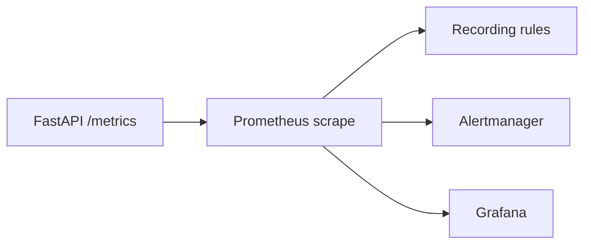

## Why this matters

CloudWatch tells you a task is running. It does not, by itself, tell you that lesson search latency just doubled for one route while the process was still healthy. Prometheus is the metrics system most Kubernetes and many ECS-side stacks use when they want application-level numbers: request rate, error ratio, and latency histograms that you can alert on.

CodeCraft's API is a FastAPI process with a few routes: courses, lessons, search, and code execution. Those routes do not share a latency budget. A histogram on "all HTTP" hides a slow search behind a fast health check. A counter with a label per student id will exhaust the database's memory. The mechanics are simple. The discipline is the product.

This lesson is the data model and the queries. Grafana, logs, and alert rules build on it.

## Intuition

Prometheus pulls. It scrapes an HTTP endpoint on your process every few seconds and stores the samples. Your process does not push a metric per request to a remote host. It updates numbers in memory, and the scrape reads them.

A counter only goes up: requests served, errors, jobs started. A gauge moves up and down: in-flight requests, queue depth, temperature. A histogram counts observations into buckets so you can estimate percentiles later. You do not store every latency. You store how many requests fell under 50 ms, under 100 ms, and so on.

Labels are the dimensions: route, method, status class. Each unique combination is a new time series. Series are cheap until they are not. A label with unbounded values is how a metrics system falls over.

## Core concept in depth

### Exposition and scrape

The process exposes text on `/metrics`. Each line is a name, optional labels, and a value. Prometheus stores that sample with a timestamp from the scrape, not from inside the request. If the process dies between scrapes, you lose the in-memory increments since the last scrape. Counters reset to zero on restart. Queries use `rate` or `increase`, which handle resets, instead of raw counter values.

Scrape interval is a budget. A 15-second interval cannot see a 1-second spike except as an average inside the window. Alerting on sub-second events is the wrong tool. Histograms and logs cover different questions.

Service discovery finds targets. On Kubernetes, Prometheus or the OpenTelemetry collector uses pod annotations or a ServiceMonitor. On ECS, you either scrape through a sidecar, remote-write from an agent, or accept CloudWatch metrics for the platform and Prometheus-format metrics from the app via an exporter. The data model is the same.

### Names and types

Name the metric for the unit and the thing measured. A counter of HTTP requests ends in `_total`. A histogram of latency is in seconds, because Prometheus conventions use seconds, not milliseconds. Mixing units is how a dashboard says the API takes 250 seconds when it takes 250 milliseconds.

Labels that belong:

| Label | Good values | Why |
| --- | --- | --- |
| `method` | GET, POST | Small set |
| `route` | the framework pattern, not the raw URL | The lessons route template is one series. The raw path with every slug is a series per lesson |
| `status` | 200, 404, 500 or a class | Small set |
| `service` | api, web | Small set |

Labels that do not belong: user id, lesson slug, search query, container id if you already have pod name from the platform and you also kept a high-cardinality request id. Request ids belong in logs and traces, not in Prometheus labels.

A histogram also creates a series per bucket per label set, plus a sum and a count. Ten buckets times four routes times five status codes is already 200 series before you add the method. That is fine. Ten buckets times every student id is not.

### RED for the API

For an online service, start with rate, errors, and duration.

- Rate: requests per second, from the counter.
- Errors: the fraction of responses that are 5xx, or that the application marks as failed. A 404 on a missing lesson is not an error budget burn. A 500 is.
- Duration: a histogram. Alert on a high quantile, not on the average. The average hides the slow tail that users of search actually feel.

USE (utilization, saturation, errors) fits the sandbox runner and the database: CPU, pool queue depth, failed checkouts of a connection. Do not force USE onto a request path or RED onto a disk. Pick the model that matches the resource.

### PromQL that operators actually run

You almost never graph a raw counter. You graph a rate over a window. The window must be at least four times the scrape interval or `rate` is noisy or empty. With a 15-second scrape, a 1-minute window is the short end.

A ratio of errors is `rate` of errors divided by `rate` of all requests. Both sides need the same labels or PromQL will do a many-to-many match and return nothing or an error. Aggregate the labels you do not want, keep the ones you do.

Percentiles come from `histogram_quantile` on the bucket series. The quantile is an estimate. If your buckets are 0.05, 0.1, 0.25, 0.5, 1, and 2.5 seconds, you cannot see the difference between 12 ms and 40 ms. Choose buckets around the SLO. For CodeCraft, a lesson read should be well under a quarter second when content is local, and search may be slower. Put a bucket boundary at the SLO, or the quantile will jump in coarse steps.

Recording rules precompute expensive expressions every evaluation interval. Dashboards then read the recording rule. Use them when many panels repeat the same heavy quantile. Do not start with fifty rules. Start with three RED queries that a human can read.

### What Prometheus is not

It is not a log store. A high cardinality event such as "this submission failed this test" is a log or a trace. It is not a request trace. It will not show you one slow SQL call. It is not durable analytics. Default local retention is short, often 15 days. If you need a year of SLO burn, remote-write to a system built for that, or accept that this Prometheus is for operations, not for finance.

CloudWatch remains the right place for AWS-managed metrics: ALB target 5xx, RDS CPU, NAT bytes. Prometheus is the right place for the FastAPI process's own view. The later CloudWatch lesson and this one meet in the alerting lesson, where one page should fire whether the failure is an empty target group or an application error ratio.

## Diagram / flowchart



### Dry-run: a search latency regression

| Observation | Series behavior |
| --- | --- |
| Deploy at 10:00 | New process, counters reset. `rate` dips then recovers. This is not an outage. |
| Search p95 moves from 80 ms to 700 ms | Histogram buckets shift. Health-check latency does not. |
| Error ratio flat | Users are slow, not failing. Page on latency, not on 500s. |
| CPU gauge flat | Not a saturation page. Look at the search code path and the content volume. |
| One label `query` was added by a well-meaning patch | Series count climbs with unique searches. Prometheus RAM climbs. Revert the label. |

### Metric types

| Type | Moves | Query shape | CodeCraft example |
| --- | --- | --- | --- |
| Counter | Up, reset on restart | `rate` or `increase` | Requests, sandbox runs started |
| Gauge | Up and down | Direct, or `avg_over_time` | In-flight runs, pool size |
| Histogram | Buckets plus sum and count | `histogram_quantile` | Route latency |
| Summary | Client-side quantiles | Hard to aggregate | Avoid for new API metrics |

## Code

Instrument FastAPI with a small set of series. The route label is the path template. Status is the numeric code. Do not include the query string.

```python
from prometheus_client import Counter, Histogram, generate_latest

REQUESTS = Counter(
    "codecraft_http_requests_total",
    "HTTP requests",
    ["method", "route", "status"],
)
LATENCY = Histogram(
    "codecraft_http_request_duration_seconds",
    "HTTP request latency",
    ["method", "route"],
    buckets=(0.025, 0.05, 0.1, 0.25, 0.5, 1, 2.5),
)


def observe(method: str, route: str, status: str, seconds: float) -> None:
    REQUESTS.labels(method=method, route=route, status=status).inc()
    LATENCY.labels(method=method, route=route).observe(seconds)


def metrics_payload() -> bytes:
    return generate_latest()
```

Scrape config for a single dev target:

```yaml
scrape_configs:
  - job_name: codecraft-api
    scrape_interval: 15s
    metrics_path: /metrics
    static_configs:
      - targets: ["backend:8000"]
```

Queries to put on the first dashboard, each as its own panel. These use label matchers, so they live as code, not as a sentence you paste into Markdown carelessly.

```promql
sum by (route) (rate(codecraft_http_requests_total[5m]))

sum(rate(codecraft_http_requests_total{status=~"5.."}[5m]))
/
sum(rate(codecraft_http_requests_total[5m]))

histogram_quantile(
  0.95,
  sum by (le, route) (
    rate(codecraft_http_request_duration_seconds_bucket[5m])
  )
)
```

The error ratio has no route label on purpose for a global burn number. Break it out by route when you are debugging. The quantile aggregates buckets with `sum by (le, route)` so routes do not get mixed into one histogram. Dropping `le` from the sum makes `histogram_quantile` lie.

Check cardinality before you add a label:

```promql
count({__name__=~"codecraft_.+"})
```

If that number climbs in step with traffic rather than with deploys, a label is leaking ids.

## Complexity analysis

| Choice | Cost | Failure |
| --- | --- | --- |
| 15s scrape | Storage and network | Misses very short spikes |
| Histogram with SLO buckets | More series than a summary | Coarse if buckets are wrong |
| Label per route template | Linear and small | Fine |
| Label per URL or user | Unbounded series | Prometheus OOM, slow queries |
| Local disk only | Simple | 15-day memory of the system, lost on disk failure |
| Remote write | Durable, extra system | Bill and a second outage domain |
| Recording rules | Fast dashboards | Stale or wrong rule is worse than a slow query |
| One global latency histogram | Cheap | Hides the slow route |

`rate` assumes the counter exists across the window. A brand-new series looks empty until enough scrapes arrive. Deploy dashboards should not page on a one-minute hole during a rolling restart. Use a longer burn window for pages, which the alerting lesson develops.

## Tricks, tips and patterns

- Put the SLO threshold on a bucket boundary.
- Use `_total` on counters and `_seconds` on latency. The unit is part of the name.
- Graph `rate` over 5 minutes for humans and evaluate alerts over the same idea, not over a raw counter.
- Keep a `/metrics` endpoint off the public internet. Scrape it inside the network. It can leak route names and, if you were careless, ids.
- Instrument the sandbox separately: runs started, runs timed out, runs killed for memory. Those are counters. In-flight runs are a gauge.
- Do not increment a counter and also a "current total" gauge for the same fact. You will not keep them in sync across processes.
- When you add a process replica, counters are per process. `sum(rate(...))` across instances is the service rate. Forgetting the sum is how one replica looks like the whole fleet.
- Test a query in the Prometheus UI before you commit it to a dashboard. The empty graph is usually a label mismatch, not a missing scrape.

## Common mistakes and edge cases

- Using the raw URL as a label. Lesson slugs become series. Memory grows with the catalog.
- Alerting on `histogram_quantile` of a 1-minute window with a 15-second scrape. The estimate flaps and pages.
- Dividing rates that do not share labels, then paging on absent data because the expression returned nothing.
- A counter that also goes down because someone set it to the current queue depth. That is a gauge. `rate` of it is nonsense.
- Millisecond histograms named as seconds. The SLO line is off by 1000 and you either never page or always page.
- Scraping `/metrics` through the public ALB with no auth. The path is now an information leak and an extra load generator.
- Losing the process on every scrape because the metrics handler locks the event loop. Keep the handler cheap. It should format memory, not query the database.
- Recording a quantile as a gauge inside the app. You cannot aggregate those across replicas honestly. Let Prometheus compute the quantile from buckets.

## Interview notes

**Why does Prometheus scrape instead of receiving pushes?**
The process stays simple and the server controls the interval and discovery. Pull also makes a dead target visible: the scrape fails. A push model hides a dead client among the clients that simply have nothing to say. Push exists for short-lived jobs, via a pushgateway, and that gateway has its own "last push wins" footguns. Request-serving APIs should be scraped.

**Counter or gauge for in-flight sandbox runs?**
Gauge. The value goes up and down. A counter of runs started is a different question and is also useful. Do not overload one series to answer both.

**What is cardinality and why did Prometheus run out of memory?**
Cardinality is the number of time series, which is the product of label values. A label with a user id or a raw URL creates a series per value. Each series is stored and indexed. Bound labels to small sets: method, route template, status.

**How do you compute a p95 latency?**
Observe a histogram in seconds, scrape the buckets, and use `histogram_quantile` on the rate of the bucket series, keeping the `le` label. It is an estimate between bucket boundaries. Put a boundary at the SLO.

**Why not alert on average latency?**
The average can stay inside the SLO while 10 percent of search requests take seconds. The tail is the user experience. Averages still belong on a debug panel. Pages use a quantile and an error ratio.

## Practice problems

1. Design the metric names and labels for the lesson API and the sandbox runner. Identify one label a teammate will propose that you will reject.
2. After a deploy, the request counter graph drops to zero for one scrape and climbs. Explain why this is not lost traffic, and which function makes the graph honest.
3. Write the error-ratio query for 5xx only, and say why 404s are excluded from the page.
4. A histogram has buckets only at 0.1 and 1 second. The SLO is 200 ms. What can you not see, and where do you add a bucket?
5. Two API replicas each show 10 requests per second. What does the dashboard show if the query forgets to sum, and what should it show?

## Summary / cheat sheet

- Prometheus pulls `/metrics` and stores series in memory and on disk.
- Counters use `rate`. Gauges are levels. Histograms estimate quantiles. Prefer histograms to summaries.
- Labels must be low cardinality. Route templates yes, user ids no.
- RED for the API: rate, 5xx ratio, latency quantile. USE for pools and nodes.
- Latency is in seconds. Bucket boundaries sit on the SLO.
- `histogram_quantile` needs the `le` label preserved.
- Sum across replicas before you compare to an SLO.
- Prometheus is not logs, traces, or CloudWatch. It is the application's own numbers.

## Further reading

- [Prometheus data model](https://prometheus.io/docs/concepts/data_model/)
- [Metric types](https://prometheus.io/docs/concepts/metric_types/)
- [PromQL basics](https://prometheus.io/docs/prometheus/latest/querying/basics/)
- [Histograms and summaries](https://prometheus.io/docs/practices/histograms/)
- [Instrumentation best practices](https://prometheus.io/docs/practices/instrumentation/)
