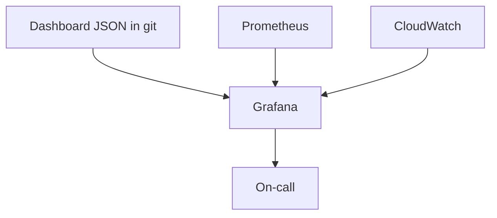

## Why this matters

A dashboard is an argument about what is wrong. CodeCraft on a bad morning needs one screen that says whether the API is failing, which route is slow, whether the sandbox is saturated, and whether the problem started at a deploy. A folder of twenty dashboards with default panels does not say that. It invites people to stare until the incident is over.

Grafana is the usual front end for Prometheus, and it also speaks CloudWatch, Loki, and Elasticsearch. The skill is not clicking panels. It is choosing a question, picking a query that matches the metric type, and storing the dashboard in git so the next incident uses the same picture.

This lesson assumes the Prometheus data model from the previous lesson. Alerting policy is the lesson after logs. Here, the dashboard is for humans who are already looking.

## Intuition

Grafana does not store your application metrics. A data source is a pointer to Prometheus, CloudWatch, or a log store. A panel is a query plus a visualization. A dashboard is a set of panels that share a time range and a set of variables.

Variables are how one dashboard serves dev and prod, or the API and the web, without cloning. A variable named `service` becomes a filter in every query. If the queries ignore the variable, the dropdown is decoration.

The time range is part of the question. "Last 5 minutes" is for a deploy you are watching. "Last 7 days" is for an SLO review. A p95 panel with an automatic resolution over 7 days is not the same number as the 5-minute rate you alert on. Say which one the panel is.

## Core concept in depth

### A first board for CodeCraft

Four rows are enough for the API.

1. **Now**: request rate, 5xx ratio, p95 latency. One stat or time series each. These match the page conditions so the dashboard and the alert disagree only when you made a mistake.
2. **By route**: the same latency and rate, split by the route label. This is where search shows up and health checks disappear into the noise.
3. **Saturation**: in-flight sandbox runs, API CPU if you have it, database connections if RDS is in the path. Gauges and limits on the same panel. A gauge without the limit is a number without a meaning.
4. **Change**: annotations for deploys. Grafana can mark a vertical line when a release happens, from CI or from a Prometheus annotation. Without that line, every person in the incident asks "did we ship?" and opens another tool.

Do not start with a panel of every node exporter graph. The host dashboard exists for the second question, after the RED row says the service is actually unhealthy.

### Queries that match the type

A counter panel uses a rate over a window, then a sum across replicas. Grafana's "rate" helper sometimes wraps this and sometimes double-applies a function if you also wrote `rate` yourself. Read the query the panel sends. A counter graphed raw looks like a sawtooth that resets on deploy and teaches the wrong lesson.

A histogram quantile panel must keep the bucket label through the sum. If the query builder drops it, the panel draws a confident wrong line. Paste the PromQL you tested in the Prometheus UI. Do not rebuild it from dropdowns you do not trust yet.

A gauge panel can be a current value. Set min and max to the real limits: sandbox concurrency max, connection pool max. A gauge of "42" is not saturation. A gauge of 42 with a max of 64 is.

Units matter. Prometheus latency is seconds. Set the panel unit to seconds. If you leave it as a raw number, 0.2 looks like nothing and someone multiplies by 1000 in the query, then the next person multiplies again.

### Variables and repetition

A `datasource` variable lets the same dashboard JSON point at dev and prod Prometheus servers. A `route` variable, populated from a label values query, filters the by-route row. Repeat a panel by route only when the set is small. Repeating by a high-cardinality label will try to draw hundreds of panels and time out the browser. That is the same cardinality bug as in Prometheus, visible as a spinning tab.

Template the environment in the dashboard title so a screenshot in Slack shows prod without someone asking.

### Dashboards as code

Clicking in the UI is fine for a draft. The draft is not the source of truth. Export JSON or, better, write the dashboard with Grafana's provisioning or with a tool that compiles to JSON. Provisioning loads dashboards from files on startup. A change goes through git and review. The production Grafana does not allow anonymous editors.

Store the JSON in this repository under something like `deploy/grafana/` when you add it, and load it in the Grafana container the same way Compose loads the rest of the stack. Until that directory exists, the discipline still holds: if it is not in git, the incident will depend on a dashboard someone edited yesterday and cannot explain.

Pin the Grafana version. Dashboard schema drifts. A JSON exported from Grafana 11 and imported into Grafana 8 fails in confusing ways.

### What not to graph

- A panel per container if the service panel already sums them. Per-container belongs one click away, for when a single task is bad.
- Averages as the only latency line.
- A stacked bar of every status code including 200, which hides 500s at the bottom of a mountain of success.
- Log lines embedded as a time series. Logs get their own exploration in the next lesson, linked from this dashboard, not plotted as numbers.
- A business metric such as "lessons completed" on the outage board. It does not debug a 500, and it invites product questions during an incident.

Link out. The API dashboard should link to the ALB CloudWatch dashboard and to the log query for the same time range. Humans should not have to reconstruct the time window by hand.

## Diagram / flowchart



### Dry-run: search is slow after a deploy

| Panel | What you see | Decision |
| --- | --- | --- |
| Global 5xx ratio | Flat | Not an error-budget page |
| p95 by route | Lessons flat, search up | Scope is search |
| Deploy annotation | Line at the same minute | Roll back or read the search diff |
| Sandbox in-flight | Low | Not the runner |
| RDS CPU | Low | Not the database |

If the deploy annotation is missing, you will still find the time from the Git history, slower. The annotation is cheap. Add it.

### Panel checklist

| Question | Panel | Query shape |
| --- | --- | --- |
| Are we failing? | 5xx ratio | rate of errors over rate of all |
| Are we slow? | p95 by route | histogram quantile |
| Are we saturated? | in-flight versus limit | gauge |
| Did we change? | annotation | deploy marker |
| Which replica? | split by instance, linked not default | sum by instance only on drill-down |

## Code

Provision a file-based dashboard source so Grafana loads git content on start.

```yaml
apiVersion: 1
providers:
  - name: codecraft
    type: file
    options:
      path: /var/lib/grafana/dashboards
      foldersFromFilesStructure: true
```

A panel query you can paste, already checked against the metric names from the Prometheus lesson:

```promql
histogram_quantile(
  0.95,
  sum by (le, route) (
    rate(codecraft_http_request_duration_seconds_bucket{route=~"$route"}[5m])
  )
)
```

`$route` is Grafana's variable interpolation inside the query string. Set the variable to `.+` by default so the board shows every route, and let the operator narrow it. If the variable is empty, the regex matches nothing and the panel looks like an outage. Default the variable. Do not leave it blank.

A Compose fragment that mounts the dashboards read-only, the same way the app mounts content:

```yaml
services:
  grafana:
    image: grafana/grafana:11.3.0
    ports:
      - "3001:3000"
    volumes:
      - ./deploy/grafana/provisioning:/etc/grafana/provisioning:ro
      - ./deploy/grafana/dashboards:/var/lib/grafana/dashboards:ro
```

Port 3000 is the frontend in this project. Do not publish Grafana on 3000. 3001 on the host is enough for local use. Production Grafana sits behind SSO, not behind an open security group.

Create an annotation from CI by posting to Grafana's annotation API after a successful deploy, with the release sha and a tag `deploy`. The panel query does not need to know the sha. The vertical line is the join key between git and the graph.

## Complexity analysis

| Choice | Benefit | Cost |
| --- | --- | --- |
| One RED dashboard | Fast incident start | Hides host-level causes until you link out |
| Many auto-generated panels | Coverage feeling | Nobody trusts or maintains them |
| UI-only edits | Fast draft | Drift, no review, lost on recreate |
| JSON in git | Reviewable | Schema upgrades are chores |
| Variable per environment | One dashboard | A bad default queries the wrong cluster |
| 7-day range on a 5-minute rate panel | Pretty trend | Not the number you alert on |
| Mixed CloudWatch and Prometheus | One screen | Two retention policies and two clocks |

Grafana queries cost the data source. A dashboard with 40 heavy quantile queries, auto-refreshing every 10 seconds, during an incident, is extra load on Prometheus while it is already slow. Keep the top board small. Put exploration in Explore, which is built for one-off queries and should not be saved as a second production dashboard by accident.

## Tricks, tips and patterns

- Match panel names to the alert names. "API error ratio" on both. Different names waste the first minute.
- Set decimals and units. Percent for ratios, seconds for latency.
- Use a log scale on rate panels when sandbox traffic and health checks differ by orders of magnitude, and say so in the panel title.
- Put the SLO as a threshold line on the latency panel, not as a memory in someone's head.
- Link panels to the runbook URL. The runbook is the next lesson's alerting work. The link can exist before the page is perfect.
- Use Explore to prototype PromQL, then copy the working query into the provisioned JSON. Do not save experimental panels onto the incident dashboard.
- Repeat rows by a variable only for low-cardinality values such as environment, not for route if you already have a split series.
- When a screenshot is ambiguous, the title should contain the environment and the window. `prod / 5m` in the text panel at the top is enough.

## Common mistakes and edge cases

- Graphing a counter without `rate`, then declaring a restart an outage because the line fell.
- Two data sources both named Prometheus, and the variable points at dev while the title says prod.
- A panel unit of "short" on a seconds metric, so p95 reads as 0.0 and the SLO looks met.
- `$route` with no default, so the board is blank at the start of the incident.
- Editing production Grafana by hand during the incident and never exporting. The next person cannot see the query that mattered.
- A dashboard that queries a label you removed. It fails closed and looks like zero traffic. Check the query error on the panel. Grafana shows it small.
- Stacking 200 and 500 on one graph. The 500s vanish. Give errors their own panel with a tight axis.
- Publishing Grafana on a public IP with the default admin password. Treat it as production access to your internals. It can read metrics and often logs.

## Interview notes

**Does Grafana store metrics?**
No. It queries data sources. Prometheus stores the application series. CloudWatch stores AWS metrics. If Grafana is down, scrapes and alerts that live in Prometheus or Alertmanager still run. You lose the picture, not the page, unless you also hosted alerts only inside Grafana.

**What is on the first CodeCraft dashboard?**
Rate, 5xx ratio, p95 by route, sandbox saturation against its limit, and a deploy annotation. Everything else is a drill-down.

**Why provision dashboards from git?**
The UI is a draft surface. Git is what review and recreate use. A cluster rebuild should restore the incident board without a human remembering panels.

**A latency panel shows zero after you added a route variable. What do you check?**
The variable default, the label name in the query, and the panel error. An empty regex matches no series. Prometheus is often healthy.

**Why is a p95 over the last 6 hours not the alert number?**
The alert uses a short burn window. The long view averages the bad five minutes into a calm line. Use the long view for weekly review. Use the alert window on the incident board.

## Practice problems

1. Sketch the four rows of the CodeCraft API dashboard and name the metric type behind each panel.
2. A teammate graphs `codecraft_http_requests_total` directly. Draw the shape of that line across a deploy and rewrite the query.
3. Explain how a deploy annotation changes the search-latency dry-run. What do you lose without it?
4. The route variable has no default and the board is empty. Pick a safe default and say why `.` star is acceptable here when a user-id label would not be.
5. Move a hand-built dashboard into provisioning. What must be true after deleting the Grafana volume and starting Compose again?

## Summary / cheat sheet

- Grafana queries. It does not own the metrics.
- First board: RED, by route, saturation versus limit, deploy markers.
- Counters use rate. Histograms use quantile. Set the unit to seconds.
- Variables need defaults. Do not repeat panels on high-cardinality labels.
- Dashboards live in git and load through provisioning.
- Match panel names and windows to the alerts.
- Link to logs and CloudWatch. Do not paste every host graph on page one.
- A blank panel is a query or variable bug until the scrape is proven dead.

## Further reading

- [Grafana dashboards](https://grafana.com/docs/grafana/latest/dashboards/)
- [Dashboard provisioning](https://grafana.com/docs/grafana/latest/administration/provisioning/)
- [Grafana variables](https://grafana.com/docs/grafana/latest/dashboards/variables/)
- [Prometheus data source](https://grafana.com/docs/grafana/latest/datasources/prometheus/)
- [Grafana annotations](https://grafana.com/docs/grafana/latest/dashboards/build-dashboards/annotate-visualizations/)
