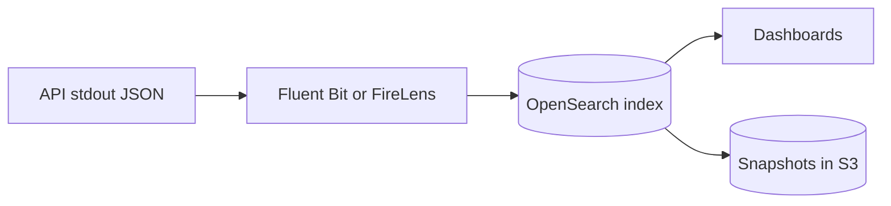

## Why this matters

Metrics told you search p95 moved. They did not tell you which exception, which content file, or which request id to grep. Logs are the record of individual events. CodeCraft's backend already uses structured logging. That choice only pays off if the fields are stable, the volume is bounded, and someone can query them during an incident without a pet server under a desk.

The classic stack is Elasticsearch, Logstash, and Kibana. In AWS the managed cousin is OpenSearch, which forked from Elasticsearch and is what most new AWS estates should use instead of running their own cluster. The ideas are the same: a document store indexed for search, a shipper, and a UI. This lesson is those ideas applied to an API that serves lessons and runs untrusted code, not a tour of product names.

## Intuition

A log line is a document. If it is a blob of text, the index can only do full-text search, which is slow and ambiguous. If it is JSON with `level`, `route`, `status`, and `request_id`, the UI can filter. Prometheus labels had to stay small because every combination is a series forever. Log fields can be wider because you are searching events, not graphing each value as a time series. They still cannot be infinite in cost. A debug log of every SQL parameter on every request will dominate the bill and may store student code you did not mean to retain.

Ship logs out of the container. The writable layer dies with the task. stdout is the contract. The platform, an agent, or the logging driver picks them up. An app that only writes `/var/log/app.log` inside the container will lose the file on the next deploy, which is exactly when you needed it.

## Core concept in depth

### The pieces

**Documents** live in an index. An index is a collection of documents with a mapping: which fields are keywords, which are numbers, which are timestamps. A keyword is for exact filters (`status` equals 500). Text is for analyzed search. Map `request_id` as a keyword. If you leave mapping to a guess, a field that is sometimes a number and sometimes a string will break indexing.

**A shipper** tails stdout or a file. Filebeat, Fluent Bit, and Vector are the common ones. Logstash can parse and enrich, and it is heavier than you need if the application already emits JSON. Prefer JSON in the process and a dumb shipper. Parsing regexes in the pipeline means the log format and the parser drift apart.

**Kibana or OpenSearch Dashboards** is the UI. It is the log equivalent of Grafana. Save searches in git as exported objects when you depend on them in a runbook. A search that exists only in someone's history will be gone when they are.

**Retention** is index lifecycle management. Hot indices take writes. Warm or cold indices take reads. Delete or snapshot after the compliance window. For CodeCraft, request logs of 14 to 30 days are plenty for debugging. Sandbox source that a student submitted may be personal data. Do not send the full source into the logging cluster "for later." Log the run id, the image digest, the exit code, and the duration. Keep the source in the short-lived runner, then drop it.

### Fields worth agreeing on

| Field | Example | Notes |
| --- | --- | --- |
| `timestamp` | ISO-8601 | One clock, UTC |
| `level` | info, warning, error | No custom synonyms |
| `service` | api, web, sandbox | Matches the metric label |
| `request_id` | a uuid | Join logs for one call |
| `route` | the template | Same discipline as metrics |
| `status` | 500 | Integer |
| `duration_ms` | 42 | Fine in logs. Metrics stay in seconds. Do not mix the stories. |
| `error.type` | `TimeoutError` | Not the full stack in a keyword if you can put the stack in a text field |

A correlation id generated at the edge and passed to the API, and from the API to the sandbox runner, is how you reconstruct one student run. Without it you have three systems and a guess.

### What the API should log

- One access line per request at info, with route, status, and duration. Not one line per function call.
- Errors with stack traces at error, once, not also as a warning.
- Sandbox start and finish with run id, limits, and exit code. Not the student's source.
- Authentication and authorization failures if you add them later, without the secret that failed.
- Deploy and startup with the image digest and git sha, once.

Do not log: environment dumps, authorization headers, cookies, database URLs, signed URLs that still contain credentials, or the body of a code submission.

### Queries during an incident

You filter, you do not scan the cluster for fun. Time range first, then `service`, then `status` at or above 500, then a `request_id` if the user has one. Aggregations such as "count of errors by route in the last 15 minutes" are allowed and useful. They are also how people reinvent Prometheus badly. If the question is a rate over weeks, use metrics. If the question is "show me the stack for this id," use logs.

OpenSearch on AWS can sit in a VPC and take a subscription from CloudWatch Logs. That path avoids running Elasticsearch yourselves. It costs money per ingest and per hour of instances. A dev cluster that indexes debug logs from a load test is a classic surprise bill. The cost lesson is next, but the lever is here: log volume is a product decision.

### Index design

Time-based indices, one per day for the API, keep deletes cheap. You drop an old index instead of deleting millions of documents. A single giant index is simpler until retention and recovery become painful.

Replicas help read availability and are not a backup. A snapshot repository to S3 is the backup. Test a restore. An untested snapshot is a rumor.

## Diagram / flowchart



### Dry-run: one failed lesson request

| Step | Where |
| --- | --- |
| Edge generates `request_id` and sends it to the API | Access log on the load balancer if you have it |
| API logs one line with that id, route, status 500 | Today's index |
| Exception log uses the same id | Same index, second document |
| Dashboard p95 for the route is high | Metrics, not this stack |
| You filter the id and read the stack | OpenSearch |
| The student's source is absent | On purpose |

### Volume levers

| Lever | Effect |
| --- | --- |
| Drop debug in prod | Often the largest cut |
| One access line, not per-middleware lines | Linear cut |
| Sample 200s, keep all 500s | Keeps signal, needs care so you do not sample away a rare 200 bug |
| Short retention | Caps disk, not ingest |
| Exclude sandbox source | Caps both risk and size |

## Code

Structured log shape the API should emit. The backend already depends on structlog. Bind the request id once and let every line inherit it.

```python
import structlog

log = structlog.get_logger()

def log_access(request_id: str, route: str, status: int, duration_ms: float) -> None:
    log.info(
        "request",
        request_id=request_id,
        route=route,
        status=status,
        duration_ms=round(duration_ms, 2),
        service="api",
    )
```

A Fluent Bit output toward OpenSearch is configuration, not application code. The important lines are the parser and the match. If the parser fails, you get a single `log` string field and your filters do nothing. Alert on parser errors. They are how the index silently degrades.

An OpenSearch filter you want in the runbook, expressed as the query string the UI shows:

```text
service:api AND status:>=500 AND route:"/api/lessons"
```

And a single-request lookup:

```text
request_id:"7f1c0b3e-2a4d-4c1a-9e22-0b5a6d7e8f90"
```

Index lifecycle as a policy you can describe to an operator:

```text
hot: write today's index, one primary, one replica
delete: indices older than 30 days
snapshot: daily to the logs bucket, retain 30 days
```

Do not put that policy only in the console. Store it next to the rest of the infrastructure code so a rebuilt cluster does not start unbounded.

CloudWatch Logs is a reasonable shipper target before you operate OpenSearch. The API still writes the same JSON to stdout. ECS `awslogs` or FireLens picks it up. You can subscribe the group to OpenSearch when the volume justifies a cluster. Changing the destination should not require changing the application fields.

## Complexity analysis

| Choice | Benefit | Cost |
| --- | --- | --- |
| JSON stdout | No parser to drift | Discipline in the app |
| Regex parsing in Logstash | Can tame old apps | Breaks when a message changes |
| OpenSearch in-VPC | Managed, IAM | Instance hours and storage |
| Self-hosted Elasticsearch | Control | You own failure, upgrades, and JVM tuning |
| CloudWatch Logs only | Less to run | Weaker full-text workflow, query cost |
| 7-day retention | Cheap | Some bugs are older than 7 days |
| 1-year retention of all access logs | Audit comfort | Disk, and possibly data you should not keep |
| Logging request bodies | Easy debugging | Secrets, student code, cost |

Sampling successful requests is a product decision. If you sample, log the sample rate in the document so a count in OpenSearch is not mistaken for the real request count. The real count stays in Prometheus.

## Tricks, tips and patterns

- Generate the request id at the first hop that you control and pass it through. Log it on both sides.
- Use the same route template string as the Prometheus label so a human can jump systems.
- Put the git sha in the startup log and as a field on every line if the cost is acceptable. It is one value per process, not per user.
- Fail a CI check that logs `os.environ` or the word password in a log call. Crude and useful.
- Index only the fields you filter. Mapping every arbitrary key in a JSON blob as a keyword is how mappings explode.
- Separate a security log from the debug log if you must retain denials longer than access lines.
- During an incident, start with the time range from the Grafana annotation, then the request id. Do not start with a cluster-wide wildcard.
- Test the restore of one snapshot. Write down the minutes it took.

## Common mistakes and edge cases

- Logging inside the container to a file and never mounting it. The deploy deletes the evidence.
- A multi-line stack trace that the shipper splits into ten documents. Use a JSON field with the trace embedded, or a multiline parser you have actually tested.
- Mapping `status` as text in one index and integer in the next. Queries work on one day and fail on the next.
- Sending sandbox source and student input to a shared logging cluster with a wide IAM policy.
- Using logs to compute a month of SLO burn. The sample rate, the missing lines, and the cost will all be wrong. Use metrics.
- A Kibana admin user shared by the whole team, with no audit. The log system is sensitive. SSO and groups.
- Retention "forever" on a dev cluster that indexed a load test.
- Full-text search for a request id with analysis enabled, so the uuid is tokenized and the filter misses. Keywords for ids.

## Interview notes

**Metrics or logs for a latency SLO?**
Metrics. Histograms are built for quantiles and are cheap to keep. Logs can debug one slow request after the metric says the route regressed. Using logs as the SLO source breaks as soon as you sample or drop a shipper.

**Why JSON instead of plain text?**
Filters on `status` and `request_id` are exact and cheap. A regex across terabytes is how incidents get longer. The application already knows the fields. Do not make the shipper rediscover them.

**What do you refuse to log for CodeCraft?**
Secrets, environment dumps, and the body of student code. Log the run id and the outcome. The source stays with the runner and dies with the tmpfs.

**Elasticsearch or OpenSearch on AWS?**
For a new AWS stack, OpenSearch Service or CloudWatch Logs. Running your own Elasticsearch means owning quorum, JVM heap, and upgrades. The document model you design is portable. The cluster babysitting is not free.

**How do you tie a Grafana spike to a stack trace?**
A deploy annotation gives the time. The route label matches the log field. A request id on the failing calls joins the access line to the exception line. If those fields differ between systems, the join is a human guessing.

## Practice problems

1. Define the JSON fields for an API access line and a sandbox completion line. Mark the fields that must never appear.
2. A search returns no documents for a request id you can see in the raw message. Explain a mapping mistake that would cause that.
3. The disk on the logging cluster fills during a load test. Name three levers, and say which one cuts ingest rather than only retention.
4. Describe the path of a log line from the FastAPI process on ECS to a human in OpenSearch Dashboards. What is lost if the task stops before the shipper flushes?
5. You want the error rate over 30 days. Which system answers it, and what would go wrong if you answered it from sampled logs?

## Summary / cheat sheet

- Logs are documents for individual events. Metrics are the aggregate. Do not swap them.
- JSON to stdout. Ship with Fluent Bit, FireLens, or the platform driver.
- Keyword fields for ids and routes. One access line per request.
- Correlation ids join API, edge, and sandbox.
- Do not log secrets or student source.
- Time-based indices, a real retention policy, snapshots to S3.
- OpenSearch or CloudWatch on AWS. Self-hosted Elasticsearch is an operational product of its own.
- Parser failures and mapping conflicts are incidents in the logging pipeline, not quiet bugs.

## Further reading

- [Elastic Common Schema](https://www.elastic.co/docs/reference/ecs)
- [OpenSearch index lifecycle](https://docs.opensearch.org/latest/im-plugin/ism/index/)
- [Fluent Bit outputs](https://docs.fluentbit.io/manual/pipeline/outputs)
- [AWS FireLens for ECS](https://docs.aws.amazon.com/AmazonECS/latest/developerguide/using_firelens.html)
- [structlog](https://www.structlog.org/en/stable/)
