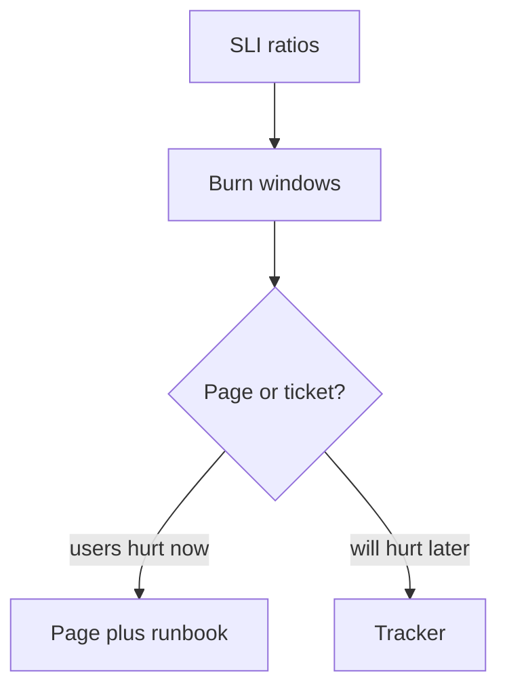

## Why this matters

An alert that fires every night teaches the on-call to mute the channel. An alert that never fires teaches nothing until the morning the site is down and the only signal is a user. SRE practice is the set of rules that decide which of those you are building: measure user-facing pain, spend the error budget on purpose, and page a human only when they must act now.

CodeCraft is a learning site. A five-minute API failure during a study session matters. A single sandbox timeout matters to that student and does not justify waking someone if the error ratio stays inside the budget. The difference is the math of burn, not the emotion of the red panel.

Grafana shows the graph. Alertmanager or CloudWatch alarms deliver the page. This lesson is the policy those tools should enforce.

## Intuition

A service level indicator is a ratio you can measure. For the API, a good SLI is the fraction of requests that complete fast enough and are not 5xx. A service level objective is the target: 99.9 percent of lesson reads succeed under 300 ms over 30 days. A service level agreement is a promise to someone outside the team, often with money attached. You can have an SLO without an SLA. You should not have an SLA you do not measure.

The error budget is what is left. At 99.9 percent over 30 days you may fail about 0.1 percent of requests, which is on the order of 40 minutes of full outage if traffic is steady, or many more minutes of partial failure. Burn rate says how fast you are spending that budget. A burn of 1 spends the budget exactly on time. A burn of 14 spends a 30-day budget in about two days. That is page-worthy if it keeps up. A one-minute blip at a huge burn is often a deploy or a scrape gap. Multi-window alerts require the fast window and the slow window to agree, which is how Google’s SRE workbook cuts false pages without waiting an hour to notice a real one.

## Core concept in depth

### Symptom alerts and cause alerts

Page on symptoms: the API is returning errors, the API is slow, users cannot complete a run. Ticket on causes that do not yet hurt users: disk will fill next week, a certificate expires in 20 days, a single replica is restarting while the service is still inside SLO.

CPU at 80 percent is not a symptom. It might be Saturday traffic. Page on CPU only if you have evidence it predicts SLO burn and nobody will see the SLO alert in time. That evidence is rare for a stateless API. It is more plausible for a connection pool you can prove saturates before the error ratio moves. Even then, the pool saturation alert is a warning. The error-budget alert is the page.

### Multi-window burn

Pick an SLO window, usually 30 days for a product and shorter for a strict control plane. Define two pages:

| Page | Fast window | Slow window | Meaning |
| --- | --- | --- | --- |
| Fast burn | 5 minutes | 1 hour | Budget is disappearing now |
| Slow burn | 30 minutes | 6 hours | A bad afternoon, not a blip |

Both windows must be over the threshold. A 5-minute spike that the hour does not share stays quiet. A real outage trips both. Ticket-level alerts can use a still slower burn, or a "budget will run out this week" forecast, and they go to a queue the team reads in daylight.

The numbers you start with are less important than writing them down and looking at every page for a month. If a page was not actionable, delete it or demote it. An SLO you miss every week is not an SLO. It is a wish. Lower the target or fix the service. Pretending 99.99 percent while you miss 99.9 percent trains everyone to ignore the budget.

### Routing

Alertmanager groups alerts that share a label, such as `service=api`, so a bad deploy sends one page with twenty series attached, not twenty pages. Inhibition stops a downstream "sandbox cannot reach API" page when the API itself is already paging. Silences have an owner and an expiry. A silence with no expiry is how a dead cluster stays dead through the next on-call rotation.

Severity is a label, not a vibe.

| Severity | Channel | Human action |
| --- | --- | --- |
| page | Phone or high-priority chat | Act now or the users are hurt |
| ticket | Issue tracker | Act this week |
| info | Dashboard only | No push |

If everything is page, nothing is. CodeCraft's first page set should be small: API fast-burn on errors, API fast-burn on latency for the lesson route, and the load balancer having zero healthy targets. Sandbox failure ratio as a ticket unless it burns the SLO. Certificate expiry at 21 days as a ticket. Disk at 70 percent as a ticket.

### Runbooks

Every page links a runbook. The runbook answers: how to confirm, what the safe mitigation is, who owns the data if data is involved, and what not to do. For the API error burn, the mitigation might be to roll back the task definition to the previous digest. For zero healthy targets, it might be to read the target group and the task stop reason before you scale out, because scaling a crash loop spends money and fixes nothing.

A runbook that says "check Grafana" is a link, not a runbook. Name the dashboard and the first query.

### On-call hygiene

The primary can roll back and can read logs. They should not need production AWS admin to restart a service. If the only fix is a Terraform apply, the pipeline from the Terraform lesson must be usable at 02:00, including the approval path. An approval gate that only one person can click is a single point of failure you should have noticed in daylight.

After a page, write a short note: what burned, what you did, whether the alert was true. That note is the data for deleting bad alerts. Postmortems are for incidents that spent real budget or surprised you, not for every blip. Blameless means the system and the gaps are the subject, including the gap in the runbook.

Error budget policy is a meeting, not a feeling. When the budget is gone, the team slows feature deploys and pays down reliability. When the budget is healthy, they ship. If you never change behavior, the SLO is a dashboard decoration.

## Diagram / flowchart



### Dry-run: a bad search deploy

| Minute | Signal | Alert |
| --- | --- | --- |
| 1 | Search p95 up, errors flat, lesson route fine | None yet. Fast window is ugly, slow window is not. |
| 15 | Hour window joins the fast window | Page: latency burn. Runbook says compare routes and roll back. |
| 20 | Rollback | Burn falls. Page resolves. |
| Next day | Ticket if budget loss was large | Discuss search tests, not a second page at night if it already recovered. |

A one-minute exception storm during the rolling restart should not pass both windows. If it does, the windows are too short or the restart is too broken.

### CodeCraft starter set

| Alert | Kind | First action |
| --- | --- | --- |
| API error burn, both windows | Page | Roll back digest or block the route |
| Lesson latency burn | Page | Split by route, roll back if the annotation matches |
| No healthy ALB targets | Page | Task stop reason, not a blind scale-up |
| Sandbox timeout ratio high | Ticket unless SLO burn | Look at limits and a bad release of the runner |
| Certificate expires in 21 days | Ticket | Renew, do not wake someone at 03:00 on day 21 |
| State bucket public | Page | This is a security incident, not an SLO. Different runbook. |

Security detections can page even when the SLO is healthy. A public state bucket is not an error budget question. Keep that route separate so SLO math does not silence it.

## Code

A Prometheus rule in words you can implement. The expression is a ratio of rates. The `for` duration is not a substitute for two windows, but a short `for` stops a single scrape glitch. Prefer two alerts, fast and slow, both required by the routing if you want the workbook behavior. A simple starting rule that pages on a 5-minute error ratio above 5 percent, held for 10 minutes, is acceptable on day one if you commit to replace it with burn windows before you add a dozen more.

```yaml
groups:
  - name: codecraft-api
    rules:
      - alert: ApiErrorRatioHigh
        expr: |
          (
            sum(rate(codecraft_http_requests_total{status=~"5.."}[5m]))
            /
            sum(rate(codecraft_http_requests_total[5m]))
          ) > 0.05
        for: 10m
        labels:
          severity: page
          service: api
        annotations:
          summary: "API 5xx ratio is above 5 percent"
          runbook: "https://github.com/codecraft-academy/runbooks/blob/main/api-error-ratio.md"
```

Alertmanager route sketch:

```yaml
route:
  receiver: tickets
  group_by: ["service", "alertname"]
  routes:
    - matchers:
        - severity = page
      receiver: pages
receivers:
  - name: tickets
  - name: pages
```

The page receiver is PagerDuty, Opsgenie, or a chat webhook that can bypass quiet hours. The ticket receiver opens an issue. Do not point both at the same chat channel or you have recreated one noisy stream.

CloudWatch alarms remain the right tool for ALB healthy host count and RDS storage. Send them to the same router if you can, so grouping and silences live in one place. Two paging systems means two chances to miss an inhibition.

A runbook outline that should exist before the rule is enabled in prod:

```text
Confirm: open the API RED dashboard, check 5xx by route and the deploy annotation.
Mitigate: roll the ECS service back to the previous task digest.
Do not: scale the service out while tasks are crash-looping.
Escalate: if rollback does not restore the ratio within 15 minutes.
```

## Complexity analysis

| Policy | False pages | Missed outages |
| --- | --- | --- |
| Page on any 500 | Constant | Rare |
| Page on a single long window | Rare | Slow |
| Multi-window burn | Low if tuned | A very short total outage may only ticket |
| Page on CPU | High | User pain can happen at low CPU |
| No alerts, dashboard only | None | Every outage depends on someone watching |
| SLO tighter than reality | Constant | You stop believing the budget |

A missed five-minute total outage is still visible in the slow window if the budget math is honest, and it is visible to users. Do not add a "any single 500 pages" rule to feel safe. You will train mute.

## Tricks, tips and patterns

- Write the SLO in the repo next to the alert rules. A number only in a slide is not an SLO.
- Use the same labels as the metrics: `service`, `route` only if you can group it. Paging per route can be twenty pages. Page on the service, put the route in the annotation or the dashboard.
- Include a runbook URL in the annotation or do not ship the alert.
- Review alerts weekly for a month after you introduce them. Delete what did not cause a useful action.
- Silence with a ticket id in the comment. Expire the silence the same day if you can.
- Distinguish "no data" from "zero errors." A scrape failure should ticket or page as a separate symptom. A ratio that divides by zero and disappears is not a healthy service.
- Keep security pages on their own route so a silence on API latency does not silence a public bucket alarm.
- Practice a rollback in dev until the on-call can do it from the runbook without inventing commands.

## Common mistakes and edge cases

- Alerting on the absence of traffic at 4 a.m. for a site that is quiet at 4 a.m. Low traffic makes ratios swing. Require a minimum request rate before the ratio can fire, or a quiet night will page on three errors.
- `for: 0s` on a noisy gauge.
- A runbook stored in someone's head.
- Routing prod and dev alerts to the same page receiver. Dev will train you to ignore prod.
- An SLO that excludes the search route because search is "best effort," while users only complain about search. The SLI has to match the complaint.
- Inhibiting the API page because the host page fired, then the host page flaps and you never see the API. Inhibit downstream, not the primary symptom.
- A silence left on over a weekend.
- Measuring the SLI from sampled logs and wondering why it disagrees with Prometheus.

## Interview notes

**What is an error budget?**
The allowed failure inside the SLO window. At 99.9 percent over 30 days, about 0.1 percent of requests, or roughly 40 minutes if the service is fully down and traffic is flat. Burn rate says whether you are spending it too fast.

**Why multi-window alerts?**
A short window catches real outages and also blips. A long window is stable and slow. Requiring both pages quickly on real incidents and stays quiet on a single bad scrape or a rolling restart.

**What do you page on for CodeCraft?**
User symptoms: API error burn, latency burn on the paths that matter, and no healthy targets. Tickets for expiry, disk, and sandbox pain that does not burn the SLO. Security misconfiguration is its own page, not an SLO.

**Symptom versus cause?**
A symptom is user-visible failure. A cause is a resource condition that might lead there. Page on symptoms. Ticket causes unless you have a proven, urgent link.

**What belongs in the runbook?**
How to confirm on a named dashboard, the mitigation you trust, the thing not to do, and when to escalate. "Look around" is not a runbook.

## Practice problems

1. Propose an SLI and an SLO for lesson reads. Say what you exclude, and why health checks must not dominate the ratio.
2. A 2-minute deploy causes a 20 percent error ratio and then recovers. Which window fires, and should a human be paged?
3. CPU is at 90 percent and the SLO is healthy. What severity do you assign, and what would change your mind?
4. Write the first four lines of the runbook for "no healthy targets." Include one action you forbid.
5. Dev alerts are waking the prod on-call. Change the routing labels so this stops, without losing prod pages.

## Summary / cheat sheet

- SLI is a measurement. SLO is a target. The budget is what you may still spend.
- Page on fast and slow burn together. Ticket the slow risks.
- Symptoms page. Causes ticket. Security can page on its own route.
- Group by service. Inhibit downstream. Expire silences.
- Every page has a runbook with a rollback or a concrete first step.
- Require enough traffic before a ratio can fire at night.
- If the page was not actionable, delete it.
- When the budget is gone, change the release pace. Otherwise the SLO is decoration.

## Further reading

- [Google SRE book: SLO chapter](https://sre.google/sre-book/service-level-objectives/)
- [Alerting on SLOs](https://sre.google/workbook/alerting-on-slos/)
- [Alertmanager configuration](https://prometheus.io/docs/alerting/latest/configuration/)
- [Site Reliability Workbook](https://sre.google/workbook/table-of-contents/)
- [AWS Well-Architected reliability pillar](https://docs.aws.amazon.com/wellarchitected/latest/reliability-pillar/welcome.html)
