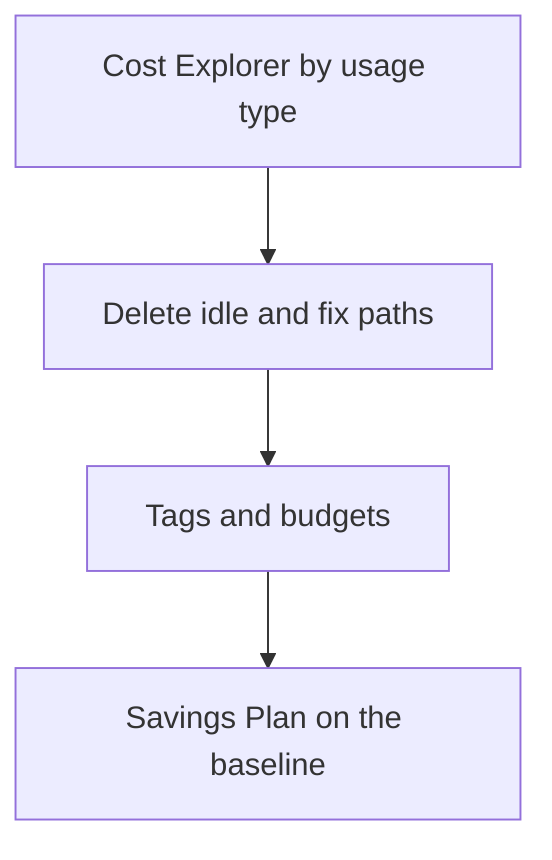

## Why this matters

A teaching site can outspend its traffic. NAT gateways, idle RDS instances, cross-AZ traffic, and verbose logs charge you whether or not a student is on the site. Cost optimization is not a spreadsheet of reserved instances applied to a wasteful design. It is the same architecture work as reliability: put the bytes where they are cheap, turn off what you do not need, and only then commit to a discount.

CodeCraft in production, as the deploy module describes it, wants a load balancer, a small API service, a database, object storage for content or artifacts, and logs. Each of those has a dominant price dimension. If you cannot name the dimension, you will "optimize" CPU credits while the bill is the NAT gateway.

This lesson is how to attribute, where the money hides, and which levers are safe.

## Intuition

Cloud prices are a set of meters. Compute is time and size. Storage is gigabyte-months plus requests. Data transfer is where the bytes go, and the direction matters. Managed services add an hourly floor: you pay for an RDS instance that sits at 1 percent CPU because the alternative was running Postgres yourself.

A discount such as a Savings Plan lowers the rate on usage you already have. It does not lower usage. Buying a discount on a dev cluster you should have shut off is how teams lock in waste. First delete, right-size, and stop cross-AZ chatter. Then commit.

Tags are how a bill becomes a set of owners. An untagged NAT gateway is everyone's problem and therefore no one's.

## Core concept in depth

### See the bill before you change the design

Turn on Cost Explorer and a monthly budget with an anomaly alert. Group by service, then by usage type. The usage type string is ugly and specific: NAT hours, NAT bytes, load balancer hours, LCU, RDS hours, GP3 storage, CloudWatch Logs ingest. That ugly string is the meter.

Allocate with tags: `project=codecraft`, `environment=dev|prod`, `owner`. Activate the tags in the billing console or they exist on resources and still do not appear on the bill. A tagging policy that is not enforced will be ignored by the next stack someone clicks together. Terraform default tags from the fundamentals lesson are the enforcement point for anything Terraform creates.

Separate accounts for dev and prod, which you already want for IAM, also separate the bill. A dev load test cannot hide inside prod's NAT line.

### The meters that surprise small architectures

**NAT Gateway.** Private subnets that pull images, call AWS APIs, or download packages go through NAT if they have no VPC endpoint. You pay per hour per AZ and per gigabyte. ECR, S3, CloudWatch Logs, and Secrets Manager should be VPC endpoints for a private CodeCraft task. Endpoints are not free. They are usually cheaper than NAT for this traffic, and they keep the traffic off the public internet. Do the arithmetic for your gigabytes. Do not install NAT in three AZs for a dev account "because prod has it."

**Cross-AZ.** Traffic between availability zones is billed in both directions for a lot of data-plane paths. A task in AZ a talking to a database in AZ b all day is a quiet line item. Keep a chatty connection in-zone when you can, and accept cross-AZ for Multi-AZ RDS as the price of failover. That trade is conscious. Accidental cross-AZ, such as a client on the wrong subnet, is not.

**Load balancers.** An ALB has an hourly floor plus capacity units. One ALB in front of the API and the web is often enough. An ALB per branch environment is how preview environments cost more than prod. Share, or delete them at night.

**RDS.** The instance hour dominates at small size. Multi-AZ doubles the instance. That is correct for prod and often wrong for dev. Storage and backups add up when you keep every snapshot forever. Automated backups with a short window, plus one manual snapshot before a migration, is a better default than infinite retention.

**Logs and metrics.** CloudWatch Logs charges ingest and storage. A debug line per request at a few kilobytes becomes the logging bill from the previous lesson. Custom metrics with high cardinality are the same mistake in a different console. Prometheus on a single small instance can be cheaper than thousands of custom metrics. It can also be more expensive if you overbuild the cluster. Look at the line item.

**Data transfer out to the internet.** Course assets served from an EC2 task pay egress at the compute rate. The same bytes from CloudFront, cached, pay the CDN rate and spare the task. Static lesson media belongs on S3 plus CloudFront. The API responses are small. Do not put a CDN in front of the API until you have a caching story that will not serve one student another student's code run.

**Idle environments.** Dev at night and on weekends can scale ECS desired count to zero if you accept a cold start in the morning, or you can stop the dev RDS instance on a schedule. Stopping RDS stops the instance hour and not the storage. Know which meter you are pausing.

### Commitments, after the waste is gone

Savings Plans discount compute usage in exchange for a committed hourly spend. Reserved Instances are the older, more specific form, still common for RDS. Buy them for the baseline you are sure you will run for a year: prod RDS, prod minimum tasks. Do not cover the peak, and do not cover dev if dev is supposed to scale to zero. A commitment you cannot fill is a donation.

Spot is a deep discount on interruptible compute. The sandbox runner is a candidate if a run can be retried. The API serving a live page is a poor candidate unless you have many replicas and a fast replacement. Spot on a single API task is an outage with a discount.

S3 storage classes and lifecycle rules move old artifacts to infrequent access. The artifact bucket from the Terraform lessons should expire failed build artifacts. The content bucket should not expire the lessons.

### Unit cost

A bill that went up 10 percent is not automatically bad if students went up 40 percent. Track a unit: dollars per monthly active student, or dollars per thousand lesson reads. The unit stops a successful launch from looking like a cost incident, and it stops a flat student count with a rising NAT bill from looking fine.

## Diagram / flowchart



### Dry-run: a quiet month that still costs money

| Line | Likely cause | Lever |
| --- | --- | --- |
| NAT hours in three AZs | Dev copied the prod network | One NAT or endpoints only, in dev |
| NAT bytes | Tasks pull images and write logs through NAT | VPC endpoints for ECR, S3, logs |
| ALB hours times six | A load balancer per preview | One shared ALB or a short TTL |
| RDS hours, dev, Multi-AZ | Prod template copied | Single-AZ in dev, stop overnight |
| CloudWatch ingest | Debug logs | Drop debug, sample 200s |
| Egress | Media from the task | S3 and CloudFront |

### What not to do first

| Tempting move | Why it waits |
| --- | --- |
| Three-year all-upfront reservation | You have not deleted the idle cluster |
| Smaller instance that saturates | You pay with latency and then scale out anyway |
| Turn off Multi-AZ in prod | You saved the instance hour and spent the SLO |
| Drop all logs | The next incident is guesswork |
| One giant Savings Plan across accounts you do not control | You pay for someone else's baseline |

## Code

A budget you can create with the CLI for the dev account. Amounts are illustrative. Replace them with a number you would actually be sad to cross.

```bash
aws budgets create-budget \
  --account-id 111111111111 \
  --budget file://dev-budget.json \
  --notifications-with-subscribers file://dev-budget-notify.json
```

The JSON sets a monthly cost budget and notifies at 50, 80, and 100 percent. Put the files in the repo. A budget that exists only in the console will not be recreated with the account.

Tag the provider so new resources inherit cost allocation tags:

```hcl
provider "aws" {
  region = var.aws_region

  default_tags {
    tags = {
      project     = "codecraft"
      environment = var.environment
      owner       = "platform"
    }
  }
}
```

An S3 lifecycle for build artifacts that are not the lesson content. Failed logs and old image-build caches should expire. Lesson content should not use this rule.

```hcl
resource "aws_s3_bucket_lifecycle_configuration" "artifacts" {
  bucket = aws_s3_bucket.artifacts.id

  rule {
    id     = "expire-old-artifacts"
    status = "Enabled"

    expiration {
      days = 30
    }

    filter {
      prefix = "ci/"
    }
  }
}
```

VPC endpoints are Terraform resources in the network module, not a cost afterthought. Add gateway endpoints for S3, which are free of hourly charges, before interface endpoints, which bill per hour per AZ. Gateway endpoints cover S3 and DynamoDB. Interface endpoints cover ECR, Logs, and Secrets Manager. Start with the gateway. Add interface endpoints when NAT bytes show up in Cost Explorer.

A weekly review that fits on a calendar:

```text
1. Cost Explorer, last 7 days, group by usage type, filter project=codecraft.
2. Anything new that is not tied to a student-facing change.
3. Dev resources running Multi-AZ or three NATs.
4. Log ingest versus last week.
5. Only then look at Savings Plan coverage.
```

## Complexity analysis

| Lever | Saves | Risk |
| --- | --- | --- |
| Delete idle preview stacks | The whole floor cost | Someone's forgotten demo |
| VPC endpoints instead of NAT bytes | Transfer and sometimes hours | Endpoint hourly charges if you add them everywhere |
| Single-AZ dev database | About half the dev instance hours | Dev downtime during AZ issues, which you can accept |
| Stop dev RDS at night | Instance hours, not storage | Morning cold start, in-flight connections dropped |
| Log sampling | Ingest | Harder debugging of rare 200s |
| CloudFront for media | Egress price and origin load | Cache invalidation when content changes |
| Savings Plan on prod baseline | Rate on compute you keep | You pay even if you later scale down |
| Spot sandbox | Large compute cut | Interrupted runs must be retryable |

The architectural risks and the dollar risks move together. Multi-AZ in prod is a reliability purchase. Call it that in the review so nobody "optimizes" it away in a quarter where the bill spiked for another reason.

## Tricks, tips and patterns

- Sort the bill by dollars, not alphabetically by service. The top three lines get the work.
- Gateway endpoints for S3 first. They are the rare discount that does not trade away reliability.
- Put budgets on dev tighter than prod. Dev has no student-facing excuse for a surprise.
- Tag shared ALBs with the project even if several services use them, and accept a rough split. An untagged ALB is invisible.
- Expire CI artifacts. Keep content. They are different buckets so the lifecycle cannot confuse them.
- Revisit Savings Plans quarterly. A commitment that no longer matches the baseline is the new waste.
- When a launch is coming, estimate the unit cost before the traffic, using request counts from the pricing lesson. NAT bytes scale with chatter, not with fame. Fix chatter first.
- Use the anomaly detector so a logging bug pages a ticket the day it starts, not at month end.

## Common mistakes and edge cases

- Reserving capacity for a footprint you are about to redesign.
- Three NAT gateways in dev because the module defaulted `az_count` to 3 and `enable_nat` to true.
- Interface endpoints in every AZ for every service "for HA" in a dev account that does not need HA. Endpoints bill per AZ.
- CloudFront in front of personalized API responses with a cache policy that ignores cookies, so one student sees another's run. Cost win, privacy bug.
- Stopping RDS and expecting storage charges to stop. They do not.
- A lifecycle rule on the wrong bucket, expiring the lessons.
- Cost allocation tags created and never activated in billing. The report stays empty and the team declares tagging useless.
- Spot for the only API task.

## Interview notes

**A bill is high and CPU is low. Where do you look?**
Usage types, not CPU. NAT hours and bytes, ALB hours, RDS hours, log ingest, and cross-AZ transfer. Idle managed services dominate small deployments.

**When do you buy a Savings Plan?**
After you have removed idle environments and right-sized, and only for the baseline you will still run. A plan discounts a rate. It does not delete a NAT gateway.

**How do VPC endpoints change the CodeCraft bill?**
Tasks in private subnets reach S3, ECR, and CloudWatch without NAT bytes. The S3 gateway endpoint has no hourly charge. Interface endpoints do. Compare that hourly cost to the NAT bytes you actually process.

**What belongs on CloudFront?**
Static media and public lesson assets from S3. Not personalized code-run responses unless the cache key is correct and you have a reason. The point is egress and origin load, not a badge that says CDN.

**How do you stop dev from copying prod's bill?**
A separate account, a tight budget, single-AZ data stores, schedules that stop idle databases, and module defaults that do not enable NAT in every AZ.

## Practice problems

1. Cost Explorer shows NAT bytes as the top line and CPU under 10 percent. List the endpoints you add and the order, gateway before interface.
2. A lifecycle rule meant for `ci/` was attached to the content bucket. What is the user-visible failure, and how do the bucket names prevent a repeat?
3. Prod RDS is Multi-AZ and dev RDS is Multi-AZ. Which one do you change, and which meter actually drops?
4. You want a one-year commitment. What usage do you exclude, and why?
5. Define a unit cost for CodeCraft and a case where the bill rises while the unit cost falls.

## Summary / cheat sheet

- Read usage types. Tags must be activated or they are not on the bill.
- NAT, cross-AZ, idle RDS, ALB hours, and log ingest beat CPU for small systems.
- S3 gateway endpoints first. Interface endpoints only where the bytes justify the hours.
- Dev is single-AZ, stoppable, and budget-capped. Prod Multi-AZ is a reliability buy.
- CloudFront for public assets. Do not cache personalized runs by accident.
- Lifecycle on artifact prefixes only.
- Savings Plans cover the remaining baseline, not the waste.
- Track dollars per student or per thousand reads so growth and waste look different.

## Further reading

- [AWS Cost Explorer](https://docs.aws.amazon.com/cost-management/latest/userguide/ce-what-is.html)
- [NAT gateway pricing](https://docs.aws.amazon.com/vpc/latest/userguide/nat-gateway-pricing.html)
- [VPC endpoints](https://docs.aws.amazon.com/vpc/latest/privatelink/vpc-endpoints.html)
- [Savings Plans](https://docs.aws.amazon.com/savingsplans/latest/userguide/what-is-savings-plans.html)
- [S3 lifecycle configuration](https://docs.aws.amazon.com/AmazonS3/latest/userguide/object-lifecycle-mgmt.html)
