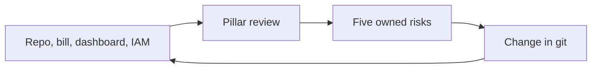

## Why this matters

Well-Architected is a review language AWS published so teams argue about the same risks. It is not a certification you paste onto a diagram, and it is not an excuse to adopt every managed service. The six pillars are operational excellence, security, reliability, performance efficiency, cost optimization, and sustainability. A review asks what you do when it fails, who can reach the data, and what the bill is buying.

CodeCraft is small enough to review in an afternoon and large enough to have real gaps: a Docker socket in dev, a single database, a public learning site, and a sandbox that runs untrusted code. Those are pillar questions. If you can answer them with a piece of evidence — a state bucket policy, an SLO, a runbook, a Cost Explorer filter — you are doing the review. If you answer with the pillar's name, you are not.

## Intuition

Each pillar is a way the system can disappoint you. Operational excellence: you cannot safely change it. Security: someone can read or break what they should not. Reliability: it is down longer than the budget allows. Performance: it is up and too slow. Cost: it is fast and wasteful. Sustainability: it burns resources you do not need, which is often the same as cost and sometimes is not, such as an oversized always-on GPU you are proud of because the invoice is someone else's.

The pillars trade. Multi-AZ spends cost to buy reliability. A private subnet with endpoints spends a little money to buy security and often saves NAT spend. The review writes the trade down. It does not pretend you can max every score.

AWS also publishes lenses for serverless, SaaS, and other domains. The core pillars come first. A lens on top of an unreviewed sandbox is decoration.

## Core concept in depth

### Operational excellence

You can ship a change and you can undo it. For CodeCraft that means the Terraform plan in git, the saved plan CI applies, the image digest in the task definition, and a rollback in the API runbook. It also means you know what good looks like: the RED dashboard and the SLO from the alerting lesson.

Evidence you should be able to open:

- The pipeline that plans on pull request and applies prod only after approval.
- A runbook that names the rollback.
- Logs with a request id, and a deploy annotation on the dashboard.
- A game day or at least one practiced rollback in dev.

A console click that fixed prod and was never imported into Terraform is an operational excellence defect even if the site is up.

### Security

Identity, network, data, and detection. IAM roles for tasks and for CI, not long-lived keys. Private subnets for the API and the database. Security groups that name the peer, not the world. Encryption in transit and at rest for RDS and for the state bucket. Student code in a sandbox with no network and no parent credentials, which the Docker security lesson specified.

Detection is CloudTrail on, a trail that the application role cannot delete, and an alarm for the state bucket becoming public. Secrets live in a secret manager, and the task role can read only its own secret.

The dev Docker socket is a documented exception with a boundary: it does not exist in the prod task definition. An exception without a boundary becomes the architecture.

### Reliability

Failure is normal. An AZ can go away, a task can die, a deploy can be bad. Reliability work is: more than one task behind a load balancer, a database that fails over if you promised that SLO, health checks that actually hit `/health`, and a rollback that is faster than a debugging session.

Say the SLO out loud in the review. If prod is a single task and a single-AZ database, the honest SLO is low, and the review records that as a choice for a teaching budget, not as "highly available" because the slide has an ALB on it. An ALB with one unhealthy target is a more expensive outage.

Backups: automated RDS snapshots, a tested restore, and S3 versioning on content. A backup you have never restored does not count as evidence.

### Performance efficiency

Pick the smallest design that meets the latency SLO. The lesson API should be a small container, not a large VM, because the work is I/O and rendering. The sandbox is bursty and benefits from a hard concurrency limit more than from a giant instance. Caching public assets at CloudFront removes load that should not have reached the task.

Review the p95 by route before you change instance sizes. Search can be slow while health is fast. Scaling the whole service because one route lacks an index is the expensive way to miss the point.

### Cost optimization

Use the previous lesson as the evidence packet: Cost Explorer by usage type, tags, dev budgets, NAT versus endpoints, no Savings Plan on waste. The Well-Architected question is whether someone owns the bill monthly. A review with no Cost Explorer screenshot is incomplete even if the architecture diagram is beautiful.

### Sustainability

Turn off dev at night, scale sandbox concurrency to demand, and do not keep a second idle cluster for comfort. Prefer managed services you actually use to a zoo of always-on daemons. This pillar is not a reason to delete prod redundancy you need for the SLO. It is a reason to delete the third copy you cannot justify.

### How a review runs

Two people, two hours, the production account, and the repo. For each pillar, write three lines: what is true, the evidence, the next risk you will actually fix. Pick at most five risks across the whole review. A list of forty is a way to do nothing. Assign an owner and a date. The next review starts by checking those five, not by generating forty new ones.

The AWS Well-Architected Tool in the console can record the official questions. Use it if the organization wants the record. The value is still the evidence and the five risks. Clicking "not applicable" on every hard question is a failed review that looks finished.

## Diagram / flowchart



### Dry-run: a CodeCraft review that is honest

| Pillar | Finding | Evidence | Next risk |
| --- | --- | --- | --- |
| Operations | Prod apply is still a laptop | No CI environment gate | Move apply into the approved workflow |
| Security | Sandbox flags exist only in a doc | Task definition has no `cap_drop` | Encode the runtime flags |
| Reliability | One API task | ECS desired count is 1 | Two tasks, then measure |
| Performance | Search p95 over SLO | Grafana by route | Fix search, do not resize the fleet |
| Cost | NAT bytes in dev | Cost Explorer | S3 gateway endpoint |
| Sustainability | Dev RDS runs all weekend | Instance hours | Stop on a schedule |

That table is a review. A diagram with six icons is not.

### What the tool will ask, in plain language

| Pillar | A question that matters here |
| --- | --- |
| Operations | How do you know a deploy worked, and how do you undo it? |
| Security | Who can read state, secrets, and student code? |
| Reliability | What happens when one AZ or one task disappears? |
| Performance | Which route misses the latency SLO, and why? |
| Cost | What are the top three usage types, and who looks monthly? |
| Sustainability | What is running when no student is? |

## Code

A review record you can commit. Dates and owners are part of the control. A paragraph in a slide is not.

```text
# Well-Architected review — CodeCraft prod — 2026-11-26

## Risks
1. Owner: platform. Due: 2026-12-10.
   Prod Terraform apply still uses a long-lived key.
   Fix: OIDC role, GitHub environment approval.
2. Owner: platform. Due: 2026-12-10.
   API desired count is 1.
   Fix: desired count 2 behind the existing target group.
3. Owner: api. Due: 2026-12-17.
   Search p95 above 300 ms.
   Fix: query plan, not a larger task.
4. Owner: platform. Due: 2026-12-03.
   Dev NAT bytes dominate.
   Fix: S3 gateway endpoint, then remeasure.
5. Owner: api. Due: 2026-12-17.
   Sandbox network none is not in the task spec.
   Fix: runtime flags in the runner, tested by a hostile fixture.
```

A minimal evidence bundle the reviewer attaches or links:

```bash
aws ce get-cost-and-usage \
  --time-period Start=2026-11-01,End=2026-11-26 \
  --granularity MONTHLY \
  --metrics UnblendedCost \
  --group-by Type=DIMENSION,Key=USAGE_TYPE

aws ecs describe-services \
  --cluster codecraft \
  --services codecraft-api \
  --query "services[0].desiredCount"

aws iam get-role --role-name codecraft-terraform-prod
```

The ECS query shows whether the reliability claim matches the service. The IAM call shows whether the pipeline role exists. If either command fails, the review item is "we cannot even inspect prod," which outranks every tuning idea.

Revisit the five risks at the next review before you add new ones. Close them in git, not in the meeting notes only.

## Complexity analysis

| Habit | What you get | What you lose |
| --- | --- | --- |
| Official tool, no evidence | A completed form | Any reason to believe it |
| Evidence, five risks, owners | A queue you might finish | The feeling of a perfect score |
| Maxing every pillar | Meetings | A design. The pillars conflict. |
| Ignoring sustainability | Simpler argument | Idle dev running all year |
| Treating the review as a one-time launch gate | A snapshot | Drift the month after launch |
| Reviewing dev with prod's bar | Busywork or fake prod in dev | A cheaper dev that is allowed to sleep |

Do the prod review and the dev review separately. Dev is allowed to fail an AZ. Prod is not, if the SLO says so. Using one worksheet for both makes dev expensive or prod fragile.

## Tricks, tips and patterns

- Start from the SLO, the bill, and the IAM role list. Those three documents disagree with wishful diagrams quickly.
- Write risks as observable fixes: a count, a flag, a pipeline. "Improve security" is not a risk statement.
- Cap the list at five. If you cannot, you have not prioritized.
- Put the review note in the repo next to the architecture diagram so the next author sees the debts.
- Use the pillars to find blind spots, then leave the vocabulary behind when you write the fix. The pull request should say "desired count 2," not "reliability pillar improvement."
- When two pillars conflict, write the reason you picked one. Multi-AZ prod and single-AZ dev is a written reason.
- Repeat the review after the first real incident. The incident is better evidence than the questionnaire.
- Do not adopt a service only because a pillar question mentions it. A service you cannot operate lowers the score you were trying to raise.

## Common mistakes and edge cases

- Answering "we use AWS" to a reliability question. The region is not a design.
- Calling a single-AZ stack highly available because it sits behind an ALB.
- A security review that ignores the sandbox and focuses on password length for a console user nobody uses.
- Closing a risk because the ticket moved to done while the desired count is still 1. Check the API, not the tracker.
- Treating sustainability as "turn off prod backups."
- Doing the review only in prod and leaving the dev socket mount undocumented, then copying the dev task definition later.
- Forty action items, zero dates.
- Using the review to block a small team until every official question is "high." The framework is a lens, not a gate that forbids shipping a learning site.

## Interview notes

**What is the Well-Architected Framework?**
A structured review of operational excellence, security, reliability, performance, cost, and sustainability. The output is evidence and a short list of owned risks, not a logo.

**How do the pillars conflict on CodeCraft?**
Multi-AZ and two tasks cost more and fail less. Dev does not need that purchase. A review that sets one answer for every environment has not done the work.

**What evidence would you bring for security?**
Task roles, the state bucket policy, where secrets live, CloudTrail, and the sandbox runtime flags. A threat model sentence about the Docker socket, including that prod does not mount it.

**What evidence would you bring for reliability?**
The SLO, desired count, Multi-AZ or an honest statement that you are single-AZ, health checks, backups, and a rollback you have done.

**How do you keep a review from becoming shelfware?**
Five risks, owners, dates, and the next review starts by rechecking them against the live account.

## Practice problems

1. Run the dry-run table against this repository's compose file. Which prod risks are already visible in dev defaults?
2. The desired count is 1 and the SLO says 99.9 percent. What do you change first, the SLO or the count, and what sentence do you write in the review?
3. Name the security evidence for the sandbox and the evidence that would show the Docker socket leaked into prod.
4. A teammate adds twenty Well-Architected tool items. Cut the list to five for the next month and justify the cuts.
5. Cost and sustainability both dislike the weekend dev RDS. Reliability does not care. Write the decision and the meter you expect to drop.

## Summary / cheat sheet

- Six pillars: operate, secure, survive failure, go fast enough, spend on purpose, do not idle.
- Evidence beats pillar vocabulary. Bills, IAM, desired count, SLO, runbooks.
- Write the trade when pillars conflict. Dev and prod may differ.
- Five owned risks. The next review checks those first.
- A single task behind an ALB is not high availability.
- The sandbox and the state bucket are security questions, not footnotes.
- Do not adopt a service just because a question names it.
- The fix pull request uses concrete config, not the pillar's name.

## Further reading

- [AWS Well-Architected Framework](https://docs.aws.amazon.com/wellarchitected/latest/framework/welcome.html)
- [Operational excellence pillar](https://docs.aws.amazon.com/wellarchitected/latest/operational-excellence-pillar/welcome.html)
- [Security pillar](https://docs.aws.amazon.com/wellarchitected/latest/security-pillar/welcome.html)
- [Reliability pillar](https://docs.aws.amazon.com/wellarchitected/latest/reliability-pillar/welcome.html)
- [Sustainability pillar](https://docs.aws.amazon.com/wellarchitected/latest/sustainability-pillar/sustainability-pillar.html)
