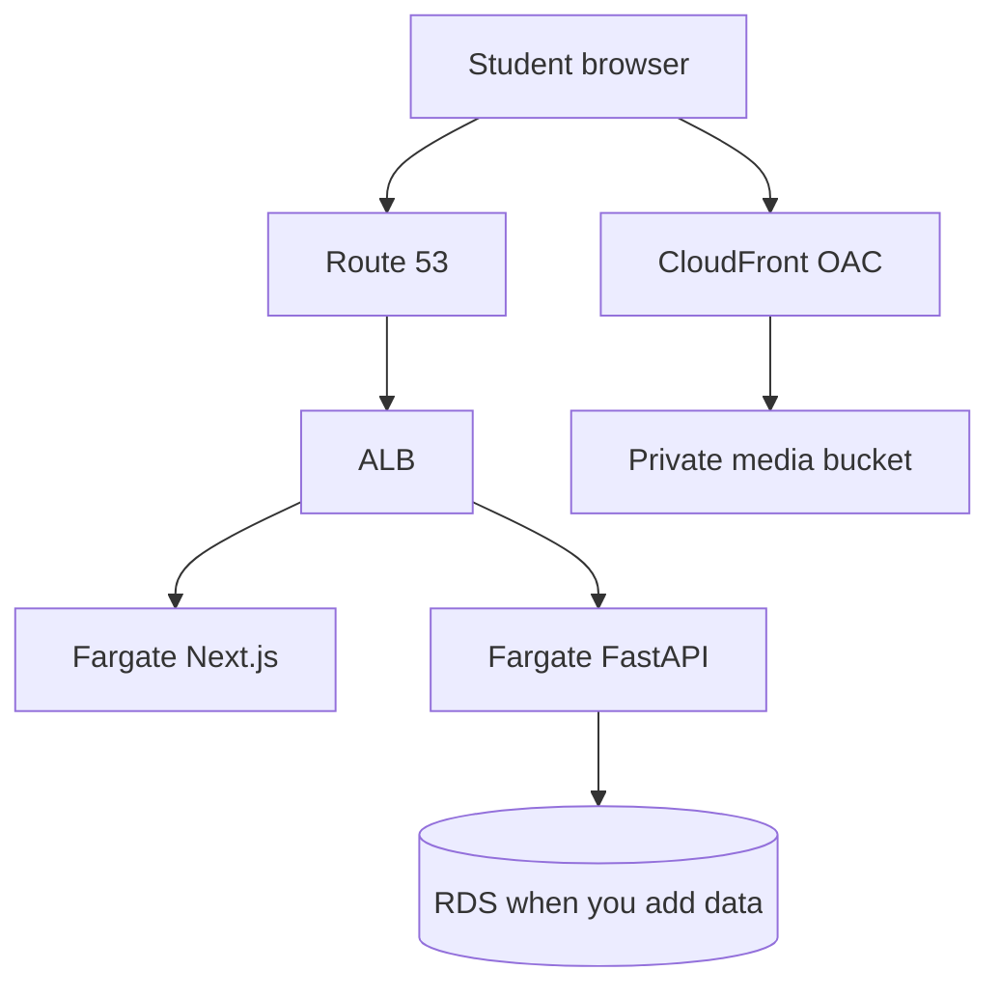
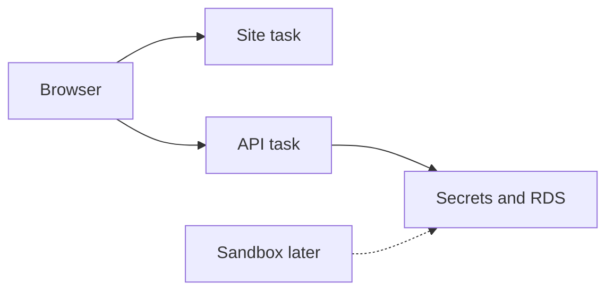

## Why this matters

The earlier lessons used CodeCraft as an example. This one is the example. The repo you have is a Next.js 14 frontend, a FastAPI backend, a lesson tree on disk, and a Docker sandbox the API starts with the local socket. Compose is the development shape. It is not a production architecture. If you copy `docker-compose.yml` onto one instance you keep the socket, the bind mounts, and a single machine. This lesson is the target you deploy in the next two lessons, including the parts of the current Dockerfiles that are development defaults.

## Intuition

Students' browsers need two origins. The site origin serves the Next.js server. The API origin serves FastAPI. The browser calls the API directly, because `frontend/src/lib/api.ts` reads `NEXT_PUBLIC_API_URL` at build time. That URL has to be a name the browser can resolve. `http://backend:8000` works on the Compose network and fails in a student's laptop. `http://localhost:8000` is what Compose publishes for local development and is wrong in production.

Both processes read the lesson tree from `CONTENT_DIR` on the filesystem. The frontend resolves it in `getContentRoot()`. The backend uses `content_dir` in settings. Compose bind-mounts `./content` read-only. A Fargate task has no host path to your laptop. The content tree has to be inside the image, or copied in at start from a private bucket. Baking it into the image matches how the course is versioned: a content change is a deploy.

The sandbox is a third process with a different trust level. Locally the API holds the Docker socket and starts `codecraft-sandbox` with no network, a memory cap, a pid cap, a read-only root, and user 1000. Those limits are good. The socket is not. Production does not give the API task a socket. Until a separate isolated runner exists, the API runs with the sandbox disabled, the same switch CI already sets for pytest.

There is no database client in the current backend. RDS is not required to boot today's `/health`. It is required the day you store accounts or progress, and it should be designed now so that day does not become "Postgres on the task's disk."

## Core concept in depth

### What Compose is doing

| Compose service | What it really is | Production replacement |
| --- | --- | --- |
| `frontend` target `development` | `npm run dev`, source mounted, content mounted | Image target `production`, `node server.js`, content copied in |
| `backend` | Uvicorn with `--reload`, content mounted, socket mounted | Uvicorn without reload, content in the image, no socket |
| `sandbox` profile `build-only` | Image build, not a long-running service | Still an image. Not started by the API task. |
| Bridge network `codecraft` | Name resolution between containers | Security groups between ALB, tasks, and later RDS |
| Host ports 3000 and 8000 | Your laptop | ALB listeners only |

The frontend Dockerfile already has the production stage: it copies the standalone server and the static assets. It does not copy `content/`, because the build context is `./frontend`. The backend Dockerfile installs curl for the health check and then runs Uvicorn with `--reload`, which is a file watcher you do not want on Fargate. Both images need a production build tweak before ECR sees them. The next lesson shows the build. This lesson says why.

### Request path

Use one region and two Availability Zones.

Route 53 alias records:

- `academy.example.com` to the ALB, forwarded to the frontend target group on port 3000.
- `api.academy.example.com` to the same ALB, forwarded to the API target group on port 8000.

ACM certificates live on the ALB. The API target group health check is `GET /health`. That route returns status and the environment name. It does not check a database, because there is not one yet. Do not point the health check at `/` on the site and call the API healthy.

The frontend task's `NEXT_PUBLIC_API_URL` is `https://api.academy.example.com`. `CORS_ORIGINS` on the API is `https://academy.example.com`. If either is left at the Compose localhost values, the browser fails in a way that looks like a random CORS bug.

Security groups: the world reaches the ALB on 443. The ALB reaches each task port. Tasks do not have public IPs. Nothing else is public.

### Content

Copy `content/` into both images and set `CONTENT_DIR` to that path. A lesson edit is a new image and a new task definition, which is what you want for a course: the running site matches a git SHA. An S3 sync on boot also works and makes content deploys independent of the image. It adds a failure mode where the task is "healthy" and the lesson tree is empty. Prefer bake-in until you have a reason to split them.

Do not serve the MDX bucket publicly. The app reads files and renders them. A public bucket is a second, worse publishing path.

CloudFront belongs in front of a private media bucket if you later store images outside the images in git. Origin access control, cache the objects, and do not put the API host behind a cache behavior. Personalized or simply dynamic JSON from FastAPI must not be cached. The Next.js server is an origin too. If you put CloudFront in front of it, bypass the cache for HTML and for anything with a cookie. The default in this design is CloudFront only for that media bucket, and the ALB for both app hosts.

### Sandbox and data

The runner in `backend/app/services/runner.py` uses the Docker SDK from the environment, then starts a container with `network_mode` from settings (default `none`), a memory limit, a pid limit, a read-only filesystem, and a non-root user. CI sets `SANDBOX_DISABLED` so pytest never needs a socket. Production does the same until you build a runner that is not the API task. That future runner gets no task role, no copy of the API environment, and no route to RDS. It does not get `/var/run/docker.sock` mounted from a shared host either. A socket on a shared Docker host is root on that host, which is the incident you are refusing.

When you add persistence, add RDS Postgres in private subnets, Multi-AZ, with the password in Secrets Manager and the security group allowing 5432 only from the API task. The frontend never gets the secret. The sandbox never gets the secret. `/health` can stay a process check. Add a separate readiness check if you want the load balancer to stop sending traffic when the database is down. Do not pretend today's health route already does that.

Lambda is the wrong home for this API. API Gateway is not required in front of the ALB. EKS is optional later, and Argo CD only if you move. Terraform owns the network and the services. The console is how you look, not how you change.

## Diagram / flowchart



The browser calls the API host directly. The edge path is only for public media, and it does not touch the API.

### Trust boundaries



The dotted line is the one you do not implement. The sandbox does not receive data-plane credentials.

### Local versus production

| Local | Production |
| --- | --- |
| `NEXT_PUBLIC_API_URL=http://localhost:8000` | `https://api.academy.example.com` baked into the frontend image |
| Content bind mount | `CONTENT_DIR` inside the image |
| `uvicorn --reload` | `uvicorn` without reload |
| Docker socket | Absent. `SANDBOX_DISABLED` true |
| Ports on the host | ALB only, tasks private |
| No TLS | ACM on the ALB |

## Code

The health route the target group should call is already in the API. A production check from a laptop that can reach the API host:

```bash
curl -fsS https://api.academy.example.com/health
```

You want a small JSON body that says the process is ok, and an environment value that is not `development`. If the body says development, the task definition is still carrying Compose defaults.

The frontend build argument has to be the public API, because Next inlines `NEXT_PUBLIC_` values during `npm run build` in the `builder` stage.

```bash
docker build \
  --target production \
  --build-arg NEXT_PUBLIC_API_URL=https://api.academy.example.com \
  -t codecraft-frontend:prod \
  ./frontend
```

That command as written still will not see `../content`. The image build lesson fixes the context. Do not point `NEXT_PUBLIC_API_URL` at the Cloud Map name or at `http://backend:8000`. The browser is not on the VPC network.

Confirm the API image you push does not include a reload watcher. The current Dockerfile `CMD` does. Override it in the task definition or change the production command to:

```bash
uvicorn app.main:app --host 0.0.0.0 --port 8000
```

`--reload` belongs on the Compose development container, where the source tree is mounted.

## Complexity analysis

| Choice | What you gain | What you give up |
| --- | --- | --- |
| Two Fargate services, one ALB, two hosts | Matches how the browser already calls the API | Two images to build and two services to watch |
| Single EC2 and Compose | Fast to demo | Socket, one AZ, no rolling replace |
| Bake content into images | Running bits match git | Content edits need a deploy |
| Sync content from S3 on boot | Content deploys without an image | Empty-tree boots, another IAM path |
| Sandbox disabled | No socket in production | No in-browser execution until a real runner exists |
| RDS now, unused | Private data path ready | A floor cost for a database nothing queries |
| RDS the day you add users | No idle database | You must not "just use SQLite on the disk" |
| CloudFront in front of the API | A familiar diagram | Cache bugs and no benefit for dynamic JSON |
| EKS | A platform you can grow | A platform you must run before the app needs it |

## Tricks, tips and patterns

- Draw the browser as a client of two hostnames. The Compose service name is not one of them.
- Bake `NEXT_PUBLIC_API_URL` and set `CORS_ORIGINS` to the same pair of public origins.
- Health check `/health` on the API target group. It is a process check today.
- Copy content into the image. `CONTENT_DIR` must exist inside the task.
- Drop `--reload` in production.
- No socket, no sandbox, until the runner is a separate locked-down compute path.
- Private tasks, public ALB, media bucket private behind origin access control.
- Add RDS with the first persistent feature, in private subnets, secret in Secrets Manager.
- Two zones for the ALB and the services.

## Common mistakes and edge cases

- Shipping the frontend with `NEXT_PUBLIC_API_URL` still on localhost. The browser calls the student's machine.
- CORS left on `http://localhost:3000`. The API is up and the browser blocks every call.
- Assuming the production frontend stage already contains the lessons. The build context is `frontend/`, and Compose hid that by mounting `../content`.
- Leaving `--reload` on. It wastes the watcher and will not see a bind mount you no longer have.
- Mounting the Docker socket into the API task "so the lab still works."
- Caching `/health` or API routes at CloudFront. Health and JSON are not media.
- Adding a public IP to tasks because ECR pulls failed. Fix NAT or endpoints.
- Treating `/health` as proof that a future database is up.
- Publishing the content bucket so the app "can read it" instead of giving the task an image or a role.

## Interview notes

**How does a student's browser reach this app?**
DNS aliases to an ALB. One host goes to the Next.js tasks. The other goes to the FastAPI tasks. The frontend was built with the public API URL. CORS allows the site origin. Tasks are in private subnets.

**Why is Compose not the production design?**
It publishes host ports, bind-mounts the repo, runs the dev server and Uvicorn reload, and gives the API the Docker socket. Each of those is a development convenience and a production defect.

**Where do the lessons come from in production?**
From `CONTENT_DIR` on disk inside the image, copied at build, because both apps read the filesystem. S3 is an alternative sync, not a public website of the MDX files.

**What do you do with the sandbox?**
Keep the local limits in mind, and do not take the socket to production. Disable execution on the API task until a separate runner exists with no database route and no API secrets.

**Does this design need RDS, Lambda, or EKS?**
Not to serve today's stateless app. RDS is the plan for real persistence. Lambda and EKS are not the default. Fargate plus an ALB is enough compute.

## Practice problems

1. A student sees the site and every API call hits `localhost`. Which build argument was wrong, and why a task environment variable alone may not fix a value that Next inlined?
2. The API task is healthy and the lesson list is empty. What did Compose mount that the image never copied?
3. Someone adds the Docker socket so code labs work. Name the privilege you just gave user-controlled code, even with `network_mode` set to none.
4. Draw the security group chain for a request to `/health`. Which hop must not be open to the internet?
5. You add user accounts. Where does Postgres go, who gets the secret, and what do you not point at the sandbox?

## Summary / cheat sheet

- Two public hostnames, one ALB, two private Fargate services, two zones.
- Browser API URL and CORS must be the production origins, not Compose localhost.
- Content is a filesystem tree. Bake it in. Do not publish the bucket.
- Production frontend target is `production`. Production API command has no `--reload`.
- `/health` checks the process. It does not check a database.
- Sandbox stays off the API task. No socket.
- CloudFront only for a private media bucket via origin access control.
- RDS, when you add data, is private and secret-injected into the API only.
- Terraform changes this. The next lessons build and ship it.

## Further reading

- [ECS task networking](https://docs.aws.amazon.com/AmazonECS/latest/developerguide/task-networking.html)
- [ALB host-based routing](https://docs.aws.amazon.com/elasticloadbalancing/latest/application/load-balancer-listeners.html)
- [Next.js standalone output](https://nextjs.org/docs/app/api-reference/config/next-config-js/output)
- [Docker Compose in this repo](https://docs.docker.com/compose/)
- [Fargate task security](https://docs.aws.amazon.com/AmazonECS/latest/developerguide/security-tasks-containers.html)
