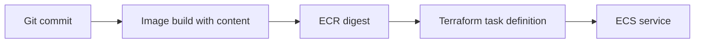

## Why this matters

The architecture lesson decided what to run. This one is how the bits get built and how the cloud resources stay reviewable. CodeCraft's Dockerfiles are honest about development and incomplete for production. Terraform should describe the VPC, the load balancer, the two services, and the registry. A person with the repo should be able to see the plan. A person with only the console should not be the only one who knows what is live.

## Intuition

Split the problem in two. First, produce images that contain the app and the content tree and do not carry development watchers. Second, tell ECS to run those images in the subnets and roles you already designed. Terraform is better at the second than at `docker build`. GitHub Actions, in the next lesson, runs the build and then rolls the service. Terraform owns the service definition, the desired count, and the IAM. Mixing "the pipeline applies the whole network on every commit" with "the pipeline only ships an image" is how state locks and surprise replaces happen. Ship images often. Apply network changes on purpose.

State lives in a remote backend with a lock, as the Terraform state lesson described. The production state key is not the same object as a sandbox experiment. One state for this stack, in this account, unless you have a second account.

## Core concept in depth

### Fix the images before you describe them

The frontend production stage runs `node server.js` and copies `.next/standalone` plus static files. The builder runs `npm run build` with `CONTENT_DIR`. The Compose file sets that variable by mounting the repo's `content` directory. A build context of `./frontend` does not include it. Widen the context to the repo root and copy `content` and `frontend` explicitly, or copy `content` into `frontend` in CI before the existing context build. Set `CONTENT_DIR` to the path you copied. Pass `NEXT_PUBLIC_API_URL` as a build argument so the browser bundle points at `https://api.academy.example.com`.

The backend image is `python:3.12-slim`, installs curl, installs `requirements.txt`, and copies the app. It does not copy `../content`. Do that in the production build and set `CONTENT_DIR`. Replace the command. The published `CMD` includes `--reload`, which is correct for the bind-mounted Compose service and wrong for a task. Production listens on `0.0.0.0` port 8000 without the reloader. Set `ENVIRONMENT` to `production` and `CORS_ORIGINS` to the site origin. Set `SANDBOX_DISABLED` to true. Do not set `DOCKER_HOST`. Do not copy a `.env` full of laptop values into the image.

Pin nothing magical and also do not ship `latest` as the only tag. Tag images with the git SHA. ECS rolls forward by pointing the task definition at that tag, or better, at the image digest. A mutable tag named `prod` will surprise you during a rollback.

### What Terraform owns

| Resource | Notes for this app |
| --- | --- |
| VPC, two zones, public and private subnets | ALB and NAT in public. Tasks in private. |
| ALB, listener 443, two target groups | Host rules for the site and the API. API health path `/health`. |
| Two ECS services on Fargate | `assignPublicIp` off. Minimum one task each, spread across the subnets. |
| Two task definitions | Separate execution role and task role. Frontend task role can be empty. |
| ECR repositories | Immutable tags preferred. Scan on push. |
| Log groups | Retention set, 30 days is enough to start. |
| ACM certificate and Route 53 aliases | Names students actually type. |
| Secrets Manager | Ready for the database URL. Unused secrets are still better than a password in the definition. |
| RDS | Add with the first feature that stores data. Not a fake dependency of today's API. |

The execution role may pull from ECR, write logs, and read the specific secrets named in the task definition. The API task role stays empty until the app itself calls AWS. The frontend task role stays empty. There is no sandbox task in this stack.

Security group on the API allows the target port from the ALB security group only. The same for the frontend. When RDS appears, its group allows the database port from the API group only.

### Apply boundaries

A sane layout is a network module and a service module, called from a live root for this environment. The root holds the region, the domain, the image tags, and the desired counts. Image tags are variables so a deploy updates a variable or a task definition revision without rewriting subnets.

Remote state and a lock are mandatory once two people can apply. Do not keep `terraform.tfstate` on a laptop. Do not commit it.

Plan output is the review. You are looking for destroyed subnets, replaced load balancers, and task definitions that gained a public IP or a secret in plaintext environment variables. A plan that only changes the image on the two task definitions is a normal deploy. A plan that recreates the VPC is not, and it should not ride along with a lesson typo.

CloudFormation or CDK can express the same graph. This course uses Terraform so the pipeline, the state lesson, and this stack stay one tool. Do not manage the same ALB from two tools.

### What you do not encode

You do not encode the Docker socket, a public database, or a task with an admin role "so the first apply works." You do not point the API health check at a URL on the frontend. You do not set the frontend `CONTENT_DIR` to a path that exists only on your laptop. You do not bake AWS access keys into either image.

## Diagram / flowchart



### Plan review

| Plan shows | Response |
| --- | --- |
| Task definition image digest changed | Expected deploy |
| Desired count changed | Make sure you meant to scale |
| Security group now allows the world on 8000 | Stop |
| Secret value in an environment variable plaintext | Stop. Use a secret reference. |
| VPC destroy and create | Stop. State or name drift. |
| New public IP on the service | Stop. Fix endpoints or NAT instead. |

### Image contents

| Path | Frontend image | API image |
| --- | --- | --- |
| App code | Standalone server | `app/` and dependencies |
| `content/` | Yes, at `CONTENT_DIR` | Yes, at `CONTENT_DIR` |
| `.env` from a laptop | No | No |
| Docker socket | No | No |
| AWS keys | No | No |

## Code

A production API command. Put this in the image or in the task definition `command`, and do not keep the reload flag from the development Dockerfile.

```bash
uvicorn app.main:app --host 0.0.0.0 --port 8000
```

Build from the repository root so `content/` is visible. The exact `COPY` lines live in the Dockerfiles you adjust. The invocation is:

```bash
docker build -f frontend/Dockerfile --target production \
  --build-arg NEXT_PUBLIC_API_URL=https://api.academy.example.com \
  -t codecraft-frontend:SHA .

docker build -f backend/Dockerfile \
  -t codecraft-api:SHA .
```

Those succeed only after the Dockerfiles copy `content` from the root context. Until then, a root context build fails on `COPY` paths that assume a smaller context. Fix the Dockerfiles. Do not `docker save` a container you mutated by hand.

Push the digest you will deploy:

```bash
docker tag codecraft-api:SHA 123456789012.dkr.ecr.us-east-1.amazonaws.com/codecraft-api:SHA
docker push 123456789012.dkr.ecr.us-east-1.amazonaws.com/codecraft-api:SHA
```

Terraform keeps the image in a variable. A task definition stub shows the split that matters: the execution role, no public IP on the service, and the sandbox switch as a plain environment variable because it is not a secret.

```hcl
variable "api_image" {
  type        = string
  description = "ECR image tag or digest for the FastAPI service."
}

resource "aws_ecs_task_definition" "api" {
  family                   = "codecraft-api"
  requires_compatibilities = ["FARGATE"]
  network_mode             = "awsvpc"
  cpu                      = "512"
  memory                   = "1024"
  execution_role_arn       = aws_iam_role.execution.arn
  task_role_arn            = aws_iam_role.api_task.arn
  container_definitions = jsonencode([
    {
      name  = "api"
      image = var.api_image
      portMappings = [{ containerPort = 8000, protocol = "tcp" }]
      environment = [
        { name = "ENVIRONMENT", value = "production" },
        { name = "SANDBOX_DISABLED", value = "true" },
        { name = "CONTENT_DIR", value = "/app/content" },
        { name = "CORS_ORIGINS", value = "https://academy.example.com" }
      ]
    }
  ])
}
```

The frontend task definition is the same shape on port 3000, with the public API URL already baked in, so you do not also rely on a runtime `NEXT_PUBLIC_API_URL` to fix a bad build. The service resource sets `assign_public_ip` to false and attaches the private subnets and the task security group.

Apply the network first when it is new. Apply a later image change with a targeted plan you have read.

```bash
terraform plan -var api_image=123456789012.dkr.ecr.us-east-1.amazonaws.com/codecraft-api@sha256:DIGEST
```

If the plan is quiet except for the task definition, apply it. ECS starts new tasks. The ALB waits until `/health` succeeds, then drops the old tasks. If new tasks fail the health check, the old tasks keep serving, as long as the deployment configuration does not force a total replacement. Watch the service events before you walk away.

## Complexity analysis

| Approach | Review | Risk |
| --- | --- | --- |
| Terraform for network and services, CI for image tags | Plans stay readable | Two moving parts to learn |
| CI runs `terraform apply` for everything on each push | One button | A content typo can plan a network change |
| Clicking ECS in the console | Fast once | Drift from the repo the next day |
| One image with both Next and FastAPI | One deployable | You couple rollbacks and ignore the two-port design |
| Mutable tag `latest` | Short scripts | Rollback races the next push |
| Digest pins | Exact bits | Slightly longer commands |

CPU and memory on the stub are a starting point, not a measurement. The API image is a slim Python process plus content. The frontend is a Node server. Raise memory if the task is OOM-killed during the lesson index, and then leave the number in Terraform so it is not a console-only edit.

## Tricks, tips and patterns

- Build from a context that contains `content/`. Set `CONTENT_DIR` to the copied path.
- Bake the public API URL into the frontend. Set CORS on the API to the public site.
- Tag and deploy digests. Avoid a floating `latest` in production.
- Execution role and task role stay split. Frontend task role empty. API task role empty until it calls AWS.
- `SANDBOX_DISABLED` true. No `DOCKER_HOST`.
- Remote state, locked. Read the plan.
- Health check path `/health`, matcher for a successful response, grace period long enough for Uvicorn to bind.
- Log group retention in the same change as the service.
- Domain and certificate before you send users, not after the first complaint.

## Common mistakes and edge cases

- Applying a plan that recreates the ALB and wondering why the alias flaps.
- Forgetting `assign_public_ip` false and also forgetting a NAT, so tasks cannot pull.
- Putting the database password in `environment` instead of `secrets` once RDS exists.
- Building the frontend without the build argument, then setting the variable at runtime and seeing no change. `NEXT_PUBLIC_` values are already in the client bundle.
- Copying content into only one image. The site and the API both read lessons.
- A health check grace of a few seconds and a slow first import. The deploy flaps. Give the process time to listen, then fail clearly.
- Two Terraform roots managing one cluster.
- State on disk, two engineers, one of them applies an old snapshot.

## Interview notes

**What does Terraform own versus the pipeline?**
Terraform owns the network, IAM, load balancer, services, and the shape of the task definition. The pipeline builds images, pushes digests, and updates the image variable. You can let Terraform apply that update. You do not let a routine image push become an unbounded apply of unrelated changes without reading a plan.

**Why change the backend command?**
The Dockerfile runs Uvicorn with `--reload` for Compose, where the source is mounted. Fargate has no source mount to reload, and the watcher is extra process surface. Production serves the copied app.

**How do lessons get into the task?**
`CONTENT_DIR` points at a directory copied during `docker build`. The Compose bind mount does not exist in ECS. Both images need the tree if both processes read it.

**How do you roll back?**
Deploy the previous digest by applying the previous image variable. ECS starts tasks on that digest. The ALB shifts traffic when health checks pass. A mutable tag makes "previous" ambiguous.

**What is the first IAM split?**
Execution role pulls and logs. Task role is what the process can call. This API does not need AWS permissions to serve lessons from disk. Do not attach an admin policy to find out.

## Practice problems

1. `terraform plan` wants to replace the VPC on a lesson-only change. What went wrong in how you structured the apply?
2. The new API tasks fail health checks and the site still works. Which setting is saving you, and what do you read next?
3. The frontend image was built with localhost as the API URL. Why does updating the task environment not fix the browser?
4. Write the two environment values that disable the sandbox and point at lessons, and name one variable you will not set.
5. You add RDS next week. Which security group source do you allow, and which task role still should not read the secret?

## Summary / cheat sheet

- Production images include `content/`, no reload flag, no socket, no laptop `.env`.
- Frontend build argument is the public API origin. API CORS is the public site origin.
- Push immutable tags or digests to ECR.
- Terraform: VPC, ALB, two services, roles, logs, DNS. Remote locked state.
- Tasks private. Execution role is not the task role. Task roles start empty.
- `SANDBOX_DISABLED` is true. `/health` is the target group path.
- Read plans. Image digest changes are normal. VPC replacements are not.
- Rollback is the previous digest.
- The pipeline in the next lesson is what runs this on every green main build.

## Further reading

- [ECS task definition parameters](https://docs.aws.amazon.com/AmazonECS/latest/developerguide/task_definition_parameters.html)
- [ECR image tagging](https://docs.aws.amazon.com/AmazonECR/latest/userguide/image-tag-mutability.html)
- [Terraform ECS service](https://registry.terraform.io/providers/hashicorp/aws/latest/docs/resources/ecs_service)
- [Fargate network configuration](https://docs.aws.amazon.com/AmazonECS/latest/developerguide/task-networking.html)
- [Next.js environment variables](https://nextjs.org/docs/app/building-your-application/configuring/environment-variables)
