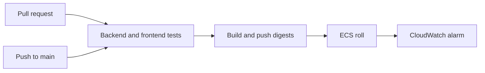

## Why this matters

`.github/workflows/ci.yml` already does the part people skip. On pull requests and on pushes it lints and tests the API with `SANDBOX_DISABLED` and a `CONTENT_DIR` pointed at the checkout. It lints, typechecks, and builds the frontend. On a push it also builds the Compose images and the sandbox image. It never logs into ECR, never assumes a role, and never updates a service. That is the right place to start and a bad place to stop if students are supposed to use a hosted academy. This lesson adds the missing deploy without weakening the tests, and it adds the minimum alarms so a bad roll is visible without watching the console.

## Intuition

Keep the three existing jobs. Add a deploy job that runs only on a push to `main`, only after backend, frontend, and the image build succeed, and only with credentials from GitHub's OIDC token. Pull requests run tests. They do not get the deploy role. The Docker job today is gated on `push` already. Deploy should be gated harder: the main branch, not every push to every branch.

A deploy is "new tasks become healthy, then old tasks stop." It is not "SSH and restart." ECS performs that if the target group is honest. Your job is to update the service to the new digest and to fail the workflow if the service does not stabilize. Then CloudWatch tells you if `/health` starts failing later, or if the API is returning 5xx while the process is still up.

## Core concept in depth

### What the current workflow guarantees

| Job | When | What it proves |
| --- | --- | --- |
| `backend` | Pull request and push | Ruff, Black, and pytest. Sandbox off. Content dir is the repo. |
| `frontend` | Pull request and push | Lint, typecheck, production build. API URL in CI is still localhost, which is fine for a compile. |
| `docker` | Push only, after the other two | The Dockerfiles still build. It does not push anywhere. |

The frontend CI build uses `NEXT_PUBLIC_API_URL=http://localhost:8000`. That must not be the command that tags the production image. Production build passes the public API origin. Use a separate step so a green "Build" job does not get mistaken for a releasable image.

Pytest disables the sandbox because there is no socket on the runner that you want tests to use, and because unit tests should not depend on Docker-in-Docker. Keep that. A deploy that "fixes" tests by enabling the sandbox on the runner is a different, riskier pipeline.

### The deploy job

1. Assume the deploy role with OIDC. The trust policy allows this repository's `main` branch only.
2. Log in to ECR.
3. Build the API and frontend images from the repo root with content included and the production API URL.
4. Push both digests.
5. Register a new task definition revision or update the image variable and apply the small Terraform change you reviewed in the last lesson.
6. Wait until the ECS service is stable.

Do not store `AWS_ACCESS_KEY_ID` in GitHub secrets. Do not run this job on `pull_request`. A pull request from a fork should not be able to assume the role even if someone loosens the `on:` trigger later. The trust policy is the backstop. The workflow `if` is the first gate.

Concurrency: one deploy at a time per environment. Two pushes should not roll the service in parallel. Cancel the older deploy or queue it. Cancelling a deploy mid-roll needs a human to look. Queuing is kinder for this app.

Rollback is a workflow you can run by hand with the previous SHA, or a re-run of the last green commit. ECS circuit breaker rollback is worth turning on so a task that crash-loops returns to the previous revision without waiting for you to notice. It does not replace the alarm. It handles the "new tasks never pass health" case. It does not handle "new tasks pass `/health` and then return 500 on real routes."

### What to watch

| Signal | Why |
| --- | --- |
| ALB `HealthyHostCount` for the API target group | Below one means students have no API. Treat missing data as bad. |
| ALB `HTTPCode_Target_5XX_Count` | The process is up and the app is failing. |
| ALB `HTTPCode_ELB_5XX_Count` | The load balancer has no healthy target or cannot connect. |
| ECS `RunningTaskCount` | Catches a service stuck at zero. |
| Log filter on tracebacks in `/ecs/codecraft-api` | Names the exception the 5xx metric only counts. |

Frontend health matters too. A target group on port 3000 should have its own healthy-host alarm. The API alarm is the one that tells you labs and lesson data routes are dead. `/health` returning ok while a lesson route throws is why you also alarm on target 5xx, not only on healthy hosts.

Log retention is part of the pipeline's definition of done. A log group created implicitly by the first task can live forever and bill forever. Create it in Terraform with a retention period.

Dashboards can wait. An alarm to an email or a chat webhook cannot. The monitoring module's paging guidance applies if this becomes a real on-call. For the academy, a noisy alarm you read is better than a perfect paging policy you never configure.

### Releases and flags

A feature flag is how you ship a risky lab without a second cluster. It is not required for the first deploy. Do not invent a blue-green stack of two ALBs for a site at this size. ECS rolling deploy plus the circuit breaker is the mechanism. If you need a canary later, shift a small listener weight to a second target group. You do not need Argo CD unless the compute moves to Kubernetes.

Database migrations, when RDS exists, run as a one-off task with the API image and the API secret, not as a step on the laptop, and not from the frontend. Expand migrations so a rolling deploy of old and new tasks can overlap. That is a later lesson's discipline. Call it out now so the first migration is not "lock the table and hope the roll finishes."

## Diagram / flowchart



Pull requests stop after tests. Main continues through the roll.

### After a bad deploy

| Observation | Likely meaning | Move |
| --- | --- | --- |
| New tasks fail `/health`, old tasks remain | Bad boot, circuit breaker should revert | Read the new task logs. Do not open a public IP. |
| Healthy hosts drop to zero | Both revisions are bad, or the target group is wrong | Roll back to a known digest. Check the path and port. |
| Healthy hosts fine, target 5xx climbing | App bug past the health route | Roll back the digest. Fix forward only if you understand it. |
| ELB 5xx, targets healthy in the console | Security group or port mismatch | The ALB cannot reach the task. |
| Deploy job green, students still see localhost | Production image built with the CI build argument | Rebuild with the public API URL. |

## Code

The existing test job should stay. The important environment lines are the ones that keep tests off the socket and on the repo content. In the workflow file they use GitHub's expression syntax, which belongs in the YAML, not in a shell one-liner you invent later. Conceptually the test step exports:

```bash
export CONTENT_DIR="$GITHUB_WORKSPACE/content"
export SANDBOX_DISABLED=true
pytest -q
```

The deploy job's permission and condition are the part to copy carefully. `id-token: write` is what lets OIDC work. `contents: read` is enough for the checkout.

```yaml
deploy:
  needs: [backend, frontend, docker]
  if: github.ref == 'refs/heads/main' && github.event_name == 'push'
  runs-on: ubuntu-latest
  permissions:
    id-token: write
    contents: read
  steps:
    - uses: actions/checkout@v4
    - uses: aws-actions/configure-aws-credentials@v4
      with:
        role-to-assume: arn:aws:iam::123456789012:role/codecraft-deploy
        aws-region: us-east-1
```

Fill in the real role ARN from Terraform outputs. The role can push to the two ECR repositories and update the two ECS services. It cannot administer IAM. After the images are pushed, wait for stability:

```bash
aws ecs update-service \
  --cluster codecraft \
  --service codecraft-api \
  --task-definition codecraft-api \
  --force-new-deployment

aws ecs wait services-stable \
  --cluster codecraft \
  --services codecraft-api codecraft-frontend
```

`--force-new-deployment` only helps if the task definition already points at the new digest. Register the new revision first, then update the service to that revision. Waiting on `services-stable` is what fails the GitHub job when tasks never become healthy. Without the wait, the workflow goes green while the roll is still dying.

A single alarm for the API targets, created in Terraform with the load balancer:

```hcl
resource "aws_cloudwatch_metric_alarm" "api_unhealthy" {
  alarm_name          = "codecraft-api-no-healthy-targets"
  comparison_operator = "LessThanThreshold"
  threshold           = 1
  evaluation_periods  = 2
  metric_name         = "HealthyHostCount"
  namespace           = "AWS/ApplicationELB"
  period              = 60
  statistic           = "Minimum"
  treat_missing_data  = "breaching"
  dimensions = {
    TargetGroup  = aws_lb_target_group.api.arn_suffix
    LoadBalancer = aws_lb.public.arn_suffix
  }
}
```

`treat_missing_data` as breaching means "the metric disappeared" pages you, which is what you want for a target group that should always exist. Wire `alarm_actions` to an SNS topic you actually subscribe to. An alarm with no actions is a chart.

## Complexity analysis

| Pipeline | Safety | Cost in time |
| --- | --- | --- |
| Tests on every pull request, no deploy | High, and nothing ships | CI minutes |
| Deploy every main push after tests | Ships current main | Image build plus a roll |
| Deploy from a laptop with keys | Easy to skip tests | High chance of drift |
| Pull request deploys to production | Fast review of UI | Untrusted code in prod. Do not. |
| Mutable `latest` plus force deploy | Short script | Hard rollback |
| Digest plus wait stable plus circuit breaker | You know what is running | A few more lines |

Build time is dominated by the frontend `npm run build` and the API dependency install. Cache dependency layers in CI. Do not cache a layer that contains a secret, because you should not have copied a secret into the build in the first place.

## Tricks, tips and patterns

- Leave the lint and test jobs alone. Add deploy. Do not merge them into one giant step that skips tests when you are in a hurry.
- Production image build is not the CI compile. Pass the public API URL only in the deploy build.
- OIDC, main branch only, no static cloud keys in the repo settings.
- One deploy at a time. Wait until the service is stable.
- Turn on the ECS deployment circuit breaker with rollback.
- Alarm on API healthy hosts and on target 5xx. Missing healthy-host data counts as bad.
- Subscribe to the alarm. Set log retention.
- Roll back by digest. Read logs before you "fix" the network.
- Keep `SANDBOX_DISABLED` on the running task and in pytest.

## Common mistakes and edge cases

- A deploy job without `needs:`, so it races the tests and ships a red commit.
- `if: github.event_name == 'push'` on every branch, so a feature branch updates production.
- Using the localhost API URL from the frontend job in the image you push.
- A GitHub secret access key copied into the workflow log by a debug `env` dump.
- `services-stable` not called, workflow green, service stuck.
- Alarm on ELB 5xx only, so application 500s never notify.
- Healthy-host alarm that treats missing data as fine, so a deleted target group is silent.
- Enabling the sandbox in production in the same change as the first deploy. Two new risks at once.
- A migration step that assumes the old tasks are already dead. During a roll both versions run.

## Interview notes

**What does this repo's CI do today?**
It tests the API with the sandbox disabled and the content directory set, it checks the frontend, and on push it builds images locally to the runner. It does not deploy.

**How should production credentials enter GitHub Actions?**
OIDC into a role whose trust policy is this repo on `main`. The role can push images and update services. It is not an administrator. There is no long-lived access key in the secrets list.

**Why is a green `/health` not enough after the roll?**
The route checks that the process responds. It does not prove lesson routes or a future database. Pair the healthy-host alarm with target 5xx and with logs.

**How do you stop two deploys from colliding?**
A concurrency group on the workflow so only one main deploy runs, and ECS deployment settings that roll a limited fraction of tasks. If a deploy is cancelled mid-way, check the service before starting another.

**What is the rollback unit?**
The previous image digest on the previous task definition revision. The circuit breaker can return there when new tasks fail health. You trigger the same return yourself when health passes and the app is still wrong.

## Practice problems

1. A pull request workflow assumed the deploy role. Which two gates failed, the workflow `if` and which trust condition?
2. The deploy job is green and the API target group has zero healthy hosts. Which command was missing?
3. Students load the site from the new deploy and the browser calls localhost. Which build argument did the production job inherit from the test job?
4. `/health` is 200 and lesson fetches are 500. Which alarm fires, and which one stays quiet?
5. You want code execution on the hosted API the same day you first deploy. Why is that a separate change from the ECS roll?

## Summary / cheat sheet

- Today's workflow tests and builds. It does not ship. Keep the tests.
- Deploy on main only, after the test jobs, with OIDC and a narrow role.
- Build production images with the public API URL and the content tree. Do not reuse the localhost CI build.
- Push digests, update the service, wait until it is stable.
- Circuit breaker on. Rollback is a previous digest.
- Alarm when the API has no healthy targets, and when targets return 5xx.
- Missing health metrics should alarm. Log retention is set. Someone receives the alarm.
- Sandbox stays disabled on the API task.
- Rolling ECS is the release strategy. A second cluster and Argo CD are not required.
- One change at a time after the first green deploy. Read the logs before you change the network.

## Further reading

- [GitHub OIDC with AWS](https://docs.github.com/en/actions/security-for-github-actions/security-hardening-your-deployments/configuring-openid-connect-in-amazon-web-services)
- [ECS wait services-stable](https://docs.aws.amazon.com/cli/latest/reference/ecs/wait/services-stable.html)
- [ECS deployment circuit breaker](https://docs.aws.amazon.com/AmazonECS/latest/developerguide/deployment-circuit-breaker.html)
- [ALB CloudWatch metrics](https://docs.aws.amazon.com/elasticloadbalancing/latest/application/load-balancer-cloudwatch-metrics.html)
- [GitHub Actions concurrency](https://docs.github.com/en/actions/using-jobs/using-concurrency)
