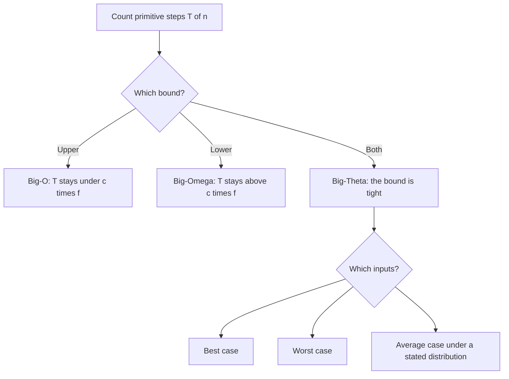

## Why this matters

Complexity is the language interviewers use to decide whether a solution will survive real input sizes. A service that is fine on a demo of a few hundred rows can time out when the same code meets a few million. At the 15 to 20 LPA bar, stating a correct bound is not a footnote you add after the code. It is part of the design. You are expected to compare a brute force idea with an improved one, name the bottleneck, and say what you would pay in memory to remove it.

The same skill shows up after the interview. Capacity planning, choosing an index, and deciding whether a nightly job can be a nested loop are all complexity arguments. If you can only say "this looks fast," you cannot defend the choice when the data grows. Big-O, Big-Omega, and Big-Theta give you a way to talk about growth without arguing about a laptop's clock speed.

## Intuition

Picture a stadium emptying after a match. If each person walks to the nearest gate without waiting on anyone else, the time grows with the number of people. Double the crowd and the exit takes about twice as long. That is linear growth. If every person must shake hands with every other person before leaving, doubling the crowd roughly quadruples the handshakes. That is quadratic growth. Binary search is the opposite kind of story: each question throws away half of the remaining possibilities, so a huge sorted list still takes only a handful of comparisons.

Asymptotic notation deliberately ignores the exact number of seconds. It answers a different question: if the input size n grows without bound, which term dominates? A program that does 3n + 100 additions and a program that does n additions are in the same class, because the 3 and the 100 stop mattering next to the growth of n. Constants still matter when you tune a hot loop in production. They do not matter when you are choosing between a linear scan and a quadratic scan for large n. The doubling test is the practical version of this idea. If doubling n doubles the time, think linear. If it multiplies the time by about four, think quadratic. If the time barely moves, think logarithmic or constant.

## Core concept in depth

Fix a function T(n) that counts the primitive steps of an algorithm on an input of size n. We say T(n) is O(f(n)) when there exist constants c greater than 0 and n0 such that for every n at least n0, T(n) is at most c times f(n). This is an upper bound. It says the cost does not grow faster than f, up to a constant factor, once n is large enough. It does not say the bound is tight. A linear scan is O(n), and it is also O(n squared), because a looser upper bound is still a true upper bound. Interviewers usually want the tightest simple bound you can justify.

T(n) is Omega(f(n)) when there exist constants c greater than 0 and n0 such that for every n at least n0, T(n) is at least c times f(n). This is a lower bound. It says the algorithm must do at least this much work on the inputs you are considering. T(n) is Theta(f(n)) when it is both O(f(n)) and Omega(f(n)). Theta is the tight bound. When you say "merge sort is Theta of n log n," you mean the leading term really is n log n, not merely that n log n is some safe overestimate.

You must also say which inputs the bound talks about. Best case is the cheapest input of size n. Worst case is the most expensive. Average case is the expectation over a stated distribution, often uniform random inputs or random pivots. Quicksort is the classic reminder: with a good pivot it is Theta of n log n on average, and with consistently terrible pivots it is Theta of n squared in the worst case. A hash table lookup is expected constant time under a good hash, and linear in the worst case when every key collides. If you say "hash maps are O(1)" without the word expected, a strong interviewer will ask you to repair the sentence.

The model behind these counts is a random-access machine: reading an array slot, adding two words, comparing two words, and following a pointer are constant-time primitives, as long as the words fit in a machine word. A loop that runs n times around a constant body is Theta(n). Two sequential loops add. Two nested loops over the same n multiply. A loop that halves a range each iteration, such as low to high in binary search, runs Theta(log n) iterations. Recursion needs a recurrence. A function that does linear work and then solves two halves has the shape T(n) = 2 T(n/2) + Theta(n). The Master theorem, treated in its own lesson, solves that to Theta(n log n).

Space complexity counts extra memory, not the input itself, unless the problem asks you to count the whole footprint. An in-place partition uses Theta(1) extra words. A hash set of the input uses Theta(n) extra words. Recursion uses stack frames. A recursive depth-first traversal of a skewed tree can use Theta(n) stack space even when the algorithm looks "in place." Output size counts when you materialize it: returning every pair of an array is Theta(n squared) space no matter how clever the loop is.

Little-o and little-omega are strict versions. T(n) is o(f(n)) when T(n) / f(n) goes to 0. You will rarely need the little forms in an interview, but they explain why we drop lower-order terms: n is o(n log n), and n log n is o(n squared).

## Diagram and dry run



The next table counts additions in a double loop, `s += 1` inside `for i in range(n)` and `for j in range(n)`, and compares that with a loop that only runs to i. For n = 4 the full square does 16 additions. The triangular loop does 0 + 1 + 2 + 3 = 6 additions, which is n(n-1)/2 and still Theta(n squared).

| n | Full n by n additions | Triangular additions | Binary-search comparisons on a sorted array of n, worst case |
| --- | --- | --- | --- |
| 1 | 1 | 0 | 1 |
| 2 | 4 | 1 | 2 |
| 4 | 16 | 6 | 3 |
| 8 | 64 | 28 | 4 |
| 16 | 256 | 120 | 5 |

Doubling n multiplies the square by four and adds only one comparison to the binary search. That single picture is worth more than a memorized formula.

## Runnable Python

The first routine is the iterative search you should be able to write without hesitation. The second is the same algorithm in recursive form. Both return the index or -1. The comparison counter makes the logarithmic bound visible.

```python
def binary_search(nums: list[int], target: int) -> int:
    lo, hi = 0, len(nums) - 1
    comparisons = 0
    while lo <= hi:
        mid = (lo + hi) // 2
        comparisons += 1
        if nums[mid] == target:
            return mid
        if nums[mid] < target:
            lo = mid + 1
        else:
            hi = mid - 1
    return -1


def binary_search_rec(nums: list[int], target: int, lo: int, hi: int) -> int:
    if lo > hi:
        return -1
    mid = (lo + hi) // 2
    if nums[mid] == target:
        return mid
    if nums[mid] < target:
        return binary_search_rec(nums, target, mid + 1, hi)
    return binary_search_rec(nums, target, lo, mid - 1)
```

On a sorted array of a million elements the loop body runs at most twenty times, because 2 to the 20th is about a million. The recursive version does the same work and also uses Theta(log n) stack frames. Prefer the loop unless the recursive shape makes the invariant clearer.

## Complexity and trade-offs

| Procedure | Best time | Worst time | Extra space |
| --- | --- | --- | --- |
| Scan an unsorted array | Theta(1) if the target is first | Theta(n) | Theta(1) |
| Iterative binary search | Theta(1) if the middle hits | Theta(log n) | Theta(1) |
| Recursive binary search | Theta(1) | Theta(log n) | Theta(log n) stack |
| Double loop over the array | Theta(n squared) | Theta(n squared) | Theta(1) |
| Build a hash set, then scan | Theta(n) expected | Theta(n squared) if every hash collides | Theta(n) |

The hash-set row is the trade you will make constantly. Two Sum is quadratic if you try every pair, and expected linear if you store values you have already seen. You pay linear memory for that speed. Say so. Also say that Python's sort is Theta(n log n) worst case, so sorting in order to binary search is Theta(n log n), not Theta(log n). The sort dominates.

## Tricks, tips, and patterns

Drop constant factors and lower-order terms when you name the class: 5n + n log n + 40 is Theta(n log n). Add sequential independent loops and multiply nested loops that each run with the full size. A loop whose counter doubles, or whose range halves, is logarithmic. Recursion depth is space. Early returns improve the best case and usually do not improve the worst case, so do not advertise the early return as the complexity of the algorithm. When a library call sits inside a loop, expand it. `in` on a list is linear. `in` on a set is expected constant time. `sorted` is linearithmic. String concatenation in a loop can be quadratic if each addition copies the whole string. Collect pieces and join them once.

The doubling question is a good sanity check when you are unsure: "If n becomes 2n, what happens to the number of inner-loop executions?" If you cannot answer, you do not have a bound yet.

## Common mistakes and edge cases

The most common mistake is hiding a linear scan inside another linear scan and still calling the result linear. Another is claiming that sorting is free. A third is quoting the average case of quicksort or of hashing as if it were a worst-case guarantee. A fourth is forgetting the output. Generating all subsets is Theta(n times 2 to the n) time simply because there are that many subsets to write down. A fifth is using the best case as the answer to "what is the complexity?" Interviewers mean worst case unless they say otherwise.

Empty inputs are Theta(1) for most scans, and they are a good test that your bound's n0 story still has a defined algorithm at n = 0. Overflow of the midpoint in languages with fixed-width integers is not a complexity issue, but it is the usual companion bug of binary search. In Python the midpoint arithmetic is safe. The infinite loop from updating lo or hi incorrectly is not safe in any language, and a wrong update can turn a logarithmic algorithm into a non-terminating one. Complexity statements assume termination.

## Interview notes

Lead with the bound you will actually defend, then the reason. A clean sentence is: "The outer loop runs n times and the inner two-pointer scan together moves each endpoint at most n times, so the total is Theta(n squared) time and Theta(1) extra memory." If you improved a quadratic brute force, say what the brute force was and which observation removed a factor of n. Mention average versus worst when the structure is a hash table, a balanced tree, or quicksort. Mention stack space when the elegant solution is recursive. If the interviewer asks you to go faster, the honest answers are a tighter bound you missed, a data-structure trade, or a statement that the problem has a known lower bound, such as comparison sorting requiring Omega(n log n) comparisons in the worst case.

Do not invent a linear sort for arbitrary comparable objects. Do not say "O of n log n or better" as a way to avoid choosing. Pick the bound, then discuss constant factors only if two algorithms share a class.

## Practice problems

Use these as complexity drills. Write the brute force, name its bound, then write the improved solution and name the new bound and the extra memory.

1. [Two Sum](/practice/two-sum) — pairs versus a hash map.
2. [Contains Duplicate](/practice/contains-duplicate) — sort, or a set.
3. [Maximum Subarray](/practice/maximum-subarray) — every subarray versus Kadane's one pass.
4. [Climbing Stairs](/practice/climbing-stairs) — the exponential recursion versus the linear recurrence.
5. [Binary Search](/practice/binary-search) — write both the loop and the recurrence T(n) = T(n/2) + Theta(1).

## Summary and cheat sheet

- Big-O is an upper bound, Big-Omega is a lower bound, and Big-Theta means both.
- Always attach the bound to best, worst, or average case. Average case needs a distribution.
- Nested full passes multiply. Sequential passes add. Halving is logarithmic.
- Space includes auxiliary structures and the call stack, and output size when you build it.
- Hashing is expected constant time, not a worst-case promise.
- Sorting arbitrary comparable items is Theta(n log n) in the worst case for comparison sorts.
- Drop constants when naming the class. Keep them when you are tuning inside one class.

## Further reading

- [Wikipedia — Big O notation](https://en.wikipedia.org/wiki/Big_O_notation)
- [Wikipedia — Best, worst and average case](https://en.wikipedia.org/wiki/Best,_worst_and_average_case)
- [Python TimeComplexity wiki](https://wiki.python.org/moin/TimeComplexity)
- [CLRS, Introduction to Algorithms](https://mitpress.mit.edu/9780262046305/introduction-to-algorithms/)
