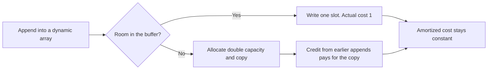

## Why this matters

Some operations are usually cheap and occasionally expensive. A dynamic array append is the everyday example: most appends write one slot, and every so often the array allocates a bigger buffer and copies everything. If you quote only the expensive copy, append looks linear and unusable. If you quote only the cheap write, you are hiding the copy. Amortized analysis is the third answer. Across a long sequence of operations, the expensive ones are rare enough that the average cost per operation is constant. Interviewers ask about this whenever a resizable array, a hash table resize, a splay tree, or a two-stack queue shows up. It is also the right way to talk about the cost of n appends in Python's list.

## Intuition

Suppose a coffee shop gives you a stamp card. Nine coffees are a quick swipe, and the tenth is free but the cashier spends a long time resetting the card. Looking only at the tenth customer, service looks slow. Looking at ten customers together, the reset is one extra piece of work spread over ten sales. Amortized cost is that long-run average. It is not the same as average-case complexity. Average-case talks about random inputs. Amortized analysis talks about a worst-case sequence of operations. The adversary can force the resize to happen. The adversary cannot force every single append to resize, because a geometric resize pays for itself with the cheap appends that follow.

## Core concept in depth

There are three standard methods, and they prove the same style of statement.

Aggregate analysis sums the total cost of a sequence of n operations and divides by n. If the total is at most c n, each operation has amortized cost c. For a dynamic array that doubles when it is full, the copies of an element happen at sizes 1, 2, 4, and so on. An element is copied O(log n) times if you look at one element over the whole life of the array, but the aggregate argument is cleaner: the total number of element-copies across n appends is at most 1 + 2 + 4 + ... + n, which is less than 2n. Plus n writes into empty slots, the whole sequence costs less than 3n element moves. Divide by n and each append is amortized Theta(1), even though some individual append is Theta(n).

The accounting method assigns a charge that may differ from the actual cost. Cheap operations pay a little extra, and that extra is stored as credit on the data structure. Expensive operations spend the credit. For doubling arrays, charge 3 units for each append. One unit pays for writing the new element. Two units are saved as credit on that element. When a resize copies the element into a new buffer, the copy spends one unit of its credit, and the other unit remains so the element can be copied again after the next doubling, or you can retune the charge. The usual textbook charge is: each append pays 3, the write uses 1, and 2 are deposited. A resize of k live elements finds 2k credits because those elements were inserted after the previous resize, and the copy costs k, so the credits cover it. No operation's bank balance goes negative, therefore the sum of charges is an upper bound on the sum of actual costs. The amortized cost is the charge, which is 3, a constant.

The potential method stores the credit in a function of the whole structure instead of on individual objects. Let Phi be the potential. Define the amortized cost of an operation as its actual cost plus the change in potential. Summing over a sequence, the potentials telescope: the sum of amortized costs equals the sum of actual costs plus Phi at the end minus Phi at the start. If Phi ends at least as high as it started, the amortized sum upper-bounds the actual sum. For a doubling array, a good potential is twice the number of occupied slots minus the capacity, or zero when that quantity is negative. An ordinary append increases the potential by 2 and does 1 unit of real work, so its amortized cost is 3. A doubling append copies n elements, the capacity jumps, and the potential drops enough to cancel the copy. You do not need to memorize one magic formula. You need to know that potential is a Lyapunov function for credit: it rises on cheap steps and falls on expensive steps, and it never has to go below its starting value.

A binary counter that starts at zero and is incremented n times is the other classic aggregate proof. Incrementing flips a trailing run of ones to zeros and flips one zero to one. Across n increments, bit 0 flips every step, bit 1 flips every second step, bit 2 every fourth step. The total flips are at most n + n/2 + n/4 + ... which is less than 2n. Each increment is amortized Theta(1) bit flips even though one increment can flip Theta(log n) bits.

A queue built from two stacks has the same shape. Push onto the inbox is Theta(1). Pop either pops the outbox or pours the entire inbox onto the outbox and then pops. Each element is pushed once, moved once, and popped once, so n operations move each element O(1) times. Any single pop can be linear. The sequence is amortized linear in n, which is amortized constant per operation.

## Diagram and dry run



Start with capacity 1. Append the letters A, B, C, D, E. A resize copies every currently live element into the new buffer.

| Append | Value | Capacity before write | Elements copied on this append | Actual element moves | Credit deposited if we charge 3 |
| --- | --- | --- | --- | --- | --- |
| 1 | A | 1, already full, grow to 1 | 0, then write A | 1 | 3 |
| 2 | B | 1, grow to 2, copy A | 1 | 2 | 3 |
| 3 | C | 2, room | 0 | 1 | 3 |
| 4 | D | 2, grow to 4, copy A B C | 3 | 4 | 3 |
| 5 | E | 4, room | 0 | 1 | 3 |

Total actual moves: 1 + 2 + 1 + 4 + 1 = 9. Total charges: 15. The charges dominate the actual cost, which is what an upper bound must do. The copies are 0, 1, and 3, a geometric series, not five full copies.

## Runnable Python

This instrumented list doubles by hand so you can see the copy count. The recursive function is not a natural fit for amortization, so the second routine is the two-stack queue, whose pop is the occasionally expensive operation. Both are worth implementing until the credit story feels mechanical.

```python
class DoublingArray:
    def __init__(self) -> None:
        self._data = [None]
        self._size = 0
        self.copies = 0

    def append(self, value: object) -> None:
        if self._size == len(self._data):
            grown = [None] * (len(self._data) * 2)
            for i in range(self._size):
                grown[i] = self._data[i]
                self.copies += 1
            self._data = grown
        self._data[self._size] = value
        self._size += 1


class TwoStackQueue:
    def __init__(self) -> None:
        self._inbox: list[object] = []
        self._outbox: list[object] = []

    def push(self, value: object) -> None:
        self._inbox.append(value)

    def pop(self) -> object:
        if not self._outbox:
            while self._inbox:
                self._outbox.append(self._inbox.pop())
        return self._outbox.pop()
```

After n appends on the doubling array, `copies` stays below n. After n pushes and n pops on the queue, each element moves from the inbox to the outbox at most once.

## Complexity and trade-offs

| Structure | Worst single operation | Amortized cost over n operations | Extra space |
| --- | --- | --- | --- |
| Doubling dynamic array append | Theta(n) on resize | Theta(1) | Theta(n) for the buffer |
| Increment a binary counter | Theta(number of bits) | Theta(1) | Theta(log n) bits |
| Two-stack queue push | Theta(1) | Theta(1) | Theta(n) |
| Two-stack queue pop | Theta(n) when the outbox is empty | Theta(1) | Theta(n) |
| Hash table insert with doubling | Theta(n) on rehash | Theta(1) expected, before hashing collisions | Theta(n) |

Growing by a constant amount, such as adding 10 slots each time, destroys the argument. The copies become n/10 + 2n/10 + ... which sums to Theta(n squared) for n appends, so each append is amortized linear. The growth factor must be a constant strictly greater than 1. Doubling is the usual choice. Growing by 1.5 also works and copies less aggressively. Shrinking has a matching trap: if you shrink as soon as the array is half empty and double as soon as it is full, an adversary can oscillate around the boundary and force a copy every operation. Shrink only when the array is about a quarter full, so that a grow and a shrink cannot chase each other.

Amortized bounds are not worst-case latency bounds. A real-time system that cannot accept a linear pause should use a structure with a strict worst-case constant, or it should spread the copy over later operations. That technique is called incremental resizing. It is more code, and it is the right follow-up if an interviewer says the pause is unacceptable.

## Tricks, tips, and patterns

If the expensive event happens every time the size doubles, sum a geometric series. The sum of 1 + 2 + 4 + ... + n is less than 2n, so the total is linear and the average is constant. If you are asked to prove it cleanly, pick aggregate analysis first and mention accounting or potential as the method you would use to assign the cost to individual operations. Multipop on a stack, where one call may pop several items but each item is popped at most once, is the same aggregate idea. A token you place on an object when it is inserted, and remove when it is deleted or moved, is an accounting proof in physical form.

## Common mistakes and edge cases

Do not say "append is O(1) worst case" for a dynamic array. Say amortized. Do not confuse amortized with average-case. The doubling proof does not require random data. Do not grow by a fixed number of slots and expect a constant amortized cost. Do not shrink at the same threshold where you grow. Do not forget that a sequence of n amortized-constant operations is Theta(n) total, which is usually what a caller needs. An empty pop on the two-stack queue is an error, not an amortized event. State the precondition.

Python's list follows this doubling strategy. Appending n items is Theta(n) total. Inserting at the front of a list is Theta(n) each time, because every later item shifts, and amortization does not save you. Use a deque when both ends must be cheap.

## Interview notes

A strong answer to "what does amortized mean?" is one sentence plus one example. The sentence: across any sequence of operations, the average cost is bounded, even if a particular operation is expensive. The example: doubling array, total copies less than 2n, therefore append is amortized constant. If they ask for a proof method, name aggregate, accounting, and potential, and walk aggregate on the board. If they ask about worst-case latency, acknowledge that amortized constant is not worst-case constant, and mention incremental growth as the remedy. The two-stack queue is a common follow-up. Implement it, then explain why each element crosses at most once.

## Practice problems

1. [Min Stack](/practice/min-stack) — a second stack keeps the minimum, and every push and pop is worst-case constant, which is stronger than amortized.
2. [LRU Cache](/practice/lru-cache) — ordered dictionary operations are amortized constant in Python. Be ready to say that.
3. [LFU Cache](/practice/lfu-cache) — frequency buckets need the same constant-time move story.
4. [Sliding Window Maximum](/practice/sliding-window-maximum) — each index enters and leaves the deque once, an aggregate argument.
5. [Online Stock Span](/practice/online-stock-span) — each day is pushed and popped at most once.

## Summary and cheat sheet

- Amortized cost is the average over a worst-case sequence, not a random-input average.
- Aggregate: sum the costs, divide by n.
- Accounting: charge extra on cheap steps and spend it on expensive steps.
- Potential: store the credit in a function that telescopes.
- Doubling arrays, binary counters, and two-stack queues are amortized constant per operation.
- Grow by a constant factor. Do not shrink at the grow threshold.
- Amortized constant does not promise a constant pause.

## Further reading

- [Wikipedia — Amortized analysis](https://en.wikipedia.org/wiki/Amortized_analysis)
- [Wikipedia — Dynamic array](https://en.wikipedia.org/wiki/Dynamic_array)
- [Python TimeComplexity wiki](https://wiki.python.org/moin/TimeComplexity)
- [CLRS, Introduction to Algorithms, amortization chapter](https://mitpress.mit.edu/9780262046305/introduction-to-algorithms/)
