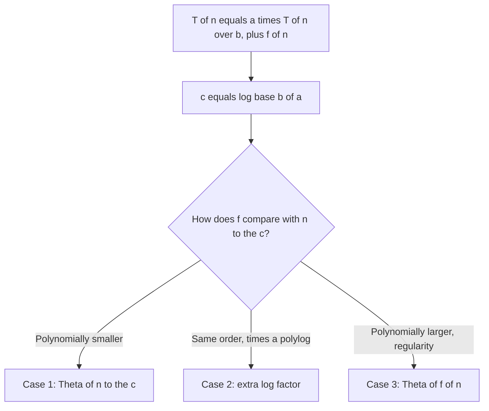

## Why this matters

Divide-and-conquer algorithms are recurrences in disguise. Merge sort splits the array, sorts both halves, and merges. Binary search throws away half the range and does a constant amount of extra work. A recurrence describes that shape, and the Master theorem solves a large family of those recurrences without drawing the whole recursion tree. Interviewers rarely ask you to recite the theorem by number. They do ask "what is the cost of this recursive function?" and they expect you to see the split, the number of subproblems, and the work outside the recursive calls. Once those three numbers are visible, the theorem, or a short tree argument that proves the same thing, gives the bound.

## Intuition

Draw the recursion tree. Each level does some work outside the recursive calls. If the levels do the same amount of work, you multiply one level by the number of levels, and the number of levels is logarithmic because the input shrinks by a constant factor. Merge sort is that picture: each level merges Theta(n) items, and there are Theta(log n) levels, so the total is Theta(n log n). If the work shrinks quickly as you go down, the root dominates and the total is the cost of the root. If the work grows as you go down, the leaves dominate and the total is the cost of doing something at every leaf. The Master theorem is that trichotomy, stated with precise conditions so you do not have to redraw the tree every time.

## Core concept in depth

The standard form is T(n) = a T(n / b) + f(n), where a is at least 1 and is the number of subproblems, b is greater than 1 and is the factor by which the subproblem shrinks, and f(n) is the non-recursive work. The critical exponent is c = log base b of a. It is the exponent that makes n^c equal to the number of leaves in a complete tree, because the tree has about log base b of n levels and a branching factor of a, so the leaf count is a to the power of that height, which simplifies to n^c. Compare f(n) with n^c.

Case 1. If f(n) is polynomially smaller than n^c, meaning f(n) is O of n^c divided by n to a positive power epsilon, then the leaves dominate and T(n) is Theta of n^c. The root and the middle levels are lower order.

Case 2. If f(n) is Theta of n^c times a polylog, that is Theta of n^c times (log n) to the power k for some k at least 0, then every level contributes about the same order and T(n) is Theta of n^c times (log n) to the power k + 1. The common interview case is k = 0: f(n) is Theta of n^c, and the answer is Theta of n^c log n.

Case 3. If f(n) is polynomially larger than n^c, and the regularity condition holds, then the root dominates and T(n) is Theta of f(n). Regularity says that a times f(n / b) is at most k times f(n) for some constant k strictly less than 1 and for all large n. It stops a weird f that is large at the root but even larger, relatively, in the subproblems. For the polynomials you meet in interviews, regularity is automatic when the polynomial degree of f is strictly greater than c.

Worked examples you should be able to do out loud:

Merge sort. T(n) = 2 T(n / 2) + Theta(n). Here a = 2, b = 2, c = log base 2 of 2 = 1, and f(n) = Theta(n) = Theta(n^c). Case 2 with k = 0. T(n) = Theta(n log n).

Binary search. T(n) = 1 T(n / 2) + Theta(1). a = 1, b = 2, c = 0, n^c = 1, f is Theta(1). Case 2. T(n) = Theta(log n).

A recursion that makes two calls on one third of the input and scans the whole input. T(n) = 2 T(n / 3) + Theta(n). c = log base 3 of 2, which is about 0.63, so n^c grows slower than n. f is polynomially larger. Case 3. T(n) = Theta(n).

Karatsuba multiplication of n-digit numbers splits into three multiplications of n/2 digits plus linear work. a = 3, b = 2, c = log base 2 of 3, about 1.58, and f is linear, which is polynomially smaller than n^c. Case 1. The cost is Theta of n to the power log base 2 of 3, better than the grade-school Theta(n squared).

The theorem does not apply to every recurrence. T(n) = T(n - 1) + Theta(n) is the cost of insertion into a sorted array or of a naive recursive sum of the first n squares of a loop. The subproblem is smaller by a constant, not by a factor, so b is not a constant greater than 1 in the required sense. Unroll it: the total is Theta(n squared). T(n) = T(n / 2) + T(n / 3) + Theta(n) has unequal subproblem sizes. The Akra-Bazzi theorem covers that. For interviews, drawing the tree or writing a short induction is enough when the Master theorem's equal-size hypothesis fails. Also state the base case. T(1) = Theta(1) is the usual assumption. A base case of Theta(n) would be a different algorithm.

Induction is the way to confirm a case-2 answer if you want a proof without naming the theorem. Claim T(n) is at most k n log n for a constant k you choose after looking at the non-recursive work. Substitute the inductive hypothesis into T(n) = 2 T(n / 2) + c n and simplify. The two halves contribute k n (log n - 1), plus c n, and you need that to be at most k n log n. It reduces to c being at most k, so any k at least c works for large n, after you check the base. The same substitution proves the matching Omega bound. This induction is worth doing once on a whiteboard so the theorem is not a black box.

## Diagram and dry run



Merge sort on 8 elements, counting only the merge work and pretending each level's merge cost equals the number of elements touched.

| Level | Subproblem size | Number of subproblems | Work at this level |
| --- | --- | --- | --- |
| 0 | 8 | 1 | 8 |
| 1 | 4 | 2 | 8 |
| 2 | 2 | 4 | 8 |
| 3 | 1 | 8 | 8 |

Four levels, each costing 8, total 32, which is n log base 2 of n for n = 8. That is case 2 in numbers. A case-3 tree would show the root row much larger than the leaf row. A case-1 tree would show the leaf row much larger than the root row.

## Runnable Python

The iterative function unwinds a case-2 merge-sort recurrence by counting levels. The recursive function is the actual merge sort on lists, so you can see a = 2 and the linear merge in the source. Both are teaching copies, not library replacements. Python's sort is Timsort, covered in the sorting module.

```python
def recurrence_cost(n: int) -> int:
    """Count the merge-sort tree: each level costs n, and there are log2 levels."""
    levels = 0
    size = n
    while size > 1:
        levels += 1
        size //= 2
    return n * levels


def merge_sort(nums: list[int]) -> list[int]:
    if len(nums) <= 1:
        return nums[:]
    mid = len(nums) // 2
    left = merge_sort(nums[:mid])
    right = merge_sort(nums[mid:])
    merged: list[int] = []
    i = j = 0
    while i < len(left) and j < len(right):
        if left[i] <= right[j]:
            merged.append(left[i])
            i += 1
        else:
            merged.append(right[j])
            j += 1
    merged.extend(left[i:])
    merged.extend(right[j:])
    return merged
```

`recurrence_cost(8)` returns 24 if you count only levels that split, or 32 if you also charge the leaf level. Be explicit about whether the base case is included. The sort itself returns a new list, so its extra memory is Theta(n) beyond the stack, which is Theta(log n) frames on the balanced split.

## Complexity and trade-offs

| Recurrence | a, b, f | Case | Solution |
| --- | --- | --- | --- |
| Binary search | 1, 2, constant | 2 | Theta(log n) |
| Merge sort | 2, 2, linear | 2 | Theta(n log n) |
| Two calls on n/3 plus a linear scan | 2, 3, linear | 3 | Theta(n) |
| Karatsuba | 3, 2, linear | 1 | Theta of n to the log base 2 of 3 |
| T(n) = T(n - 1) + linear | not this form | unroll | Theta(n squared) |

The theorem gives time. Space is separate. Merge sort's recursion is balanced, so the stack is logarithmic, but the merge buffers are linear. A recursion with a = 1, such as binary search or a tail-like scan of n/2, can be rewritten as a loop and the stack disappears. When a is at least 2 you generally want both subproblems, and a loop does not remove the work, it only changes the control structure.

## Tricks, tips, and patterns

Read the code and fill in a, b, and f before you name a case. a is the number of recursive calls whose arguments shrink. A call on a constant-size piece is part of f, not part of a. b must be a constant factor. If you see n - 1, stop and unroll. Compare exponents, not functions you cannot sort by eye: linear versus n to the 0.63 is case 3 because 1 is greater than 0.63. Linear versus n to the 1.58 is case 1 because 1 is less than 1.58. Equal exponents are case 2 and add a log. Floor and ceiling, and the difference between n/b and (n/b) rounded, do not change the Theta bound for the algorithms in this course.

## Common mistakes and edge cases

Applying the theorem to T(n) = 2 T(n - 1) + 1 produces nonsense because there is no b. That recurrence is exponential: it is the recursion tree of naive Fibonacci or of a subset search that branches without shrinking by a fraction. Forgetting the extra log in case 2 makes merge sort look linear. Forgetting regularity is rare in interviews, but inventing case 3 for f(n) = n^c log n is wrong: that is still case 2, and the answer grows by one more log. Base cases matter for the constant hidden by Theta, not for the case selection, as long as the base is constant time on a constant-size input. Off-by-one splits, such as recursing on n and on n - 1, do not balance, and the depth becomes linear. That bug turns a legal Master-theorem algorithm into a different, slower recurrence.

## Interview notes

Say the recurrence before the closed form. "I split into two halves and merge in linear time, so T(n) = 2 T(n/2) + Theta(n), which is Theta(n log n)." If you blank on the case numbers, draw three levels of the tree and compare the row sums. That is the same proof. If the interviewer changes the split, recompute c. Two subproblems of size n/2 is c = 1. Four subproblems of size n/2 is c = 2, and a linear f is then case 1, with solution Theta(n squared), because you are doing much more branching than merging. Always mention the base case in one clause so the recurrence is well defined.

## Practice problems

1. [Count Inversions](/practice/count-inversions) — the merge-sort recurrence, with extra linear work in the merge.
2. [Sort List](/practice/sort-list) — the same recurrence on a linked list, where finding the middle is linear and still absorbed by case 2.
3. [Pow(x, n)](/practice/powx-n) — one or two subproblems of size n/2. Write the recurrence that matches your code.
4. [Majority Element](/practice/majority-element) — Boyer-Moore is linear. The divide-and-conquer majority algorithm is a Master-theorem exercise if you implement that version.

## Summary and cheat sheet

- Form: T(n) = a T(n/b) + f(n), with b greater than 1. Critical exponent c = log base b of a.
- f polynomially below n^c: answer is Theta of n^c.
- f the same order as n^c, possibly times a polylog: multiply by one more log.
- f polynomially above n^c, with regularity: answer is Theta of f(n).
- n - 1 subproblems are not this theorem. Unroll them.
- Merge sort and binary search are the two case-2 examples to memorize.
- Prove case 2 once by induction so the log is not magic.

## Further reading

- [Wikipedia — Master theorem (analysis of algorithms)](https://en.wikipedia.org/wiki/Master_theorem_(analysis_of_algorithms))
- [Wikipedia — Merge sort](https://en.wikipedia.org/wiki/Merge_sort)
- [Wikipedia — Karatsuba algorithm](https://en.wikipedia.org/wiki/Karatsuba_algorithm)
- [CLRS, divide-and-conquer chapter](https://mitpress.mit.edu/9780262046305/introduction-to-algorithms/)
